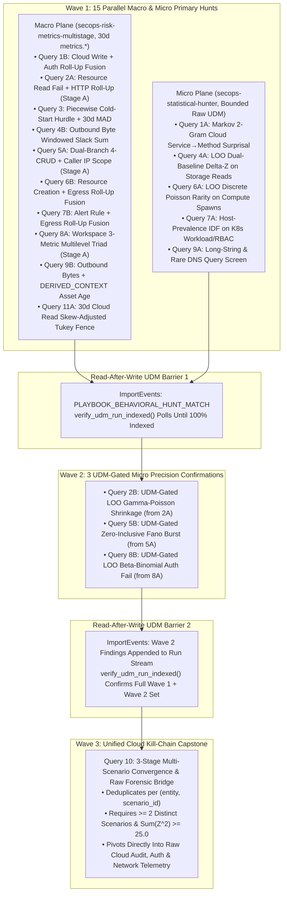

# Cloud Threats UEBA Hunting Runbook: Bilateral Detection & Investigation Guide

> **Author's Note on Terminology ("Runbook" vs. "Playbook")**: In Google Security Operations, "Playbook" is traditionally a SOAR response automation term, whereas this document is an analytical **Behavioral Hunting Runbook**—a structured, multi-stage YARA-L 2.0 query suite designed for interactive SOC / Cloud Security threat hunting and automated multi-wave execution via `PlaybookRunner` in `agentic_ueba`. Every model in this runbook states the exact statistical quantity computed in YARA-L 2.0 (30-day Z-scores with Poisson count and fleet byte dispersion floors, Leave-One-Out Gamma-Poisson and Beta-Binomial conjugate shrinkage, Two-Part Zero-Inflated Hurdles, Non-Parametric Median Absolute Deviation and Hubert-Vandervieren Skew-Adjusted Tukey Fences, Windowed Slack Sums, Zero-Inclusive Fano Factors, Markov 2-Gram Transition Surprisal, Host-Prevalence IDF Rarity, and Long-String DNS Candidate Screening). Calibrated Risk Index (`CRI`) scoring is computed downstream in Python (`ueba_constants.calculate_cri`) from the Z-equivalent scores emitted by each query rather than via in-query CRI ladders.

---

## 1. Executive Architecture & Bilateral Hunting Model

Cloud-native adversaries operate across two distinct telemetry horizons simultaneously: sub-hour API bursts, IAM permission chains, and container control-plane mutations in raw Cloud Audit Logs (`GCP_CLOUDAUDIT`, `AWS_CLOUDTRAIL`, `AZURE_ACTIVITY`, `KUBERNETES_NODE`, `WORKSPACE_ACTIVITY`), paired with multi-week volumetric shifts across storage, authentication, and network egress. Neither plane is sufficient in isolation: scanning 30 days of raw VPC flow or HTTP logs hits search row-scan ceilings, while daily pre-computed `metrics.*` counters (`by 1d`) cannot resolve hourly parent-to-child API call ordering, sub-hour destructive deletion bursts, or long-string DNS tunneling queries.

This runbook implements the **Bilateral UEBA Harness** across **10 cloud threat scenarios** plus **Section 3 non-parametric quantile and ingestion-lag diagnostics** (**20 `yara` query blocks total**: **19 multi-stage `PlaybookRunner` queries** + **1 standalone single-stage ingestion-lag audit**):

1. **Macro Plane (`secops-risk-metrics-multistage`, 30-Day `metrics.*` Baselines)**:
   * Evaluates Mode A (last complete UTC day `[D T00:00:00Z, D+1 T00:00:00Z)`) against trailing 30-day baselines (`period: 1d, window: 30d`).
   * Enforces the **7-active-day maturity gate** (`num_metric_periods >= 7`) on all Gaussian Z-scores (routing `< 7` active-day entities to Two-Part Hurdle or `FIRST_SEEN_NOVELTY` logic, since `agg: stddev` uses sample $N - 1$ degrees of freedom bounded by Samuelson's inequality $(N - 1)/\sqrt{N}$).
   * Replaces legacy `+ 1.0` variance fallbacks with continuous **Poisson count dispersion floors** $\sigma_{\text{safe}} = \max(\sigma, \sqrt{\max(\mu, 1.0)})$ for discrete event counters and empirical **fleet byte dispersion floors** (`44979.0` bytes for `metrics.network_bytes_outbound`) for byte-sum metrics.
   * Applies **multiplicity correction** ($\sqrt{2 \ln K_{\text{eff}}}$) when rolling up per-resource or per-rule slice Z-scores to an account or host entity (`rollup_sector_fusion_4stage.yl2`).
   * Anchors Mode A Entity Context Graph (`DERIVED_CONTEXT`) joins at `[D-2 T00:00:00Z, D+1 T00:00:00Z)` while pinning the event stage to `"YYYY-MM-DD"` (`D`) via `timestamp.get_date(metadata.event_timestamp.seconds)`.
2. **Micro Plane (`secops-statistical-hunter`, Bounded Raw `UDM_EVENTS` Windows)**:
   * Evaluates bounded raw telemetry windows (`1h`–`24h` for high-volume logs; `7d`–`14d` maximum for sparse Cloud Audit / IAM / Kubernetes creation streams) without touching `metrics.*`.
   * Computes structural and out-of-sample statistics unavailable in daily batch counters: whole-window Laplace-smoothed **Markov 2-Gram Transition Surprisal**, **Leave-One-Out (LOO) Gamma-Poisson** and **Beta-Binomial** predictive Z-scores, **LOO Dual-Baseline Delta-Z**, **Zero-Inclusive Fano Factor** burst dispersion, **LOO Discrete Poisson Rarity**, **Host-Prevalence IDF (`ZIPFIAN_PROCESS_RARITY`)**, and **Long-String DNS Candidate Screening (`LONG_STRING_SCREEN`)**.
3. **Connective Tissue (`agentic_ueba` / `PlaybookRunner` 3-Wave UDM Loopback)**:
   * Chains Macro and Micro detections through native Chronicle UDM loopback events (`metadata.event_type = "GENERIC_EVENT"`, `metadata.product_event_type = "PLAYBOOK_BEHAVIORAL_HUNT_MATCH"`), culminating in a Wave 3 Capstone query firing on **$\ge 2$ distinct scenarios** (`LOOPBACK_MIN_DISTINCT_HITS = 2`) and **$\sum Z_i^2 \ge 25.0$** (`LOOPBACK_COMPOSITE_SUM_Z_SQ_THRESHOLD = 25.0`, $D \ge 5.0\sigma$).



### 1.1 Wave Execution Topology (`19` `PlaybookRunner` Multi-Stage Queries + `1` Auxiliary Audit)

When `PlaybookRunner.parse_markdown_playbook()` parses this document, it discovers the **19 multi-stage YARA-L 2.0 pipelines** (each containing `stage <name> {`) and schedules them across **3 deterministic waves** (`{1: 15, 2: 3, 3: 1}`), while leaving the single-stage **Auxiliary Ingestion-Lag Audit** in Section 3.2 as a standalone pre-hunt telemetry health check:

* **Wave 1 (`15` Upstream Macro & Micro Queries)**: Executes `Query 1A`, `Query 1B`, `Query 2A`, `Query 3`, `Query 4A`, `Query 4B`, `Query 5A`, `Query 6A`, `Query 6B`, `Query 7A`, `Query 7B`, `Query 8A`, `Query 9A`, `Query 9B`, and `Query 11A` concurrently; normalizes all outlier entities into `PLAYBOOK_BEHAVIORAL_HUNT_MATCH` UDM events tagged with `metadata.product_log_id = "<run_id>"`; and blocks at `verify_udm_run_indexed()`.
* **Wave 2 (`3` UDM-Gated Stage B Queries)**: Executes `Query 2B` (seeded via UDM from `Query 2A`), `Query 5B` (seeded via UDM from `Query 5A`), and `Query 8B` (seeded via UDM from `Query 8A`), then flushes Wave 2 matches through the second UDM indexing barrier.
* **Wave 3 (`1` Capstone Convergence Query)**: Executes `Query 10` across all Wave 1 + Wave 2 loopback records, enforcing `distinct_scenarios_matched >= 2` and `capstone_threat_norm_sq >= 25.0` joined with live raw Cloud Audit, Auth, and Network events.

### 1.2 Optional Customization: Scoping Hunts with a Cloud Watchlist Data Table (`%cloud_critical_watchlist`)

Cloud Security teams often maintain a roster of tier-0 production service accounts, break-glass IAM principals, or crown-jewel compute hosts in a SecOps Data Table (`%cloud_critical_watchlist`).

> [!TIP]
> **Why Data Table References Are Commented Out by Default**: In Google SecOps YARA-L 2.0, referencing a Data Table (`%cloud_critical_watchlist.userid` or `%cloud_critical_watchlist.hostname`) that has not yet been created in the target tenant causes an immediate compilation failure (`invalid argument`). To guarantee that all 20 queries in this runbook compile and execute out-of-the-box—and to preserve fleetwide discovery of uncataloged shadow service accounts—every Data Table filter in this runbook is commented out (`// $entity in %cloud_critical_watchlist.userid` or `// $host in %cloud_critical_watchlist.hostname`). See **Section 3.3** for the schema and `<PROJECT_ID>` / `<CUSTOMER_ID>` provisioning commands before uncommenting.

### 1.3 Cloud Threat Scenario Portfolio Matrix

| Scenario | MITRE ATT&CK | Wave & Architecture | Query ID(s) & Statistical Model | Primary Telemetry & `metrics.*` Vectors |
| :--- | :--- | :--- | :--- | :--- |
| **1. Cloud IAM Privilege Escalation & Admin Role Abuse** | `T1098.001`, `T1098.003`, `T1548` | **Wave 1: Parallel Pair** (`1A` + `1B`) | **`Query 1A`**: 2-Stage Markov 2-Gram Transition Surprisal (`MARKOV_2GRAM_TRANSITION_RARITY`)<br>**`Query 1B`**: 4-Stage Roll-Up Cloud Write + Auth Success Fusion (`D^2 >= 12.25`) | `RESOURCE_PERMISSIONS_CHANGE`, `RESOURCE_WRITTEN`, `USER_LOGIN` (`metrics.resource_written_success`, `metrics.auth_attempts_success`) |
| **2. Compromised Cloud Access Keys & Workload Token Theft** | `T1552.005`, `T1528`, `T1078.004` | **Wave 1 $\rightarrow$ Wave 2 Split** (`2A` $\rightarrow$ UDM $\rightarrow$ `2B`) | **`Query 2A`**: 4-Stage Roll-Up Cloud Read Fail + HTTP Fusion<br>**`Query 2B`**: 4-Stage UDM-Gated LOO Gamma-Poisson Shrinkage (`BAYESIAN_GAMMA_SHRINKAGE`) | `RESOURCE_READ`, `USER_RESOURCE_ACCESS`, `NETWORK_HTTP` (`metrics.resource_read_fail`, `metrics.http_queries_total`) |
| **3. Dormant Cloud Service Account / Admin Awakening** | `T1078.004`, `T1136.003` | **Wave 1: Piecewise 4-Stage** (`Query 3`) | **`Query 3`**: Piecewise Cold-Start Hurdle (`< 7d`) + 30-Day Iglewicz-Hoaglin MAD (`>= 7d`, `mad_robust_z_4stage.yl2`) | `RESOURCE_READ`, `USER_RESOURCE_ACCESS` (`metrics.resource_read_total`) |
| **4. Cloud Storage & Database Exfiltration (S3 / GCS / BQ / RDS)** | `T1530`, `T1537`, `T1567.002` | **Wave 1: Parallel Pair** (`4A` + `4B`) | **`Query 4A`**: 3-Stage LOO Dual-Baseline Delta-Z (`DUAL_BASELINE_DELTA_Z`)<br>**`Query 4B`**: 3-Stage Outbound Byte Windowed Slack Sum (`longitudinal_cusum_2stage.yl2`) | `RESOURCE_READ`, `USER_RESOURCE_ACCESS`, `NETWORK_CONNECTION` (`metrics.network_bytes_outbound`) |
| **5. Service Account Out-of-Scope Repo Access & Ransomware Wiping** | `T1485`, `T1486`, `T1490` | **Wave 1 $\rightarrow$ Wave 2 Split** (`5A` $\rightarrow$ UDM $\rightarrow$ `5B`) | **`Query 5A`**: 4-Stage Dual-Branch 4-CRUD + Caller IP Scope (`cloud_repository_scope_dual_branch.yl2`)<br>**`Query 5B`**: 4-Stage UDM-Gated Zero-Inclusive Fano Burst (`POISSON_BURST_CLUSTERING`) | `RESOURCE_READ`, `RESOURCE_WRITTEN`, `RESOURCE_DELETION`, `RESOURCE_CREATION` (`metrics.resource_*`) |
| **6. Cryptomining & Rogue Compute / Serverless Provisioning** | `T1496`, `T1578.002` | **Wave 1: Parallel Pair** (`6A` + `6B`) | **`Query 6A`**: 3-Stage LOO Discrete Poisson Rarity (`POISSON_RARE_SURGE`)<br>**`Query 6B`**: 4-Stage Roll-Up Resource Creation + Outbound Bytes Fusion | `RESOURCE_CREATION`, `USER_RESOURCE_CREATION`, `NETWORK_CONNECTION` (`metrics.resource_creation_total`, `metrics.network_bytes_outbound`) |
| **7. Kubernetes / Container Control Plane Escape & RBAC Abuse** | `T1610`, `T1611`, `T1609` | **Wave 1: Parallel Pair** (`7A` + `7B`) | **`Query 7A`**: 4-Stage Host-Prevalence IDF Rarity (`ZIPFIAN_PROCESS_RARITY`)<br>**`Query 7B`**: 4-Stage Roll-Up EDR/Container Alert + Outbound Bytes Fusion | `RESOURCE_CREATION` (`Kubernetes`/`GKE`/`EKS`/`AKS`), `CB_EDR`/`CS_EDR` (`metrics.alert_event_name_count`, `metrics.network_bytes_outbound`) |
| **8. Cloud Workspace Identity Compromise & MFA / Session Hijacking** | `T1078.004`, `T1550.001`, `T1550.004`, `T1621` | **Wave 1 $\rightarrow$ Wave 2 Split** (`8A` $\rightarrow$ UDM $\rightarrow$ `8B`) | **`Query 8A`**: 4-Stage Multilevel Workspace 3-Metric Triad (`part_of_the_whole_triad_multilevel.yl2`)<br>**`Query 8B`**: 4-Stage UDM-Gated LOO Beta-Binomial Auth Failure (`BETA_BINOMIAL_FAILURE`) | `Google Workspace` (`workspace_auth_attempts_total`, `workspace_total_download_actions`, `workspace_total_change_actions`), `USER_LOGIN` |
| **9. Cloud DNS Long-String Tunneling & Young Shadow Infrastructure** | `T1071.004`, `T1572`, `T1578` | **Wave 1: Parallel Pair** (`9A` + `9B`) | **`Query 9A`**: 2-Stage DNS Long-String & Rare-Query Screen (`LONG_STRING_SCREEN`)<br>**`Query 9B`**: 2-Stage 30d Outbound Bytes + `DERIVED_CONTEXT` Young Asset Age (`<= 14d`) | `NETWORK_DNS`, `NETWORK_CONNECTION` (`metrics.network_bytes_outbound`) + `DERIVED_CONTEXT` (`ASSET`) |
| **10. Unified Cloud Multi-Vector Kill-Chain Capstone** | Multi-Tactic Cloud Kill Chain | **Wave 3: Unified Roll-Up** (`Query 10`) | **`Query 10`**: 3-Stage Scenario Dedup + L2 Sum-of-Squares ($\ge 2$ hits, $\sum Z_i^2 \ge 25.0$) + Raw Cloud Forensic Pivot | `PLAYBOOK_BEHAVIORAL_HUNT_MATCH` $\bowtie$ `RESOURCE_*`, `USER_LOGIN`, `NETWORK_CONNECTION` |
| **Section 3. Non-Parametric Cloud Resource Quantile & Lag Audit** | Heavy-Tail Exfil & Clock/Pipeline Skew | **Wave 1 (`11A`) + Standalone Audit** | **`Query 11A`**: 3-Stage Skewness-Adjusted Tukey Fence (`quantile_iqr_skew_3stage.yl2`)<br>**`Auxiliary Audit`**: Single-Stage Ingestion-Lag Quantile Screen | `RESOURCE_READ`, `USER_RESOURCE_ACCESS` (`metrics.resource_read_total`); `metadata.ingested_timestamp` |

---

## 2. Cloud Threat Hunting Scenarios

### Scenario 1: Cloud IAM Privilege Escalation & Admin Role Abuse (`Query 1A` + `Query 1B`)

* **Attack Pattern & MITRE ATT&CK**: `T1098.001` (Additional Cloud Credentials), `T1098.003` (Additional Cloud Roles), `T1548` (Abuse Elevation Control Mechanism). Adversaries who compromise a low-privilege CI/CD worker or developer identity pivot into IAM administration—invoking `SetIamPolicy`, `UpdateAssumeRolePolicy`, `AttachRolePolicy`, `CreateServiceAccountKey`, or `ImpersonateServiceAccount` from a cloud service context (`target.application` / `metadata.product_name`) that rarely issues privilege-granting mutations.
* **Why Both Bilateral Planes Are Required**:
  * **Micro Plane (`Query 1A`)**: Measures whole-window Laplace-smoothed **Markov 2-gram transition surprisal** $I(B \mid A) = -\ln \frac{C(A \to B) + 1}{C(A) + 100}$ from the cloud service (`$parent`) to the specific privilege-mutation method (`$child`), isolating rare `(service -> IAM mutation)` transitions adopted by `<= 3` distinct principals (`$fleet_prevalence <= 3`).
  * **Macro Plane (`Query 1B`)**: Evaluates 30-day multi-sector roll-up fusion across successful cloud resource writes (`metrics.resource_written_success`, sliced per target resource with multiplicity offset $\sqrt{2 \ln K_{\text{eff}}}$) and successful logins (`metrics.auth_attempts_success`), enforcing `>= 7` active baseline days and continuous Poisson count dispersion floors $\sqrt{\max(\mu, 1.0)}$.

#### Query 1A: Markov 2-Gram Cloud Service-to-Method Transition Surprisal (`secops-statistical-hunter`)

```yara
// ============================================================================
// METHODOLOGY & HUNTING GOAL
// Goal: Detect anomalous Cloud IAM privilege escalation and key/token minting transitions (Service Context -> Admin API Method) using whole-window Markov 1st-order transition surprisal.
// Target Telemetry: UDM_EVENTS (RESOURCE_PERMISSIONS_CHANGE, USER_RESOURCE_UPDATE_PERMISSIONS, RESOURCE_WRITTEN, USER_RESOURCE_UPDATE_CONTENT)
// Statistical Model: MARKOV_2GRAM_TRANSITION_RARITY (Whole-Window Laplace-Smoothed Conditional Transition Surprisal)
// Recommended Execution Window: Bounded 7d-14d raw Cloud Audit window
// Skill: secops-statistical-hunter
// ============================================================================

stage parent_baseline {
    (
        metadata.event_type = "RESOURCE_PERMISSIONS_CHANGE" or
        metadata.event_type = "USER_RESOURCE_UPDATE_PERMISSIONS" or
        metadata.event_type = "RESOURCE_WRITTEN" or
        metadata.event_type = "USER_RESOURCE_UPDATE_CONTENT"
    )
    $parent = strings.coalesce(target.application, metadata.product_name)
    $parent != ""

  match:
    $parent

  outcome:
    $window_parent_launches = count(metadata.id)
    $iam_perm_parent_events = sum(if(metadata.event_type = "RESOURCE_PERMISSIONS_CHANGE" or metadata.event_type = "USER_RESOURCE_UPDATE_PERMISSIONS", 1, 0))
    $parent_hosts = count_distinct(principal.user.userid)
    $parent_active_buckets = count_distinct(timestamp.get_timestamp(metadata.event_timestamp.seconds, "HOUR"))
}

stage child_transition {
    (
        metadata.event_type = "RESOURCE_PERMISSIONS_CHANGE" or
        metadata.event_type = "USER_RESOURCE_UPDATE_PERMISSIONS" or
        metadata.event_type = "RESOURCE_WRITTEN" or
        metadata.event_type = "USER_RESOURCE_UPDATE_CONTENT"
    )
    re.regex(metadata.product_event_type, "(?i)(SetIamPolicy|UpdateAssumeRolePolicy|AttachUserPolicy|AttachRolePolicy|PutUserPolicy|PutRolePolicy|CreateServiceAccountKey|CreateAccessKey|ImpersonateServiceAccount|GenerateAccessToken|ActAs|RoleAssignment.*/write)")
    principal.user.userid = $entity
    $parent = strings.coalesce(target.application, metadata.product_name)
    metadata.product_event_type = $child
    $entity != ""
    $parent != ""
    $child != ""
    // Optional Cloud Critical-Principal Watchlist Data Table filter (see Section 1.2):
    // $entity in %cloud_critical_watchlist.userid

  match:
    $entity, $parent, $child by 1h

  outcome:
    $pair_count = count(metadata.id)
    $iam_perm_events = sum(if(metadata.event_type = "RESOURCE_PERMISSIONS_CHANGE" or metadata.event_type = "USER_RESOURCE_UPDATE_PERMISSIONS", 1, 0))
}

stage pair_window_totals {
    $parent = $child_transition.parent
    $child = $child_transition.child

  match:
    $parent, $child

  outcome:
    $window_pair_launches = sum($child_transition.pair_count)
    $pair_hosts = count_distinct($child_transition.entity)
}

$entity = $child_transition.entity
$parent = $child_transition.parent
$child = $child_transition.child
$ws = $child_transition.window_start
$parent = $pair_window_totals.parent
$child = $pair_window_totals.child
$parent = $parent_baseline.parent

match:
  $entity, $parent, $child, $ws by 1h

outcome:
  $pair_count = max($child_transition.pair_count)
  $window_pair_launches = max($pair_window_totals.window_pair_launches)
  $window_parent_launches = max($parent_baseline.window_parent_launches)
  $smoothed_num = $window_pair_launches + 1.0
  $smoothed_den = $window_parent_launches + 100.0
  $transition_prob = $smoothed_num / $smoothed_den
  $markov_threat_score = math.log($smoothed_den / $smoothed_num)

  // 6 Standardized Evidence Pillars
  $observation_count = $pair_count
  $baseline_active_samples = max($parent_baseline.parent_active_buckets)
  $baseline_mean = $transition_prob
  $baseline_dispersion = max($parent_baseline.parent_hosts)
  $fleet_prevalence = max($pair_window_totals.pair_hosts)
  $distinct_binaries = 1
  $iam_perm_events = max($child_transition.iam_perm_events)

condition:
  $baseline_active_samples >= 3
  and $window_parent_launches >= 10
  and $observation_count >= 1
  and $fleet_prevalence <= 3
  and $markov_threat_score >= 3.0

order:
  $markov_threat_score desc
```

#### Query 1B: 4-Stage Roll-Up Cloud Resource Write + Authentication Success Fusion (`secops-risk-metrics-multistage`)

```yara
// ============================================================================
// ARCHITECTURE: 4-STAGE ROLL-UP COMPOSITE SECTOR FUSION (CLOUD RESOURCE WRITE + AUTH SUCCESS)
// Goal: Detect cloud identities combining anomalous per-resource cloud write/mutation surges with elevated authentication volume over 30-day baselines.
// Statistical Model: 4-Stage Roll-Up Multi-Sector Euclidean Threat Norm (D^2 = Z_write_adj^2 + Z_auth^2 >= 12.25) with Poisson Count Dispersion Floors and >= 7 Active Days
// Mode A Execution Window: Last complete UTC day [D T00:00:00Z, D+1 T00:00:00Z)
// Skill: secops-risk-metrics-multistage
// ============================================================================

stage sector_a_detail {
    (metadata.event_type = "RESOURCE_WRITTEN" or metadata.event_type = "USER_RESOURCE_UPDATE_CONTENT")
    security_result.action = "ALLOW"
    principal.user.userid = $entity
    metadata.vendor_name = $vendor
    metadata.product_name = $product
    target.resource.name = $resource
    $entity != ""
    $vendor != ""
    $product != ""
    $resource != ""
    // Optional Cloud Critical-Principal Watchlist Data Table filter (see Section 1.2):
    // $entity in %cloud_critical_watchlist.userid

  match:
    $entity, $vendor, $product, $resource by 1d

  outcome:
    $d_obs = count(metadata.id)
    $cloud_write_events = sum(if(metadata.event_type = "RESOURCE_WRITTEN", 1, 0))
    $d_avg = max(metrics.resource_written_success(
        period: 1d, window: 30d, metric: event_count_sum, agg: avg,
        principal.user.userid: principal.user.userid,
        metadata.vendor_name: metadata.vendor_name,
        metadata.product_name: metadata.product_name,
        target.resource.name: target.resource.name
    ))
    $d_std = max(metrics.resource_written_success(
        period: 1d, window: 30d, metric: event_count_sum, agg: stddev,
        principal.user.userid: principal.user.userid,
        metadata.vendor_name: metadata.vendor_name,
        metadata.product_name: metadata.product_name,
        target.resource.name: target.resource.name
    ))
    $d_days = max(metrics.resource_written_success(
        period: 1d, window: 30d, metric: event_count_sum, agg: num_metric_periods,
        principal.user.userid: principal.user.userid,
        metadata.vendor_name: metadata.vendor_name,
        metadata.product_name: metadata.product_name,
        target.resource.name: target.resource.name
    ))
}

stage sector_a_scores {
    $entity = $sector_a_detail.entity
    $vendor = $sector_a_detail.vendor
    $product = $sector_a_detail.product
    $resource = $sector_a_detail.resource
    $ws = $sector_a_detail.window_start

  match:
    $entity, $vendor, $product, $resource, $ws by 1d

  outcome:
    $d_obs = max($sector_a_detail.d_obs)
    $d_avg = max($sector_a_detail.d_avg)
    $d_std = max($sector_a_detail.d_std)
    $d_days = max($sector_a_detail.d_days)
    $d_floor_arg = if($d_avg > 1.0, $d_avg, 1.0)
    $d_floor = math.sqrt($d_floor_arg)
    $d_safe_std = if($d_std > $d_floor, $d_std, $d_floor)
    $d_z_raw = ($d_obs - $d_avg) / $d_safe_std
    $d_z_pos = if($d_z_raw > 0.0, $d_z_raw, 0.0)
    $d_z = if($d_days >= 7, $d_z_pos, 0.0)
    $d_hot = if($d_days >= 7 and $d_z_raw >= 3.0, 1, 0)
    $d_novel = if($d_days = 0, 1, 0)
    $d_active = if($d_days >= 7, 1, 0)
}

stage sector_a {
    $entity = $sector_a_scores.entity
    $ws = $sector_a_scores.ws

  match:
    $entity, $ws by 1d

  outcome:
    $a_obs = sum($sector_a_scores.d_obs)
    $a_max_z = max($sector_a_scores.d_z)
    $a_hot_slices = sum($sector_a_scores.d_hot)
    $a_novel_slices = sum($sector_a_scores.d_novel)
    $a_active_slices = sum($sector_a_scores.d_active)
    $a_slices = count($sector_a_scores.resource)
    $k_eff = if($a_active_slices > 1, $a_active_slices, 1)
    $multiplicity_offset = math.sqrt(2.0 * math.log($k_eff))
    $z_a_adj = $a_max_z - $multiplicity_offset
    $z_a = if($z_a_adj > 0.0, $z_a_adj, 0.0)
}

stage sector_b {
    metadata.event_type = "USER_LOGIN"
    security_result.action = "ALLOW"
    target.user.userid = $entity
    $entity != ""

  match:
    $entity by 1d

  outcome:
    $b_obs = count(metadata.id)
    $b_avg = max(metrics.auth_attempts_success(
        period: 1d, window: 30d, metric: event_count_sum, agg: avg,
        target.user.userid: target.user.userid
    ))
    $b_std = max(metrics.auth_attempts_success(
        period: 1d, window: 30d, metric: event_count_sum, agg: stddev,
        target.user.userid: target.user.userid
    ))
    $b_days = max(metrics.auth_attempts_success(
        period: 1d, window: 30d, metric: event_count_sum, agg: num_metric_periods,
        target.user.userid: target.user.userid
    ))
}

$entity = $sector_a.entity
$entity = $sector_b.entity
$ws = $sector_a.ws
$ws = $sector_b.window_start

match:
  $entity, $ws by 1d

outcome:
  $z_a = max($sector_a.z_a)
  $a_max_raw_z = max($sector_a.a_max_z)
  $a_obs = max($sector_a.a_obs)
  $a_hot_slices = max($sector_a.a_hot_slices)
  $a_novel_slices = max($sector_a.a_novel_slices)
  $a_slices = max($sector_a.a_slices)
  $b_obs = max($sector_b.b_obs)
  $b_avg = max($sector_b.b_avg)
  $b_std = max($sector_b.b_std)
  $b_days = max($sector_b.b_days)
  $b_floor_arg = if($b_avg > 1.0, $b_avg, 1.0)
  $b_floor = math.sqrt($b_floor_arg)
  $b_safe_std = if($b_std > $b_floor, $b_std, $b_floor)
  $z_b_raw = ($b_obs - $b_avg) / $b_safe_std
  $z_b_pos = if($z_b_raw > 0.0, $z_b_raw, 0.0)
  $z_b = if($b_days >= 7, $z_b_pos, 0.0)
  $composite_threat_norm_sq = ($z_a * $z_a) + ($z_b * $z_b)
  $composite_threat_norm = math.sqrt($composite_threat_norm_sq)

condition:
  $composite_threat_norm_sq >= 12.25

order:
  $composite_threat_norm_sq desc
```

---

### Scenario 2: Compromised Cloud Access Keys & Workload Identity Token Theft (`Query 2A` $\rightarrow$ UDM $\rightarrow$ `Query 2B`)

* **Attack Pattern & MITRE ATT&CK**: `T1552.005` (Cloud Instance Metadata API), `T1528` (Steal Application Access Token), `T1078.004` (Cloud Accounts). When an attacker harvests temporary credentials from IMDS (`169.254.169.254`) or leaks a long-lived `AKIA...` / GCP JSON key, their first actions are reconnaissance API enumeration (`ListBuckets`, `GetCallerIdentity`, `TestIamPermissions`) that trigger bursts of `AccessDenied` / `PERMISSION_DENIED` read failures alongside elevated HTTP API call volume.
* **Two-Wave UDM Loopback Design (`2A -> UDM -> 2B`)**:
  * **Wave 1 (`Query 2A`)**: Screens the cloud principal population over 30-day baselines by fusing rolled-up per-resource read denials (`metrics.resource_read_fail` with multiplicity offset $\sqrt{2 \ln K_{\text{eff}}}$) and daily HTTP volume (`metrics.http_queries_total`). Matched principals are written to Chronicle UDM as `PLAYBOOK_BEHAVIORAL_HUNT_MATCH` records (`rule_name` matching `:q[0-9]+_query_2a`).
  * **Wave 2 (`Query 2B`)**: Joins `stage1_upstream_2a_candidates` directly from Chronicle UDM and evaluates **Leave-One-Out (LOO) Empirical Bayes Gamma-Poisson Shrinkage** (`bayesian_gamma_shrinkage_4stage.yl2`) on hourly Cloud API read bursts—shrinking noisy microservice accounts via excess overdispersion while surfacing sharp hourly discovery bursts on stable identities (`$bayesian_z >= 3.0`).

#### Query 2A: 4-Stage Roll-Up Cloud Resource Read Failure + HTTP Queries Fusion (`secops-risk-metrics-multistage`)

```yara
// ============================================================================
// ARCHITECTURE: 4-STAGE ROLL-UP COMPOSITE SECTOR FUSION (STAGE A -> UDM LOOPBACK)
// Goal: Detect stolen cloud access keys and IMDS tokens generating permission-denied resource read probing paired with anomalous HTTP query volume over 30-day baselines.
// Statistical Model: 4-Stage Roll-Up Multi-Sector Euclidean Threat Norm (D^2 = Z_read_fail_adj^2 + Z_http^2 >= 12.25) with Poisson Count Dispersion Floors and >= 7 Active Days
// UDM LOOPBACK CONTRACT (Feeds Wave 2 Query 2B): PlaybookRunner writes matched $entity values as GENERIC_EVENT / PLAYBOOK_BEHAVIORAL_HUNT_MATCH with security_result.rule_name matching ":q[0-9]+_query_2a".
// Mode A Execution Window: Last complete UTC day [D T00:00:00Z, D+1 T00:00:00Z)
// Skill: secops-risk-metrics-multistage
// ============================================================================

stage sector_a_detail {
    (metadata.event_type = "RESOURCE_READ" or metadata.event_type = "USER_RESOURCE_ACCESS")
    not security_result.action = "ALLOW"
    principal.user.userid = $entity
    metadata.vendor_name = $vendor
    metadata.product_name = $product
    target.resource.name = $resource
    $entity != ""
    $vendor != ""
    $product != ""
    $resource != ""
    // Optional Cloud Critical-Principal Watchlist Data Table filter (see Section 1.2):
    // $entity in %cloud_critical_watchlist.userid

  match:
    $entity, $vendor, $product, $resource by 1d

  outcome:
    $d_obs = count(metadata.id)
    $cloud_read_denials = sum(if(metadata.event_type = "RESOURCE_READ", 1, 0))
    $d_avg = max(metrics.resource_read_fail(
        period: 1d, window: 30d, metric: event_count_sum, agg: avg,
        principal.user.userid: principal.user.userid,
        metadata.vendor_name: metadata.vendor_name,
        metadata.product_name: metadata.product_name,
        target.resource.name: target.resource.name
    ))
    $d_std = max(metrics.resource_read_fail(
        period: 1d, window: 30d, metric: event_count_sum, agg: stddev,
        principal.user.userid: principal.user.userid,
        metadata.vendor_name: metadata.vendor_name,
        metadata.product_name: metadata.product_name,
        target.resource.name: target.resource.name
    ))
    $d_days = max(metrics.resource_read_fail(
        period: 1d, window: 30d, metric: event_count_sum, agg: num_metric_periods,
        principal.user.userid: principal.user.userid,
        metadata.vendor_name: metadata.vendor_name,
        metadata.product_name: metadata.product_name,
        target.resource.name: target.resource.name
    ))
}

stage sector_a_scores {
    $entity = $sector_a_detail.entity
    $vendor = $sector_a_detail.vendor
    $product = $sector_a_detail.product
    $resource = $sector_a_detail.resource
    $ws = $sector_a_detail.window_start

  match:
    $entity, $vendor, $product, $resource, $ws by 1d

  outcome:
    $d_obs = max($sector_a_detail.d_obs)
    $d_avg = max($sector_a_detail.d_avg)
    $d_std = max($sector_a_detail.d_std)
    $d_days = max($sector_a_detail.d_days)
    $d_floor_arg = if($d_avg > 1.0, $d_avg, 1.0)
    $d_floor = math.sqrt($d_floor_arg)
    $d_safe_std = if($d_std > $d_floor, $d_std, $d_floor)
    $d_z_raw = ($d_obs - $d_avg) / $d_safe_std
    $d_z_pos = if($d_z_raw > 0.0, $d_z_raw, 0.0)
    $d_z = if($d_days >= 7, $d_z_pos, 0.0)
    $d_hot = if($d_days >= 7 and $d_z_raw >= 3.0, 1, 0)
    $d_novel = if($d_days = 0, 1, 0)
    $d_active = if($d_days >= 7, 1, 0)
}

stage sector_a {
    $entity = $sector_a_scores.entity
    $ws = $sector_a_scores.ws

  match:
    $entity, $ws by 1d

  outcome:
    $a_obs = sum($sector_a_scores.d_obs)
    $a_max_z = max($sector_a_scores.d_z)
    $a_hot_slices = sum($sector_a_scores.d_hot)
    $a_novel_slices = sum($sector_a_scores.d_novel)
    $a_active_slices = sum($sector_a_scores.d_active)
    $a_slices = count($sector_a_scores.resource)
    $k_eff = if($a_active_slices > 1, $a_active_slices, 1)
    $multiplicity_offset = math.sqrt(2.0 * math.log($k_eff))
    $z_a_adj = $a_max_z - $multiplicity_offset
    $z_a = if($z_a_adj > 0.0, $z_a_adj, 0.0)
}

stage sector_b {
    (network.http.method != "" or network.http.user_agent != "" or network.http.response_code != 0 or network.http.referral_url != "")
    principal.user.userid = $entity
    $entity != ""

  match:
    $entity by 1d

  outcome:
    $b_obs = count(metadata.id)
    $b_avg = max(metrics.http_queries_total(
        period: 1d, window: 30d, metric: event_count_sum, agg: avg,
        principal.user.userid: principal.user.userid
    ))
    $b_std = max(metrics.http_queries_total(
        period: 1d, window: 30d, metric: event_count_sum, agg: stddev,
        principal.user.userid: principal.user.userid
    ))
    $b_days = max(metrics.http_queries_total(
        period: 1d, window: 30d, metric: event_count_sum, agg: num_metric_periods,
        principal.user.userid: principal.user.userid
    ))
}

$entity = $sector_a.entity
$entity = $sector_b.entity
$ws = $sector_a.ws
$ws = $sector_b.window_start

match:
  $entity, $ws by 1d

outcome:
  $z_a = max($sector_a.z_a)
  $a_max_raw_z = max($sector_a.a_max_z)
  $a_obs = max($sector_a.a_obs)
  $a_hot_slices = max($sector_a.a_hot_slices)
  $a_novel_slices = max($sector_a.a_novel_slices)
  $a_slices = max($sector_a.a_slices)
  $b_obs = max($sector_b.b_obs)
  $b_avg = max($sector_b.b_avg)
  $b_std = max($sector_b.b_std)
  $b_days = max($sector_b.b_days)
  $b_floor_arg = if($b_avg > 1.0, $b_avg, 1.0)
  $b_floor = math.sqrt($b_floor_arg)
  $b_safe_std = if($b_std > $b_floor, $b_std, $b_floor)
  $z_b_raw = ($b_obs - $b_avg) / $b_safe_std
  $z_b_pos = if($z_b_raw > 0.0, $z_b_raw, 0.0)
  $z_b = if($b_days >= 7, $z_b_pos, 0.0)
  $composite_threat_norm_sq = ($z_a * $z_a) + ($z_b * $z_b)
  $composite_threat_norm = math.sqrt($composite_threat_norm_sq)

condition:
  $composite_threat_norm_sq >= 12.25

order:
  $composite_threat_norm_sq desc
```

#### Query 2B: 4-Stage UDM-Gated Empirical Bayes Gamma-Poisson Shrinkage on Cloud API Calls (`secops-statistical-hunter`)

```yara
// ============================================================================
// METHODOLOGY & HUNTING GOAL
// Goal: Confirm acute hourly Cloud API enumeration bursts on Wave 1 (Query 2A) candidate principals using Leave-One-Out (LOO) Empirical Bayes Gamma-Poisson Shrinkage.
// Target Telemetry: UDM_EVENTS (PLAYBOOK_BEHAVIORAL_HUNT_MATCH joined with RESOURCE_READ, USER_RESOURCE_ACCESS)
// Statistical Model: BAYESIAN_GAMMA_SHRINKAGE (Wave 2 UDM-Gated LOO Gamma-Poisson Posterior Predictive Z-Score)
// UDM LOOPBACK PREREQUISITE: Requires Wave 1 Query 2A findings indexed in Chronicle UDM as PLAYBOOK_BEHAVIORAL_HUNT_MATCH (:q[0-9]+_query_2a).
// Skill: secops-statistical-hunter
// ============================================================================

stage stage1_upstream_2a_candidates {
    metadata.event_type = "GENERIC_EVENT"
    metadata.product_event_type = "PLAYBOOK_BEHAVIORAL_HUNT_MATCH"
    re.regex(security_result.rule_name, ":q[0-9]+_query_2a")
    principal.user.userid = $entity
    $entity != ""

  match:
    $entity

  outcome:
    $upstream_2a_score = max(security_result.confidence_score)
}

stage host_hourly_activity {
    (metadata.event_type = "RESOURCE_READ" or metadata.event_type = "USER_RESOURCE_ACCESS")
    principal.user.userid = $entity
    $entity != ""
    // Optional Cloud Critical-Principal Watchlist Data Table filter (see Section 1.2):
    // $entity in %cloud_critical_watchlist.userid

  match:
    $entity by 1h

  outcome:
    $hourly_count = count(metadata.id)
    $hourly_count_sq = 1.0 * count(metadata.id) * count(metadata.id)
    $cloud_crud_reads = sum(if(metadata.event_type = "RESOURCE_READ", 1, 0))
    $distinct_resources = count_distinct(target.resource.name)
}

stage host_prior_stats {
    $entity = $host_hourly_activity.entity
    $entity = $stage1_upstream_2a_candidates.entity

  match:
    $entity

  outcome:
    $sum_x = sum($host_hourly_activity.hourly_count)
    $sum_x2 = sum($host_hourly_activity.hourly_count_sq)
    $active_hours = count($host_hourly_activity.window_start)
    $upstream_2a_z = max($stage1_upstream_2a_candidates.upstream_2a_score)
}

stage fleet_context {
    $ws = $host_hourly_activity.window_start

  match:
    $ws by 1h

  outcome:
    $fleet_principals = sum(if($host_hourly_activity.hourly_count >= 10, 1, 0))
}

$entity = $host_hourly_activity.entity
$entity = $host_prior_stats.entity
$ws = $host_hourly_activity.window_start
$ws = $fleet_context.ws

match:
  $entity, $ws by 1h

outcome:
  $observation_count = max($host_hourly_activity.hourly_count)
  $baseline_active_samples = max($host_prior_stats.active_hours)
  $fleet_prevalence = max($fleet_context.fleet_principals)
  $distinct_binaries = max($host_hourly_activity.distinct_resources)

  $prior_n_cand = $baseline_active_samples - 1
  $prior_n = if($prior_n_cand > 1, $prior_n_cand, 1)
  $raw_prior_sum = max($host_prior_stats.sum_x) - $observation_count
  $prior_sum = if($raw_prior_sum > 0, $raw_prior_sum, 0)
  $raw_prior_sum_sq = max($host_prior_stats.sum_x2) - (1.0 * $observation_count * $observation_count)
  $prior_sum_sq = if($raw_prior_sum_sq > 0.0, $raw_prior_sum_sq, 0.0)

  $alpha_prior = 2.0 + $prior_sum
  $beta_prior = 1.0 + $prior_n
  $baseline_mean = $alpha_prior / $beta_prior
  $raw_excess_var = (1.0 * $prior_sum_sq / $prior_n) - ((1.0 * $prior_sum / $prior_n) * (1.0 * $prior_sum / $prior_n)) - (1.0 * $prior_sum / $prior_n)
  $excess_var = if($raw_excess_var > 0.0, $raw_excess_var, 0.0)
  $raw_pred_var = ($baseline_mean * ($beta_prior + 1.0) / $beta_prior) + $excess_var
  $safe_pred_var = if($raw_pred_var > 1.0, $raw_pred_var, 1.0)
  $baseline_dispersion = math.sqrt($safe_pred_var)
  $bayesian_z = ($observation_count - $baseline_mean) / $baseline_dispersion

condition:
  $baseline_active_samples >= 4 and $observation_count >= 10 and $bayesian_z >= 3.0

order:
  $bayesian_z desc
```

---

### Scenario 3: Dormant Cloud Service Account / Admin Awakening (`Query 3`)

* **Attack Pattern & MITRE ATT&CK**: `T1078.004` (Cloud Accounts — Dormant / Orphaned Identities), `T1136.003` (Create Cloud Account). Abandoned migration service accounts, legacy Terraform roles, and break-glass cloud admin identities sit idle (`active_days < 7`) for weeks until an attacker discovers their credentials and immediately enumerates cloud secrets, buckets, or IAM bindings. Conversely, active multi-purpose cloud accounts (`active_days >= 7`) exhibit heavy-tailed burstiness that inflates classical standard deviation $\sigma$.
* **Single Piecewise 4-Stage Pipeline**:
  * **Cold-Start / Dormant Branch (`$active_days < 7`)**: Evaluates a **Two-Part Zero-Inflated Hurdle** binary awakening gate (`$active_days < 7`, `$observed >= 25`, and `$observed > $hist_max` against 30-day `agg: max`) so dormant identities at or below their historical daily ceiling never false-fire, scoring true breakouts via Laplace-smoothed dormancy surprisal plus log volume, $-\ln\left(\frac{\text{active\_days} + 0.5}{31.0}\right) + \ln(X_{\text{obs}} + 1.0)$.
  * **Mature Baseline Branch (`$active_days >= 7` and `$raw_active_days >= 7`)**: Evaluates the **4-Stage Non-Parametric Median Absolute Deviation (MAD)** Modified Z-score (`mad_robust_z_4stage.yl2`, `window.median(..., false)` so zero deviations are retained) with the **Iglewicz-Hoaglin `MAD = 0` fallback** ($1.253314 \cdot \text{meanAD}$) and a continuous **Poisson count dispersion floor** $\sqrt{\max(\text{median}, 1.0)}$. Run over a 14–30 day window (`$in_scoring_window = 1` pins output to the target UTC day `2026-10-29`; in single-day Mode A compile checks, the cold-start hurdle branch remains active while the mature branch safely gates on `$raw_active_days >= 7`).

#### Query 3: 4-Stage Piecewise Cold-Start Hurdle & 30-Day Robust MAD on Cloud Resource Reads (`secops-risk-metrics-multistage`)

```yara
// ============================================================================
// ARCHITECTURE: 4-STAGE PIECEWISE COLD-START HURDLE (< 7d) & IGLEWICZ-HOAGLIN MAD (>= 7d)
// Goal: Catch both dormant/cold-start cloud accounts suddenly awakening (< 7 active baseline days) and mature cloud accounts breaking above their non-parametric median/MAD resource read envelope (>= 7 active days).
// Statistical Model: Piecewise TWO_PART_HURDLE (< 7 active days) + 4-Stage Robust MAD Modified Z-Score (>= 7 active days) with Count Dispersion Floor
// Execution Window: 14d-30d window with $in_scoring_window pinned to "2026-10-29" (compiles cleanly in 1d Mode A)
// Skill: secops-risk-metrics-multistage
// ============================================================================

stage stage1_extract {
    (metadata.event_type = "RESOURCE_READ" or metadata.event_type = "USER_RESOURCE_ACCESS")
    principal.user.userid = $entity
    metadata.vendor_name = $vendor
    metadata.product_name = $product
    target.resource.name = $resource
    $entity != ""
    $vendor != ""
    $product != ""
    $resource != ""
    // Optional Cloud Critical-Principal Watchlist Data Table filter (see Section 1.2):
    // $entity in %cloud_critical_watchlist.userid

  match:
    $entity, $vendor, $product, $resource by 1d

  outcome:
    $observed_val = count(metadata.id)
    $cloud_crud_reads = sum(if(metadata.event_type = "RESOURCE_READ", 1, 0))
    $in_scoring_window = max(if(timestamp.get_date(metadata.event_timestamp.seconds) >= "2026-10-29", 1, 0))
    $historical_max = max(metrics.resource_read_total(
        period: 1d, window: 30d, metric: event_count_sum, agg: max,
        principal.user.userid: principal.user.userid,
        metadata.vendor_name: metadata.vendor_name,
        metadata.product_name: metadata.product_name,
        target.resource.name: target.resource.name
    ))
    $active_days = max(metrics.resource_read_total(
        period: 1d, window: 30d, metric: event_count_sum, agg: num_metric_periods,
        principal.user.userid: principal.user.userid,
        metadata.vendor_name: metadata.vendor_name,
        metadata.product_name: metadata.product_name,
        target.resource.name: target.resource.name
    ))
}

stage mad_center {
    $entity = $stage1_extract.entity
    $vendor = $stage1_extract.vendor
    $product = $stage1_extract.product
    $resource = $stage1_extract.resource

  match:
    $entity, $vendor, $product, $resource

  outcome:
    $median_val = window.median($stage1_extract.observed_val, false)
    $raw_active_days = count($stage1_extract.window_start)
}

stage mad_spread {
    $entity = $stage1_extract.entity
    $vendor = $stage1_extract.vendor
    $product = $stage1_extract.product
    $resource = $stage1_extract.resource
    $entity = $mad_center.entity
    $vendor = $mad_center.vendor
    $product = $mad_center.product
    $resource = $mad_center.resource

  match:
    $entity, $vendor, $product, $resource

  outcome:
    $mad_val = window.median(math.abs($stage1_extract.observed_val - $mad_center.median_val), false)
    $mean_abs_dev = avg(math.abs($stage1_extract.observed_val - $mad_center.median_val))
}

$entity = $stage1_extract.entity
$vendor = $stage1_extract.vendor
$product = $stage1_extract.product
$resource = $stage1_extract.resource
$ws = $stage1_extract.window_start
$entity = $mad_center.entity
$vendor = $mad_center.vendor
$product = $mad_center.product
$resource = $mad_center.resource
$entity = $mad_spread.entity
$vendor = $mad_spread.vendor
$product = $mad_spread.product
$resource = $mad_spread.resource

match:
  $entity, $vendor, $product, $resource, $ws by 1d

outcome:
  $observed = max($stage1_extract.observed_val)
  $in_scoring_window = max($stage1_extract.in_scoring_window)
  $active_days = max($stage1_extract.active_days)
  $hist_max = max($stage1_extract.historical_max)
  $raw_active_days = max($mad_center.raw_active_days)
  $median_val = max($mad_center.median_val)
  $mad_val = max($mad_spread.mad_val)
  $mean_abs_dev = max($mad_spread.mean_abs_dev)
  $mad_scaled = $mad_val / 0.6745
  $mean_ad_scaled = $mean_abs_dev * 1.253314
  $floor_arg = if($median_val > 1.0, $median_val, 1.0)
  $disp_floor = math.sqrt($floor_arg)
  $raw_scale = if($mad_val > 0.0, $mad_scaled, $mean_ad_scaled)
  $robust_scale = if($raw_scale > $disp_floor, $raw_scale, $disp_floor)
  $modified_z = ($observed - $median_val) / $robust_scale
  $bernoulli_p = ($active_days + 0.5) / 31.0
  $hurdle_surprisal = 0.0 - math.log($bernoulli_p)
  $cold_start_score = $hurdle_surprisal + math.log($observed + 1.0)
  $unified_threat_score = if($active_days < 7, $cold_start_score, $modified_z)

condition:
  $in_scoring_window = 1
  and (
      ($active_days < 7 and $observed >= 25 and $observed > $hist_max and $unified_threat_score >= 4.5)
      or ($active_days >= 7 and $raw_active_days >= 7 and $modified_z >= 3.5)
  )

order:
  $unified_threat_score desc
```

---

### Scenario 4: Cloud Storage & Database Exfiltration — S3 / GCS / BigQuery / RDS (`Query 4A` + `Query 4B`)

* **Attack Pattern & MITRE ATT&CK**: `T1530` (Data from Cloud Storage), `T1537` (Transfer Data to Cloud Account), `T1567.002` (Exfiltration to Cloud Storage). Cloud data theft splits into two temporal profiles: (1) acute hourly object/table harvesting (`GetObject`, `storage.objects.get`, `bigquery.tabledata.list`, `CreateSnapshot`, `ModifySnapshotAttribute`), which must be separated from scheduled enterprise backup/ETL waves; and (2) multi-day low-and-slow egress (`+1.5σ` to `+2.0σ` per day) that stays below single-day `+3.0σ` gates.
* **Why Both Bilateral Planes Are Required**:
  * **Micro Plane (`Query 4A`)**: Computes **Leave-One-Out (LOO) Dual-Baseline Delta-Z** (`dual_baseline_delta_z_3stage.yl2`), subtracting the positive-rectified mature-cohort fleet hourly Z-score from each principal's out-of-sample personal hourly Z-score ($\Delta Z = Z_{\text{personal,LOO}} - \max(0, Z_{\text{fleet}})$) with a continuous Poisson count dispersion floor $\sqrt{\max(\mu_{\text{LOO}}, 1.0)}$.
  * **Macro Plane (`Query 4B`)**: Computes the **Windowed Slack Sum** $\sum_t \max(0, Z_t - 0.5)$ (`longitudinal_cusum_2stage.yl2`) over multi-day `metrics.network_bytes_outbound` using the `44979.0`-byte fleet dispersion floor and `$active_days >= 7` maturity gate. Because YARA-L 2.0 `outcome:` blocks are stateless across rows, `Query 4B` computes the non-resetting Windowed Slack Sum prefilter in-SIEM; for exact recursive Page's CUSUM $S_t = \max(0, S_{t-1} + Z_t - k)$ over 2–30 days, pair `longitudinal_cusum_series_3stage.yl2` with `scripts/cusum_helper.py`.

#### Query 4A: 3-Stage Dual-Baseline Fleet-Normalized Delta-Z on Cloud Storage & Snapshot Operations (`secops-statistical-hunter`)

```yara
// ============================================================================
// METHODOLOGY & HUNTING GOAL
// Goal: Isolate targeted hourly cloud storage, BigQuery, and snapshot exfiltration surges from fleetwide ETL or backup maintenance waves using Leave-One-Out Dual-Baseline Delta-Z.
// Target Telemetry: UDM_EVENTS (RESOURCE_READ, USER_RESOURCE_ACCESS, USER_RESOURCE_UPDATE_PERMISSIONS)
// Statistical Model: DUAL_BASELINE_DELTA_Z (LOO Personal Hourly Z minus Mature-Cohort Fleet Shift Z)
// Recommended Execution Window: Bounded 7d raw Cloud Audit window
// Skill: secops-statistical-hunter
// ============================================================================

stage host_hourly_extract {
    (
        metadata.event_type = "RESOURCE_READ" or
        metadata.event_type = "USER_RESOURCE_ACCESS" or
        metadata.event_type = "USER_RESOURCE_UPDATE_PERMISSIONS"
    )
    re.regex(metadata.product_event_type, "(?i)(GetObject|SelectObjectContent|storage\\.objects\\.get|bigquery\\.jobs\\.|bigquery\\.tabledata\\.list|CreateSnapshot|ModifySnapshotAttribute|PutBucketReplication|PutBucketPolicy)")
    principal.user.userid = $entity
    $entity != ""
    // Optional Cloud Critical-Principal Watchlist Data Table filter (see Section 1.2):
    // $entity in %cloud_critical_watchlist.userid

  match:
    $entity by 1h

  outcome:
    $hourly_count = count(metadata.id)
    $hourly_count_sq = 1.0 * count(metadata.id) * count(metadata.id)
    $cloud_crud_reads = sum(if(metadata.event_type = "RESOURCE_READ", 1, 0))
    $distinct_resources = count_distinct(target.resource.name)
}

stage host_personal_baseline {
    $entity = $host_hourly_extract.entity

  match:
    $entity

  outcome:
    $sum_x = sum($host_hourly_extract.hourly_count)
    $sum_x2 = sum($host_hourly_extract.hourly_count_sq)
    $personal_avg = avg($host_hourly_extract.hourly_count)
    $personal_stddev = stddev($host_hourly_extract.hourly_count)
    $active_hours = count($host_hourly_extract.window_start)
}

stage fleet_concurrent_baseline {
    $entity = $host_hourly_extract.entity
    $entity = $host_personal_baseline.entity
    $ws = $host_hourly_extract.window_start

  match:
    $ws by 1h

  outcome:
    $active_fleet_hosts = sum(if($host_personal_baseline.active_hours >= 12, 1, 0))
    $sum_fleet_obs = sum(if($host_personal_baseline.active_hours >= 12, $host_hourly_extract.hourly_count, 0))
    $sum_fleet_exp = sum(if($host_personal_baseline.active_hours >= 12, $host_personal_baseline.personal_avg, 0.0))
    $sum_fleet_sd = sum(if($host_personal_baseline.active_hours >= 12, $host_personal_baseline.personal_stddev, 0.0))
}

$entity = $host_hourly_extract.entity
$entity = $host_personal_baseline.entity
$ws = $host_hourly_extract.window_start
$ws = $fleet_concurrent_baseline.ws

match:
  $entity, $ws by 1h

outcome:
  $observation_count = max($host_hourly_extract.hourly_count)
  $baseline_active_samples = max($host_personal_baseline.active_hours)
  $fleet_prevalence = max($fleet_concurrent_baseline.active_fleet_hosts)
  $distinct_binaries = max($host_hourly_extract.distinct_resources)

  $raw_n_prior = $baseline_active_samples - 1
  $n_prior = if($raw_n_prior > 1, $raw_n_prior, 1)
  $baseline_mean = 1.0 * (max($host_personal_baseline.sum_x) - $observation_count) / $n_prior
  $raw_loo_var = ((max($host_personal_baseline.sum_x2) - (1.0 * $observation_count * $observation_count)) / $n_prior) - ($baseline_mean * $baseline_mean)
  $floor_var = if($baseline_mean > 1.0, $baseline_mean, 1.0)
  $safe_var = if($raw_loo_var > $floor_var, $raw_loo_var, $floor_var)
  $baseline_dispersion = math.sqrt($safe_var)
  $personal_z = ($observation_count - $baseline_mean) / $baseline_dispersion

  $safe_hosts = if($fleet_prevalence > 0, $fleet_prevalence, 1)
  $fleet_exp_mean = 1.0 * max($fleet_concurrent_baseline.sum_fleet_exp) / $safe_hosts
  $raw_fleet_var = (1.0 * max($fleet_concurrent_baseline.sum_fleet_sd) / $safe_hosts) * (1.0 * max($fleet_concurrent_baseline.sum_fleet_sd) / $safe_hosts)
  $fleet_floor_var = if($fleet_exp_mean > 1.0, $fleet_exp_mean, 1.0)
  $safe_fleet_var = if($raw_fleet_var > $fleet_floor_var, $raw_fleet_var, $fleet_floor_var)
  $fleet_z = ((1.0 * max($fleet_concurrent_baseline.sum_fleet_obs) / $safe_hosts) - $fleet_exp_mean) / math.sqrt($safe_fleet_var)
  $pos_fleet_z = if($fleet_z > 0.0, $fleet_z, 0.0)
  $delta_z = $personal_z - $pos_fleet_z

condition:
  $baseline_active_samples >= 12
  and $fleet_prevalence >= 3
  and $observation_count >= 10
  and $delta_z >= 3.0

order:
  $delta_z desc
```

#### Query 4B: 3-Stage Windowed Slack Sum (Stateless CUSUM Prefilter) on Outbound Cloud Network Bytes (`secops-risk-metrics-multistage`)

```yara
// ============================================================================
// ARCHITECTURE: 3-STAGE WINDOWED SLACK SUM ON OUTBOUND CLOUD NETWORK BYTES
// Goal: Detect multi-day low-and-slow cloud data exfiltration (+1.5 to +2.0 sigma/day) accumulating excess egress above a 0.5-sigma slack allowance over a 30-day byte baseline.
// Statistical Model: Windowed Slack Sum (sum_t max(0, Z_t - 0.5)) with 44,979-Byte Fleet Dispersion Floor and >= 7 Active Baseline Days
// Recommended Execution Window: 2d-14d timeline window (compiles cleanly in 1d Mode A; requires >= 2 drift days to fire)
// Skill: secops-risk-metrics-multistage
// ============================================================================

stage stage1_extract {
    network.sent_bytes > 0
    network.sent_bytes < 1000000000000000
    principal.asset.hostname = $host
    $host != ""
    // Optional Cloud Critical-Asset Watchlist Data Table filter (see Section 1.2):
    // $host in %cloud_critical_watchlist.hostname

  match:
    $host by 1d

  outcome:
    $observed_val = sum(network.sent_bytes)
    $historical_avg = max(metrics.network_bytes_outbound(
        period: 1d, window: 30d, metric: value_sum, agg: avg,
        principal.asset.hostname: principal.asset.hostname
    ))
    $historical_stddev = max(metrics.network_bytes_outbound(
        period: 1d, window: 30d, metric: value_sum, agg: stddev,
        principal.asset.hostname: principal.asset.hostname
    ))
    $active_days = max(metrics.network_bytes_outbound(
        period: 1d, window: 30d, metric: value_sum, agg: num_metric_periods,
        principal.asset.hostname: principal.asset.hostname
    ))
}

stage stage2_daily_slack {
    $host = $stage1_extract.host
    $ws = $stage1_extract.window_start

  match:
    $host, $ws by 1d

  outcome:
    $obs = max($stage1_extract.observed_val)
    $avg = max($stage1_extract.historical_avg)
    $std = max($stage1_extract.historical_stddev)
    $days = max($stage1_extract.active_days)
    $safe_std = if($std > 44979.0, $std, 44979.0)
    $daily_z = ($obs - $avg) / $safe_std
    $deviation = $daily_z - 0.5
    $daily_excess = if($deviation > 0.0, $deviation, 0.0)
    $is_drift_day = if($daily_excess > 0.0, 1, 0)
}

$host = $stage2_daily_slack.host

match:
  $host

outcome:
  $windowed_slack_sum = sum($stage2_daily_slack.daily_excess)
  $cusum_drift_score = $windowed_slack_sum
  $drift_days = sum($stage2_daily_slack.is_drift_day)
  $max_daily_z = max($stage2_daily_slack.daily_z)
  $total_window_bytes = sum($stage2_daily_slack.obs)
  $baseline_daily_avg = max($stage2_daily_slack.avg)
  $baseline_daily_std = max($stage2_daily_slack.std)
  $active_days = max($stage2_daily_slack.days)
  $evaluated_days = count($stage2_daily_slack.ws)

condition:
  $active_days >= 7
  and $windowed_slack_sum >= 4.0
  and $drift_days >= 2

order:
  $windowed_slack_sum desc
```

---

### Scenario 5: Service Account Out-of-Scope Repository Access & Destructive Ransomware Wiping (`Query 5A` $\rightarrow$ UDM $\rightarrow$ `Query 5B`)

* **Attack Pattern & MITRE ATT&CK**: `T1485` (Data Destruction), `T1486` (Data Encrypted for Impact), `T1490` (Inhibit System Recovery). Cloud service accounts operate on deterministic rails—accessing a fixed set of buckets, KMS keys, and databases from known VPC NAT or workload IPs. When hijacked for cloud ransomware or destructive wiping, the service account touches unprofiled repositories or operates from an unseen caller IP (`Query 5A`) and then executes synchronized bursts of object, snapshot, or KMS key deletions (`Query 5B`).
* **Two-Wave UDM Loopback Design (`5A -> UDM -> 5B`)**:
  * **Wave 1 (`Query 5A`)**: Evaluates the canonical **Dual-Branch Cloud Repository Scope & Caller IP Pipeline** (`cloud_repository_scope_dual_branch.yl2`) across all 4 CRUD metric families (`resource_read_total`, `resource_written_total`, `resource_deletion_total`, `resource_creation_total`) for both destination `target.resource.name` (`stage1_extract`) and caller `principal.ip` (`stage2_origin_rollup` $\rightarrow$ `stage3_origin_score`), enforcing `>= 7` active days and Poisson count dispersion floors $\sqrt{\max(\mu, 1.0)}$ on Z-scores while flagging `$is_unseen_scope = 1` when either repository or caller IP has zero 30-day history.
  * **Wave 2 (`Query 5B`)**: Joins `stage1_upstream_5a_candidates` (`:q[0-9]+_query_5a`) from Chronicle UDM and evaluates the **Zero-Inclusive Poisson Fano Factor** $F = \sigma^2 / \mu \ge 4.0$ (`poisson_burst_clustering_2stage.yl2`) across `5m` sub-hour buckets over a 1-hour (`T = 12` bucket) destructive deletion window.

#### Query 5A: 4-Stage Dual-Branch Cloud Repository Scope & 4-Family CRUD + Caller IP Pipeline (`secops-risk-metrics-multistage`)

```yara
// ============================================================================
// ARCHITECTURE: DUAL-BRANCH CLOUD REPOSITORY SCOPE & ORIGIN OUTLIER (STAGE A -> UDM LOOPBACK)
// Goal: Detect cloud service accounts breaking out of their 30-day repository scope across all 4 CRUD families (Read, Write, Delete, Create) or operating from an unseen caller IP.
// Statistical Model: Per-Resource 4-CRUD Local-Baseline Isolation + Caller IP 4-CRUD Roll-Up Z-Score (Poisson Count Dispersion Floors + >= 7 Active Days + Unseen Scope Flag)
// UDM LOOPBACK CONTRACT (Feeds Wave 2 Query 5B): PlaybookRunner writes matched $sa values as GENERIC_EVENT / PLAYBOOK_BEHAVIORAL_HUNT_MATCH with security_result.rule_name matching ":q[0-9]+_query_5a".
// Mode A Execution Window: Last complete UTC day [D T00:00:00Z, D+1 T00:00:00Z)
// Skill: secops-risk-metrics-multistage
// ============================================================================

stage stage1_extract {
    (
        metadata.event_type = "RESOURCE_READ" or
        metadata.event_type = "USER_RESOURCE_ACCESS" or
        metadata.event_type = "RESOURCE_WRITTEN" or
        metadata.event_type = "USER_RESOURCE_UPDATE_CONTENT" or
        metadata.event_type = "RESOURCE_DELETION" or
        metadata.event_type = "USER_RESOURCE_DELETION" or
        metadata.event_type = "RESOURCE_CREATION" or
        metadata.event_type = "USER_RESOURCE_CREATION"
    )
    principal.user.userid = $sa
    metadata.vendor_name = $vendor
    metadata.product_name = $product
    target.resource.name = $resource
    principal.ip = $ip
    $sa != ""
    re.regex(principal.user.userid, `(?i)(@.*gserviceaccount\.com$|^arn:aws:sts::|^svc[-_]|[-_]sa$|service[-_]?account)`)
    not re.regex(principal.user.userid, `(?i)^(system|local service|network service|.*\$$)`)
    $vendor != ""
    $product != ""
    $resource != ""
    $ip != ""
    // Optional Cloud Critical-Principal Watchlist Data Table filter (see Section 1.2):
    // $sa in %cloud_critical_watchlist.userid

  match:
    $sa, $vendor, $product, $resource, $ip by 1d

  outcome:
    $observed_reads = sum(if(metadata.event_type = "RESOURCE_READ" or metadata.event_type = "USER_RESOURCE_ACCESS", 1, 0))
    $observed_writes = sum(if(metadata.event_type = "RESOURCE_WRITTEN" or metadata.event_type = "USER_RESOURCE_UPDATE_CONTENT", 1, 0))
    $observed_deletes = sum(if(metadata.event_type = "RESOURCE_DELETION" or metadata.event_type = "USER_RESOURCE_DELETION", 1, 0))
    $observed_creates = sum(if(metadata.event_type = "RESOURCE_CREATION" or metadata.event_type = "USER_RESOURCE_CREATION", 1, 0))

    $dest_avg = max(metrics.resource_read_total(
        period: 1d, window: 30d, metric: event_count_sum, agg: avg,
        principal.user.userid: principal.user.userid,
        metadata.vendor_name: metadata.vendor_name,
        metadata.product_name: metadata.product_name,
        target.resource.name: target.resource.name
    ))
    $dest_stddev = max(metrics.resource_read_total(
        period: 1d, window: 30d, metric: event_count_sum, agg: stddev,
        principal.user.userid: principal.user.userid,
        metadata.vendor_name: metadata.vendor_name,
        metadata.product_name: metadata.product_name,
        target.resource.name: target.resource.name
    ))
    $dest_active_days = max(metrics.resource_read_total(
        period: 1d, window: 30d, metric: event_count_sum, agg: num_metric_periods,
        principal.user.userid: principal.user.userid,
        metadata.vendor_name: metadata.vendor_name,
        metadata.product_name: metadata.product_name,
        target.resource.name: target.resource.name
    ))

    $dest_write_avg = max(metrics.resource_written_total(
        period: 1d, window: 30d, metric: event_count_sum, agg: avg,
        principal.user.userid: principal.user.userid,
        metadata.vendor_name: metadata.vendor_name,
        metadata.product_name: metadata.product_name,
        target.resource.name: target.resource.name
    ))
    $dest_write_stddev = max(metrics.resource_written_total(
        period: 1d, window: 30d, metric: event_count_sum, agg: stddev,
        principal.user.userid: principal.user.userid,
        metadata.vendor_name: metadata.vendor_name,
        metadata.product_name: metadata.product_name,
        target.resource.name: target.resource.name
    ))
    $dest_write_days = max(metrics.resource_written_total(
        period: 1d, window: 30d, metric: event_count_sum, agg: num_metric_periods,
        principal.user.userid: principal.user.userid,
        metadata.vendor_name: metadata.vendor_name,
        metadata.product_name: metadata.product_name,
        target.resource.name: target.resource.name
    ))

    $dest_del_avg = max(metrics.resource_deletion_total(
        period: 1d, window: 30d, metric: event_count_sum, agg: avg,
        principal.user.userid: principal.user.userid,
        metadata.vendor_name: metadata.vendor_name,
        metadata.product_name: metadata.product_name,
        target.resource.name: target.resource.name
    ))
    $dest_del_stddev = max(metrics.resource_deletion_total(
        period: 1d, window: 30d, metric: event_count_sum, agg: stddev,
        principal.user.userid: principal.user.userid,
        metadata.vendor_name: metadata.vendor_name,
        metadata.product_name: metadata.product_name,
        target.resource.name: target.resource.name
    ))
    $dest_del_days = max(metrics.resource_deletion_total(
        period: 1d, window: 30d, metric: event_count_sum, agg: num_metric_periods,
        principal.user.userid: principal.user.userid,
        metadata.vendor_name: metadata.vendor_name,
        metadata.product_name: metadata.product_name,
        target.resource.name: target.resource.name
    ))

    $dest_create_avg = max(metrics.resource_creation_total(
        period: 1d, window: 30d, metric: event_count_sum, agg: avg,
        principal.user.userid: principal.user.userid,
        metadata.vendor_name: metadata.vendor_name,
        metadata.product_name: metadata.product_name,
        target.resource.name: target.resource.name
    ))
    $dest_create_stddev = max(metrics.resource_creation_total(
        period: 1d, window: 30d, metric: event_count_sum, agg: stddev,
        principal.user.userid: principal.user.userid,
        metadata.vendor_name: metadata.vendor_name,
        metadata.product_name: metadata.product_name,
        target.resource.name: target.resource.name
    ))
    $dest_create_days = max(metrics.resource_creation_total(
        period: 1d, window: 30d, metric: event_count_sum, agg: num_metric_periods,
        principal.user.userid: principal.user.userid,
        metadata.vendor_name: metadata.vendor_name,
        metadata.product_name: metadata.product_name,
        target.resource.name: target.resource.name
    ))
}

stage stage2_origin_rollup {
    (
        metadata.event_type = "RESOURCE_READ" or
        metadata.event_type = "USER_RESOURCE_ACCESS" or
        metadata.event_type = "RESOURCE_WRITTEN" or
        metadata.event_type = "USER_RESOURCE_UPDATE_CONTENT" or
        metadata.event_type = "RESOURCE_DELETION" or
        metadata.event_type = "USER_RESOURCE_DELETION" or
        metadata.event_type = "RESOURCE_CREATION" or
        metadata.event_type = "USER_RESOURCE_CREATION"
    )
    principal.user.userid = $sa
    metadata.vendor_name = $vendor
    metadata.product_name = $product
    principal.ip = $ip
    $sa != ""
    re.regex(principal.user.userid, `(?i)(@.*gserviceaccount\.com$|^arn:aws:sts::|^svc[-_]|[-_]sa$|service[-_]?account)`)
    not re.regex(principal.user.userid, `(?i)^(system|local service|network service|.*\$$)`)
    $vendor != ""
    $product != ""
    $ip != ""

  match:
    $sa, $vendor, $product, $ip by 1d

  outcome:
    $ip_total_reads = sum(if(metadata.event_type = "RESOURCE_READ" or metadata.event_type = "USER_RESOURCE_ACCESS", 1, 0))
    $ip_total_writes = sum(if(metadata.event_type = "RESOURCE_WRITTEN" or metadata.event_type = "USER_RESOURCE_UPDATE_CONTENT", 1, 0))
    $ip_total_deletes = sum(if(metadata.event_type = "RESOURCE_DELETION" or metadata.event_type = "USER_RESOURCE_DELETION", 1, 0))
    $ip_total_creates = sum(if(metadata.event_type = "RESOURCE_CREATION" or metadata.event_type = "USER_RESOURCE_CREATION", 1, 0))

    $origin_read_avg = max(metrics.resource_read_total(
        period: 1d, window: 30d, metric: event_count_sum, agg: avg,
        principal.user.userid: principal.user.userid,
        principal.ip: principal.ip,
        metadata.vendor_name: metadata.vendor_name,
        metadata.product_name: metadata.product_name
    ))
    $origin_read_stddev = max(metrics.resource_read_total(
        period: 1d, window: 30d, metric: event_count_sum, agg: stddev,
        principal.user.userid: principal.user.userid,
        principal.ip: principal.ip,
        metadata.vendor_name: metadata.vendor_name,
        metadata.product_name: metadata.product_name
    ))
    $origin_read_days = max(metrics.resource_read_total(
        period: 1d, window: 30d, metric: event_count_sum, agg: num_metric_periods,
        principal.user.userid: principal.user.userid,
        principal.ip: principal.ip,
        metadata.vendor_name: metadata.vendor_name,
        metadata.product_name: metadata.product_name
    ))

    $origin_write_avg = max(metrics.resource_written_total(
        period: 1d, window: 30d, metric: event_count_sum, agg: avg,
        principal.user.userid: principal.user.userid,
        principal.ip: principal.ip,
        metadata.vendor_name: metadata.vendor_name,
        metadata.product_name: metadata.product_name
    ))
    $origin_write_stddev = max(metrics.resource_written_total(
        period: 1d, window: 30d, metric: event_count_sum, agg: stddev,
        principal.user.userid: principal.user.userid,
        principal.ip: principal.ip,
        metadata.vendor_name: metadata.vendor_name,
        metadata.product_name: metadata.product_name
    ))
    $origin_write_days = max(metrics.resource_written_total(
        period: 1d, window: 30d, metric: event_count_sum, agg: num_metric_periods,
        principal.user.userid: principal.user.userid,
        principal.ip: principal.ip,
        metadata.vendor_name: metadata.vendor_name,
        metadata.product_name: metadata.product_name
    ))

    $origin_del_avg = max(metrics.resource_deletion_total(
        period: 1d, window: 30d, metric: event_count_sum, agg: avg,
        principal.user.userid: principal.user.userid,
        principal.ip: principal.ip,
        metadata.vendor_name: metadata.vendor_name,
        metadata.product_name: metadata.product_name
    ))
    $origin_del_stddev = max(metrics.resource_deletion_total(
        period: 1d, window: 30d, metric: event_count_sum, agg: stddev,
        principal.user.userid: principal.user.userid,
        principal.ip: principal.ip,
        metadata.vendor_name: metadata.vendor_name,
        metadata.product_name: metadata.product_name
    ))
    $origin_del_days = max(metrics.resource_deletion_total(
        period: 1d, window: 30d, metric: event_count_sum, agg: num_metric_periods,
        principal.user.userid: principal.user.userid,
        principal.ip: principal.ip,
        metadata.vendor_name: metadata.vendor_name,
        metadata.product_name: metadata.product_name
    ))

    $origin_create_avg = max(metrics.resource_creation_total(
        period: 1d, window: 30d, metric: event_count_sum, agg: avg,
        principal.user.userid: principal.user.userid,
        principal.ip: principal.ip,
        metadata.vendor_name: metadata.vendor_name,
        metadata.product_name: metadata.product_name
    ))
    $origin_create_stddev = max(metrics.resource_creation_total(
        period: 1d, window: 30d, metric: event_count_sum, agg: stddev,
        principal.user.userid: principal.user.userid,
        principal.ip: principal.ip,
        metadata.vendor_name: metadata.vendor_name,
        metadata.product_name: metadata.product_name
    ))
    $origin_create_days = max(metrics.resource_creation_total(
        period: 1d, window: 30d, metric: event_count_sum, agg: num_metric_periods,
        principal.user.userid: principal.user.userid,
        principal.ip: principal.ip,
        metadata.vendor_name: metadata.vendor_name,
        metadata.product_name: metadata.product_name
    ))
}

stage stage3_origin_score {
    $sa = $stage2_origin_rollup.sa
    $vendor = $stage2_origin_rollup.vendor
    $product = $stage2_origin_rollup.product
    $ip = $stage2_origin_rollup.ip
    $ws = $stage2_origin_rollup.window_start

  match:
    $sa, $vendor, $product, $ip, $ws by 1d

  outcome:
    $r_fl = math.sqrt(if(max($stage2_origin_rollup.origin_read_avg) > 1.0, max($stage2_origin_rollup.origin_read_avg), 1.0))
    $r_sd = if(max($stage2_origin_rollup.origin_read_stddev) > $r_fl, max($stage2_origin_rollup.origin_read_stddev), $r_fl)
    $r_raw = (max($stage2_origin_rollup.ip_total_reads) - max($stage2_origin_rollup.origin_read_avg)) / $r_sd
    $r_z = if(max($stage2_origin_rollup.origin_read_days) >= 7 and $r_raw > 0.0, $r_raw, 0.0)

    $w_fl = math.sqrt(if(max($stage2_origin_rollup.origin_write_avg) > 1.0, max($stage2_origin_rollup.origin_write_avg), 1.0))
    $w_sd = if(max($stage2_origin_rollup.origin_write_stddev) > $w_fl, max($stage2_origin_rollup.origin_write_stddev), $w_fl)
    $w_raw = (max($stage2_origin_rollup.ip_total_writes) - max($stage2_origin_rollup.origin_write_avg)) / $w_sd
    $w_z = if(max($stage2_origin_rollup.origin_write_days) >= 7 and $w_raw > 0.0, $w_raw, 0.0)

    $d_fl = math.sqrt(if(max($stage2_origin_rollup.origin_del_avg) > 1.0, max($stage2_origin_rollup.origin_del_avg), 1.0))
    $d_sd = if(max($stage2_origin_rollup.origin_del_stddev) > $d_fl, max($stage2_origin_rollup.origin_del_stddev), $d_fl)
    $d_raw = (max($stage2_origin_rollup.ip_total_deletes) - max($stage2_origin_rollup.origin_del_avg)) / $d_sd
    $d_z = if(max($stage2_origin_rollup.origin_del_days) >= 7 and $d_raw > 0.0, $d_raw, 0.0)

    $c_fl = math.sqrt(if(max($stage2_origin_rollup.origin_create_avg) > 1.0, max($stage2_origin_rollup.origin_create_avg), 1.0))
    $c_sd = if(max($stage2_origin_rollup.origin_create_stddev) > $c_fl, max($stage2_origin_rollup.origin_create_stddev), $c_fl)
    $c_raw = (max($stage2_origin_rollup.ip_total_creates) - max($stage2_origin_rollup.origin_create_avg)) / $c_sd
    $c_z = if(max($stage2_origin_rollup.origin_create_days) >= 7 and $c_raw > 0.0, $c_raw, 0.0)

    $ip_origin_days = max($stage2_origin_rollup.origin_read_days) + max($stage2_origin_rollup.origin_write_days) + max($stage2_origin_rollup.origin_del_days) + max($stage2_origin_rollup.origin_create_days)
    $ip_origin_z = $r_z + $w_z + $d_z + $c_z
}

$sa = $stage1_extract.sa
$vendor = $stage1_extract.vendor
$product = $stage1_extract.product
$resource = $stage1_extract.resource
$ip = $stage1_extract.ip
$ws = $stage1_extract.window_start
$sa = $stage3_origin_score.sa
$vendor = $stage3_origin_score.vendor
$product = $stage3_origin_score.product
$ip = $stage3_origin_score.ip
$ws = $stage3_origin_score.ws

match:
  $sa, $vendor, $product, $resource, $ws by 1d

outcome:
  $r_fl = math.sqrt(if(max($stage1_extract.dest_avg) > 1.0, max($stage1_extract.dest_avg), 1.0))
  $r_sd = if(max($stage1_extract.dest_stddev) > $r_fl, max($stage1_extract.dest_stddev), $r_fl)
  $r_raw = (sum($stage1_extract.observed_reads) - max($stage1_extract.dest_avg)) / $r_sd
  $dest_z = if(max($stage1_extract.dest_active_days) >= 7 and $r_raw > 0.0, $r_raw, 0.0)

  $w_fl = math.sqrt(if(max($stage1_extract.dest_write_avg) > 1.0, max($stage1_extract.dest_write_avg), 1.0))
  $w_sd = if(max($stage1_extract.dest_write_stddev) > $w_fl, max($stage1_extract.dest_write_stddev), $w_fl)
  $w_raw = (sum($stage1_extract.observed_writes) - max($stage1_extract.dest_write_avg)) / $w_sd
  $write_z = if(max($stage1_extract.dest_write_days) >= 7 and $w_raw > 0.0, $w_raw, 0.0)

  $d_fl = math.sqrt(if(max($stage1_extract.dest_del_avg) > 1.0, max($stage1_extract.dest_del_avg), 1.0))
  $d_sd = if(max($stage1_extract.dest_del_stddev) > $d_fl, max($stage1_extract.dest_del_stddev), $d_fl)
  $d_raw = (sum($stage1_extract.observed_deletes) - max($stage1_extract.dest_del_avg)) / $d_sd
  $del_z = if(max($stage1_extract.dest_del_days) >= 7 and $d_raw > 0.0, $d_raw, 0.0)

  $c_fl = math.sqrt(if(max($stage1_extract.dest_create_avg) > 1.0, max($stage1_extract.dest_create_avg), 1.0))
  $c_sd = if(max($stage1_extract.dest_create_stddev) > $c_fl, max($stage1_extract.dest_create_stddev), $c_fl)
  $c_raw = (sum($stage1_extract.observed_creates) - max($stage1_extract.dest_create_avg)) / $c_sd
  $create_z = if(max($stage1_extract.dest_create_days) >= 7 and $c_raw > 0.0, $c_raw, 0.0)

  $origin_z = max($stage3_origin_score.ip_origin_z)
  $total_crud_days = max($stage1_extract.dest_active_days) + max($stage1_extract.dest_write_days) + max($stage1_extract.dest_del_days) + max($stage1_extract.dest_create_days)
  $is_unseen_scope = if($total_crud_days <= 0 or min($stage3_origin_score.ip_origin_days) <= 0, 1, 0)
  $composite_risk = $dest_z + $write_z + $del_z + $create_z + $origin_z

condition:
  $composite_risk >= 3.0 or $is_unseen_scope = 1

order:
  $composite_risk desc
```

#### Query 5B: 4-Stage UDM-Gated Zero-Inclusive Poisson Fano Factor on Destructive Cloud Deletions (`secops-statistical-hunter`)

```yara
// ============================================================================
// METHODOLOGY & HUNTING GOAL
// Goal: Detect synchronized destructive cloud deletion and KMS/logging sabotage bursts on Wave 1 (Query 5A) anomalous service accounts using the Zero-Inclusive Poisson Fano Factor (F = sigma^2 / mu).
// Target Telemetry: UDM_EVENTS (PLAYBOOK_BEHAVIORAL_HUNT_MATCH joined with RESOURCE_DELETION, USER_RESOURCE_DELETION, RESOURCE_WRITTEN)
// Statistical Model: POISSON_BURST_CLUSTERING (Wave 2 UDM-Gated Zero-Inclusive Fano Dispersion Index over 12 x 5m Buckets)
// UDM LOOPBACK PREREQUISITE: Requires Wave 1 Query 5A findings indexed in Chronicle UDM as PLAYBOOK_BEHAVIORAL_HUNT_MATCH (:q[0-9]+_query_5a).
// Skill: secops-statistical-hunter
// ============================================================================

stage stage1_upstream_5a_candidates {
    metadata.event_type = "GENERIC_EVENT"
    metadata.product_event_type = "PLAYBOOK_BEHAVIORAL_HUNT_MATCH"
    re.regex(security_result.rule_name, ":q[0-9]+_query_5a")
    principal.user.userid = $entity
    $entity != ""

  match:
    $entity

  outcome:
    $upstream_5a_score = max(security_result.confidence_score)
}

stage bucketed_deletions {
    (
        metadata.event_type = "RESOURCE_DELETION" or
        metadata.event_type = "USER_RESOURCE_DELETION" or
        (
            metadata.event_type = "RESOURCE_WRITTEN" and
            re.regex(metadata.product_event_type, "(?i)(Delete|Destroy|Purge|ScheduleKeyDeletion|DisableKey|StopLogging|DeleteTrail)")
        )
    )
    principal.user.userid = $entity
    $entity != ""
    // Optional Cloud Critical-Principal Watchlist Data Table filter (see Section 1.2):
    // $entity in %cloud_critical_watchlist.userid

  match:
    $entity by 5m

  outcome:
    $bucket_events = count(metadata.id)
    $cloud_del_events = sum(if(metadata.event_type = "RESOURCE_DELETION", 1, 0))
    $distinct_targets = count_distinct(target.resource.name)
}

stage entity_burst_moments {
    $entity = $bucketed_deletions.entity
    $entity = $stage1_upstream_5a_candidates.entity

  match:
    $entity

  outcome:
    $sum_x = sum($bucketed_deletions.bucket_events)
    $sum_x2 = sum($bucketed_deletions.bucket_events * $bucketed_deletions.bucket_events)
    $active_buckets = count_distinct($bucketed_deletions.window_start)
    $peak_bucket = max($bucketed_deletions.bucket_events)
    $total_targets = sum($bucketed_deletions.distinct_targets)
    $upstream_5a_z = max($stage1_upstream_5a_candidates.upstream_5a_score)
}

$entity = $entity_burst_moments.entity

match:
  $entity

outcome:
  $sum_x = max($entity_burst_moments.sum_x)
  $sum_x2 = max($entity_burst_moments.sum_x2)
  $active_buckets = max($entity_burst_moments.active_buckets)
  $peak_bucket = max($entity_burst_moments.peak_bucket)
  $total_targets = max($entity_burst_moments.total_targets)

  // Zero-inclusive moments across T = 12 five-minute buckets (1h burst window)
  $mu = $sum_x / 12.0
  $safe_mu = if($mu > 0.001, $mu, 0.001)
  $raw_var = ($sum_x2 / 12.0) - ($mu * $mu)
  $variance = if($raw_var > 0.0, $raw_var, 0.0)
  $fano_factor = $variance / $safe_mu

  // 6 Standardized Evidence Pillars
  $observation_count = $sum_x
  $baseline_active_samples = $active_buckets
  $baseline_mean = $mu
  $baseline_dispersion = math.sqrt($variance)
  $fleet_prevalence = 0 - 1
  $distinct_binaries = $total_targets

condition:
  $observation_count >= 10
  and $peak_bucket >= 5
  and $fano_factor >= 4.0

order:
  $fano_factor desc
```

---

### Scenario 6: Cryptomining & Rogue Compute / Serverless Provisioning (`Query 6A` + `Query 6B`)

* **Attack Pattern & MITRE ATT&CK**: `T1496` (Resource Hijacking), `T1578.002` (Create Cloud Instance). Compromised cloud principals spinning up GPU/compute instances (`RunInstances`, `compute.instances.insert`), serverless functions (`CreateFunction`, `run.services.create`), or managed node groups exhibit two signatures: (1) a sudden discrete arrival-rate spike on an identity whose historical daily compute-creation rate $\lambda$ is near zero (`Query 6A`), and (2) concurrent 30-day surges in cloud resource creation (`metrics.resource_creation_total`) and outbound network bytes (`metrics.network_bytes_outbound`) toward mining pools or C2 endpoints (`Query 6B`).
* **Why Both Bilateral Planes Are Required**:
  * **Micro Plane (`Query 6A`)**: Computes **Leave-One-Out Discrete Poisson Rarity** (`poisson_rare_surge_2stage.yl2`), measuring each principal's active calendar-day span in `entity_activity_span` (`$online_days >= 7`) so quiet identities whose prior compute-creation count is zero still receive an exact Jeffreys-smoothed arrival rate $\lambda = \max\left(0.05, \frac{N_{\text{prior}} + 0.5}{D_{\text{prior}}}\right)$ without sample-SD collapse.
  * **Macro Plane (`Query 6B`)**: Evaluates 4-stage roll-up multi-sector threat fusion combining per-vendor/product `metrics.resource_creation_total` (with count dispersion floor and multiplicity offset) and `metrics.network_bytes_outbound` (with the `44979.0`-byte fleet floor and `>= 7` active days).

#### Query 6A: 3-Stage Leave-One-Out Discrete Poisson Rarity on Cloud Compute & Serverless Provisioning (`secops-statistical-hunter`)

```yara
// ============================================================================
// METHODOLOGY & HUNTING GOAL
// Goal: Detect sudden bursts of VM, GPU, Kubernetes cluster, or Serverless function provisioning on cloud identities with near-zero historical compute-creation arrival rates (lambda).
// Target Telemetry: UDM_EVENTS (RESOURCE_CREATION, USER_RESOURCE_CREATION, RESOURCE_READ, USER_RESOURCE_ACCESS)
// Statistical Model: POISSON_RARE_SURGE (Leave-One-Out Jeffreys-Smoothed Discrete Poisson Z-Score)
// Recommended Execution Window: Bounded 7d-14d raw Cloud Audit window
// Skill: secops-statistical-hunter
// ============================================================================

stage daily_creation_counts {
    (metadata.event_type = "RESOURCE_CREATION" or metadata.event_type = "USER_RESOURCE_CREATION")
    re.regex(metadata.product_event_type, "(?i)(RunInstances|CreateFunction|CreateCluster|CreateNodegroup|compute\\.instances\\.insert|cloudfunctions\\.functions\\.create|run\\.services\\.create|VirtualMachines)")
    principal.user.userid = $entity
    metadata.product_event_type = $api_method
    $entity != ""
    $api_method != ""
    // Optional Cloud Critical-Principal Watchlist Data Table filter (see Section 1.2):
    // $entity in %cloud_critical_watchlist.userid

  match:
    $entity, $api_method by 1d

  outcome:
    $daily_runs = count(metadata.id)
    $cloud_create_events = sum(if(metadata.event_type = "RESOURCE_CREATION", 1, 0))
    $distinct_resources = count_distinct(target.resource.name)
    $bucket_max_ts = max(metadata.event_timestamp.seconds)
}

stage historical_lambda {
    $entity = $daily_creation_counts.entity
    $api_method = $daily_creation_counts.api_method

  match:
    $entity, $api_method

  outcome:
    $window_total_runs = sum($daily_creation_counts.daily_runs)
    $active_creation_days = count($daily_creation_counts.window_start)
}

stage entity_activity_span {
    (
        metadata.event_type = "RESOURCE_CREATION" or
        metadata.event_type = "USER_RESOURCE_CREATION" or
        metadata.event_type = "RESOURCE_READ" or
        metadata.event_type = "USER_RESOURCE_ACCESS"
    )
    principal.user.userid = $entity
    $entity != ""
    $utc_date = timestamp.get_date(metadata.event_timestamp.seconds, "UTC")

  match:
    $entity

  outcome:
    $online_days = count_distinct($utc_date)
    $host_max_ts = max(metadata.event_timestamp.seconds)
    $cloud_span_events = sum(if(metadata.event_type = "RESOURCE_CREATION" or metadata.event_type = "RESOURCE_READ", 1, 0))
}

$entity = $daily_creation_counts.entity
$api_method = $daily_creation_counts.api_method
$ws = $daily_creation_counts.window_start
$entity = $historical_lambda.entity
$api_method = $historical_lambda.api_method
$entity = $entity_activity_span.entity

match:
  $entity, $api_method, $ws by 1d

outcome:
  $obs_today = max($daily_creation_counts.daily_runs)
  $online_days = max($entity_activity_span.online_days)
  $prior_days_raw = $online_days - 1
  $prior_days = if($prior_days_raw >= 1, $prior_days_raw, 1)
  $raw_prior_runs = max($historical_lambda.window_total_runs) - $obs_today
  $prior_runs = if($raw_prior_runs > 0, $raw_prior_runs, 0)
  $lambda_raw = ($prior_runs + 0.5) / $prior_days
  $lambda = if($lambda_raw > 0.05, $lambda_raw, 0.05)

  $raw_diff = $obs_today - $lambda
  $excess = if($raw_diff > 0.0, $raw_diff, 0.0)
  $poisson_z_sq = ($excess * $excess) / $lambda
  $poisson_z = math.sqrt($poisson_z_sq)
  $lag_seconds = max($entity_activity_span.host_max_ts) - max($daily_creation_counts.bucket_max_ts)
  $is_latest_day = if($lag_seconds < 86400, 1, 0)

  // 6 Standardized Evidence Pillars
  $observation_count = $obs_today
  $baseline_active_samples = $online_days
  $baseline_mean = $lambda
  $baseline_dispersion = math.sqrt($lambda)
  $fleet_prevalence = 0 - 1
  $distinct_binaries = max($daily_creation_counts.distinct_resources)

condition:
  $is_latest_day = 1
  and $baseline_active_samples >= 7
  and $observation_count >= 3
  and $poisson_z >= 3.5

order:
  $poisson_z desc
```

#### Query 6B: 4-Stage Roll-Up Cloud Resource Creation + Outbound Network Bytes Fusion (`secops-risk-metrics-multistage`)

```yara
// ============================================================================
// ARCHITECTURE: 4-STAGE ROLL-UP COMPOSITE SECTOR FUSION (CLOUD RESOURCE CREATION + OUTBOUND BYTES)
// Goal: Detect rogue cloud compute/cryptomining campaigns combining anomalous 30-day resource creation volume with outbound network egress surges on the same cloud principal.
// Statistical Model: 4-Stage Roll-Up Multi-Sector Euclidean Threat Norm (D^2 = Z_create_adj^2 + Z_egress^2 >= 12.25) with Count + 44,979-Byte Dispersion Floors and >= 7 Active Days
// Mode A Execution Window: Last complete UTC day [D T00:00:00Z, D+1 T00:00:00Z)
// Skill: secops-risk-metrics-multistage
// ============================================================================

stage sector_a_detail {
    (metadata.event_type = "RESOURCE_CREATION" or metadata.event_type = "USER_RESOURCE_CREATION")
    principal.user.userid = $entity
    metadata.vendor_name = $vendor
    metadata.product_name = $product
    $entity != ""
    $vendor != ""
    $product != ""
    // Optional Cloud Critical-Principal Watchlist Data Table filter (see Section 1.2):
    // $entity in %cloud_critical_watchlist.userid

  match:
    $entity, $vendor, $product by 1d

  outcome:
    $d_obs = count(metadata.id)
    $cloud_create_events = sum(if(metadata.event_type = "RESOURCE_CREATION", 1, 0))
    $d_avg = max(metrics.resource_creation_total(
        period: 1d, window: 30d, metric: event_count_sum, agg: avg,
        principal.user.userid: principal.user.userid,
        metadata.vendor_name: metadata.vendor_name,
        metadata.product_name: metadata.product_name
    ))
    $d_std = max(metrics.resource_creation_total(
        period: 1d, window: 30d, metric: event_count_sum, agg: stddev,
        principal.user.userid: principal.user.userid,
        metadata.vendor_name: metadata.vendor_name,
        metadata.product_name: metadata.product_name
    ))
    $d_days = max(metrics.resource_creation_total(
        period: 1d, window: 30d, metric: event_count_sum, agg: num_metric_periods,
        principal.user.userid: principal.user.userid,
        metadata.vendor_name: metadata.vendor_name,
        metadata.product_name: metadata.product_name
    ))
}

stage sector_a_scores {
    $entity = $sector_a_detail.entity
    $vendor = $sector_a_detail.vendor
    $product = $sector_a_detail.product
    $ws = $sector_a_detail.window_start

  match:
    $entity, $vendor, $product, $ws by 1d

  outcome:
    $d_obs = max($sector_a_detail.d_obs)
    $d_avg = max($sector_a_detail.d_avg)
    $d_std = max($sector_a_detail.d_std)
    $d_days = max($sector_a_detail.d_days)
    $d_floor_arg = if($d_avg > 1.0, $d_avg, 1.0)
    $d_floor = math.sqrt($d_floor_arg)
    $d_safe_std = if($d_std > $d_floor, $d_std, $d_floor)
    $d_z_raw = ($d_obs - $d_avg) / $d_safe_std
    $d_z_pos = if($d_z_raw > 0.0, $d_z_raw, 0.0)
    $d_z = if($d_days >= 7, $d_z_pos, 0.0)
    $d_hot = if($d_days >= 7 and $d_z_raw >= 3.0, 1, 0)
    $d_novel = if($d_days = 0, 1, 0)
    $d_active = if($d_days >= 7, 1, 0)
}

stage sector_a {
    $entity = $sector_a_scores.entity
    $ws = $sector_a_scores.ws

  match:
    $entity, $ws by 1d

  outcome:
    $a_obs = sum($sector_a_scores.d_obs)
    $a_max_z = max($sector_a_scores.d_z)
    $a_hot_slices = sum($sector_a_scores.d_hot)
    $a_novel_slices = sum($sector_a_scores.d_novel)
    $a_active_slices = sum($sector_a_scores.d_active)
    $a_slices = count($sector_a_scores.product)
    $k_eff = if($a_active_slices > 1, $a_active_slices, 1)
    $multiplicity_offset = math.sqrt(2.0 * math.log($k_eff))
    $z_a_adj = $a_max_z - $multiplicity_offset
    $z_a = if($z_a_adj > 0.0, $z_a_adj, 0.0)
}

stage sector_b {
    network.sent_bytes > 0
    network.sent_bytes < 1000000000000000
    principal.user.userid = $entity
    $entity != ""

  match:
    $entity by 1d

  outcome:
    $b_obs = sum(network.sent_bytes)
    $b_avg = max(metrics.network_bytes_outbound(
        period: 1d, window: 30d, metric: value_sum, agg: avg,
        principal.user.userid: principal.user.userid
    ))
    $b_std = max(metrics.network_bytes_outbound(
        period: 1d, window: 30d, metric: value_sum, agg: stddev,
        principal.user.userid: principal.user.userid
    ))
    $b_days = max(metrics.network_bytes_outbound(
        period: 1d, window: 30d, metric: value_sum, agg: num_metric_periods,
        principal.user.userid: principal.user.userid
    ))
}

$entity = $sector_a.entity
$entity = $sector_b.entity
$ws = $sector_a.ws
$ws = $sector_b.window_start

match:
  $entity, $ws by 1d

outcome:
  $z_a = max($sector_a.z_a)
  $a_max_raw_z = max($sector_a.a_max_z)
  $a_obs = max($sector_a.a_obs)
  $a_hot_slices = max($sector_a.a_hot_slices)
  $a_novel_slices = max($sector_a.a_novel_slices)
  $a_slices = max($sector_a.a_slices)
  $b_obs = max($sector_b.b_obs)
  $b_avg = max($sector_b.b_avg)
  $b_std = max($sector_b.b_std)
  $b_days = max($sector_b.b_days)
  $b_safe_std = if($b_std > 44979.0, $b_std, 44979.0)
  $z_b_raw = ($b_obs - $b_avg) / $b_safe_std
  $z_b_pos = if($z_b_raw > 0.0, $z_b_raw, 0.0)
  $z_b = if($b_days >= 7, $z_b_pos, 0.0)
  $composite_threat_norm_sq = ($z_a * $z_a) + ($z_b * $z_b)
  $composite_threat_norm = math.sqrt($composite_threat_norm_sq)

condition:
  $composite_threat_norm_sq >= 12.25

order:
  $composite_threat_norm_sq desc
```

---

### Scenario 7: Kubernetes / Container Control Plane Escape & RBAC Abuse (`Query 7A` + `Query 7B`)

* **Attack Pattern & MITRE ATT&CK**: `T1610` (Deploy Container), `T1611` (Escape to Host), `T1609` (Container Administration Command). Attackers compromising a Kubernetes service account or kubeconfig deploy one-off privileged DaemonSets, CronJobs, `ClusterRoleBinding` grants, or `pods/exec` sessions against long-tail Kubernetes resource names (`target.resource.name`) never touched by standard GitOps controllers, followed by runtime EDR/container alerts and outbound C2/exfiltration traffic on the underlying worker node.
* **Why Both Bilateral Planes Are Required**:
  * **Micro Plane (`Query 7A`)**: Computes **Host-Prevalence Inverse Document Frequency (IDF)** $\text{IDF}(r) = \ln\left(\frac{N_{\text{principals}}}{N_{\text{adopters}}(r)}\right)$ (`ZIPFIAN_PROCESS_RARITY`, `zipfian_process_rarity_2stage.yl2`) across Kubernetes control-plane `RESOURCE_CREATION` events—surfacing workload and RBAC targets created by at most `<= 2` distinct principals across a cluster principal population of `>= 10` without conflating event volume with adopter rarity.
  * **Macro Plane (`Query 7B`)**: Evaluates 4-stage roll-up multi-sector threat fusion on worker nodes combining per-rule EDR/container alert counts (`metrics.alert_event_name_count`, with count dispersion floor and multiplicity offset $\sqrt{2 \ln K_{\text{eff}}}$) and 30-day node outbound egress (`metrics.network_bytes_outbound`, with the `44979.0`-byte fleet floor and `>= 7` active days).

#### Query 7A: 4-Stage Host-Prevalence IDF (Zipfian Long-Tail Rarity) on Kubernetes Workload & RBAC Creations (`secops-statistical-hunter`)

```yara
// ============================================================================
// METHODOLOGY & HUNTING GOAL
// Goal: Detect rare Kubernetes pods, DaemonSets, CronJobs, ClusterRoleBindings, and admission webhooks created by long-tail principals using Host-Prevalence Inverse Document Frequency (IDF).
// Target Telemetry: UDM_EVENTS (RESOURCE_CREATION on Kubernetes / GKE / EKS / AKS)
// Statistical Model: ZIPFIAN_PROCESS_RARITY (Pure Adopter-Prevalence IDF: ln(N_fleet_principals / N_adopter_principals))
// Recommended Execution Window: Bounded 7d-14d raw Kubernetes Audit window
// Skill: secops-statistical-hunter
// ============================================================================

stage principal_execs {
    metadata.event_type = "RESOURCE_CREATION"
    re.regex(metadata.product_name, "(?i)(Kubernetes|GKE|EKS|AKS)")
    re.regex(metadata.product_event_type, "(?i)(pods|daemonsets|deployments|jobs|cronjobs|clusterrolebindings|rolebindings|mutatingwebhookconfigurations|validatingwebhookconfigurations|exec|portforward)")
    principal.user.userid = $entity
    target.resource.name = $k8s_target
    $entity != ""
    $k8s_target != ""
    // Optional Cloud Critical-Principal Watchlist Data Table filter (see Section 1.2):
    // $entity in %cloud_critical_watchlist.userid

  match:
    $entity, $k8s_target by 1d

  outcome:
    $exec_count = count(metadata.id)
    $sample_methods = array_distinct(metadata.product_event_type)
}

stage target_adopters {
    $k8s_target = $principal_execs.k8s_target
    $ws = $principal_execs.window_start

  match:
    $k8s_target, $ws by 1d

  outcome:
    $adopter_principals = count_distinct($principal_execs.entity)
    $global_exec_vol = sum($principal_execs.exec_count)
}

stage entity_baseline {
    $entity = $principal_execs.entity

  match:
    $entity

  outcome:
    $active_days = count($principal_execs.window_start)
    $distinct_targets = count_distinct($principal_execs.k8s_target)
}

stage fleet_totals {
    $ws = $principal_execs.window_start

  match:
    $ws by 1d

  outcome:
    $total_fleet_principals = count_distinct($principal_execs.entity)
    $total_fleet_execs = sum($principal_execs.exec_count)
}

$entity = $principal_execs.entity
$k8s_target = $principal_execs.k8s_target
$ws = $principal_execs.window_start
$k8s_target = $target_adopters.k8s_target
$ws = $target_adopters.ws
$entity = $entity_baseline.entity
$ws = $fleet_totals.ws

match:
  $entity, $k8s_target, $ws by 1d

outcome:
  $bucket_execs = max($principal_execs.exec_count)
  $adopters = max($target_adopters.adopter_principals)
  $fleet_principals = max($fleet_totals.total_fleet_principals)
  $safe_adopters = if($adopters > 0, $adopters, 1)
  $safe_fleet = if($fleet_principals > $safe_adopters, $fleet_principals, $safe_adopters)
  $idf_num = 1.0 * $safe_fleet
  $zipf_rarity_score = math.log($idf_num / $safe_adopters)

  // 6 Standardized Evidence Pillars
  $observation_count = $bucket_execs
  $baseline_active_samples = max($entity_baseline.active_days)
  $baseline_mean = 1.0 * $adopters / $safe_fleet
  $baseline_dispersion = $zipf_rarity_score
  $fleet_prevalence = $adopters
  $distinct_binaries = max($entity_baseline.distinct_targets)

condition:
  $safe_fleet >= 10
  and $baseline_active_samples >= 3
  and $fleet_prevalence <= 2
  and $observation_count >= 1
  and $zipf_rarity_score >= 2.5

order:
  $zipf_rarity_score desc
```

#### Query 7B: 4-Stage Roll-Up Cloud/Container Alert + Outbound Network Bytes Fusion (`secops-risk-metrics-multistage`)

```yara
// ============================================================================
// ARCHITECTURE: 4-STAGE ROLL-UP COMPOSITE SECTOR FUSION (CONTAINER/EDR ALERTS + OUTBOUND BYTES)
// Goal: Detect Kubernetes worker nodes or cloud VMs exhibiting multi-rule runtime security alert surges paired with 30-day outbound network byte anomalies.
// Statistical Model: 4-Stage Roll-Up Multi-Sector Euclidean Threat Norm (D^2 = Z_alert_adj^2 + Z_egress^2 >= 12.25) with Count + 44,979-Byte Dispersion Floors and >= 7 Active Days
// Mode A Execution Window: Last complete UTC day [D T00:00:00Z, D+1 T00:00:00Z)
// Skill: secops-risk-metrics-multistage
// ============================================================================

stage sector_a_detail {
    (
        metadata.log_type = "CB_EDR" or
        metadata.log_type = "CS_EDR" or
        metadata.log_type = "MICROSOFT_GRAPH_ALERT" or
        metadata.log_type = "SENTINELONE_ALERTS"
    )
    principal.asset.hostname = $entity
    security_result.rule_name = $rule_name
    $entity != ""
    $rule_name != ""
    // Optional Cloud Critical-Asset Watchlist Data Table filter (see Section 1.2):
    // $entity in %cloud_critical_watchlist.hostname

  match:
    $entity, $rule_name by 1d

  outcome:
    $d_obs = count(metadata.id)
    $d_avg = max(metrics.alert_event_name_count(
        period: 1d, window: 30d, metric: event_count_sum, agg: avg,
        principal.asset.hostname: principal.asset.hostname,
        security_result.rule_name: security_result.rule_name
    ))
    $d_std = max(metrics.alert_event_name_count(
        period: 1d, window: 30d, metric: event_count_sum, agg: stddev,
        principal.asset.hostname: principal.asset.hostname,
        security_result.rule_name: security_result.rule_name
    ))
    $d_days = max(metrics.alert_event_name_count(
        period: 1d, window: 30d, metric: event_count_sum, agg: num_metric_periods,
        principal.asset.hostname: principal.asset.hostname,
        security_result.rule_name: security_result.rule_name
    ))
}

stage sector_a_scores {
    $entity = $sector_a_detail.entity
    $rule_name = $sector_a_detail.rule_name
    $ws = $sector_a_detail.window_start

  match:
    $entity, $rule_name, $ws by 1d

  outcome:
    $d_obs = max($sector_a_detail.d_obs)
    $d_avg = max($sector_a_detail.d_avg)
    $d_std = max($sector_a_detail.d_std)
    $d_days = max($sector_a_detail.d_days)
    $d_floor_arg = if($d_avg > 1.0, $d_avg, 1.0)
    $d_floor = math.sqrt($d_floor_arg)
    $d_safe_std = if($d_std > $d_floor, $d_std, $d_floor)
    $d_z_raw = ($d_obs - $d_avg) / $d_safe_std
    $d_z_pos = if($d_z_raw > 0.0, $d_z_raw, 0.0)
    $d_z = if($d_days >= 7, $d_z_pos, 0.0)
    $d_hot = if($d_days >= 7 and $d_z_raw >= 3.0, 1, 0)
    $d_novel = if($d_days = 0, 1, 0)
    $d_active = if($d_days >= 7, 1, 0)
}

stage sector_a {
    $entity = $sector_a_scores.entity
    $ws = $sector_a_scores.ws

  match:
    $entity, $ws by 1d

  outcome:
    $a_obs = sum($sector_a_scores.d_obs)
    $a_max_z = max($sector_a_scores.d_z)
    $a_hot_slices = sum($sector_a_scores.d_hot)
    $a_novel_slices = sum($sector_a_scores.d_novel)
    $a_active_slices = sum($sector_a_scores.d_active)
    $a_slices = count($sector_a_scores.rule_name)
    $k_eff = if($a_active_slices > 1, $a_active_slices, 1)
    $multiplicity_offset = math.sqrt(2.0 * math.log($k_eff))
    $z_a_adj = $a_max_z - $multiplicity_offset
    $z_a = if($z_a_adj > 0.0, $z_a_adj, 0.0)
}

stage sector_b {
    network.sent_bytes > 0
    network.sent_bytes < 1000000000000000
    principal.asset.hostname = $entity
    $entity != ""

  match:
    $entity by 1d

  outcome:
    $b_obs = sum(network.sent_bytes)
    $b_avg = max(metrics.network_bytes_outbound(
        period: 1d, window: 30d, metric: value_sum, agg: avg,
        principal.asset.hostname: principal.asset.hostname
    ))
    $b_std = max(metrics.network_bytes_outbound(
        period: 1d, window: 30d, metric: value_sum, agg: stddev,
        principal.asset.hostname: principal.asset.hostname
    ))
    $b_days = max(metrics.network_bytes_outbound(
        period: 1d, window: 30d, metric: value_sum, agg: num_metric_periods,
        principal.asset.hostname: principal.asset.hostname
    ))
}

$entity = $sector_a.entity
$entity = $sector_b.entity
$ws = $sector_a.ws
$ws = $sector_b.window_start

match:
  $entity, $ws by 1d

outcome:
  $z_a = max($sector_a.z_a)
  $a_max_raw_z = max($sector_a.a_max_z)
  $a_obs = max($sector_a.a_obs)
  $a_hot_slices = max($sector_a.a_hot_slices)
  $a_novel_slices = max($sector_a.a_novel_slices)
  $a_slices = max($sector_a.a_slices)
  $b_obs = max($sector_b.b_obs)
  $b_avg = max($sector_b.b_avg)
  $b_std = max($sector_b.b_std)
  $b_days = max($sector_b.b_days)
  $b_safe_std = if($b_std > 44979.0, $b_std, 44979.0)
  $z_b_raw = ($b_obs - $b_avg) / $b_safe_std
  $z_b_pos = if($z_b_raw > 0.0, $z_b_raw, 0.0)
  $z_b = if($b_days >= 7, $z_b_pos, 0.0)
  $composite_threat_norm_sq = ($z_a * $z_a) + ($z_b * $z_b)
  $composite_threat_norm = math.sqrt($composite_threat_norm_sq)

condition:
  $composite_threat_norm_sq >= 12.25

order:
  $composite_threat_norm_sq desc
```

---

### Scenario 8: Cloud Workspace Identity Compromise & MFA / Session Hijacking (`Query 8A` $\rightarrow$ UDM $\rightarrow$ `Query 8B`)

* **Attack Pattern & MITRE ATT&CK**: `T1078.004` (Cloud Accounts), `T1550.001` (Application Access Token), `T1550.004` (Web Session Cookie), `T1621` (Multi-Factor Authentication Request Generation). Adversaries hijacking a cloud administrator's SSO / Google Workspace identity trigger simultaneous behavioral shifts across Workspace login/SAML/OAuth token events, Drive downloads, and Workspace administration/change actions (`Query 8A`), paired with localized bursts of failed SSO / MFA challenges (`Query 8B`). *(Note: Legacy geodesic velocity and single-mean von Mises clock proxies are retired because VPN/anycast GeoIP shifts and bimodal work schedules generate severe false positives; for multi-day circadian off-hours login profiling over raw logs, use `HOUR_OF_DAY_PROFILE` via `hour_of_day_profile_3stage.yl2`, or `DERIVED_CONTEXT_PREVALENCE` for unfamiliar login assets.)*
* **Two-Wave UDM Loopback Design (`8A -> UDM -> 8B`)**:
  * **Wave 1 (`Query 8A`)**: Evaluates the **Multilevel Part-of-the-Whole Cloud Workspace Identity Triad** (`part_of_the_whole_triad_multilevel.yl2` in fleet-only mode) across `workspace_auth_attempts_total`, `workspace_total_download_actions`, and `workspace_total_change_actions`, comparing each user against both their own 30-day baseline (`$d_personal_sq >= 12.25`, with `>= 7` active days and Poisson count dispersion floors $\sqrt{\max(\mu, 1.0)}$) and the **Leave-One-Out (LOO)** cross-sectional enterprise peer distribution (`$d_vs_fleet_sq >= 12.25`, `$f_n >= 6`).
  * **Wave 2 (`Query 8B`)**: Joins `stage1_upstream_8a_candidates` (`:q[0-9]+_query_8a`) from Chronicle UDM and evaluates **Leave-One-Out Beta-Binomial Auth Failure Regularization** (`beta_binomial_failure_4stage.yl2`), computing the posterior predictive failure Z-score (`$fail_z >= 3.0`) so chronic misconfigured clients and single `1/1` typos are suppressed while MFA push-bombing and credential-stuffing waves stand out cleanly.

#### Query 8A: 4-Stage Multilevel Part-of-the-Whole Cloud Workspace Identity Triad (`secops-risk-metrics-multistage`)

```yara
// ============================================================================
// ARCHITECTURE: 4-STAGE MULTILEVEL PART-OF-THE-WHOLE WORKSPACE IDENTITY TRIAD (STAGE A -> UDM LOOPBACK)
// Goal: Detect hijacked Cloud / Google Workspace identities exhibiting simultaneous anomalies across Workspace authentication/SAML/token events, Drive downloads, and Workspace change actions relative to both 30-day personal history and Leave-One-Out fleet peers.
// Statistical Model: 3-Metric Personal + Leave-One-Out Cross-Sectional Fleet Euclidean Norms (D_personal^2 >= 12.25 or D_vs_fleet^2 >= 12.25, Fleet N >= 6)
// UDM LOOPBACK CONTRACT (Feeds Wave 2 Query 8B): PlaybookRunner writes matched $user values as GENERIC_EVENT / PLAYBOOK_BEHAVIORAL_HUNT_MATCH with security_result.rule_name matching ":q[0-9]+_query_8a".
// Mode A Execution Window: Last complete UTC day [D T00:00:00Z, D+1 T00:00:00Z)
// Skill: secops-risk-metrics-multistage
// ============================================================================

stage ws_triad_raw {
    metadata.vendor_name = "Google Workspace"
    principal.user.userid = $user
    $user != ""
    // Optional Cloud Critical-Principal Watchlist Data Table filter (see Section 1.2):
    // $user in %cloud_critical_watchlist.userid

  match:
    $user by 1d

  outcome:
    $m1_obs = sum(if(metadata.product_name = "login" or metadata.product_name = "saml" or metadata.product_name = "token", 1, 0))
    $m1_avg = max(metrics.workspace_auth_attempts_total(
        period: 1d, window: 30d, metric: event_count_sum, agg: avg,
        principal.user.userid: principal.user.userid
    ))
    $m1_std = max(metrics.workspace_auth_attempts_total(
        period: 1d, window: 30d, metric: event_count_sum, agg: stddev,
        principal.user.userid: principal.user.userid
    ))
    $m1_days = max(metrics.workspace_auth_attempts_total(
        period: 1d, window: 30d, metric: event_count_sum, agg: num_metric_periods,
        principal.user.userid: principal.user.userid
    ))

    $m2_obs = sum(if(metadata.product_event_type = "download", 1, 0))
    $m2_avg = max(metrics.workspace_total_download_actions(
        period: 1d, window: 30d, metric: event_count_sum, agg: avg,
        principal.user.userid: principal.user.userid
    ))
    $m2_std = max(metrics.workspace_total_download_actions(
        period: 1d, window: 30d, metric: event_count_sum, agg: stddev,
        principal.user.userid: principal.user.userid
    ))
    $m2_days = max(metrics.workspace_total_download_actions(
        period: 1d, window: 30d, metric: event_count_sum, agg: num_metric_periods,
        principal.user.userid: principal.user.userid
    ))

    $m3_obs = count(metadata.id)
    $m3_avg = max(metrics.workspace_total_change_actions(
        period: 1d, window: 30d, metric: event_count_sum, agg: avg,
        principal.user.userid: principal.user.userid
    ))
    $m3_std = max(metrics.workspace_total_change_actions(
        period: 1d, window: 30d, metric: event_count_sum, agg: stddev,
        principal.user.userid: principal.user.userid
    ))
    $m3_days = max(metrics.workspace_total_change_actions(
        period: 1d, window: 30d, metric: event_count_sum, agg: num_metric_periods,
        principal.user.userid: principal.user.userid
    ))
}

stage ws_triad_scores {
    $user = $ws_triad_raw.user
    $ws = $ws_triad_raw.window_start

  match:
    $user, $ws by 1d

  outcome:
    $m1_obs = max($ws_triad_raw.m1_obs)
    $f1_arg = if(max($ws_triad_raw.m1_avg) > 1.0, max($ws_triad_raw.m1_avg), 1.0)
    $f1 = math.sqrt($f1_arg)
    $s1 = if(max($ws_triad_raw.m1_std) > $f1, max($ws_triad_raw.m1_std), $f1)
    $z1_raw = ($m1_obs - max($ws_triad_raw.m1_avg)) / $s1
    $z1 = if(max($ws_triad_raw.m1_days) >= 7 and $z1_raw > 0.0, $z1_raw, 0.0)

    $m2_obs = max($ws_triad_raw.m2_obs)
    $f2_arg = if(max($ws_triad_raw.m2_avg) > 1.0, max($ws_triad_raw.m2_avg), 1.0)
    $f2 = math.sqrt($f2_arg)
    $s2 = if(max($ws_triad_raw.m2_std) > $f2, max($ws_triad_raw.m2_std), $f2)
    $z2_raw = ($m2_obs - max($ws_triad_raw.m2_avg)) / $s2
    $z2 = if(max($ws_triad_raw.m2_days) >= 7 and $z2_raw > 0.0, $z2_raw, 0.0)

    $m3_obs = max($ws_triad_raw.m3_obs)
    $f3_arg = if(max($ws_triad_raw.m3_avg) > 1.0, max($ws_triad_raw.m3_avg), 1.0)
    $f3 = math.sqrt($f3_arg)
    $s3 = if(max($ws_triad_raw.m3_std) > $f3, max($ws_triad_raw.m3_std), $f3)
    $z3_raw = ($m3_obs - max($ws_triad_raw.m3_avg)) / $s3
    $z3 = if(max($ws_triad_raw.m3_days) >= 7 and $z3_raw > 0.0, $z3_raw, 0.0)

    $d_personal_sq = ($z1 * $z1) + ($z2 * $z2) + ($z3 * $z3)
}

stage enterprise_stats {
    $ws = $ws_triad_scores.ws

  match:
    $ws by 1d

  outcome:
    $f_n = count_distinct($ws_triad_scores.user)
    $f_s1 = sum($ws_triad_scores.m1_obs)
    $f_ss1 = sum($ws_triad_scores.m1_obs * $ws_triad_scores.m1_obs)
    $f_s2 = sum($ws_triad_scores.m2_obs)
    $f_ss2 = sum($ws_triad_scores.m2_obs * $ws_triad_scores.m2_obs)
    $f_s3 = sum($ws_triad_scores.m3_obs)
    $f_ss3 = sum($ws_triad_scores.m3_obs * $ws_triad_scores.m3_obs)
}

stage loo_scores {
    $user = $ws_triad_scores.user
    $ws = $ws_triad_scores.ws
    $ws = $enterprise_stats.ws

  match:
    $user, $ws by 1d

  outcome:
    $f_n = max($enterprise_stats.f_n)
    $d_personal_sq = max($ws_triad_scores.d_personal_sq)
    $m1_obs = max($ws_triad_scores.m1_obs)
    $m2_obs = max($ws_triad_scores.m2_obs)
    $m3_obs = max($ws_triad_scores.m3_obs)

    $f_n_m1 = (1.0 * $f_n) - 1.0
    $f_n_m2 = (1.0 * $f_n) - 2.0
    $f_k = if($f_n > 2, $f_n_m1, 1.0)
    $f_df = if($f_n > 2, $f_n_m2, 1.0)

    $mu1 = (max($enterprise_stats.f_s1) - $m1_obs) / $f_k
    $v1 = ((max($enterprise_stats.f_ss1) - (1.0 * $m1_obs * $m1_obs)) - ($f_k * $mu1 * $mu1)) / $f_df
    $fl1 = if($mu1 > 1.0, $mu1, 1.0)
    $v1_safe = if($v1 > $fl1, $v1, $fl1)
    $z1_f_raw = ($m1_obs - $mu1) / math.sqrt($v1_safe)

    $mu2 = (max($enterprise_stats.f_s2) - $m2_obs) / $f_k
    $v2 = ((max($enterprise_stats.f_ss2) - (1.0 * $m2_obs * $m2_obs)) - ($f_k * $mu2 * $mu2)) / $f_df
    $fl2 = if($mu2 > 1.0, $mu2, 1.0)
    $v2_safe = if($v2 > $fl2, $v2, $fl2)

    $mu3 = (max($enterprise_stats.f_s3) - $m3_obs) / $f_k
    $v3 = ((max($enterprise_stats.f_ss3) - (1.0 * $m3_obs * $m3_obs)) - ($f_k * $mu3 * $mu3)) / $f_df
}

$user = $loo_scores.user
$ws = $loo_scores.ws

match:
  $user, $ws by 1d

outcome:
  $f_n = max($loo_scores.f_n)
  $auth_today = max($loo_scores.m1_obs)
  $downloads_today = max($loo_scores.m2_obs)
  $changes_today = max($loo_scores.m3_obs)
  $d_personal_sq = max($loo_scores.d_personal_sq)

  $z1_f_raw = max($loo_scores.z1_f_raw)
  $z2_f_raw = ($downloads_today - max($loo_scores.mu2)) / math.sqrt(max($loo_scores.v2_safe))
  $mu3 = max($loo_scores.mu3)
  $v3 = max($loo_scores.v3)
  $fl3 = if($mu3 > 1.0, $mu3, 1.0)
  $v3_safe = if($v3 > $fl3, $v3, $fl3)
  $z3_f_raw = ($changes_today - $mu3) / math.sqrt($v3_safe)

  $z1_f = if($f_n > 2 and $z1_f_raw > 0.0, $z1_f_raw, 0.0)
  $z2_f = if($f_n > 2 and $z2_f_raw > 0.0, $z2_f_raw, 0.0)
  $z3_f = if($f_n > 2 and $z3_f_raw > 0.0, $z3_f_raw, 0.0)
  $d_vs_fleet_sq = ($z1_f * $z1_f) + ($z2_f * $z2_f) + ($z3_f * $z3_f)
  $composite_threat_norm_sq = if($d_personal_sq > $d_vs_fleet_sq, $d_personal_sq, $d_vs_fleet_sq)

condition:
  $f_n >= 6 and ($d_personal_sq >= 12.25 or $d_vs_fleet_sq >= 12.25)

order:
  $composite_threat_norm_sq desc
```

#### Query 8B: 4-Stage UDM-Gated Leave-One-Out Beta-Binomial Cloud Auth Failure Rate (`secops-statistical-hunter`)

```yara
// ============================================================================
// METHODOLOGY & HUNTING GOAL
// Goal: Confirm localized MFA push-bombing, token replay, or SSO credential-stuffing failure bursts on Wave 1 (Query 8A) anomalous Workspace identities using Leave-One-Out Beta-Binomial predictive Z-scoring.
// Target Telemetry: UDM_EVENTS (PLAYBOOK_BEHAVIORAL_HUNT_MATCH joined with USER_LOGIN)
// Statistical Model: BETA_BINOMIAL_FAILURE (Wave 2 UDM-Gated Leave-One-Out Conjugate Beta-Binomial Predictive Z-Score)
// UDM LOOPBACK PREREQUISITE: Requires Wave 1 Query 8A findings indexed in Chronicle UDM as PLAYBOOK_BEHAVIORAL_HUNT_MATCH (:q[0-9]+_query_8a).
// Skill: secops-statistical-hunter
// ============================================================================

stage stage1_upstream_8a_candidates {
    metadata.event_type = "GENERIC_EVENT"
    metadata.product_event_type = "PLAYBOOK_BEHAVIORAL_HUNT_MATCH"
    re.regex(security_result.rule_name, ":q[0-9]+_query_8a")
    $user = strings.coalesce(principal.user.userid, target.user.userid)
    $user != ""

  match:
    $user

  outcome:
    $upstream_8a_score = max(security_result.confidence_score)
}

stage hourly_auth {
    metadata.event_type = "USER_LOGIN"
    target.user.userid = $user
    $user != ""
    // Optional Cloud Critical-Principal Watchlist Data Table filter (see Section 1.2):
    // $user in %cloud_critical_watchlist.userid

  match:
    $user by 1h

  outcome:
    $fails = sum(if(security_result.action = "BLOCK" or security_result.action = "FAIL", 1, 0))
    $total = count(metadata.id)
    $distinct_sources = count_distinct(principal.ip)
}

stage user_history {
    $user = $hourly_auth.user
    $user = $stage1_upstream_8a_candidates.user

  match:
    $user

  outcome:
    $hist_fails = sum($hourly_auth.fails)
    $hist_total = sum($hourly_auth.total)
    $active_hours = count($hourly_auth.window_start)
    $upstream_8a_d_sq = max($stage1_upstream_8a_candidates.upstream_8a_score)
}

stage fleet_stats {
    $ws = $hourly_auth.window_start

  match:
    $ws by 1h

  outcome:
    $fleet_users = sum(if($hourly_auth.fails >= 5, 1, 0))
}

$user = $hourly_auth.user
$user = $user_history.user
$ws = $hourly_auth.window_start
$ws = $fleet_stats.ws

match:
  $user, $ws by 1h

outcome:
  $observation_count = max($hourly_auth.fails)
  $hourly_trials_count = max($hourly_auth.total)
  $safe_trials = if($hourly_trials_count > 0, $hourly_trials_count, 1)
  $baseline_active_samples = max($user_history.active_hours)
  $fleet_prevalence = max($fleet_stats.fleet_users)
  $distinct_binaries = max($hourly_auth.distinct_sources)

  $raw_prior_fails = max($user_history.hist_fails) - $observation_count
  $prior_fails = if($raw_prior_fails > 0, $raw_prior_fails, 0)
  $raw_prior_events = max($user_history.hist_total) - $hourly_trials_count
  $prior_events = if($raw_prior_events > $prior_fails, $raw_prior_events, $prior_fails)
  $alpha_prior = 1.0 + $prior_fails
  $beta_prior = 19.0 + ($prior_events - $prior_fails)
  $prior_total = $alpha_prior + $beta_prior
  $baseline_mean = $alpha_prior / $prior_total
  $binom_var = $safe_trials * $baseline_mean * (1.0 - $baseline_mean)
  $pred_var = $binom_var * (($prior_total + $safe_trials) / ($prior_total + 1.0))
  $safe_pred_var = if($pred_var > 0.25, $pred_var, 0.25)
  $baseline_dispersion = math.sqrt($safe_pred_var)
  $fail_z = ($observation_count - ($safe_trials * $baseline_mean)) / $baseline_dispersion

condition:
  $baseline_active_samples >= 4
  and $hourly_trials_count >= 5
  and $observation_count >= 5
  and $baseline_mean <= 0.80
  and $fail_z >= 3.0

order:
  $fail_z desc
```

---

### Scenario 9: Cloud DNS Long-String Tunneling & Young Shadow Infrastructure (`Query 9A` + `Query 9B`)

* **Attack Pattern & MITRE ATT&CK**: `T1071.004` (Application Layer Protocol: DNS), `T1572` (Protocol Tunneling), `T1578` (Modify Cloud Compute Infrastructure). Cloud workloads restricted by egress firewall rules often exfiltrate secrets through base32/hex-encoded DNS queries (`iodine`, `dnscat2`, `sliver` DNS C2) or route large outbound byte transfers from recently provisioned ("shadow") cloud VMs.
* **Why Both Bilateral Planes Are Required**:
  * **Micro Plane (`Query 9A`)**: Runs the **Cloud DNS Long-String & Rare-Query Candidate Screen (`LONG_STRING_SCREEN`)** (`long_string_screen_2stage.yl2`), isolating DNS query names with `strings.length >= 48` resolved by at most `<= 2` distinct hosts (`$fleet_prevalence <= 2`). Because YARA-L 2.0 has no per-character string iteration primitive (`PF-5`), `Query 9A` does not claim to compute character-level Shannon entropy in-query; when `run_command` is available, pair `shannon_entropy_character_2stage.yl2` with `micro_python_helpers.py shannon` for exact $O(L)$ character-frequency Shannon entropy $H(X) = -\sum p(c)\log_2 p(c)$.
  * **Macro Plane (`Query 9B`)**: Evaluates the **2-Stage Hybrid 30-Day Outbound Network Bytes + `DERIVED_CONTEXT` Young Cloud Asset Age** pipeline (`hybrid_metric_derived_asset_age_2stage.yl2`). In Mode A, search `[D-2 T00:00:00Z, D+1 T00:00:00Z)` (`[2026-10-27T00:00:00Z, 2026-10-30T00:00:00Z)`) so `DERIVED_CONTEXT` asset snapshots materialize while Stage 1 pins raw egress events to `"2026-10-29"`. Note that Stage 2 `DERIVED_CONTEXT` acts as an **inner-join filter** and `$active_days >= 7` paired with `$asset_age_days <= 14.0` scopes `Query 9B` to young `[7d, 14d]` cloud instances; for brand-new `< 7` active-day VMs or assets without a graph record yet, run `first_seen_novelty_2stage.yl2` (`FIRST_SEEN_NOVELTY`).

#### Query 9A: 2-Stage Cloud DNS Long-String & Rare-Query Candidate Screen (`secops-statistical-hunter`)

```yara
// ============================================================================
// METHODOLOGY & HUNTING GOAL
// Goal: Surface candidate DNS tunneling, base32/hex-encoded subdomain exfiltration, and rare algorithmic queries from cloud workloads using length and fleet adopter rarity screening.
// Target Telemetry: UDM_EVENTS (NETWORK_DNS)
// Statistical Model: LONG_STRING_SCREEN (Query Length >= 48 + Fleet Adopter Rarity <= 2 Hosts; use micro_python_helpers.py shannon for exact per-character Shannon entropy)
// Recommended Execution Window: Bounded 1h-24h raw DNS window
// Skill: secops-statistical-hunter
// ============================================================================

stage raw_long_dns {
    metadata.event_type = "NETWORK_DNS"
    principal.asset.hostname = $entity
    network.dns.questions.name = $query_name
    $entity != ""
    $query_name != ""
    strings.length(network.dns.questions.name) >= 48
    // Optional Cloud Critical-Asset Watchlist Data Table filter (see Section 1.2):
    // $entity in %cloud_critical_watchlist.hostname

  match:
    $entity, $query_name by 1h

  outcome:
    $event_count = count(metadata.id)
    $token_length = max(strings.length(network.dns.questions.name))
}

stage fleet_query_breadth {
    $query_name = $raw_long_dns.query_name

  match:
    $query_name

  outcome:
    $adopter_hosts = count_distinct($raw_long_dns.entity)
    $fleet_events = sum($raw_long_dns.event_count)
}

$entity = $raw_long_dns.entity
$query_name = $raw_long_dns.query_name
$ws = $raw_long_dns.window_start
$query_name = $fleet_query_breadth.query_name

match:
  $entity, $query_name, $ws by 1h

outcome:
  $token_length = max($raw_long_dns.token_length)
  $length_excess = $token_length - 48.0
  $pos_excess = if($length_excess > 0.0, $length_excess, 0.0)
  $threat_score = 3.0 + ($pos_excess / 16.0)

  // 6 Standardized Evidence Pillars
  $observation_count = max($raw_long_dns.event_count)
  $baseline_active_samples = max($fleet_query_breadth.fleet_events)
  $baseline_mean = 48.0
  $baseline_dispersion = 16.0
  $fleet_prevalence = max($fleet_query_breadth.adopter_hosts)
  $distinct_binaries = 1

condition:
  $token_length >= 48
  and $fleet_prevalence <= 2
  and $observation_count >= 1
  and $threat_score >= 3.0

order:
  $threat_score desc
```

#### Query 9B: 2-Stage Hybrid 30-Day Outbound Network Bytes + `DERIVED_CONTEXT` Young Cloud Asset Age (`secops-risk-metrics-multistage`)

```yara
// ============================================================================
// ARCHITECTURE: 2-STAGE HYBRID METRIC + DERIVED_CONTEXT YOUNG CLOUD ASSET AGE PIPELINE
// Goal: Amplify 30-day outbound network byte anomalies (Z >= 3.0 with 44,979-byte fleet floor and >= 7 active days) originating from recently provisioned cloud VMs (asset age <= 14 days in DERIVED_CONTEXT).
// Statistical Model: 30-Day Outbound Byte Z-Score (44,979-Byte Floor) x DERIVED_CONTEXT Young-Asset Multiplier (1.5x for 7d-14d assets; <7d Day-0 assets route to FIRST_SEEN_NOVELTY)
// Mode A Execution Window: Search [2026-10-27T00:00:00Z, 2026-10-30T00:00:00Z) ([D-2, D+1)) with Stage 1 pinned to "2026-10-29"
// Skill: secops-risk-metrics-multistage
// ============================================================================

stage metric_outliers {
    network.sent_bytes > 0
    network.sent_bytes < 1000000000000000
    timestamp.get_date(metadata.event_timestamp.seconds) = "2026-10-29"
    principal.asset.hostname = $entity
    $entity != ""
    // Optional Cloud Critical-Asset Watchlist Data Table filter (see Section 1.2):
    // $entity in %cloud_critical_watchlist.hostname

  match:
    $entity by 1d

  outcome:
    $observed_val = sum(network.sent_bytes)
    $event_ts = max(metadata.event_timestamp.seconds)
    $historical_avg = max(metrics.network_bytes_outbound(
        period: 1d, window: 30d, metric: value_sum, agg: avg,
        principal.asset.hostname: principal.asset.hostname
    ))
    $historical_stddev = max(metrics.network_bytes_outbound(
        period: 1d, window: 30d, metric: value_sum, agg: stddev,
        principal.asset.hostname: principal.asset.hostname
    ))
    $active_days = max(metrics.network_bytes_outbound(
        period: 1d, window: 30d, metric: value_sum, agg: num_metric_periods,
        principal.asset.hostname: principal.asset.hostname
    ))
}

stage asset_age_context {
    $graph.graph.metadata.entity_type = "ASSET"
    $graph.graph.metadata.source_type = "DERIVED_CONTEXT"
    $graph.graph.entity.asset.hostname = $entity
    $entity != ""
    $graph.graph.entity.asset.first_seen_time.seconds > 0

  match:
    $entity

  outcome:
    $first_seen = max($graph.graph.entity.asset.first_seen_time.seconds)
}

$entity = $metric_outliers.entity
$entity = $asset_age_context.entity
$ws = $metric_outliers.window_start

match:
  $entity, $ws by 1d

outcome:
  $observed = max($metric_outliers.observed_val)
  $mean = max($metric_outliers.historical_avg)
  $stddev = max($metric_outliers.historical_stddev)
  $active_days = max($metric_outliers.active_days)
  $obs_ts = max($metric_outliers.event_ts)
  $first_seen = max($asset_age_context.first_seen)

  $safe_std = if($stddev > 44979.0, $stddev, 44979.0)
  $z_score = ($observed - $mean) / $safe_std

  $raw_age_days = ($obs_ts - $first_seen) / 86400.0
  $asset_age_days = if($raw_age_days >= 0.0, $raw_age_days, 0.0)
  $age_mult = if($asset_age_days <= 14.0, 1.5, 1.0)
  $hybrid_threat_score = $z_score * $age_mult

condition:
  $first_seen > 0
  and $active_days >= 7
  and $asset_age_days <= 14.0
  and $z_score >= 3.0

order:
  $hybrid_threat_score desc
```

---

### Scenario 10: Unified Cloud Multi-Vector Kill-Chain Capstone (`Query 10`)

* **Attack Pattern & Kill-Chain Convergence**: Individual cloud anomalies in isolation can reflect DevOps noise—a CI/CD runner hitting `AccessDenied` on a staging bucket, or a developer testing a Kubernetes Job. True cloud intrusions chain multiple tactics across the same principal or workload: e.g., IMDS token theft (`Scenario 2`) $\rightarrow$ IAM policy escalation (`Scenario 1`) $\rightarrow$ out-of-scope bucket reads and snapshot creation (`Scenario 4` / `Scenario 5`) $\rightarrow$ outbound egress (`Scenario 9`).
* **Wave 3 UDM Loopback Convergence (`CAPSTONE_UDM_LOOPBACK_CONVERGENCE`)**:
  1. **`stage1_scenario_dedup`**: Reads `PLAYBOOK_BEHAVIORAL_HUNT_MATCH` loopback events emitted across Wave 1 and Wave 2 (automatically scoped to `metadata.product_log_id = "<run_id>"` by `PlaybookRunner.prepare_capstone_query()`) and deduplicates to the peak positive-rectified Z-equivalent score per `($entity, $scenario_id)`.
  2. **`stage2_entity_convergence`**: Aggregates across distinct scenarios per entity, computing `$distinct_scenarios_matched` (`LOOPBACK_MIN_DISTINCT_HITS = 2`) and the squared Euclidean L2 threat norm $\sum Z_i^2$ (`LOOPBACK_COMPOSITE_SUM_Z_SQ_THRESHOLD = 25.0`, equivalent to $D \ge 5.0\sigma$).
  3. **`stage3_raw_forensic_pivot` & Root**: Bridges converged entities directly into live Cloud Audit, IAM, Authentication, and Network events with per-silo telemetry counts so SOC responders receive immediate API method, resource, and source IP evidence in a single dossier.

#### Query 10: 3-Stage Unified Capstone Multi-Scenario Convergence & Raw Cloud Telemetry Forensic Bridge (`agentic_ueba`)

```yara
// ============================================================================
// ARCHITECTURE: 3-STAGE CAPSTONE MULTI-SCENARIO CONVERGENCE & RAW CLOUD FORENSIC BRIDGE
// Goal: Correlate Wave 1 and Wave 2 cloud behavioral findings from PLAYBOOK_BEHAVIORAL_HUNT_MATCH UDM loopback events and pivot converged high-risk entities (>= 2 distinct scenarios and Sum(Z^2) >= 25.0) directly into raw Cloud Audit, Auth, and Network telemetry.
// Statistical Model: CAPSTONE_UDM_LOOPBACK_CONVERGENCE (Per-Scenario Deduplicated L2 Threat Norm Sq >= 25.0 across >= 2 Distinct Scenarios)
// Wave: Wave 3 (Final PlaybookRunner Capstone Roll-Up)
// ============================================================================

stage stage1_scenario_dedup {
    metadata.event_type = "GENERIC_EVENT"
    metadata.product_event_type = "PLAYBOOK_BEHAVIORAL_HUNT_MATCH"
    re.regex(security_result.rule_name, `:q[0-9]+_query_[1-9]`)
    $entity = strings.coalesce(principal.user.userid, target.user.userid, principal.asset.hostname, principal.ip[0])
    $entity != ""
    $scenario_id = security_result.rule_name

  match:
    $entity, $scenario_id

  outcome:
    $scenario_z = max(security_result.confidence_score)
    $scenario_cri = max(security_result.risk_score)
    $scenario_z_sq = 1.0 * max(security_result.confidence_score) * max(security_result.confidence_score)
    $scenario_hits = count(metadata.id)
}

stage stage2_entity_convergence {
    $entity = $stage1_scenario_dedup.entity
    // Optional Cloud Critical-Principal Watchlist Data Table filter (see Section 1.2 & Section 3.3):
    // $entity in %cloud_critical_watchlist.userid

  match:
    $entity

  outcome:
    $distinct_scenarios_matched = count_distinct($stage1_scenario_dedup.scenario_id)
    $capstone_threat_norm_sq = sum($stage1_scenario_dedup.scenario_z_sq)
    $max_scenario_z = max($stage1_scenario_dedup.scenario_z)
    $max_scenario_cri = max($stage1_scenario_dedup.scenario_cri)
    $matched_rules = array_distinct($stage1_scenario_dedup.scenario_id)
}

stage stage3_raw_forensic_pivot {
    (
        metadata.event_type = "RESOURCE_READ" or
        metadata.event_type = "USER_RESOURCE_ACCESS" or
        metadata.event_type = "RESOURCE_PERMISSIONS_CHANGE" or
        metadata.event_type = "RESOURCE_CREATION" or
        metadata.event_type = "RESOURCE_DELETION" or
        metadata.event_type = "USER_LOGIN" or
        metadata.event_type = "NETWORK_CONNECTION"
    )
    $entity = strings.coalesce(principal.user.userid, target.user.userid, principal.asset.hostname, principal.ip[0])
    $entity != ""

  match:
    $entity

  outcome:
    $raw_corroborating_events = count(metadata.id)
    $cloud_crud_events = sum(if(metadata.event_type = "RESOURCE_READ" or metadata.event_type = "USER_RESOURCE_ACCESS" or metadata.event_type = "RESOURCE_CREATION" or metadata.event_type = "RESOURCE_DELETION", 1, 0))
    $iam_perm_events = sum(if(metadata.event_type = "RESOURCE_PERMISSIONS_CHANGE", 1, 0))
    $auth_events = sum(if(metadata.event_type = "USER_LOGIN", 1, 0))
    $network_events = sum(if(metadata.event_type = "NETWORK_CONNECTION", 1, 0))
    $distinct_cloud_resources = count_distinct(target.resource.name)
    $sample_api_methods = array_distinct(metadata.product_event_type)
    $sample_source_ips = array_distinct(principal.ip)
}

$entity = $stage2_entity_convergence.entity
$entity = $stage3_raw_forensic_pivot.entity

match:
  $entity

outcome:
  $distinct_scenarios_matched = max($stage2_entity_convergence.distinct_scenarios_matched)
  $capstone_threat_norm_sq = max($stage2_entity_convergence.capstone_threat_norm_sq)
  $capstone_threat_distance = math.sqrt($capstone_threat_norm_sq)
  $max_scenario_z = max($stage2_entity_convergence.max_scenario_z)
  $matched_scenarios = array_distinct($stage2_entity_convergence.matched_rules)
  $raw_corroborating_events = max($stage3_raw_forensic_pivot.raw_corroborating_events)
  $cloud_crud_events = max($stage3_raw_forensic_pivot.cloud_crud_events)
  $iam_perm_events = max($stage3_raw_forensic_pivot.iam_perm_events)
  $auth_events = max($stage3_raw_forensic_pivot.auth_events)
  $network_events = max($stage3_raw_forensic_pivot.network_events)
  $distinct_cloud_resources = max($stage3_raw_forensic_pivot.distinct_cloud_resources)
  $sample_api_methods = array_distinct($stage3_raw_forensic_pivot.sample_api_methods)
  $sample_source_ips = array_distinct($stage3_raw_forensic_pivot.sample_source_ips)

condition:
  $distinct_scenarios_matched >= 2
  and $capstone_threat_norm_sq >= 25.0
  and $raw_corroborating_events >= 1

order:
  $capstone_threat_norm_sq desc
```

---

## 3. Non-Parametric Cloud Resource Quantile Envelope, Ingestion-Lag Audit & Watchlist Reference

### 3.1 Non-Parametric Cloud Resource Quantile Envelope & Skew-Adjusted Tukey Fence (`Query 11A`)

Cloud data-plane APIs (`RESOURCE_READ`, `USER_RESOURCE_ACCESS`) frequently exhibit right-skewed daily distributions where periodic batch exports inflate classical standard deviation $\sigma$ while `MAD = 0` occurs when $>50\%$ of active days emit a constant heartbeat count. `Query 11A` implements the **Hubert-Vandervieren Skewness-Adjusted Tukey Upper Fence** (`quantile_iqr_skew_3stage.yl2`) using **Bowley quartile skewness** $S_B = \frac{Q_{75} + Q_{25} - 2 Q_{50}}{\text{IQR}_{\text{safe}}}$ and the calibrated `1.35` Bowley medcouple-conversion factor:

$$\text{UpperFence}_{\text{adj}} = Q_{75} + 1.5 \cdot e^{1.35 \cdot \max(0, S_B)} \cdot \text{IQR}_{\text{safe}}, \qquad Z_{\text{Tukey}} = \frac{X_{\text{obs}} - \text{UpperFence}_{\text{adj}}}{\text{IQR}_{\text{safe}} / 1.349}$$

Alongside the non-parametric fence (`$tukey_excess_z >= 1.0`), `quantile_envelope` computes the out-of-sample pre-scoring active-day Z-score (`$personal_z`) over days preceding `"2026-10-29"` with the Poisson count dispersion floor $\sqrt{\max(\bar{x}_{\text{pre}}, 1.0)}$. Run over a 14–30 day window (`$in_scoring_window = 1` pins output to `"2026-10-29"`).

#### Query 11A: 3-Stage Non-Parametric Cloud Resource Quantile Envelope & Skewness-Adjusted Tukey Fence (`secops-risk-metrics-multistage`)

```yara
// ============================================================================
// ARCHITECTURE: NON-PARAMETRIC QUANTILE ENVELOPE, BOWLEY SKEWNESS & SKEW-ADJUSTED TUKEY FENCE
// Goal: Detect heavy-tail cloud repository bulk-read spikes without Gaussian variance masking using a 5-point empirical quantile envelope (P10, Q25, Q50, Q75, P90), Bowley quartile skewness, and the Hubert-Vandervieren Skewness-Adjusted Tukey Upper Fence (1.35 Bowley factor).
// Statistical Model: Hubert-Vandervieren Skew-Adjusted Tukey Fence Excess Z (tukey_excess_z >= 1.0) + Pre-Scoring Raw Active-Day Z Cross-Check
// Execution Window: 14d-30d window with $in_scoring_window pinned to "2026-10-29" (compiles cleanly in 1d Mode A)
// Skill: secops-risk-metrics-multistage
// ============================================================================

stage stage1_extract {
    (metadata.event_type = "RESOURCE_READ" or metadata.event_type = "USER_RESOURCE_ACCESS")
    principal.user.userid = $entity
    metadata.vendor_name = $vendor
    metadata.product_name = $product
    target.resource.name = $resource
    $entity != ""
    $vendor != ""
    $product != ""
    $resource != ""
    // Optional Cloud Critical-Principal Watchlist Data Table filter (see Section 1.2):
    // $entity in %cloud_critical_watchlist.userid

  match:
    $entity, $vendor, $product, $resource by 1d

  outcome:
    $observed_val = count(metadata.id)
    $cloud_crud_reads = sum(if(metadata.event_type = "RESOURCE_READ", 1, 0))
    $in_scoring_window = max(if(timestamp.get_date(metadata.event_timestamp.seconds) >= "2026-10-29", 1, 0))
    $historical_active_days = max(metrics.resource_read_total(
        period: 1d, window: 30d, metric: event_count_sum, agg: num_metric_periods,
        principal.user.userid: principal.user.userid,
        metadata.vendor_name: metadata.vendor_name,
        metadata.product_name: metadata.product_name,
        target.resource.name: target.resource.name
    ))
}

stage stage2_pre_window {
    $entity = $stage1_extract.entity
    $vendor = $stage1_extract.vendor
    $product = $stage1_extract.product
    $resource = $stage1_extract.resource
    $ws = $stage1_extract.window_start

  match:
    $entity, $vendor, $product, $resource, $ws by 1d

  outcome:
    $observed_val = max($stage1_extract.observed_val)
    $in_scoring_window = max($stage1_extract.in_scoring_window)
    $historical_active_days = max($stage1_extract.historical_active_days)
    $obs_float = 1.0 * $observed_val
    $pre_obs = if($in_scoring_window = 0, $obs_float, 0.0)
    $pre_obs_sq = $pre_obs * $pre_obs
    $pre_day = if($in_scoring_window = 0, 1, 0)
}

stage quantile_envelope {
    $entity = $stage2_pre_window.entity
    $vendor = $stage2_pre_window.vendor
    $product = $stage2_pre_window.product
    $resource = $stage2_pre_window.resource

  match:
    $entity, $vendor, $product, $resource

  outcome:
    $p10 = window.percentile($stage2_pre_window.observed_val, 10)
    $q25 = window.percentile($stage2_pre_window.observed_val, 25)
    $q50 = window.percentile($stage2_pre_window.observed_val, 50)
    $q75 = window.percentile($stage2_pre_window.observed_val, 75)
    $p90 = window.percentile($stage2_pre_window.observed_val, 90)
    $raw_active_days = count_distinct($stage2_pre_window.ws)
    $pre_n = sum($stage2_pre_window.pre_day)
    $pre_sum = sum($stage2_pre_window.pre_obs)
    $pre_sum_sq = sum($stage2_pre_window.pre_obs_sq)
    $safe_pre_n = if($pre_n > 0, $pre_n, 1.0)
    $pre_avg = $pre_sum / $safe_pre_n
    $pre_df_raw = $pre_n - 1.0
    $safe_pre_df = if($pre_n > 1, $pre_df_raw, 1.0)
    $raw_var_num = $pre_sum_sq - ($pre_n * $pre_avg * $pre_avg)
    $pos_var_num = if($raw_var_num > 0.0, $raw_var_num, 0.0)
    $pre_sd = math.sqrt($pos_var_num / $safe_pre_df)
    $dispersion_floor = math.sqrt(if($pre_avg > 1.0, $pre_avg, 1.0))
    $safe_pre_sd = if($pre_sd > $dispersion_floor, $pre_sd, $dispersion_floor)
}

$entity = $stage2_pre_window.entity
$vendor = $stage2_pre_window.vendor
$product = $stage2_pre_window.product
$resource = $stage2_pre_window.resource
$ws = $stage2_pre_window.ws
$entity = $quantile_envelope.entity
$vendor = $quantile_envelope.vendor
$product = $quantile_envelope.product
$resource = $quantile_envelope.resource

match:
  $entity, $vendor, $product, $resource, $ws by 1d

outcome:
  $observed = max($stage2_pre_window.observed_val)
  $hist_avg = max($quantile_envelope.pre_avg)
  $hist_stddev = max($quantile_envelope.pre_sd)
  $active_days = max($quantile_envelope.pre_n)
  $q25_val = max($quantile_envelope.q25)
  $q50_val = max($quantile_envelope.q50)
  $q75_val = max($quantile_envelope.q75)
  $raw_active_days = max($quantile_envelope.raw_active_days)
  $in_scoring_window = max($stage2_pre_window.in_scoring_window)

  $safe_stddev = max($quantile_envelope.safe_pre_sd)
  $raw_personal_z = ($observed - $hist_avg) / $safe_stddev
  $personal_z = if($active_days >= 7, $raw_personal_z, 0.0)

  $iqr = $q75_val - $q25_val
  $q50_floor = ($q50_val * 0.05) + 1.0
  $safe_iqr = if($iqr > 0.0, $iqr, $q50_floor)
  $bowley_skew = ($q75_val + $q25_val - (2.0 * $q50_val)) / $safe_iqr
  $tail_heaviness = (max($quantile_envelope.p90) - max($quantile_envelope.p10)) / $safe_iqr

  $bowley_pos = if($bowley_skew > 0.0, $bowley_skew, 0.0)
  $adj_upper_fence = $q75_val + (1.5 * math.pow(2.718281828, 1.35 * $bowley_pos) * $safe_iqr)
  $tukey_excess_z = ($observed - $adj_upper_fence) / ($safe_iqr / 1.349)

condition:
  $in_scoring_window = 1 and $raw_active_days >= 7 and $tukey_excess_z >= 1.0

order:
  $tukey_excess_z desc
```

### 3.2 Standalone Telemetry Health Check: Cloud Audit Log Ingestion-Lag Quantiles

Before interpreting Mode A (`[D T00:00:00Z, D+1 T00:00:00Z)`) or sub-hour Wave 2 hunts on cross-cloud feeds (`AWS_CLOUDTRAIL` S3/SQS delivery, `AZURE_ACTIVITY` Event Hub pipelines, `GCP_CLOUDAUDIT` Pub/Sub sinks), verify that feed delivery lag has not delayed events across UTC day boundaries (`$p90 >= 300` seconds) or introduced negative clock skew (`$p10 < 0`). Because this query is a **single-stage diagnostic** (no `stage <name> {` block), `PlaybookRunner.parse_markdown_playbook()` skips it automatically during automated wave runs while analysts can execute it directly over a bounded `1h`–`6h` window.

#### Auxiliary Audit: Single-Stage Cloud Audit Log Ingestion-Lag Quantile Screen (`secops-statistical-hunter`)

```yara
// ============================================================================
// METHODOLOGY & HUNTING GOAL
// Goal: Profile Cloud Audit telemetry ingestion-lag quantiles (P10, P25, P50, P75, P90), pipeline delay, and negative clock-skew anomalies per log_type.
// Target Telemetry: UDM_EVENTS (All active log_types with ingested_timestamp and event_timestamp)
// Statistical Model: Single-Stage Empirical Ingestion-Lag Quantile Envelope Diagnostic
// Recommended Execution Window: Bounded 1h-6h raw diagnostic window
// ============================================================================

metadata.event_timestamp.seconds > 0
metadata.ingested_timestamp.seconds > 0
$log_type = metadata.log_type
$log_type != ""

match:
  $log_type by 1h

outcome:
  $event_count = count(metadata.id)
  $p10 = window.percentile(metadata.ingested_timestamp.seconds - metadata.event_timestamp.seconds, 10)
  $p25 = window.percentile(metadata.ingested_timestamp.seconds - metadata.event_timestamp.seconds, 25)
  $p50 = window.percentile(metadata.ingested_timestamp.seconds - metadata.event_timestamp.seconds, 50)
  $p75 = window.percentile(metadata.ingested_timestamp.seconds - metadata.event_timestamp.seconds, 75)
  $p90 = window.percentile(metadata.ingested_timestamp.seconds - metadata.event_timestamp.seconds, 90)

condition:
  $event_count >= 10 and ($p10 < 0 or $p90 >= 300)

order:
  $p90 desc
```

### 3.3 Provisioning `%cloud_critical_watchlist` (Optional SecOps Data Table Reference)

If your team chooses to uncomment the `%cloud_critical_watchlist` filters in Stage 1 of individual queries (for targeted tier-0 principal monitoring) or in `stage2_entity_convergence` of `Query 10` (for a Crown-Jewel Capstone digest), create the table first via the Chronicle REST API using your `<PROJECT_ID>` and `<CUSTOMER_ID>` placeholders:

```bash
curl -X POST \
  -H "Authorization: Bearer $(gcloud auth print-access-token)" \
  -H "Content-Type: application/json" \
  "https://us-chronicle.googleapis.com/v1alpha/projects/<PROJECT_ID>/locations/us/instances/<CUSTOMER_ID>/dataTables?dataTableId=cloud_critical_watchlist" \
  -d '{
    "description": "Tier-0 cloud service accounts, break-glass IAM principals, and critical cloud compute hosts",
    "rowTimeToLive": "90d",
    "columnInfo": [
      {"columnIndex": 0, "originalColumn": "userid", "columnType": "STRING"},
      {"columnIndex": 1, "originalColumn": "hostname", "columnType": "STRING"},
      {"columnIndex": 2, "originalColumn": "cloud_environment", "columnType": "STRING"},
      {"columnIndex": 3, "originalColumn": "owner_team", "columnType": "STRING"}
    ]
  }'
```

---

## License

This project is licensed under the [Apache License 2.0](LICENSE).

```text
Copyright 2026 Google LLC

Licensed under the Apache License, Version 2.0 (the "License");
you may not use this file except in compliance with the License.
You may obtain a copy of the License at

    http://www.apache.org/licenses/LICENSE-2.0
```

---
*Created and maintained by Greg Kushmerek for Google Security Operations (Chronicle SIEM & SOAR).*
