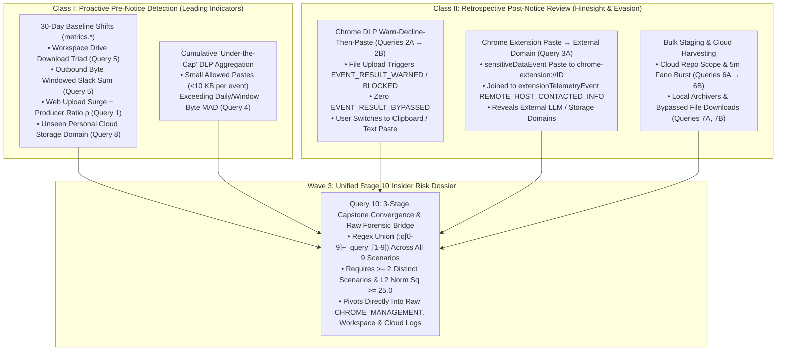

# Insider Risk & Data Movement Hunting Runbook: Pre-Notice Baselines, Post-Notice Retrospectives, and Chrome Enterprise DLP in Google SecOps

> **Author's Note on Terminology ("Runbook" vs. "Playbook")**: In Google Security Operations, "Playbook" is traditionally a SOAR response automation term, whereas this document is an analytical **Behavioral Hunting Runbook**—a structured, multi-stage YARA-L 2.0 query suite that can be run interactively by Insider Risk and SOC analysts or scheduled programmatically via `PlaybookRunner` in `agentic_ueba`. All mathematical models in this runbook are described by their exact statistical operations (30-day Z-scores with dispersion floors, Two-Part Zero-Inflated Hurdles, Non-Parametric Median Absolute Deviation, Windowed Slack Sums, Producer-Consumer Byte Ratios, Fano Factor Dispersion, Host-Prevalence IDF Rarity, and Cross-Event Relational Joins) without decorative DSP analogies. CRI scoring is computed downstream in Python (`ueba_constants.calculate_cri`) from the Z-equivalent scores emitted by each query.

---

## 1. Theory of the Case: Why Insider Risk Requires a Different Lens Than External Cyber Threat Hunting

External cyber threat hunting focuses heavily on command-and-control (C2) beaconing, malware IOCs, exploit parent-to-child process chains, and lateral movement. **Insider Risk** operates in a fundamentally different regime:

1. **The Actor Is Already Authenticated and Authorized**: A departing employee, contractor, or privileged insider does not need an exploit or C2 implant to read project plans, contact lists, sales pipelines, pricing sheets, or source code—they use their normal corporate laptop, browser profile, Google Workspace account, and cloud IAM role.
2. **The "Personal vs. Corporate Data" Signal-to-Noise Dilemma**: Most employees keep some personal files on their corporate machine (tax receipts, family photos, personal snapshots) and occasionally access personal webmail or cloud storage. Without pervasive file-level classification tags on every document at rest, a SOC cannot rely on static volume thresholds alone to distinguish an employee uploading 15 MB of personal tax receipts from one staging 15 MB of Q4 pricing sheets and customer contact lists.
3. **Two Distinct Operational Classes of Insider Risk Hunting**:
   * **Class I — Proactive Pre-Notice Detection (Leading Behavioral Shifts)**: Before an employee hands in their resignation notice, HR and the SOC have no formal offboarding trigger. However, in the 14–30 days leading up to resignation, data collection and staging rise sharply relative to the employee's own 30-day historical baseline and their peer group—manifesting as Google Drive download surges (`metrics.workspace_total_download_actions`), multi-day outbound byte elevation (`Windowed Slack Sum`), Producer-Consumer upload ratio inversions ($\rho \ge 0.55$), and cumulative "under-the-cap" Chrome DLP paste/upload volume.
   * **Class II — Retrospective Post-Notice Audit (Benefit-of-Hindsight & Policy Circumvention)**: Once an employee announces their departure (or enters a high-risk offboarding window), Insider Risk teams conduct a structured lookback. At this stage, employees who know they are leaving often run into **Chrome Enterprise Data Protection (DLP) rules** (`CHROME_MANAGEMENT`) and adapt their behavior in real time to evade blocks or warnings.



### 1.1 Leveraging Chrome Enterprise (`CHROME_MANAGEMENT`) Telemetry in Hybrid Insider Risk Hunts

When Chrome Enterprise Core / Chrome Enterprise Premium reporting is enabled, Google SecOps ingests `CHROME_MANAGEMENT` events (`metadata.log_type = "CHROME_MANAGEMENT"`, `metadata.product_name = "Chrome Management"` or `"Chrome Browser Cloud Management"`) with near-real-time (~2 minute) latency. Three specific Chrome Data Protection patterns—adapted directly from the **Elevate 25 SecOps DLP Policy** curriculum—solve visibility gaps that traditional network or EDR logs cannot see:

1. **Proving Intent via Warn-Decline-Then-Paste Circumvention (`Scenario 2: Query 2A -> Query 2B`)**:
   * When an employee attempts to upload a sensitive file (e.g., a customer pricing sheet) and receives a Chrome DLP warning (`security_result.action_details = "EVENT_RESULT_WARNED"`) or block (`"EVENT_RESULT_BLOCKED"`), they may cancel the file upload (so no `"EVENT_RESULT_BYPASSED"` event is logged). Instead, they open the file, copy the text to their clipboard, and paste it into a web form, pastebin, personal webmail draft, or browser extension (`additional.fields["transfer_method"] = "FILE_PASTE"`, `additional.fields["trigger_type"] = "CLIPBOARD_PASTE"`, or `target.file.mime_type = "text/plain"`). Because clipboard text hashes do not match the original file hash, static hash matching fails—but joining same-day `WARNED`/`BLOCKED` upload declines (`bypass_count = 0`) with subsequent `ALLOWED`/`DETECTED` text paste events exposes deliberate circumvention.
2. **Linking Sensitive Data Pastes into Chrome Extensions with External Destination Domains (`Scenario 3: Query 3A`)**:
   * When a user pastes sensitive corporate text into a Chrome extension popup, `sensitiveDataEvent` records `target.url = "chrome-extension://<extension_id>/..."`—which tells the analyst *which extension* received the data, but not *which external servers* that extension transmitted the data to. Meanwhile, `extensionTelemetryEvent` batches extension network activity (`target.resource.name = "REMOTE_HOST_CONTACTED_INFO"`, `target.resource_ancestors.product_object_id = "<extension_id>"`, `target.hostname = "<external_domain>"`). By extracting the 32-character extension ID via `re.capture(target.url, "(?i)^chrome-extension://([a-z0-9]+)")` in Stage 1 and inner-joining it with `extensionTelemetryEvent` in Stage 2, SecOps directly attributes sensitive extension pastes to external LLMs (`api.openai.com`, `chat.openai.com`) or unsanctioned storage endpoints.
3. **Auditing Cumulative "Under-the-Cap" Allowed Pastes (`Scenario 4: Query 4`)**:
   * Many organizations allow employees to copy, paste, or upload small snippets of sensitive data (e.g., under 10 KB) for legitimate daily workflows, logging those events under audit-only rules (`security_result.action_details = "EVENT_RESULT_ALLOWED"` or `"EVENT_RESULT_DETECTED"`). No single 150-byte or 1 KB paste triggers a block—but an insider copying records piecemeal can exfiltrate an entire contact list or pricing table across dozens of small pastes. Aggregating `sum(target.file.size)` and `count(metadata.id)` per user/day against their multi-day **Median Absolute Deviation (MAD)** and daily byte budget (`>= 10,000` bytes) catches piecemeal exfiltration.

### 1.2 Optional Customization: Scoping or Enriching Hunts with an HR Offboarding Data Table (`%insider_risk_watchlist`)

Insider Risk teams frequently maintain an **HR Offboarding / Watchlist Roster** (exported from Workday, BambooHR, or ServiceNow offboarding tickets) listing employees who have submitted their resignation notice, contractors approaching end-of-contract, or personnel in high-risk restructuring cohorts.

> [!TIP]
> **Why Data Table Filters Are Commented Out by Default**: In Google SecOps YARA-L 2.0, referencing a Data Table (`%insider_risk_watchlist.userid`) that has not yet been created in the target tenant causes an immediate compiler error. To ensure every query in this runbook works **out-of-the-box** for testing—and to support **Class I (Pre-Notice) Discovery** where an insider has *not yet given notice to HR*—all 16 queries in this file ship unscoped by default and include a commented-out 2-line placeholder (`// $entity in %insider_risk_watchlist.entity_id`, `// $user in %insider_risk_watchlist.userid`, or `// $host in %insider_risk_watchlist.hostname`).

Once you create and populate `%insider_risk_watchlist` (see **Section 4.3** for the exact schema, Chronicle REST API `curl` commands, and SecOps MCP examples, including automatic row expiration via `rowTimeToLive`), you can apply it in two ways:
1. **Selective Class II Scoping (Uncomment in Stage 1)**: Uncomment the placeholder in specific Class II queries (or in a cloned "Post-Notice Audit" copy of the runbook) to evaluate only departing employees and their assigned laptops.
2. **Stage 10 Capstone Watchlist Filtering or Enrichment (Uncomment in `Query 10` Only)**: Leave Queries 1–9 unscoped so the UEBA engine baselines the entire enterprise (catching Class I pre-notice actors), and uncomment the `%insider_risk_watchlist` join in **Stage 10 (`Query 10`)** when generating a dedicated daily digest for the Insider Risk / HR Legal review board.

---

## 2. Runbook Portfolio Matrix (16 Queries Across 10 Scenarios + Per-Flow Quantile Shape in 3 Waves)

> [!IMPORTANT]
> **How `agentic_ueba` (`PlaybookRunner`) and LLM Agents Handle `A -> UDM -> B` Splits (`2A -> 2B` and `6A -> 6B`)**:
> 1. **Programmatic `PlaybookRunner` (`run_markdown_playbook` / `/api/v1/playbooks/run`)**: `PlaybookRunner.parse_markdown_playbook()` inspects the YARA-L AST of every query. Because `Query 2B` (`stage1_upstream_2a_candidates` matching `:q[0-9]+_query_2a`) and `Query 6B` (`stage1_upstream_6a_candidates` matching `:q[0-9]+_query_6a`) reference `PLAYBOOK_BEHAVIORAL_HUNT_MATCH` with Stage A rule-name regexes, `PlaybookRunner` automatically assigns them **`is_udm_gated = True` (`execution_wave = 2`)** and schedules the 16 queries in this runbook across **3 strict waves with read-after-write UDM barriers**:
>    * **Wave 1 (13 Upstream Queries)**: Executes `Queries 1, 2A, 3A, 3B, 4, 5, 6A, 7A, 7B, 8, 9A, 9B` plus the Section 7 per-flow quantile shape query in parallel, converts all matched entities into `GENERIC_EVENT` (`PLAYBOOK_BEHAVIORAL_HUNT_MATCH`) records tagged with `metadata.product_log_id = <run_id>` and `security_result.rule_name = "<playbook_id>:q<NN>_query_<id>..."`, flushes them via `ImportEvents`, and polls `verify_udm_run_indexed()` until Chronicle UDM confirms 100% of Wave 1 events are indexed.
>    * **Wave 2 (2 UDM-Gated Stage B Queries)**: Executes `Query 2B` and `Query 6B` (which join `stage1_upstream_2a_candidates` / `stage1_upstream_6a_candidates` directly from Chronicle UDM), flushes their matches to UDM, and polls `verify_udm_run_indexed()` again.
>    * **Wave 3 (Unified Stage 10 Capstone)**: Executes `Query 10` (`execution_wave = 3`) over all indexed Wave 1 + Wave 2 UDM events (`distinct_scenarios_matched >= 2` and `capstone_threat_norm_sq >= 25.0`).
> 2. **Interactive / Manual Agent Execution (`udm_search` + `import_logs`)**: If an agent or analyst runs Scenario 2 or Scenario 6 manually without `PlaybookRunner`, **you must ingest the matched entities from `Query 2A` (or `Query 6A`) into Chronicle UDM as `PLAYBOOK_BEHAVIORAL_HUNT_MATCH` events and wait for UDM indexing before running `Query 2B` (or `Query 6B`)**. Each Stage A / Stage B query header below includes explicit `UDM LOOPBACK CONTRACT` comments specifying the exact fields required.

| Scenario | Operational Class | Wave & Architecture | Query ID(s) & Statistical / Relational Model | Primary Telemetry & `metrics.*` Vectors |
| :--- | :--- | :--- | :--- | :--- |
| **1. Personal Web Upload Surge & Producer Ratio** | **Class I** (Pre-Notice) & **Class II** (Post-Notice) | **Wave 1: Single Combined Query** (3-Stage `by 1d`) | **`Query 1`**: 30-Day HTTP + Outbound Byte Dual-Sector Fusion & Producer-Consumer Byte Ratio ($\rho \ge 0.55$) | `NETWORK_HTTP`, `NETWORK_CONNECTION` (`metrics.http_queries_total`, `metrics.network_bytes_outbound`) |
| **2. Chrome DLP Warn-Decline-Then-Paste Circumvention** | **Class II** (Post-Notice Evasion) | **Wave 1 $\rightarrow$ Wave 2 Split** (`2A` $\rightarrow$ UDM $\rightarrow$ `2B`) | **`Query 2A`**: 4-Stage Non-Parametric MAD on Chrome DLP Events<br>**`Query 2B`**: 2-Stage UDM-Gated Warn/Block (`bypass=0`) $\rightarrow$ Text Paste Join | `CHROME_MANAGEMENT` (`sensitiveDataEvent`, `contentTransferEvent`) |
| **3. Chrome Extension Sensitive Paste $\rightarrow$ External Domain Attribution** | **Class I** & **Class II** (Shadow AI / DLP) | **Wave 1: Parallel Pair** (`3A` + `3B`) | **`Query 3A`**: 2-Stage Cross-Event Join (`sensitiveDataEvent` $\bowtie$ `extensionTelemetryEvent`)<br>**`Query 3B`**: 4-Stage Host-Prevalence IDF Rarity (`ZIPFIAN_PROCESS_RARITY`) | `CHROME_MANAGEMENT` (`sensitiveDataEvent`, `extensionTelemetryEvent`, `browserExtensionInstallEvent`) |
| **4. Cumulative "Under-the-Cap" Allowed DLP Paste Aggregation** | **Class I** (Pre-Notice Drip) & **Class II** | **Wave 1: Single Combined Query** (4-Stage `by 1d`) | **`Query 4`**: 4-Stage Non-Parametric Byte MAD + Daily Budget Breach ($\ge 10\text{ KB}$) | `CHROME_MANAGEMENT` (`sensitiveDataEvent`, `contentTransferEvent`, `target.file.size`) |
| **5. Google Workspace Drive Hoarding Triad & Outbound Slack Sum** | **Class I** (Pre-Notice Staging) | **Wave 1: Single Combined Query** (4-Stage `by 1d`) | **`Query 5`**: 30-Day Workspace Activity Triad + Outbound Byte Windowed Slack Sum | `WORKSPACE_ACTIVITY` (`workspace_total_download_actions`, `change_actions`, `auth_attempts_total`) + `network_bytes_outbound` |
| **6. Cloud Repository / Bucket Bulk Harvesting & Burst Denials** | **Class I** & **Class II** | **Wave 1 $\rightarrow$ Wave 2 Split** (`6A` $\rightarrow$ UDM $\rightarrow$ `6B`) | **`Query 6A`**: 3-Stage Dual-Branch 30d Cloud CRUD Repository & Caller IP Scope<br>**`Query 6B`**: 4-Stage UDM-Gated `5m` Fano Factor Dispersion ($F \ge 3.5$) | `RESOURCE_READ`, `RESOURCE_WRITTEN`, `RESOURCE_CREATION`, `RESOURCE_DELETION`, `USER_RESOURCE_ACCESS` (`metrics.resource_*`) |
| **7. Endpoint Archive Staging & Bypassed Browser File Downloads** | **Class II** (Post-Notice Collection) | **Wave 1: Parallel Pair** (`7A` + `7B`) | **`Query 7A`**: 4-Stage Roll-Up Process Execution + Egress Fusion<br>**`Query 7B`**: 4-Stage Leave-One-Out Z-Score on Chrome Downloads & Bypassed Warnings | `PROCESS_LAUNCH` (`metrics.file_executions_total`), `CHROME_MANAGEMENT` (`dangerousDownloadEvent`, `FILE_DOWNLOAD`) |
| **8. Unsanctioned Personal Cloud Storage Domain Rarity** | **Class I** (Pre-Notice Staging) | **Wave 1: Single Combined Query** (3-Stage `by 1d`) | **`Query 8`**: 30-Day Host DNS Baseline + `DERIVED_CONTEXT` 10-Day Domain Prevalence (`rolling_max <= 3`) | `NETWORK_DNS` (`metrics.dns_queries_total`) + `DERIVED_CONTEXT` (`DOMAIN_NAME`) |
| **9. Off-Network Personal ISP Access & Multi-Rule EDR Alert Fusion** | **Class I** & **Class II** | **Wave 1: Parallel Pair** (`9A` + `9B`) | **`Query 9A`**: 3-Stage Two-Part Hurdle on 30d Auth ASN & Application Scope<br>**`Query 9B`**: 4-Stage Roll-Up EDR Alert Rule Velocity + Outbound Egress | `USER_LOGIN` (`metrics.auth_attempts_total`), `metrics.alert_event_name_count`, `metrics.network_bytes_outbound` |
| **10. Unified Insider Risk Capstone Convergence & Forensic Dossier** | **Class I + Class II Rollup** | **Wave 3: Single Unified Query** (3-Stage) | **`Query 10`**: Regex Union (`:q[0-9]+_query_[1-9]`) Dedup + Multi-Scenario L2 Rollup ($\sum Z_i^2 \ge 25.0$) + Raw DLP / Cloud / Endpoint Forensic Pivot | `PLAYBOOK_BEHAVIORAL_HUNT_MATCH` $\bowtie$ `CHROME_MANAGEMENT`, `SCAN_FILE`, `PROCESS_LAUNCH`, `RESOURCE_READ`, `NETWORK_CONNECTION` |

---

## 3. Scenario-by-Scenario Multi-Stage YARA-L 2.0 Queries

### Scenario 1: Personal Web Upload Surge & Producer-Consumer Byte Ratio (Combined `Query 1`)

Employees casually checking personal webmail or viewing a receipt on a corporate laptop are **net consumers** of data (`received_bytes >> sent_bytes`, so their Producer-Consumer Ratio $\rho = \frac{\text{sent}}{\text{sent} + \text{received} + 1} < 0.25$). When an employee begins uploading project folders, sales spreadsheets, or database exports to personal cloud storage before handing in their notice, two things change simultaneously:
1. Their daily HTTP request count (`metrics.http_queries_total`, evaluated with a Poisson count dispersion floor $\sqrt{\max(\mu, 1)}$ over $\ge 7$ active baseline days) and/or outbound byte volume (`metrics.network_bytes_outbound`, evaluated with the `44979.0` fleet byte dispersion floor over $\ge 7$ active baseline days) break above their 30-day personal baseline ($D^2 = Z_{\text{http}}^2 + Z_{\text{bytes}}^2 \ge 12.25$).
2. Their directional byte ratio flips into a **net producer regime** ($\rho \ge 0.55$).

#### Query 1: 3-Stage Combined 30-Day HTTP + Outbound Byte Dual-Sector Fusion & Producer-Consumer Byte Ratio (`secops-risk-metrics-multistage`)

```yara
// ============================================================================
// ARCHITECTURE: 3-STAGE DUAL-SECTOR WEB UPLOAD SURGE & PRODUCER-CONSUMER RATIO PIPELINE
// Goal: Detect pre-departure or offboarding upload spikes by fusing 30-day HTTP query and outbound byte Z-scores (with >= 7 active baseline days and Poisson/byte dispersion floors) gated on Producer-Consumer byte asymmetry (rho >= 0.55).
// Statistical Model: 30-Day Dual-Sector Euclidean Threat Norm (D^2 = Z_http^2 + Z_bytes^2 >= 12.25) + Producer-Consumer Byte Ratio Gate (rho >= 0.55)
// Mode A Execution Window: Last complete UTC day [D T00:00:00Z, D+1 T00:00:00Z)
// Skill: secops-risk-metrics-multistage
// ============================================================================

stage sector_a_http {
    (network.http.method != "" or network.http.user_agent != "" or network.http.response_code != 0 or network.http.referral_url != "")
    principal.asset.hostname = $entity
    $entity != ""
    // Optional HR Offboarding / Watchlist Data Table filter (see Section 4.3):
    // $entity in %insider_risk_watchlist.hostname

  match:
    $entity by 1d

  outcome:
    $a_obs = count(metadata.id)
    $distinct_domains = count_distinct(target.hostname)
    $sample_domains = array_distinct(target.hostname)
    $a_avg = max(metrics.http_queries_total(
        period: 1d, window: 30d, metric: event_count_sum, agg: avg,
        principal.asset.hostname: principal.asset.hostname
    ))
    $a_std = max(metrics.http_queries_total(
        period: 1d, window: 30d, metric: event_count_sum, agg: stddev,
        principal.asset.hostname: principal.asset.hostname
    ))
    $a_days = max(metrics.http_queries_total(
        period: 1d, window: 30d, metric: event_count_sum, agg: num_metric_periods,
        principal.asset.hostname: principal.asset.hostname
    ))
}

stage sector_b_egress {
    network.sent_bytes > 0
    network.sent_bytes < 1000000000000000
    principal.asset.hostname = $entity
    $entity != ""

  match:
    $entity by 1d

  outcome:
    $b_obs = sum(network.sent_bytes)
    $recv_bytes = sum(network.received_bytes)
    $b_avg = max(metrics.network_bytes_outbound(
        period: 1d, window: 30d, metric: value_sum, agg: avg,
        principal.asset.hostname: principal.asset.hostname
    ))
    $b_std = max(metrics.network_bytes_outbound(
        period: 1d, window: 30d, metric: value_sum, agg: stddev,
        principal.asset.hostname: principal.asset.hostname
    ))
    $b_days = max(metrics.network_bytes_outbound(
        period: 1d, window: 30d, metric: value_sum, agg: num_metric_periods,
        principal.asset.hostname: principal.asset.hostname
    ))
}

$entity = $sector_a_http.entity
$entity = $sector_b_egress.entity
$ws = $sector_a_http.window_start
$ws = $sector_b_egress.window_start

match:
  $entity, $ws by 1d

outcome:
  $http_observed = max($sector_a_http.a_obs)
  $distinct_domains = max($sector_a_http.distinct_domains)
  $sample_domains = array_distinct($sector_a_http.sample_domains)
  $sent_bytes = max($sector_b_egress.b_obs)
  $received_bytes = max($sector_b_egress.recv_bytes)
  $a_avg = max($sector_a_http.a_avg)
  $a_std = max($sector_a_http.a_std)
  $a_days = max($sector_a_http.a_days)
  $b_avg = max($sector_b_egress.b_avg)
  $b_std = max($sector_b_egress.b_std)
  $b_days = max($sector_b_egress.b_days)

  $a_floor = math.sqrt(if($a_avg > 1.0, $a_avg, 1.0))
  $a_safe_std = if($a_std > $a_floor, $a_std, $a_floor)
  $z_a_raw = ($http_observed - $a_avg) / $a_safe_std
  $z_a = if($a_days >= 7 and $z_a_raw > 0.0, $z_a_raw, 0.0)

  $b_safe_std = if($b_std > 44979.0, $b_std, 44979.0)
  $z_b_raw = ($sent_bytes - $b_avg) / $b_safe_std
  $z_b = if($b_days >= 7 and $z_b_raw > 0.0, $z_b_raw, 0.0)

  $producer_ratio = 1.0 * $sent_bytes / ($sent_bytes + $received_bytes + 1.0)
  $composite_threat_norm_sq = ($z_a * $z_a) + ($z_b * $z_b)

condition:
  $producer_ratio >= 0.55
  and $composite_threat_norm_sq >= 12.25

order:
  $composite_threat_norm_sq desc
```

---

### Scenario 2: Chrome DLP Warn-Decline-Then-Paste Circumvention (`Query 2A` $\rightarrow$ UDM $\rightarrow$ `Query 2B`)

When an insider attempts to upload a sensitive file and receives a Chrome Data Protection warning (`EVENT_RESULT_WARNED`) or block (`EVENT_RESULT_BLOCKED`), they often decline the file upload (generating zero `EVENT_RESULT_BYPASSED` events) and immediately switch to copying and pasting the file's text contents into a browser form, webmail body, pastebin, or extension (`target.file.mime_type = "text/plain"` or `chrome-extension:` target URL).
* **Wave 1 (`Query 2A`)** evaluates daily `CHROME_MANAGEMENT` `sensitiveDataEvent` and `contentTransferEvent` counts per user/host over a bounded multi-day window against their non-parametric **Iglewicz-Hoaglin Modified Z-Score (MAD)** baseline (`$baseline_active_samples >= 7`, Poisson count floor $\sqrt{\max(\text{median}, 1.0)}$, `$m_z_score >= 3.5`) and exports candidate entities into Chronicle UDM (`PLAYBOOK_BEHAVIORAL_HUNT_MATCH`).
* **Wave 2 (`Query 2B`)** gates on `Query 2A`'s candidate entities via UDM Loopback (`re.regex(security_result.rule_name, `:q[0-9]+_query_2a`)`) and isolates users/hosts who triggered $\ge 1$ `WARNED`/`BLOCKED` DLP event with **zero** `EVENT_RESULT_BYPASSED` events (`$distinct_binaries = 0`) while executing $\ge 1$ `ALLOWED`/`DETECTED` text or extension paste on the same day.

#### Query 2A: 4-Stage Non-Parametric MAD on Chrome DLP Sensitive Data Uploads, Warnings & Blocks (`secops-statistical-hunter`)

```yara
// ============================================================================
// ARCHITECTURE: 4-STAGE NON-PARAMETRIC MAD ON CHROME DLP SENSITIVE DATA EVENTS
// Goal: Detect anomalous spikes in Chrome Enterprise DLP sensitiveDataEvent and contentTransferEvent activity (uploads, pastes, warnings, blocks) per user/host (M_Z >= 3.5).
// Statistical Model: 4-Stage Iglewicz-Hoaglin Modified Z-Score via Median Absolute Deviation (MAD) with Continuous Count Dispersion Floor (>= 7 Active Days)
// Execution Wave: Wave 1 (Upstream Stage A).
// UDM LOOPBACK CONTRACT (2A -> 2B): Before executing Query 2B, matched $entity rows from Query 2A MUST be pushed to Chronicle UDM as GENERIC_EVENT records with metadata.product_event_type = "PLAYBOOK_BEHAVIORAL_HUNT_MATCH", metadata.product_log_id = "<run_id>", and security_result.rule_name containing ":q02_query_2a" (handled automatically by PlaybookRunner between Wave 1 and Wave 2).
// Skill: secops-statistical-hunter
// ============================================================================

stage daily_dlp_events {
    (
      metadata.log_type = "CHROME_MANAGEMENT"
      or metadata.product_name = "Chrome Management"
      or metadata.product_name = "Chrome Browser Cloud Management"
    )
    (
      metadata.product_event_type = "sensitiveDataEvent"
      or metadata.product_event_type = "contentTransferEvent"
    )
    $entity = strings.coalesce(principal.user.userid, principal.user.user_display_name, principal.asset.hostname, principal.hostname)
    $entity != ""
    // Optional HR Offboarding / Watchlist Data Table filter (see Section 4.3):
    // $entity in %insider_risk_watchlist.entity_id

  match:
    $entity by 1d

  outcome:
    $daily_events = count(metadata.id)
    $daily_bytes = sum(target.file.size)
    $warn_or_block_events = sum(if(security_result.action_details = "EVENT_RESULT_WARNED" or security_result.action_details = "EVENT_RESULT_BLOCKED" or security_result.action_details = "EVENT_RESULT_BYPASSED", 1, 0))
    $distinct_urls = count_distinct(target.url)
    $sample_urls = array_distinct(target.url)
    $triggered_dlp_rules = array_distinct(security_result.rule_name)
}

stage median_stats {
    $entity = $daily_dlp_events.entity

  match:
    $entity

  outcome:
    $baseline_median = window.median($daily_dlp_events.daily_events, false)
}

stage mad_stats {
    $entity = $daily_dlp_events.entity
    $entity = $median_stats.entity

  match:
    $entity

  outcome:
    $mad = window.median(math.abs($daily_dlp_events.daily_events - $median_stats.baseline_median), false)
    $mean_abs_dev = avg(math.abs($daily_dlp_events.daily_events - $median_stats.baseline_median))
    $median_val = max($median_stats.baseline_median)
    $active_days = count_distinct($daily_dlp_events.window_start)
}

$entity = $daily_dlp_events.entity
$entity = $mad_stats.entity
$ws = $daily_dlp_events.window_start

match:
  $entity, $ws by 1d

outcome:
  $observation_count = max($daily_dlp_events.daily_events)
  $daily_dlp_bytes = max($daily_dlp_events.daily_bytes)
  $warn_block_count = max($daily_dlp_events.warn_or_block_events)
  $baseline_active_samples = max($mad_stats.active_days)
  $baseline_median = max($mad_stats.median_val)
  $baseline_mean = max($mad_stats.median_val)
  $baseline_dispersion = max($mad_stats.mad)
  $baseline_mean_abs_dev = max($mad_stats.mean_abs_dev)
  $fleet_prevalence = 0 - 1
  $distinct_binaries = max($daily_dlp_events.distinct_urls)
  $sample_urls = array_distinct($daily_dlp_events.sample_urls)
  $dlp_rules = array_distinct($daily_dlp_events.triggered_dlp_rules)

  $scale_from_mad = $baseline_dispersion / 0.6745
  $scale_from_meanad = $baseline_mean_abs_dev * 1.253314
  $robust_scale = if($baseline_dispersion > 0, $scale_from_mad, $scale_from_meanad)
  $med_floor_arg = if($baseline_median > 1.0, $baseline_median, 1.0)
  $disp_floor = math.sqrt($med_floor_arg)
  $safe_robust_scale = if($robust_scale > $disp_floor, $robust_scale, $disp_floor)
  $m_z_score = ($observation_count - $baseline_median) / $safe_robust_scale

condition:
  $baseline_active_samples >= 7
  and $observation_count >= 2
  and $m_z_score >= 3.5

order:
  $m_z_score desc
```

#### Query 2B: 3-Stage UDM-Gated Chrome DLP Warn/Block Decline Followed by Clipboard/Text Paste Circumvention (`secops-statistical-hunter`)

```yara
// ============================================================================
// ARCHITECTURE: 3-STAGE UDM-GATED CHROME DLP WARN-DECLINE-THEN-PASTE CIRCUMVENTION PIPELINE
// Goal: Isolate candidate entities from Query 2A that received a Chrome DLP file upload warning or block (with zero bypasses) and switched to allowed/detected text or extension pastes on the same day.
// Statistical Model: UDM Loopback Stage 1 Candidate Gate + Non-Existence of Bypass (bypass_count = 0) + Upstream Z + Log Paste Volume Ranking
// Execution Wave: Wave 2 (UDM-Gated Stage B — requires Query 2A UDM events to be ingested and indexed in Chronicle UDM first).
// Skill: secops-statistical-hunter
// ============================================================================

stage stage1_upstream_2a_candidates {
    metadata.event_type = "GENERIC_EVENT"
    metadata.vendor_name = "Google SecOps"
    metadata.product_name = "SecOps Risk Metrics Hunter"
    metadata.product_event_type = "PLAYBOOK_BEHAVIORAL_HUNT_MATCH"
    metadata.product_log_id = $run_id
    re.regex(security_result.rule_name, `:q[0-9]+_query_2a`)
    $entity = strings.coalesce(principal.user.userid, principal.asset.hostname, principal.hostname, principal.ip[0])
    $entity != ""
    $run_id != ""

  match:
    $entity

  outcome:
    $upstream_2a_z = max(security_result.confidence_score)
}

stage stage2_dlp_warn_then_paste {
    (
      metadata.log_type = "CHROME_MANAGEMENT"
      or metadata.product_name = "Chrome Management"
      or metadata.product_name = "Chrome Browser Cloud Management"
    )
    (
      metadata.product_event_type = "sensitiveDataEvent"
      or metadata.product_event_type = "contentTransferEvent"
    )
    $entity = strings.coalesce(principal.user.userid, principal.user.user_display_name, principal.asset.hostname, principal.hostname)
    $entity != ""
    // Optional HR Offboarding / Watchlist Data Table filter (see Section 4.3):
    // $entity in %insider_risk_watchlist.entity_id

  match:
    $entity by 1d

  outcome:
    $total_dlp_events = count(metadata.id)
    $total_dlp_bytes = sum(target.file.size)
    $warn_or_block_count = sum(if(security_result.action_details = "EVENT_RESULT_WARNED" or security_result.action_details = "EVENT_RESULT_BLOCKED", 1, 0))
    $bypass_count = sum(if(security_result.action_details = "EVENT_RESULT_BYPASSED", 1, 0))
    $allowed_or_detected_count = sum(if(security_result.action_details = "EVENT_RESULT_ALLOWED" or security_result.action_details = "EVENT_RESULT_DETECTED", 1, 0))
    $text_or_paste_count = sum(if(target.file.mime_type = "text/plain" or re.regex(target.url, "(?i)chrome-extension:"), 1, 0))
    $sample_urls = array_distinct(target.url)
    $triggered_rules = array_distinct(security_result.rule_name)
}

$entity = $stage1_upstream_2a_candidates.entity
$entity = $stage2_dlp_warn_then_paste.entity
$ws = $stage2_dlp_warn_then_paste.window_start

match:
  $entity, $ws by 1d

outcome:
  $upstream_z = max($stage1_upstream_2a_candidates.upstream_2a_z)
  $observation_count = max($stage2_dlp_warn_then_paste.text_or_paste_count)
  $baseline_active_samples = max($stage2_dlp_warn_then_paste.warn_or_block_count)
  $baseline_mean = max($stage2_dlp_warn_then_paste.total_dlp_bytes)
  $baseline_dispersion = max($stage2_dlp_warn_then_paste.allowed_or_detected_count)
  $fleet_prevalence = 0 - 1
  $distinct_binaries = max($stage2_dlp_warn_then_paste.bypass_count)

  $sample_urls = array_distinct($stage2_dlp_warn_then_paste.sample_urls)
  $triggered_rules = array_distinct($stage2_dlp_warn_then_paste.triggered_rules)

  $threat_score = $upstream_z + math.log($observation_count + 1.0)

condition:
  $baseline_active_samples >= 1
  and $distinct_binaries = 0
  and $baseline_dispersion >= 1
  and $observation_count >= 1
  and $threat_score >= 3.5

order:
  $threat_score desc
```

---

### Scenario 3: Sensitive Data Paste into Chrome Extensions & External Domain Attribution (`Query 3A` & `Query 3B`)

When an insider pastes sensitive corporate data into a browser extension (such as a sidebar LLM translator, writing assistant, or web clipper), `sensitiveDataEvent` logs `target.url = "chrome-extension://<ext_id>/..."`, while `extensionTelemetryEvent` separately logs `REMOTE_HOST_CONTACTED_INFO` with `target.resource_ancestors.product_object_id = "<ext_id>"` and `target.hostname = "<external_domain>"`.
* **`Query 3A`** extracts the extension ID from `sensitiveDataEvent` (`re.capture(target.url, "(?i)chrome-extension:[/]+([a-z0-9]+)")`) in Stage 1 and inner-joins it with `extensionTelemetryEvent` in Stage 2 on `($host, $ext_id, $ws by 1d)`, directly linking the DLP paste event to the exact external domains contacted by that extension and ranking rows by log-paste volume and external domain breadth.
* **`Query 3B`** evaluates Chrome extension installation and execution across the active Chrome fleet using pure **Host-Prevalence Inverse Document Frequency (IDF) Rarity** ($\ln(N_{\text{fleet\_hosts}} / N_{\text{adopter\_hosts}}) \ge 2.5$, `adopter_hosts <= 2`, `safe_fleet_hosts >= 10`) to surface isolated or sideloaded extensions.

#### Query 3A: 2-Stage Chrome Sensitive Data Paste to Extension Joined with Extension External Domain Contacts (`secops-statistical-hunter`)

```yara
// ============================================================================
// ARCHITECTURE: 2-STAGE CHROME DLP EXTENSION PASTE TO EXTERNAL DOMAIN ATTRIBUTION JOIN
// Goal: Link Chrome DLP sensitiveDataEvent pastes targeting chrome-extension:// URLs directly to the external domains contacted by that extension in extensionTelemetryEvent.
// Statistical Model: Cross-Event Relational Join (sensitiveDataEvent ⋈ extensionTelemetryEvent on host, ext_id) Ranked by Log Paste Bytes, Paste Count & External Domain Breadth
// Skill: secops-statistical-hunter
// ============================================================================

stage stage1_sensitive_paste_to_extension {
    (
      metadata.log_type = "CHROME_MANAGEMENT"
      or metadata.product_name = "Chrome Management"
      or metadata.product_name = "Chrome Browser Cloud Management"
    )
    metadata.product_event_type = "sensitiveDataEvent"
    re.regex(target.url, "(?i)chrome-extension:")
    $host = strings.coalesce(principal.asset.hostname, principal.hostname)
    $ext_id = re.capture(target.url, "(?i)chrome-extension:[/]+([a-z0-9]+)")
    $host != ""
    $ext_id != ""
    // Optional HR Offboarding / Watchlist Data Table filter (see Section 4.3):
    // $host in %insider_risk_watchlist.hostname

  match:
    $host, $ext_id by 1d

  outcome:
    $paste_events = count(metadata.id)
    $pasted_bytes = sum(target.file.size)
    $dlp_rules = array_distinct(security_result.rule_name)
    $users = array_distinct(principal.user.user_display_name)
}

stage stage2_extension_external_domains {
    (
      metadata.log_type = "CHROME_MANAGEMENT"
      or metadata.product_name = "Chrome Management"
      or metadata.product_name = "Chrome Browser Cloud Management"
    )
    metadata.product_event_type = "extensionTelemetryEvent"
    target.resource.name = "REMOTE_HOST_CONTACTED_INFO"
    $host = strings.coalesce(principal.asset.hostname, principal.hostname)
    $ext_id = target.resource_ancestors.product_object_id
    $ext_domain = target.hostname
    $host != ""
    $ext_id != ""
    $ext_domain != ""

  match:
    $host, $ext_id by 1d

  outcome:
    $remote_contact_events = count(metadata.id)
    $distinct_external_domains = count_distinct(target.hostname)
    $external_domains = array_distinct(target.hostname)
    $extension_names = array_distinct(target.resource_ancestors.name)
    $llm_domain_hits = sum(if(re.regex(target.hostname, `(?i)(openai|chatgpt|anthropic|claude|gemini|perplexity|deepseek|cohere|mistral|huggingface|captaina)`), 1, 0))
}

$host = $stage1_sensitive_paste_to_extension.host
$ext_id = $stage1_sensitive_paste_to_extension.ext_id
$host = $stage2_extension_external_domains.host
$ext_id = $stage2_extension_external_domains.ext_id
$ws = $stage1_sensitive_paste_to_extension.window_start
$ws = $stage2_extension_external_domains.window_start

match:
  $host, $ext_id, $ws by 1d

outcome:
  $observation_count = max($stage1_sensitive_paste_to_extension.paste_events)
  $baseline_active_samples = max($stage2_extension_external_domains.remote_contact_events)
  $baseline_mean = max($stage1_sensitive_paste_to_extension.pasted_bytes)
  $baseline_dispersion = max($stage2_extension_external_domains.llm_domain_hits)
  $fleet_prevalence = 0 - 1
  $distinct_binaries = max($stage2_extension_external_domains.distinct_external_domains)

  $users = array_distinct($stage1_sensitive_paste_to_extension.users)
  $dlp_rules = array_distinct($stage1_sensitive_paste_to_extension.dlp_rules)
  $extension_names = array_distinct($stage2_extension_external_domains.extension_names)
  $external_domains = array_distinct($stage2_extension_external_domains.external_domains)

  $threat_score = math.log($baseline_mean + 1.0) + math.log($observation_count + 1.0) + math.log($distinct_binaries + 1.0)

condition:
  $observation_count >= 1
  and $baseline_active_samples >= 1
  and $threat_score >= 3.5

order:
  $threat_score desc
```

#### Query 3B: 4-Stage Chrome Extension Host-Prevalence Inverse Document Frequency (IDF) Rarity (`secops-statistical-hunter`)

```yara
// ============================================================================
// ARCHITECTURE: 4-STAGE HOST-PREVALENCE INVERSE DOCUMENT FREQUENCY (IDF) RARITY ON CHROME EXTENSIONS
// Goal: Detect newly installed or fleet-rare Chrome extensions (<= 2 adopter hosts across an active Chrome fleet >= 10 hosts) used during pre-departure or offboarding windows.
// Statistical Model: Host-Prevalence Inverse Document Frequency Rarity (Zipf Score = ln(N_fleet_hosts / N_adopter_hosts) >= 2.5)
// Skill: secops-statistical-hunter
// ============================================================================

stage daily_extension_activity {
    (
      metadata.log_type = "CHROME_MANAGEMENT"
      or metadata.product_name = "Chrome Management"
      or metadata.product_name = "Chrome Browser Cloud Management"
    )
    (
      metadata.product_event_type = "extensionTelemetryEvent"
      or metadata.product_event_type = "browserExtensionInstallEvent"
    )
    $host = strings.coalesce(principal.asset.hostname, principal.hostname)
    $ext_id = strings.coalesce(target.resource.product_object_id, target.resource_ancestors.product_object_id)
    $host != ""
    $ext_id != ""
    // Optional HR Offboarding / Watchlist Data Table filter (see Section 4.3):
    // $host in %insider_risk_watchlist.hostname

  match:
    $host, $ext_id by 1d

  outcome:
    $daily_events = count(metadata.id)
    $distinct_targets = count_distinct(target.hostname)
    $sample_targets = array_distinct(target.hostname)
}

stage extension_fleet_popularity {
    $ext_id = $daily_extension_activity.ext_id
    $ws = $daily_extension_activity.window_start

  match:
    $ext_id, $ws by 1d

  outcome:
    $adopter_hosts = count_distinct($daily_extension_activity.host)
}

stage fleet_host_total {
    $ws = $daily_extension_activity.window_start

  match:
    $ws by 1d

  outcome:
    $total_fleet_hosts = count_distinct($daily_extension_activity.host)
}

$host = $daily_extension_activity.host
$ext_id = $daily_extension_activity.ext_id
$ext_id = $extension_fleet_popularity.ext_id
$ws = $daily_extension_activity.window_start
$ws = $extension_fleet_popularity.ws
$ws = $fleet_host_total.ws

match:
  $host, $ext_id, $ws by 1d

outcome:
  $adopter_hosts = max($extension_fleet_popularity.adopter_hosts)
  $fleet_total_hosts = max($fleet_host_total.total_fleet_hosts)
  $local_volume = max($daily_extension_activity.daily_events)
  $sample_domains = array_distinct($daily_extension_activity.sample_targets)

  $safe_hosts = if($adopter_hosts > 0, $adopter_hosts, 1)
  $safe_fleet_hosts = if($fleet_total_hosts > $safe_hosts, $fleet_total_hosts, $safe_hosts)
  $zipf_rarity_score = math.log(1.0 * $safe_fleet_hosts / $safe_hosts)

  $observation_count = $local_volume
  $baseline_active_samples = $safe_fleet_hosts
  $baseline_mean = 1.0 * $adopter_hosts / $safe_fleet_hosts
  $baseline_dispersion = $zipf_rarity_score
  $fleet_prevalence = $adopter_hosts
  $distinct_binaries = max($daily_extension_activity.distinct_targets)

condition:
  $safe_fleet_hosts >= 10
  and $adopter_hosts <= 2
  and $observation_count >= 1
  and $zipf_rarity_score >= 2.5

order:
  $zipf_rarity_score desc
```

---

### Scenario 4: Cumulative "Under-the-Cap" Allowed Chrome DLP Paste & Upload Byte Aggregation (`Query 4`)

Organizations typically allow employees to copy/paste or upload small quantities of sensitive data (e.g., up to 10 KB per day) for legitimate business tasks, logging those actions under audit rules (`EVENT_RESULT_ALLOWED` or `EVENT_RESULT_DETECTED`). Because no hard block stops the user at 10 KB, an insider can copy and paste sensitive records in small 150-to-500-byte increments across the day or week.

**`Query 4`** aggregates daily and multi-day cumulative bytes (`sum(target.file.size)`) and paste counts across allowed/monitored Chrome DLP events over a bounded multi-day window, scoring each mature entity (`$baseline_active_samples >= 7`) using the **Iglewicz-Hoaglin Modified Z-Score (MAD)** with a `1024.0`-byte minimum dispersion floor (`$m_z_score >= 3.5`) gated by a `>= 10,000`-byte daily or cumulative window budget breach.

#### Query 4: 4-Stage Cumulative "Under-the-Cap" Chrome DLP Allowed Paste & Upload Byte Aggregation (`secops-statistical-hunter`)

```yara
// ============================================================================
// ARCHITECTURE: 4-STAGE CUMULATIVE ALLOWED CHROME DLP PASTE & BYTE AGGREGATION PIPELINE
// Goal: Audit allowed/monitored low-volume Chrome DLP pastes and uploads (EVENT_RESULT_ALLOWED / DETECTED) that breach >= 10,000 bytes and exceed the entity's multi-day byte MAD baseline (M_Z >= 3.5).
// Statistical Model: 4-Stage Iglewicz-Hoaglin Byte Median Absolute Deviation (MAD) Modified Z-Score (1024.0 Byte Floor, >= 7 Active Days) + 10KB Budget Gate
// Skill: secops-statistical-hunter
// ============================================================================

stage stage1_daily_allowed_dlp {
    (
      metadata.log_type = "CHROME_MANAGEMENT"
      or metadata.product_name = "Chrome Management"
      or metadata.product_name = "Chrome Browser Cloud Management"
    )
    (
      metadata.product_event_type = "sensitiveDataEvent"
      or metadata.product_event_type = "contentTransferEvent"
    )
    not additional.fields["trigger_type"] = "FILE_DOWNLOAD"
    (
      security_result.action_details = "EVENT_RESULT_ALLOWED"
      or security_result.action_details = "EVENT_RESULT_DETECTED"
      or security_result.action_details = "EVENT_RESULT_REPORTED"
      or security_result.action_details = "EVENT_RESULT_BYPASSED"
    )
    $entity = strings.coalesce(principal.user.userid, principal.user.user_display_name, principal.asset.hostname, principal.hostname)
    $entity != ""
    // Optional HR Offboarding / Watchlist Data Table filter (see Section 4.3):
    // $entity in %insider_risk_watchlist.entity_id

  match:
    $entity by 1d

  outcome:
    $daily_bytes = sum(target.file.size)
    $daily_pastes = count(metadata.id)
    $distinct_destinations = count_distinct(target.url)
    $sample_destinations = array_distinct(target.url)
    $audit_rules = array_distinct(security_result.rule_name)
}

stage stage2_median_bytes {
    $entity = $stage1_daily_allowed_dlp.entity

  match:
    $entity

  outcome:
    $median_bytes = window.median($stage1_daily_allowed_dlp.daily_bytes, false)
}

stage stage3_mad_bytes {
    $entity = $stage1_daily_allowed_dlp.entity
    $entity = $stage2_median_bytes.entity

  match:
    $entity

  outcome:
    $mad_bytes = window.median(math.abs($stage1_daily_allowed_dlp.daily_bytes - $stage2_median_bytes.median_bytes), false)
    $mean_abs_dev = avg(math.abs($stage1_daily_allowed_dlp.daily_bytes - $stage2_median_bytes.median_bytes))
    $med_val = max($stage2_median_bytes.median_bytes)
    $active_days = count_distinct($stage1_daily_allowed_dlp.window_start)
    $cumulative_window_bytes = sum($stage1_daily_allowed_dlp.daily_bytes)
}

$entity = $stage1_daily_allowed_dlp.entity
$entity = $stage3_mad_bytes.entity
$ws = $stage1_daily_allowed_dlp.window_start

match:
  $entity, $ws by 1d

outcome:
  $observation_count = max($stage1_daily_allowed_dlp.daily_bytes)
  $daily_paste_events = max($stage1_daily_allowed_dlp.daily_pastes)
  $cumulative_window_bytes = max($stage3_mad_bytes.cumulative_window_bytes)
  $baseline_active_samples = max($stage3_mad_bytes.active_days)
  $baseline_median = max($stage3_mad_bytes.med_val)
  $baseline_mean = max($stage3_mad_bytes.med_val)
  $baseline_dispersion = max($stage3_mad_bytes.mad_bytes)
  $baseline_mean_abs_dev = max($stage3_mad_bytes.mean_abs_dev)
  $fleet_prevalence = 0 - 1
  $distinct_binaries = max($stage1_daily_allowed_dlp.distinct_destinations)
  $sample_destinations = array_distinct($stage1_daily_allowed_dlp.sample_destinations)
  $audit_rules = array_distinct($stage1_daily_allowed_dlp.audit_rules)

  $scale_from_mad = $baseline_dispersion / 0.6745
  $scale_from_meanad = $baseline_mean_abs_dev * 1.253314
  $robust_scale = if($baseline_dispersion > 0, $scale_from_mad, $scale_from_meanad)
  $safe_robust_scale = if($robust_scale > 1024.0, $robust_scale, 1024.0)
  $m_z_score = ($observation_count - $baseline_median) / $safe_robust_scale
  $peak_or_window_bytes = if($observation_count > $cumulative_window_bytes, $observation_count, $cumulative_window_bytes)

condition:
  $baseline_active_samples >= 7
  and $daily_paste_events >= 2
  and $peak_or_window_bytes >= 10000
  and $m_z_score >= 3.5

order:
  $m_z_score desc
```

---

### Scenario 5: Google Workspace Pre-Departure Hoarding Triad & Outbound Byte Windowed Slack Sum (Combined `Query 5`)

Before announcing their departure, an employee collecting corporate intellectual property (project roadmaps, customer lists, sales decks, pricing models) typically exhibits a surge in **Google Workspace Drive downloads and Workspace activity** (`metrics.workspace_total_download_actions`, `metrics.workspace_total_change_actions`, `metrics.workspace_auth_attempts_total`) paired with upward drift in outbound network bytes (`metrics.network_bytes_outbound` keyed on `principal.user.userid`).

**`Query 5`** combines the positive-rectified 3-metric Workspace Activity Triad (`ws_triad_raw` $\rightarrow$ `ws_triad_scores`, Poisson count floors, `>= 7` active days) with the **Windowed Slack Sum** (`egress_raw` $\rightarrow$ `egress_slack`, $W = \sum \max(0, Z_t - 0.5)$ over mature baselines with the `44979.0` fleet byte floor) into a single user-keyed fusion query ($D^2 \ge 12.25$). Run over a single complete UTC day (Mode A) for daily screening or a bounded 7d–14d Mode B window to accumulate multi-day drift slack.

#### Query 5: Combined Google Workspace Hoarding Triad & Outbound Byte Windowed Slack Sum (`secops-risk-metrics-multistage`)

```yara
// ============================================================================
// ARCHITECTURE: 4-STAGE COMBINED WORKSPACE HOARDING TRIAD + OUTBOUND BYTE WINDOWED SLACK SUM PIPELINE
// Goal: Detect pre-departure Google Drive document hoarding (downloads + Workspace activity) coupled with outbound byte Windowed Slack Sum drift on the same user (D^2 >= 12.25).
// Statistical Model: 30-Day Positive-Rectified Workspace Triad (Poisson Floors, >= 7 Active Days) + Windowed Slack Sum (k = 0.5 sigma, 44979.0 Fleet Byte Floor)
// Skill: secops-risk-metrics-multistage
// ============================================================================

stage ws_triad_raw {
    metadata.vendor_name = "Google Workspace"
    principal.user.userid = $user
    $user != ""
    // Optional HR Offboarding / Watchlist Data Table filter (see Section 4.3):
    // $user in %insider_risk_watchlist.userid

  match:
    $user by 1d

  outcome:
    $m1_obs = sum(if(metadata.product_name = "login" or metadata.product_name = "saml" or metadata.product_name = "token", 1, 0))
    $m1_avg = max(metrics.workspace_auth_attempts_total(
        period: 1d, window: 30d, metric: event_count_sum, agg: avg,
        principal.user.userid: principal.user.userid
    ))
    $m1_std = max(metrics.workspace_auth_attempts_total(
        period: 1d, window: 30d, metric: event_count_sum, agg: stddev,
        principal.user.userid: principal.user.userid
    ))
    $m1_days = max(metrics.workspace_auth_attempts_total(
        period: 1d, window: 30d, metric: event_count_sum, agg: num_metric_periods,
        principal.user.userid: principal.user.userid
    ))

    $m2_obs = sum(if(metadata.product_event_type = "download", 1, 0))
    $m2_avg = max(metrics.workspace_total_download_actions(
        period: 1d, window: 30d, metric: event_count_sum, agg: avg,
        principal.user.userid: principal.user.userid
    ))
    $m2_std = max(metrics.workspace_total_download_actions(
        period: 1d, window: 30d, metric: event_count_sum, agg: stddev,
        principal.user.userid: principal.user.userid
    ))
    $m2_days = max(metrics.workspace_total_download_actions(
        period: 1d, window: 30d, metric: event_count_sum, agg: num_metric_periods,
        principal.user.userid: principal.user.userid
    ))

    $m3_obs = count(metadata.id)
    $m3_avg = max(metrics.workspace_total_change_actions(
        period: 1d, window: 30d, metric: event_count_sum, agg: avg,
        principal.user.userid: principal.user.userid
    ))
    $m3_std = max(metrics.workspace_total_change_actions(
        period: 1d, window: 30d, metric: event_count_sum, agg: stddev,
        principal.user.userid: principal.user.userid
    ))
    $m3_days = max(metrics.workspace_total_change_actions(
        period: 1d, window: 30d, metric: event_count_sum, agg: num_metric_periods,
        principal.user.userid: principal.user.userid
    ))
}

stage ws_triad_scores {
    $user = $ws_triad_raw.user
    $ws = $ws_triad_raw.window_start

  match:
    $user, $ws by 1d

  outcome:
    $m2_obs = max($ws_triad_raw.m2_obs)
    $m3_obs = max($ws_triad_raw.m3_obs)

    $f1 = math.sqrt(if(max($ws_triad_raw.m1_avg) > 1.0, max($ws_triad_raw.m1_avg), 1.0))
    $s1 = if(max($ws_triad_raw.m1_std) > $f1, max($ws_triad_raw.m1_std), $f1)
    $z1_raw = (max($ws_triad_raw.m1_obs) - max($ws_triad_raw.m1_avg)) / $s1
    $z1 = if(max($ws_triad_raw.m1_days) >= 7 and $z1_raw > 0.0, $z1_raw, 0.0)

    $f2 = math.sqrt(if(max($ws_triad_raw.m2_avg) > 1.0, max($ws_triad_raw.m2_avg), 1.0))
    $s2 = if(max($ws_triad_raw.m2_std) > $f2, max($ws_triad_raw.m2_std), $f2)
    $z2_raw = ($m2_obs - max($ws_triad_raw.m2_avg)) / $s2
    $z2 = if(max($ws_triad_raw.m2_days) >= 7 and $z2_raw > 0.0, $z2_raw, 0.0)

    $f3 = math.sqrt(if(max($ws_triad_raw.m3_avg) > 1.0, max($ws_triad_raw.m3_avg), 1.0))
    $s3 = if(max($ws_triad_raw.m3_std) > $f3, max($ws_triad_raw.m3_std), $f3)
    $z3_raw = ($m3_obs - max($ws_triad_raw.m3_avg)) / $s3
    $z3 = if(max($ws_triad_raw.m3_days) >= 7 and $z3_raw > 0.0, $z3_raw, 0.0)

    $ws_daily_z = math.sqrt(($z1 * $z1) + ($z2 * $z2) + ($z3 * $z3))
}

stage egress_raw {
    network.sent_bytes > 0
    network.sent_bytes < 1000000000000000
    principal.user.userid = $user
    $user != ""

  match:
    $user by 1d

  outcome:
    $observed_bytes = sum(network.sent_bytes)
    $hist_avg = max(metrics.network_bytes_outbound(
        period: 1d, window: 30d, metric: value_sum, agg: avg,
        principal.user.userid: principal.user.userid
    ))
    $hist_std = max(metrics.network_bytes_outbound(
        period: 1d, window: 30d, metric: value_sum, agg: stddev,
        principal.user.userid: principal.user.userid
    ))
    $hist_days = max(metrics.network_bytes_outbound(
        period: 1d, window: 30d, metric: value_sum, agg: num_metric_periods,
        principal.user.userid: principal.user.userid
    ))
}

stage egress_slack {
    $user = $egress_raw.user
    $ws = $egress_raw.window_start

  match:
    $user, $ws by 1d

  outcome:
    $observed_bytes = max($egress_raw.observed_bytes)
    $hist_days = max($egress_raw.hist_days)
    $safe_std = if(max($egress_raw.hist_std) > 44979.0, max($egress_raw.hist_std), 44979.0)
    $raw_daily_z = ($observed_bytes - max($egress_raw.hist_avg)) / $safe_std
    $daily_z = if($hist_days >= 7, $raw_daily_z, 0.0)
    $deviation = $daily_z - 0.5
    $daily_excess = if($hist_days >= 7 and $deviation > 0.0, $deviation, 0.0)
}

$user = $ws_triad_scores.user
$user = $egress_slack.user

match:
  $user

outcome:
  $peak_downloads = max($ws_triad_scores.m2_obs)
  $peak_changes = max($ws_triad_scores.m3_obs)
  $ws_triad_z = max($ws_triad_scores.ws_daily_z)

  $peak_daily_bytes = max($egress_slack.observed_bytes)
  $windowed_slack_sum = sum($egress_slack.daily_excess)
  $cusum_drift_score = $windowed_slack_sum
  $drift_days = sum(if($egress_slack.daily_excess > 0.0, 1, 0))

  $composite_threat_norm_sq = ($ws_triad_z * $ws_triad_z) + ($windowed_slack_sum * $windowed_slack_sum)
  $fused_threat_score = math.sqrt($composite_threat_norm_sq)

condition:
  $composite_threat_norm_sq >= 12.25

order:
  $composite_threat_norm_sq desc
```

---

### Scenario 6: Cloud Repository / Bucket Bulk Harvesting & Permission-Denial Probing (`Query 6A` $\rightarrow$ UDM $\rightarrow$ `Query 6B`)

Technical insiders (engineers, data scientists, cloud admins) frequently stage sensitive datasets or source repositories from GCS buckets, BigQuery tables, or secret stores before leaving, or probe datasets outside their normal project scope (triggering clusters of `403 PERMISSION_DENIED` / `ACCESS_DENIED` errors).
* **Wave 1 (`Query 6A`)** baselines 30-day cloud CRUD volume (`metrics.resource_read_total`, `resource_written_total`, `resource_deletion_total`, `resource_creation_total`) across both destination repositories and caller origin IPs (`>= 7` active days per branch, Poisson count dispersion floors) and exports anomalous users/service accounts to UDM.
* **Wave 2 (`Query 6B`)** gates on `Query 6A`'s candidate identities in Stage 1 (`re.regex(security_result.rule_name, `:q[0-9]+_query_6a`)`) and computes the **Zero-Inclusive 5-Minute Fano Factor Index of Dispersion ($F = \sigma^2 / \mu \ge 3.5$)** over $T = 12$ buckets in a 1-hour micro window to detect rapid repository enumeration bursts.

#### Query 6A: Dual-Branch Cloud Repository Scope & Caller IP Outlier (`secops-risk-metrics-multistage`)

```yara
// ============================================================================
// ARCHITECTURE: DUAL-BRANCH CLOUD REPOSITORY SCOPE & CALLER IP OUTLIER PIPELINE
// Goal: Detect insiders or cloud identities harvesting cloud repositories at anomalous mature 30-day volumes across all 4 CRUD families on destination repositories and caller origin IPs (Composite Risk >= 3.0).
// Statistical Model: Local-Baseline Isolation across 4 Cloud CRUD Families with Poisson Count Dispersion Floors & >= 7 Active-Day Maturity Gates (cloud_repository_scope_dual_branch.yl2)
// Execution Wave: Wave 1 (Upstream Stage A).
// UDM LOOPBACK CONTRACT (6A -> 6B): Before executing Query 6B, matched $user rows from Query 6A MUST be pushed to Chronicle UDM as GENERIC_EVENT records with metadata.product_event_type = "PLAYBOOK_BEHAVIORAL_HUNT_MATCH", metadata.product_log_id = "<run_id>", and security_result.rule_name containing ":q08_query_6a" (handled automatically by PlaybookRunner between Wave 1 and Wave 2).
// Skill: secops-risk-metrics-multistage
// ============================================================================

stage stage1_extract {
    (
        metadata.event_type = "RESOURCE_READ" or
        metadata.event_type = "USER_RESOURCE_ACCESS" or
        metadata.event_type = "RESOURCE_DELETION" or
        metadata.event_type = "USER_RESOURCE_DELETION" or
        metadata.event_type = "RESOURCE_WRITTEN" or
        metadata.event_type = "USER_RESOURCE_UPDATE_CONTENT" or
        metadata.event_type = "RESOURCE_CREATION" or
        metadata.event_type = "USER_RESOURCE_CREATION"
    )
    not re.regex(principal.user.userid, `(?i)^(system|local service|network service|.*\$$)`)
    $user = principal.user.userid
    $vendor = metadata.vendor_name
    $product = metadata.product_name
    $resource = target.resource.name
    $ip = principal.ip

    $user != ""
    $vendor != ""
    $product != ""
    $resource != ""
    $ip != ""
    // Optional HR Offboarding / Watchlist Data Table filter (see Section 4.3):
    // $user in %insider_risk_watchlist.userid

  match:
    $user, $vendor, $product, $resource, $ip by 1d

  outcome:
    $observed_reads = sum(if(metadata.event_type = "RESOURCE_READ" or metadata.event_type = "USER_RESOURCE_ACCESS", 1, 0))
    $observed_writes = sum(if(metadata.event_type = "RESOURCE_WRITTEN" or metadata.event_type = "USER_RESOURCE_UPDATE_CONTENT", 1, 0))
    $observed_deletes = sum(if(metadata.event_type = "RESOURCE_DELETION" or metadata.event_type = "USER_RESOURCE_DELETION", 1, 0))
    $observed_creates = sum(if(metadata.event_type = "RESOURCE_CREATION" or metadata.event_type = "USER_RESOURCE_CREATION", 1, 0))

    $dest_avg = max(metrics.resource_read_total(
        period: 1d, window: 30d, metric: event_count_sum, agg: avg,
        principal.user.userid: principal.user.userid,
        metadata.vendor_name: metadata.vendor_name,
        metadata.product_name: metadata.product_name,
        target.resource.name: target.resource.name
    ))
    $dest_stddev = max(metrics.resource_read_total(
        period: 1d, window: 30d, metric: event_count_sum, agg: stddev,
        principal.user.userid: principal.user.userid,
        metadata.vendor_name: metadata.vendor_name,
        metadata.product_name: metadata.product_name,
        target.resource.name: target.resource.name
    ))
    $dest_active_days = max(metrics.resource_read_total(
        period: 1d, window: 30d, metric: event_count_sum, agg: num_metric_periods,
        principal.user.userid: principal.user.userid,
        metadata.vendor_name: metadata.vendor_name,
        metadata.product_name: metadata.product_name,
        target.resource.name: target.resource.name
    ))

    $dest_write_avg = max(metrics.resource_written_total(
        period: 1d, window: 30d, metric: event_count_sum, agg: avg,
        principal.user.userid: principal.user.userid,
        metadata.vendor_name: metadata.vendor_name,
        metadata.product_name: metadata.product_name,
        target.resource.name: target.resource.name
    ))
    $dest_write_stddev = max(metrics.resource_written_total(
        period: 1d, window: 30d, metric: event_count_sum, agg: stddev,
        principal.user.userid: principal.user.userid,
        metadata.vendor_name: metadata.vendor_name,
        metadata.product_name: metadata.product_name,
        target.resource.name: target.resource.name
    ))
    $dest_write_days = max(metrics.resource_written_total(
        period: 1d, window: 30d, metric: event_count_sum, agg: num_metric_periods,
        principal.user.userid: principal.user.userid,
        metadata.vendor_name: metadata.vendor_name,
        metadata.product_name: metadata.product_name,
        target.resource.name: target.resource.name
    ))

    $dest_del_avg = max(metrics.resource_deletion_total(
        period: 1d, window: 30d, metric: event_count_sum, agg: avg,
        principal.user.userid: principal.user.userid,
        metadata.vendor_name: metadata.vendor_name,
        metadata.product_name: metadata.product_name,
        target.resource.name: target.resource.name
    ))
    $dest_del_stddev = max(metrics.resource_deletion_total(
        period: 1d, window: 30d, metric: event_count_sum, agg: stddev,
        principal.user.userid: principal.user.userid,
        metadata.vendor_name: metadata.vendor_name,
        metadata.product_name: metadata.product_name,
        target.resource.name: target.resource.name
    ))
    $dest_del_days = max(metrics.resource_deletion_total(
        period: 1d, window: 30d, metric: event_count_sum, agg: num_metric_periods,
        principal.user.userid: principal.user.userid,
        metadata.vendor_name: metadata.vendor_name,
        metadata.product_name: metadata.product_name,
        target.resource.name: target.resource.name
    ))

    $dest_create_avg = max(metrics.resource_creation_total(
        period: 1d, window: 30d, metric: event_count_sum, agg: avg,
        principal.user.userid: principal.user.userid,
        metadata.vendor_name: metadata.vendor_name,
        metadata.product_name: metadata.product_name,
        target.resource.name: target.resource.name
    ))
    $dest_create_stddev = max(metrics.resource_creation_total(
        period: 1d, window: 30d, metric: event_count_sum, agg: stddev,
        principal.user.userid: principal.user.userid,
        metadata.vendor_name: metadata.vendor_name,
        metadata.product_name: metadata.product_name,
        target.resource.name: target.resource.name
    ))
    $dest_create_days = max(metrics.resource_creation_total(
        period: 1d, window: 30d, metric: event_count_sum, agg: num_metric_periods,
        principal.user.userid: principal.user.userid,
        metadata.vendor_name: metadata.vendor_name,
        metadata.product_name: metadata.product_name,
        target.resource.name: target.resource.name
    ))
}

stage stage2_origin_rollup {
    (
        metadata.event_type = "RESOURCE_READ" or
        metadata.event_type = "USER_RESOURCE_ACCESS" or
        metadata.event_type = "RESOURCE_DELETION" or
        metadata.event_type = "USER_RESOURCE_DELETION" or
        metadata.event_type = "RESOURCE_WRITTEN" or
        metadata.event_type = "USER_RESOURCE_UPDATE_CONTENT" or
        metadata.event_type = "RESOURCE_CREATION" or
        metadata.event_type = "USER_RESOURCE_CREATION"
    )
    not re.regex(principal.user.userid, `(?i)^(system|local service|network service|.*\$$)`)
    $user = principal.user.userid
    $vendor = metadata.vendor_name
    $product = metadata.product_name
    $ip = principal.ip

    $user != ""
    $vendor != ""
    $product != ""
    $ip != ""

  match:
    $user, $vendor, $product, $ip by 1d

  outcome:
    $ip_total_reads = sum(if(metadata.event_type = "RESOURCE_READ" or metadata.event_type = "USER_RESOURCE_ACCESS", 1, 0))
    $ip_total_writes = sum(if(metadata.event_type = "RESOURCE_WRITTEN" or metadata.event_type = "USER_RESOURCE_UPDATE_CONTENT", 1, 0))
    $ip_total_deletes = sum(if(metadata.event_type = "RESOURCE_DELETION" or metadata.event_type = "USER_RESOURCE_DELETION", 1, 0))
    $ip_total_creates = sum(if(metadata.event_type = "RESOURCE_CREATION" or metadata.event_type = "USER_RESOURCE_CREATION", 1, 0))

    $origin_read_avg = max(metrics.resource_read_total(
        period: 1d, window: 30d, metric: event_count_sum, agg: avg,
        principal.user.userid: principal.user.userid,
        principal.ip: principal.ip,
        metadata.vendor_name: metadata.vendor_name,
        metadata.product_name: metadata.product_name
    ))
    $origin_read_stddev = max(metrics.resource_read_total(
        period: 1d, window: 30d, metric: event_count_sum, agg: stddev,
        principal.user.userid: principal.user.userid,
        principal.ip: principal.ip,
        metadata.vendor_name: metadata.vendor_name,
        metadata.product_name: metadata.product_name
    ))
    $origin_read_days = max(metrics.resource_read_total(
        period: 1d, window: 30d, metric: event_count_sum, agg: num_metric_periods,
        principal.user.userid: principal.user.userid,
        principal.ip: principal.ip,
        metadata.vendor_name: metadata.vendor_name,
        metadata.product_name: metadata.product_name
    ))

    $origin_write_avg = max(metrics.resource_written_total(
        period: 1d, window: 30d, metric: event_count_sum, agg: avg,
        principal.user.userid: principal.user.userid,
        principal.ip: principal.ip,
        metadata.vendor_name: metadata.vendor_name,
        metadata.product_name: metadata.product_name
    ))
    $origin_write_stddev = max(metrics.resource_written_total(
        period: 1d, window: 30d, metric: event_count_sum, agg: stddev,
        principal.user.userid: principal.user.userid,
        principal.ip: principal.ip,
        metadata.vendor_name: metadata.vendor_name,
        metadata.product_name: metadata.product_name
    ))
    $origin_write_days = max(metrics.resource_written_total(
        period: 1d, window: 30d, metric: event_count_sum, agg: num_metric_periods,
        principal.user.userid: principal.user.userid,
        principal.ip: principal.ip,
        metadata.vendor_name: metadata.vendor_name,
        metadata.product_name: metadata.product_name
    ))

    $origin_del_avg = max(metrics.resource_deletion_total(
        period: 1d, window: 30d, metric: event_count_sum, agg: avg,
        principal.user.userid: principal.user.userid,
        principal.ip: principal.ip,
        metadata.vendor_name: metadata.vendor_name,
        metadata.product_name: metadata.product_name
    ))
    $origin_del_stddev = max(metrics.resource_deletion_total(
        period: 1d, window: 30d, metric: event_count_sum, agg: stddev,
        principal.user.userid: principal.user.userid,
        principal.ip: principal.ip,
        metadata.vendor_name: metadata.vendor_name,
        metadata.product_name: metadata.product_name
    ))
    $origin_del_days = max(metrics.resource_deletion_total(
        period: 1d, window: 30d, metric: event_count_sum, agg: num_metric_periods,
        principal.user.userid: principal.user.userid,
        principal.ip: principal.ip,
        metadata.vendor_name: metadata.vendor_name,
        metadata.product_name: metadata.product_name
    ))

    $origin_create_avg = max(metrics.resource_creation_total(
        period: 1d, window: 30d, metric: event_count_sum, agg: avg,
        principal.user.userid: principal.user.userid,
        principal.ip: principal.ip,
        metadata.vendor_name: metadata.vendor_name,
        metadata.product_name: metadata.product_name
    ))
    $origin_create_stddev = max(metrics.resource_creation_total(
        period: 1d, window: 30d, metric: event_count_sum, agg: stddev,
        principal.user.userid: principal.user.userid,
        principal.ip: principal.ip,
        metadata.vendor_name: metadata.vendor_name,
        metadata.product_name: metadata.product_name
    ))
    $origin_create_days = max(metrics.resource_creation_total(
        period: 1d, window: 30d, metric: event_count_sum, agg: num_metric_periods,
        principal.user.userid: principal.user.userid,
        principal.ip: principal.ip,
        metadata.vendor_name: metadata.vendor_name,
        metadata.product_name: metadata.product_name
    ))
}

stage stage3_origin_score {
    $user = $stage2_origin_rollup.user
    $vendor = $stage2_origin_rollup.vendor
    $product = $stage2_origin_rollup.product
    $ip = $stage2_origin_rollup.ip
    $ws = $stage2_origin_rollup.window_start

  match:
    $user, $vendor, $product, $ip, $ws by 1d

  outcome:
    $r_fl = math.sqrt(if(max($stage2_origin_rollup.origin_read_avg) > 1.0, max($stage2_origin_rollup.origin_read_avg), 1.0))
    $r_sd = if(max($stage2_origin_rollup.origin_read_stddev) > $r_fl, max($stage2_origin_rollup.origin_read_stddev), $r_fl)
    $r_raw = (max($stage2_origin_rollup.ip_total_reads) - max($stage2_origin_rollup.origin_read_avg)) / $r_sd
    $r_z = if(max($stage2_origin_rollup.origin_read_days) >= 7 and $r_raw > 0.0, $r_raw, 0.0)

    $w_fl = math.sqrt(if(max($stage2_origin_rollup.origin_write_avg) > 1.0, max($stage2_origin_rollup.origin_write_avg), 1.0))
    $w_sd = if(max($stage2_origin_rollup.origin_write_stddev) > $w_fl, max($stage2_origin_rollup.origin_write_stddev), $w_fl)
    $w_raw = (max($stage2_origin_rollup.ip_total_writes) - max($stage2_origin_rollup.origin_write_avg)) / $w_sd
    $w_z = if(max($stage2_origin_rollup.origin_write_days) >= 7 and $w_raw > 0.0, $w_raw, 0.0)

    $d_fl = math.sqrt(if(max($stage2_origin_rollup.origin_del_avg) > 1.0, max($stage2_origin_rollup.origin_del_avg), 1.0))
    $d_sd = if(max($stage2_origin_rollup.origin_del_stddev) > $d_fl, max($stage2_origin_rollup.origin_del_stddev), $d_fl)
    $d_raw = (max($stage2_origin_rollup.ip_total_deletes) - max($stage2_origin_rollup.origin_del_avg)) / $d_sd
    $d_z = if(max($stage2_origin_rollup.origin_del_days) >= 7 and $d_raw > 0.0, $d_raw, 0.0)

    $c_fl = math.sqrt(if(max($stage2_origin_rollup.origin_create_avg) > 1.0, max($stage2_origin_rollup.origin_create_avg), 1.0))
    $c_sd = if(max($stage2_origin_rollup.origin_create_stddev) > $c_fl, max($stage2_origin_rollup.origin_create_stddev), $c_fl)
    $c_raw = (max($stage2_origin_rollup.ip_total_creates) - max($stage2_origin_rollup.origin_create_avg)) / $c_sd
    $c_z = if(max($stage2_origin_rollup.origin_create_days) >= 7 and $c_raw > 0.0, $c_raw, 0.0)

    $ip_origin_z = $r_z + $w_z + $d_z + $c_z
}

$user = $stage1_extract.user
$vendor = $stage1_extract.vendor
$product = $stage1_extract.product
$resource = $stage1_extract.resource
$ip = $stage1_extract.ip
$ws = $stage1_extract.window_start
$user = $stage3_origin_score.user
$vendor = $stage3_origin_score.vendor
$product = $stage3_origin_score.product
$ip = $stage3_origin_score.ip
$ws = $stage3_origin_score.ws

match:
  $user, $vendor, $product, $resource, $ws by 1d

outcome:
  $obs_reads = sum($stage1_extract.observed_reads)
  $distinct_ips = count_distinct($stage1_extract.ip)

  $r_fl = math.sqrt(if(max($stage1_extract.dest_avg) > 1.0, max($stage1_extract.dest_avg), 1.0))
  $r_sd = if(max($stage1_extract.dest_stddev) > $r_fl, max($stage1_extract.dest_stddev), $r_fl)
  $r_raw = ($obs_reads - max($stage1_extract.dest_avg)) / $r_sd
  $dest_z = if(max($stage1_extract.dest_active_days) >= 7 and $r_raw > 0.0, $r_raw, 0.0)

  $w_fl = math.sqrt(if(max($stage1_extract.dest_write_avg) > 1.0, max($stage1_extract.dest_write_avg), 1.0))
  $w_sd = if(max($stage1_extract.dest_write_stddev) > $w_fl, max($stage1_extract.dest_write_stddev), $w_fl)
  $w_raw = (sum($stage1_extract.observed_writes) - max($stage1_extract.dest_write_avg)) / $w_sd
  $write_z = if(max($stage1_extract.dest_write_days) >= 7 and $w_raw > 0.0, $w_raw, 0.0)

  $d_fl = math.sqrt(if(max($stage1_extract.dest_del_avg) > 1.0, max($stage1_extract.dest_del_avg), 1.0))
  $d_sd = if(max($stage1_extract.dest_del_stddev) > $d_fl, max($stage1_extract.dest_del_stddev), $d_fl)
  $d_raw = (sum($stage1_extract.observed_deletes) - max($stage1_extract.dest_del_avg)) / $d_sd
  $del_z = if(max($stage1_extract.dest_del_days) >= 7 and $d_raw > 0.0, $d_raw, 0.0)

  $c_fl = math.sqrt(if(max($stage1_extract.dest_create_avg) > 1.0, max($stage1_extract.dest_create_avg), 1.0))
  $c_sd = if(max($stage1_extract.dest_create_stddev) > $c_fl, max($stage1_extract.dest_create_stddev), $c_fl)
  $c_raw = (sum($stage1_extract.observed_creates) - max($stage1_extract.dest_create_avg)) / $c_sd
  $create_z = if(max($stage1_extract.dest_create_days) >= 7 and $c_raw > 0.0, $c_raw, 0.0)

  $origin_z = max($stage3_origin_score.ip_origin_z)
  $composite_risk = $dest_z + $write_z + $del_z + $create_z + $origin_z

condition:
  $composite_risk >= 3.0

order:
  $composite_risk desc
```

#### Query 6B: 4-Stage UDM-Gated 5-Minute Zero-Inclusive Fano Factor Dispersion on Cloud Repository Permission Denials (`secops-statistical-hunter`)

```yara
// ============================================================================
// ARCHITECTURE: 4-STAGE UDM-GATED POISSON FANO FACTOR DISPERSION ON CLOUD API DENIALS
// Goal: Detect clustered 5-minute bursts of cloud API permission denials (Zero-Inclusive Fano Factor F = sigma^2 / mu >= 3.5 over T = 12 buckets in a 1h window) strictly on candidate identities surfaced by Query 6A via UDM Loopback.
// Statistical Model: UDM Loopback Stage 1 Candidate Gate + Zero-Inclusive Fano Factor Index of Dispersion (F = sigma^2 / mu over T = 12 5m buckets; update 12.0 to 288.0 for 24h windows)
// Execution Wave: Wave 2 (UDM-Gated Stage B — requires Query 6A UDM events to be ingested and indexed in Chronicle UDM first).
// Skill: secops-statistical-hunter
// ============================================================================

stage stage1_upstream_6a_candidates {
    metadata.event_type = "GENERIC_EVENT"
    metadata.vendor_name = "Google SecOps"
    metadata.product_name = "SecOps Risk Metrics Hunter"
    metadata.product_event_type = "PLAYBOOK_BEHAVIORAL_HUNT_MATCH"
    metadata.product_log_id = $run_id
    re.regex(security_result.rule_name, `:q[0-9]+_query_6a`)
    $user = strings.coalesce(principal.user.userid, principal.asset.hostname, principal.ip[0])
    $user != ""
    $run_id != ""

  match:
    $user

  outcome:
    $upstream_6a_z = max(security_result.confidence_score)
}

stage denial_buckets {
    (
        metadata.event_type = "RESOURCE_READ" or
        metadata.event_type = "RESOURCE_WRITTEN" or
        metadata.event_type = "RESOURCE_CREATION" or
        metadata.event_type = "RESOURCE_DELETION" or
        metadata.event_type = "USER_RESOURCE_ACCESS"
    )
    (
        security_result.action = "BLOCK" or
        re.regex(security_result.description, `(?i)(denied|forbidden|unauthorized|permission)`)
    )
    principal.user.userid = $user
    $user != ""
    // Optional HR Offboarding / Watchlist Data Table filter (see Section 4.3):
    // $user in %insider_risk_watchlist.userid

  match:
    $user by 5m

  outcome:
    $cloud_crud_denials = sum(if(metadata.event_type = "RESOURCE_READ" or metadata.event_type = "RESOURCE_WRITTEN" or metadata.event_type = "RESOURCE_CREATION" or metadata.event_type = "RESOURCE_DELETION", 1, 0))
    $user_access_denials = sum(if(metadata.event_type = "USER_RESOURCE_ACCESS", 1, 0))
    $bucket_denials = count(metadata.id)
    $bucket_denials_sq = 1.0 * count(metadata.id) * count(metadata.id)
    $bucket_resources = count_distinct(target.resource.name)
    $sample_resources = array_distinct(target.resource.name)
}

stage user_dispersion {
    $user = $denial_buckets.user

  match:
    $user

  outcome:
    $sum_x = sum($denial_buckets.bucket_denials)
    $sum_x2 = sum($denial_buckets.bucket_denials_sq)
    $active_buckets = count($denial_buckets.window_start)
    $max_resources = max($denial_buckets.bucket_resources)
}

$user = $stage1_upstream_6a_candidates.user
$user = $denial_buckets.user
$user = $user_dispersion.user

match:
  $user

outcome:
  $upstream_z = max($stage1_upstream_6a_candidates.upstream_6a_z)
  $sum_x = max($user_dispersion.sum_x)
  $sum_x2 = max($user_dispersion.sum_x2)
  $zero_incl_mean = 1.0 * $sum_x / 12.0
  $mean_sq = 1.0 * $sum_x2 / 12.0
  $raw_var = $mean_sq - ($zero_incl_mean * $zero_incl_mean)
  $zero_incl_var = if($raw_var > 0.0, $raw_var, 0.0)
  $zero_incl_sd = math.sqrt($zero_incl_var)
  $safe_mean = if($zero_incl_mean > 0.0, $zero_incl_mean, 1.0)
  $raw_fano = $zero_incl_var / $safe_mean
  $fano_factor = if($zero_incl_mean > 0.0, $raw_fano, 0.0)

  $observation_count = $sum_x
  $baseline_active_samples = max($user_dispersion.active_buckets)
  $baseline_mean = $zero_incl_mean
  $baseline_dispersion = $zero_incl_sd
  $fleet_prevalence = 0 - 1
  $distinct_binaries = max($user_dispersion.max_resources)
  $sample_resources = array_distinct($denial_buckets.sample_resources)

condition:
  $baseline_active_samples >= 1
  and $observation_count >= 6
  and $fano_factor >= 3.5

order:
  $fano_factor desc
```

---

### Scenario 7: Local Endpoint Archive Staging & Bypassed Browser File Downloads (`Query 7A` & `Query 7B`)

When staging files locally on a workstation prior to exfiltration, insiders frequently run archive or compression utilities (`WinRAR.exe`, `7z.exe`, `zip`, `tar`, `rclone`) and download bulk CSV exports or bypass Chrome download warnings (`dangerousDownloadEvent`, `unscannedFileEvent`, `FILE_DOWNLOAD` with `EVENT_RESULT_BYPASSED`).
* **`Query 7A`** uses a 4-Stage Roll-Up Sector Fusion combining 30-day per-binary execution Z-scores (`metrics.file_executions_total`, gated at $\ge 7$ active baseline days with Poisson dispersion floor $\sqrt{\max(\mu_k, 1)}$ and Gaussian multiplicity offset $\sqrt{2 \ln K_{\text{eff}}}$) with 30-day outbound network byte surges (`metrics.network_bytes_outbound`, `44979.0` fleet byte floor, $\ge 7$ active days) on the same endpoint. Note that $Z_a$ measures whether any single binary is unusual for the host after multiplicity adjustment, not whether total process execution volume is unusual.
* **`Query 7B`** profiles daily `CHROME_MANAGEMENT` file download velocity (`FILE_DOWNLOAD`, `dangerousDownloadEvent`, `unscannedFileEvent`) per user/host using a 4-Stage **Leave-One-Out Parametric Z-Score** (`$baseline_active_samples >= 7`, continuous Poisson dispersion floor $\sqrt{\max(\mu_{-t}, 1.0)}$, `$observation_count >= 3`, `$z_score >= 3.0`), surfacing bypassed download warnings (`$bypassed_or_dangerous`) and downloaded byte volume as triage context.

#### Query 7A: 4-Stage Roll-Up Sector Fusion on Endpoint Binary Execution Rarity and Network Egress (`secops-risk-metrics-multistage`)

```yara
// ============================================================================
// ARCHITECTURE: 4-STAGE ROLL-UP SECTOR FUSION (FILE EXECUTIONS + OUTBOUND BYTES)
// Goal: Detect endpoints where an individual binary exhibits an anomalous 30-day execution spike (after K-key multiplicity adjustment) coupled with a 30-day outbound byte surge.
// Statistical Model: 4-Stage Composite Roll-Up Sector Fusion (rollup_sector_fusion_4stage.yl2; Gaussian Multiplicity Offset sqrt(2*ln(K_eff)) + 44979.0 Fleet Byte Floor; D^2 >= 12.25)
// ADVISORY: Z_a answers whether any one binary is unusual for this entity after multiplicity adjustment, NOT whether total process launch volume is unusual.
// Mode A Execution Window: Last complete UTC day [D T00:00:00Z, D+1 T00:00:00Z)
// Skill: secops-risk-metrics-multistage
// ============================================================================

stage sector_a_detail {
    metadata.event_type = "PROCESS_LAUNCH"
    principal.asset.hostname = $entity
    $entity != ""
    metadata.event_type = $event_type
    principal.process.file.sha256 = $principal_process_file_hash
    $principal_process_file_hash != ""
    // Optional HR Offboarding / Watchlist Data Table filter (see Section 4.3):
    // $entity in %insider_risk_watchlist.hostname

  match:
    $entity, $event_type, $principal_process_file_hash by 1d

  outcome:
    $d_obs = count(metadata.id)
    $d_avg = max(metrics.file_executions_total(
        period: 1d, window: 30d, metric: event_count_sum, agg: avg,
        principal.asset.hostname: principal.asset.hostname,
        metadata.event_type: metadata.event_type,
        principal.process.file.sha256: principal.process.file.sha256
    ))
    $d_std = max(metrics.file_executions_total(
        period: 1d, window: 30d, metric: event_count_sum, agg: stddev,
        principal.asset.hostname: principal.asset.hostname,
        metadata.event_type: metadata.event_type,
        principal.process.file.sha256: principal.process.file.sha256
    ))
    $d_days = max(metrics.file_executions_total(
        period: 1d, window: 30d, metric: event_count_sum, agg: num_metric_periods,
        principal.asset.hostname: principal.asset.hostname,
        metadata.event_type: metadata.event_type,
        principal.process.file.sha256: principal.process.file.sha256
    ))
}

stage sector_a_scores {
    $entity = $sector_a_detail.entity
    $principal_process_file_hash = $sector_a_detail.principal_process_file_hash
    $ws = $sector_a_detail.window_start

  match:
    $entity, $principal_process_file_hash, $ws by 1d

  outcome:
    $d_obs = max($sector_a_detail.d_obs)
    $d_avg = max($sector_a_detail.d_avg)
    $d_std = max($sector_a_detail.d_std)
    $d_days = max($sector_a_detail.d_days)
    $d_floor = math.sqrt(if($d_avg > 1.0, $d_avg, 1.0))
    $d_safe_std = if($d_std > $d_floor, $d_std, $d_floor)
    $d_z_raw = ($d_obs - $d_avg) / $d_safe_std
    $d_z_pos = if($d_z_raw > 0.0, $d_z_raw, 0.0)
    $d_z = if($d_obs > 0 and $d_days >= 7, $d_z_pos, 0.0)
    $d_hot = if($d_obs > 0 and $d_days >= 7 and $d_z_raw >= 3.0, 1, 0)
    $d_novel = if($d_obs > 0 and $d_days = 0, 1, 0)
    $d_active = if($d_obs > 0, 1, 0)
}

stage sector_a {
    $entity = $sector_a_scores.entity
    $ws = $sector_a_scores.window_start

  match:
    $entity, $ws by 1d

  outcome:
    $a_obs = sum($sector_a_scores.d_obs)
    $a_keys = count_distinct($sector_a_scores.principal_process_file_hash)
    $a_active_keys = sum($sector_a_scores.d_active)
    $a_hot_keys = sum($sector_a_scores.d_hot)
    $a_novel_keys = sum($sector_a_scores.d_novel)
    $a_days = max($sector_a_scores.d_days)
    $z_a_max = max($sector_a_scores.d_z)
    $k_eff = if($a_active_keys > 1, $a_active_keys, 1)
    $multiplicity_offset = math.sqrt(2.0 * math.log($k_eff))
    $z_a_adj = $z_a_max - $multiplicity_offset
    $z_a = if($z_a_adj > 0.0, $z_a_adj, 0.0)
}

stage sector_b {
    network.sent_bytes > 0
    network.sent_bytes < 1000000000000000
    principal.asset.hostname = $entity
    $entity != ""

  match:
    $entity by 1d

  outcome:
    $b_obs = sum(network.sent_bytes)
    $b_avg = max(metrics.network_bytes_outbound(
        period: 1d, window: 30d, metric: value_sum, agg: avg,
        principal.asset.hostname: principal.asset.hostname
    ))
    $b_std = max(metrics.network_bytes_outbound(
        period: 1d, window: 30d, metric: value_sum, agg: stddev,
        principal.asset.hostname: principal.asset.hostname
    ))
    $b_days = max(metrics.network_bytes_outbound(
        period: 1d, window: 30d, metric: value_sum, agg: num_metric_periods,
        principal.asset.hostname: principal.asset.hostname
    ))
}

$entity = $sector_a.entity
$entity = $sector_b.entity
$ws = $sector_a.window_start
$ws = $sector_b.window_start

match:
  $entity, $ws by 1d

outcome:
  $a_observed = max($sector_a.a_obs)
  $distinct_binaries = max($sector_a.a_keys)
  $surging_binaries = max($sector_a.a_hot_keys)
  $novel_binaries = max($sector_a.a_novel_keys)
  $b_observed = max($sector_b.b_obs)
  $b_avg = max($sector_b.b_avg)
  $b_std = max($sector_b.b_std)
  $b_days = max($sector_b.b_days)
  $b_safe_std = if($b_std > 44979.0, $b_std, 44979.0)
  $z_b_raw = ($b_observed - $b_avg) / $b_safe_std
  $z_b = if($b_days >= 7 and $z_b_raw > 0.0, $z_b_raw, 0.0)

  $z_a = max($sector_a.z_a)
  $composite_threat_norm_sq = ($z_a * $z_a) + ($z_b * $z_b)

condition:
  $composite_threat_norm_sq >= 12.25

order:
  $composite_threat_norm_sq desc
```

#### Query 7B: 4-Stage Leave-One-Out Z-Score on Chrome Bulk File Downloads & Bypassed DLP Warnings (`secops-statistical-hunter`)

```yara
// ============================================================================
// ARCHITECTURE: 4-STAGE LEAVE-ONE-OUT Z-SCORE ON CHROME FILE DOWNLOADS
// Goal: Detect users or hosts exhibiting statistical surges in daily Chrome file downloads (Z-Score >= 3.0), surfacing bypassed Chrome DLP download warnings (EVENT_RESULT_BYPASSED / dangerousDownloadEvent) and downloaded byte volume.
// Statistical Model: Leave-One-Out Parametric Z-Score per Entity (zscore_process_surge_2stage.yl2; Z = (x - mu_{-t}) / max(s_{-t}, sqrt(max(mu_{-t}, 1.0)))) & Fleet Prevalence
// Bounded Execution Window: 14d for sparse filtered CHROME_MANAGEMENT download telemetry (or 1h-24h smoke check)
// Skill: secops-statistical-hunter
// ============================================================================

stage stage1_chrome_downloads {
    (
      metadata.log_type = "CHROME_MANAGEMENT"
      or metadata.product_name = "Chrome Management"
      or metadata.product_name = "Chrome Browser Cloud Management"
    )
    (
      metadata.product_event_type = "dangerousDownloadEvent"
      or metadata.product_event_type = "unscannedFileEvent"
      or additional.fields["trigger_type"] = "FILE_DOWNLOAD"
    )
    $entity = strings.coalesce(principal.user.userid, principal.user.user_display_name, principal.asset.hostname, principal.hostname)
    $entity != ""
    // Optional HR Offboarding / Watchlist Data Table filter (see Section 4.3):
    // $entity in %insider_risk_watchlist.entity_id

  match:
    $entity by 1d

  outcome:
    $download_events = count(metadata.id)
    $download_events_sq = 1.0 * count(metadata.id) * count(metadata.id)
    $downloaded_bytes = sum(target.file.size)
    $bypassed_or_dangerous = sum(if(security_result.action_details = "EVENT_RESULT_BYPASSED" or metadata.product_event_type = "dangerousDownloadEvent", 1, 0))
    $distinct_files = count_distinct(target.file.full_path)
    $sample_files = array_distinct(target.file.full_path)
    $sample_urls = array_distinct(target.url)
}

stage stage2_download_baseline {
    $entity = $stage1_chrome_downloads.entity

  match:
    $entity

  outcome:
    $sum_x = sum($stage1_chrome_downloads.download_events)
    $sum_x2 = sum($stage1_chrome_downloads.download_events_sq)
    $active_samples = count($stage1_chrome_downloads.window_start)
}

stage stage3_fleet_breadth {
    $ws = $stage1_chrome_downloads.window_start

  match:
    $ws by 1d

  outcome:
    $fleet_entities = sum(if($stage1_chrome_downloads.download_events >= 3, 1, 0))
}

$entity = $stage1_chrome_downloads.entity
$entity = $stage2_download_baseline.entity
$ws = $stage1_chrome_downloads.window_start
$ws = $stage3_fleet_breadth.ws

match:
  $entity, $ws by 1d

outcome:
  $observation_count = max($stage1_chrome_downloads.download_events)
  $downloaded_bytes = max($stage1_chrome_downloads.downloaded_bytes)
  $bypassed_or_dangerous = max($stage1_chrome_downloads.bypassed_or_dangerous)
  $baseline_active_samples = max($stage2_download_baseline.active_samples) - 1
  $safe_n_prior = if($baseline_active_samples > 1, $baseline_active_samples, 1)
  $loo_sum = max($stage2_download_baseline.sum_x) - $observation_count
  $baseline_mean = 1.0 * $loo_sum / $safe_n_prior
  $df = $baseline_active_samples - 1
  $safe_df = if($df > 1, $df, 1)
  $raw_ss = (max($stage2_download_baseline.sum_x2) - (1.0 * $observation_count * $observation_count)) - ((1.0 * $loo_sum * $loo_sum) / $safe_n_prior)
  $pos_ss = if($raw_ss > 0.0, $raw_ss, 0.0)
  $loo_sd = math.sqrt($pos_ss / $safe_df)
  $floor_arg = if($baseline_mean > 1.0, $baseline_mean, 1.0)
  $poisson_floor = math.sqrt($floor_arg)
  $baseline_dispersion = if($loo_sd > $poisson_floor, $loo_sd, $poisson_floor)
  $z_score = ($observation_count - $baseline_mean) / $baseline_dispersion
  $fleet_prevalence = max($stage3_fleet_breadth.fleet_entities)
  $distinct_binaries = max($stage1_chrome_downloads.distinct_files)
  $sample_commands = array_distinct($stage1_chrome_downloads.sample_urls)
  $sample_files = array_distinct($stage1_chrome_downloads.sample_files)

condition:
  $baseline_active_samples >= 7
  and $observation_count >= 3
  and $z_score >= 3.0

order:
  $z_score desc
```

---

### Scenario 8: Unsanctioned Personal Cloud Storage & Rare External Domain Resolution (`Query 8`)

When an employee sets up a personal cloud storage bucket, private S3/R2 endpoint, or custom file-drop domain to stage files before leaving, that domain has **low organizational prevalence** (`DERIVED_CONTEXT` `day_count = 10`, `rolling_max <= 3` hosts across the entire company; note that `DERIVED_CONTEXT` is an inner join, so destinations absent from the Entity Graph drop out). **`Query 8`** rolls up same-day host-wide DNS query volume against the 30-day host-level `metrics.dns_queries_total` baseline ($\ge 7$ active baseline days, Poisson dispersion floor $\sqrt{\max(\mu, 1)}$, $Z \ge 3.0$) and filters to hosts that resolved at least one rare external domain (`rolling_max > 0` and `rolling_max <= 3`), using the Mode A Entity Graph freshness window (`startTime = D-2 T00:00:00Z`, `endTime = D+1 T00:00:00Z` with the event stage pinned to `D`).

#### Query 8: 3-Stage 30-Day Host DNS Baseline + `DERIVED_CONTEXT` 10-Day Rare Domain Prevalence (`secops-risk-metrics-multistage`)

```yara
// ============================================================================
// ARCHITECTURE: 3-STAGE HOST-WIDE DNS BASELINE + DERIVED_CONTEXT RARE DOMAIN FILTER
// Goal: Detect endpoints exhibiting a 30-day host-wide DNS query surge (Z >= 3.0 over >= 7 active days) that resolved at least one low-prevalence external domain (DERIVED_CONTEXT rolling_max <= 3 in 10d).
// Statistical Model: 30-Day Host DNS Z-Score (Poisson Dispersion Floor sqrt(max(avg, 1.0))) + DERIVED_CONTEXT 10-Day Prevalence Filter (rare_destination_ecg_3stage.yl2 semantics)
// Mode A Entity Graph Window: startTime = D-2 T00:00:00Z, endTime = D+1 T00:00:00Z; event stage pinned to D ("2026-10-29")
// Skill: secops-risk-metrics-multistage
// ============================================================================

stage dns_domain_contacts {
    (network.dns.questions.name != "" or network.dns.answers.name != "" or network.dns.id != 0)
    timestamp.get_date(metadata.event_timestamp.seconds) = "2026-10-29"
    principal.asset.hostname = $host
    network.dns.questions.name = $dest
    $host != ""
    $dest != ""
    // Optional HR Offboarding / Watchlist Data Table filter (see Section 4.3):
    // $host in %insider_risk_watchlist.hostname

  match:
    $host, $dest by 1d

  outcome:
    $domain_obs = count(metadata.id)
    $tot_avg = max(metrics.dns_queries_total(
        period: 1d, window: 30d, metric: event_count_sum, agg: avg,
        principal.asset.hostname: principal.asset.hostname
    ))
    $tot_std = max(metrics.dns_queries_total(
        period: 1d, window: 30d, metric: event_count_sum, agg: stddev,
        principal.asset.hostname: principal.asset.hostname
    ))
    $tot_days = max(metrics.dns_queries_total(
        period: 1d, window: 30d, metric: event_count_sum, agg: num_metric_periods,
        principal.asset.hostname: principal.asset.hostname
    ))
}

stage dns_host_rollup {
    $host = $dns_domain_contacts.host
    $ws = $dns_domain_contacts.window_start

  match:
    $host, $ws by 1d

  outcome:
    $host_obs = sum($dns_domain_contacts.domain_obs)
    $tot_avg = max($dns_domain_contacts.tot_avg)
    $tot_std = max($dns_domain_contacts.tot_std)
    $tot_days = max($dns_domain_contacts.tot_days)
    $dispersion_floor = math.sqrt(if($tot_avg > 1.0, $tot_avg, 1.0))
    $safe_std = if($tot_std > $dispersion_floor, $tot_std, $dispersion_floor)
    $raw_z = ($host_obs - $tot_avg) / $safe_std
    $z_dns = if($tot_days >= 7, $raw_z, 0.0)
}

stage rare_domain_context {
    $g.graph.metadata.source_type = "DERIVED_CONTEXT"
    $g.graph.metadata.entity_type = "DOMAIN_NAME"
    $g.graph.entity.domain.name = $dest
    $g.graph.entity.domain.prevalence.day_count = 10
    $g.graph.entity.domain.prevalence.rolling_max > 0
    $g.graph.entity.domain.prevalence.rolling_max <= 3
    not re.regex($g.graph.entity.domain.name, `(?i)\.(in-addr\.arpa|ip6\.arpa|local)$`)
    $dest != ""

  match:
    $dest

  outcome:
    $prevalence = max($g.graph.entity.domain.prevalence.rolling_max)
}

$host = $dns_host_rollup.host
$host = $dns_domain_contacts.host
$ws = $dns_host_rollup.window_start
$ws = $dns_domain_contacts.window_start
$dest = $dns_domain_contacts.dest
$dest = $rare_domain_context.dest

match:
  $host, $ws by 1d

outcome:
  $observed_queries = max($dns_host_rollup.host_obs)
  $baseline_avg = max($dns_host_rollup.tot_avg)
  $active_days = max($dns_host_rollup.tot_days)
  $z_score = max($dns_host_rollup.z_dns)
  $rare_destinations = array_distinct($dns_domain_contacts.dest)
  $rare_destination_count = count_distinct($dns_domain_contacts.dest)
  $min_prevalence = min($rare_domain_context.prevalence)

condition:
  $active_days >= 7
  and $z_score >= 3.0

order:
  $z_score desc
```

---

### Scenario 9: Off-Network Personal ISP / Application Access & Multi-Rule Endpoint EDR Alert Velocity (`Query 9A` & `Query 9B`)

* **`Query 9A`** evaluates `metrics.auth_attempts_total` separately across `(target.user.userid, principal.ip_geo_artifact.network.organization_name)` and `(target.user.userid, target.application)` using the canonical **Two-Part Zero-Inflated Hurdle** (`two_part_hurdle.yl2`: dormant/immature pairs with `< 7` active days require `observed >= 25` and `observed > hist_max` to score $3.0 + \ln(\text{obs} / \max(\text{hist\_max}, 25))$, while mature pairs with $\ge 7$ active days use a positive-rectified Z-score with Poisson dispersion floor), combining both projections via a collinear-safe maximum (`$hurdle_threat_score = max($score_asn, $score_app) >= 3.0`).
* **`Query 9B`** uses a 4-Stage Roll-Up Sector Fusion combining per-rule EDR/endpoint alert velocity (`metrics.alert_event_name_count` across `CB_EDR`, `CS_EDR`, `MICROSOFT_GRAPH_ALERT`, `SENTINELONE_ALERTS`, with $\ge 7$ active days and Gaussian multiplicity offset $\sqrt{2 \ln K_{\text{eff}}}$) with `metrics.network_bytes_outbound` (`44979.0` fleet byte floor, $\ge 7$ active days) on the same endpoint.

#### Query 9A: 3-Stage Two-Part Hurdle on External ASN & Application Authentication Scope (`secops-risk-metrics-multistage`)

```yara
// ============================================================================
// ARCHITECTURE: 3-STAGE DUAL-PROJECTION TWO-PART HURDLE ON AUTH ASN & APPLICATION SCOPE
// Goal: Detect corporate users authenticating from dormant/novel residential or VPN ASNs (>= 25 logins exceeding 30d max) or surging above mature 30-day ASN/application baselines prior to departure.
// Statistical Model: Two-Part Zero-Inflated Hurdle (two_part_hurdle.yl2; <7d Dormant Awakening Gate >=25 & >hist_max; >=7d Positive-Rectified Z with Poisson Floor; Collinear-Safe Max)
// Mode A Execution Window: Last complete UTC day [D T00:00:00Z, D+1 T00:00:00Z)
// Skill: secops-risk-metrics-multistage
// ============================================================================

stage stage1_extract {
    metadata.event_type = "USER_LOGIN"
    $user = target.user.userid
    $asn_org = principal.ip_geo_artifact.network.organization_name
    $app = target.application
    $user != ""
    $asn_org != ""
    $app != ""
    // Optional HR Offboarding / Watchlist Data Table filter (see Section 4.3):
    // $user in %insider_risk_watchlist.userid

  match:
    $user, $asn_org, $app by 1d

  outcome:
    $obs = count(metadata.id)

    $asn_avg = max(metrics.auth_attempts_total(
        period: 1d, window: 30d, metric: event_count_sum, agg: avg,
        principal.ip_geo_artifact.network.organization_name: principal.ip_geo_artifact.network.organization_name,
        target.user.userid: target.user.userid
    ))
    $asn_std = max(metrics.auth_attempts_total(
        period: 1d, window: 30d, metric: event_count_sum, agg: stddev,
        principal.ip_geo_artifact.network.organization_name: principal.ip_geo_artifact.network.organization_name,
        target.user.userid: target.user.userid
    ))
    $asn_max = max(metrics.auth_attempts_total(
        period: 1d, window: 30d, metric: event_count_sum, agg: max,
        principal.ip_geo_artifact.network.organization_name: principal.ip_geo_artifact.network.organization_name,
        target.user.userid: target.user.userid
    ))
    $asn_days = max(metrics.auth_attempts_total(
        period: 1d, window: 30d, metric: event_count_sum, agg: num_metric_periods,
        principal.ip_geo_artifact.network.organization_name: principal.ip_geo_artifact.network.organization_name,
        target.user.userid: target.user.userid
    ))

    $app_avg = max(metrics.auth_attempts_total(
        period: 1d, window: 30d, metric: event_count_sum, agg: avg,
        target.application: target.application,
        target.user.userid: target.user.userid
    ))
    $app_std = max(metrics.auth_attempts_total(
        period: 1d, window: 30d, metric: event_count_sum, agg: stddev,
        target.application: target.application,
        target.user.userid: target.user.userid
    ))
    $app_max = max(metrics.auth_attempts_total(
        period: 1d, window: 30d, metric: event_count_sum, agg: max,
        target.application: target.application,
        target.user.userid: target.user.userid
    ))
    $app_days = max(metrics.auth_attempts_total(
        period: 1d, window: 30d, metric: event_count_sum, agg: num_metric_periods,
        target.application: target.application,
        target.user.userid: target.user.userid
    ))
}

stage stage2_asn_hurdle {
    $user = $stage1_extract.user
    $asn_org = $stage1_extract.asn_org
    $ws = $stage1_extract.window_start

  match:
    $user, $asn_org, $ws by 1d

  outcome:
    $asn_obs = sum($stage1_extract.obs)
    $asn_avg = max($stage1_extract.asn_avg)
    $asn_std = max($stage1_extract.asn_std)
    $asn_max = max($stage1_extract.asn_max)
    $asn_days = max($stage1_extract.asn_days)
    $asn_denom = if($asn_max > 25, $asn_max, 25)
    $asn_ratio = 1.0 * $asn_obs / $asn_denom
    $asn_safe_ratio = if($asn_ratio > 1.0, $asn_ratio, 1.0)
    $asn_dormant_raw = 3.0 + math.log($asn_safe_ratio)
    $asn_dormant = if($asn_days < 7 and $asn_obs >= 25 and $asn_obs > $asn_max, $asn_dormant_raw, 0.0)
    $asn_floor = math.sqrt(if($asn_avg > 1.0, $asn_avg, 1.0))
    $asn_safe_std = if($asn_std > $asn_floor, $asn_std, $asn_floor)
    $asn_z_raw = ($asn_obs - $asn_avg) / $asn_safe_std
    $asn_z_pos = if($asn_z_raw > 0.0, $asn_z_raw, 0.0)
    $score_asn = if($asn_days < 7, $asn_dormant, $asn_z_pos)
}

stage stage3_app_hurdle {
    $user = $stage1_extract.user
    $app = $stage1_extract.app
    $ws = $stage1_extract.window_start

  match:
    $user, $app, $ws by 1d

  outcome:
    $app_obs = sum($stage1_extract.obs)
    $app_avg = max($stage1_extract.app_avg)
    $app_std = max($stage1_extract.app_std)
    $app_max = max($stage1_extract.app_max)
    $app_days = max($stage1_extract.app_days)
    $app_denom = if($app_max > 25, $app_max, 25)
    $app_ratio = 1.0 * $app_obs / $app_denom
    $app_safe_ratio = if($app_ratio > 1.0, $app_ratio, 1.0)
    $app_dormant_raw = 3.0 + math.log($app_safe_ratio)
    $app_dormant = if($app_days < 7 and $app_obs >= 25 and $app_obs > $app_max, $app_dormant_raw, 0.0)
    $app_floor = math.sqrt(if($app_avg > 1.0, $app_avg, 1.0))
    $app_safe_std = if($app_std > $app_floor, $app_std, $app_floor)
    $app_z_raw = ($app_obs - $app_avg) / $app_safe_std
    $app_z_pos = if($app_z_raw > 0.0, $app_z_raw, 0.0)
    $score_app = if($app_days < 7, $app_dormant, $app_z_pos)
}

$user = $stage1_extract.user
$user = $stage2_asn_hurdle.user
$user = $stage3_app_hurdle.user
$asn_org = $stage1_extract.asn_org
$asn_org = $stage2_asn_hurdle.asn_org
$app = $stage1_extract.app
$app = $stage3_app_hurdle.app
$ws = $stage1_extract.window_start
$ws = $stage2_asn_hurdle.window_start
$ws = $stage3_app_hurdle.window_start

match:
  $user, $asn_org, $app, $ws by 1d

outcome:
  $pair_logins = max($stage1_extract.obs)
  $asn_observed = max($stage2_asn_hurdle.asn_obs)
  $asn_active_days = max($stage2_asn_hurdle.asn_days)
  $app_observed = max($stage3_app_hurdle.app_obs)
  $app_active_days = max($stage3_app_hurdle.app_days)
  $score_asn = max($stage2_asn_hurdle.score_asn)
  $score_app = max($stage3_app_hurdle.score_app)
  $hurdle_threat_score = if($score_asn > $score_app, $score_asn, $score_app)

condition:
  $hurdle_threat_score >= 3.0

order:
  $hurdle_threat_score desc
```

#### Query 9B: 4-Stage Roll-Up Sector Fusion on EDR Alert Rule Velocity and Outbound Egress (`secops-risk-metrics-multistage`)

```yara
// ============================================================================
// ARCHITECTURE: 4-STAGE ROLL-UP SECTOR FUSION (ALERT_EVENT_NAME_COUNT + NETWORK_BYTES_OUTBOUND)
// Goal: Detect endpoints where an individual EDR/endpoint security alert rule spikes above its 30-day baseline (after K-key multiplicity adjustment) paired with a 30-day outbound network byte surge.
// Statistical Model: 4-Stage Composite Roll-Up Sector Fusion (rollup_sector_fusion_4stage.yl2; Gaussian Multiplicity Offset sqrt(2*ln(K_eff)) + 44979.0 Fleet Byte Floor; D^2 >= 12.25)
// ADVISORY: Z_a answers whether any one alert rule is unusual for this entity after multiplicity adjustment, NOT whether total alert volume is unusual.
// Mode A Execution Window: Last complete UTC day [D T00:00:00Z, D+1 T00:00:00Z)
// Skill: secops-risk-metrics-multistage
// ============================================================================

stage sector_a_detail {
    (metadata.log_type = "CB_EDR" or metadata.log_type = "CS_EDR" or metadata.log_type = "MICROSOFT_GRAPH_ALERT" or metadata.log_type = "SENTINELONE_ALERTS")
    principal.asset.hostname = $entity
    $entity != ""
    security_result.rule_name = $security_result_rule_name
    $security_result_rule_name != ""
    // Optional HR Offboarding / Watchlist Data Table filter (see Section 4.3):
    // $entity in %insider_risk_watchlist.hostname

  match:
    $entity, $security_result_rule_name by 1d

  outcome:
    $d_obs = count(metadata.id)
    $d_avg = max(metrics.alert_event_name_count(
        period: 1d, window: 30d, metric: event_count_sum, agg: avg,
        principal.asset.hostname: principal.asset.hostname,
        security_result.rule_name: security_result.rule_name
    ))
    $d_std = max(metrics.alert_event_name_count(
        period: 1d, window: 30d, metric: event_count_sum, agg: stddev,
        principal.asset.hostname: principal.asset.hostname,
        security_result.rule_name: security_result.rule_name
    ))
    $d_days = max(metrics.alert_event_name_count(
        period: 1d, window: 30d, metric: event_count_sum, agg: num_metric_periods,
        principal.asset.hostname: principal.asset.hostname,
        security_result.rule_name: security_result.rule_name
    ))
}

stage sector_a_scores {
    $entity = $sector_a_detail.entity
    $security_result_rule_name = $sector_a_detail.security_result_rule_name
    $ws = $sector_a_detail.window_start

  match:
    $entity, $security_result_rule_name, $ws by 1d

  outcome:
    $d_obs = max($sector_a_detail.d_obs)
    $d_avg = max($sector_a_detail.d_avg)
    $d_std = max($sector_a_detail.d_std)
    $d_days = max($sector_a_detail.d_days)
    $d_floor = math.sqrt(if($d_avg > 1.0, $d_avg, 1.0))
    $d_safe_std = if($d_std > $d_floor, $d_std, $d_floor)
    $d_z_raw = ($d_obs - $d_avg) / $d_safe_std
    $d_z_pos = if($d_z_raw > 0.0, $d_z_raw, 0.0)
    $d_z = if($d_obs > 0 and $d_days >= 7, $d_z_pos, 0.0)
    $d_hot = if($d_obs > 0 and $d_days >= 7 and $d_z_raw >= 3.0, 1, 0)
    $d_novel = if($d_obs > 0 and $d_days = 0, 1, 0)
    $d_active = if($d_obs > 0, 1, 0)
}

stage sector_a {
    $entity = $sector_a_scores.entity
    $ws = $sector_a_scores.window_start

  match:
    $entity, $ws by 1d

  outcome:
    $a_obs = sum($sector_a_scores.d_obs)
    $a_keys = count_distinct($sector_a_scores.security_result_rule_name)
    $a_active_keys = sum($sector_a_scores.d_active)
    $a_hot_keys = sum($sector_a_scores.d_hot)
    $a_novel_keys = sum($sector_a_scores.d_novel)
    $a_days = max($sector_a_scores.d_days)
    $z_a_max = max($sector_a_scores.d_z)
    $k_eff = if($a_active_keys > 1, $a_active_keys, 1)
    $multiplicity_offset = math.sqrt(2.0 * math.log($k_eff))
    $z_a_adj = $z_a_max - $multiplicity_offset
    $z_a = if($z_a_adj > 0.0, $z_a_adj, 0.0)
}

stage sector_b {
    network.sent_bytes > 0
    network.sent_bytes < 1000000000000000
    principal.asset.hostname = $entity
    $entity != ""

  match:
    $entity by 1d

  outcome:
    $b_obs = sum(network.sent_bytes)
    $b_avg = max(metrics.network_bytes_outbound(
        period: 1d, window: 30d, metric: value_sum, agg: avg,
        principal.asset.hostname: principal.asset.hostname
    ))
    $b_std = max(metrics.network_bytes_outbound(
        period: 1d, window: 30d, metric: value_sum, agg: stddev,
        principal.asset.hostname: principal.asset.hostname
    ))
    $b_days = max(metrics.network_bytes_outbound(
        period: 1d, window: 30d, metric: value_sum, agg: num_metric_periods,
        principal.asset.hostname: principal.asset.hostname
    ))
}

$entity = $sector_a.entity
$entity = $sector_b.entity
$ws = $sector_a.window_start
$ws = $sector_b.window_start

match:
  $entity, $ws by 1d

outcome:
  $a_observed = max($sector_a.a_obs)
  $distinct_rules = max($sector_a.a_keys)
  $surging_rules = max($sector_a.a_hot_keys)
  $novel_rules = max($sector_a.a_novel_keys)
  $b_observed = max($sector_b.b_obs)
  $b_avg = max($sector_b.b_avg)
  $b_std = max($sector_b.b_std)
  $b_days = max($sector_b.b_days)
  $b_safe_std = if($b_std > 44979.0, $b_std, 44979.0)
  $z_b_raw = ($b_observed - $b_avg) / $b_safe_std
  $z_b = if($b_days >= 7 and $z_b_raw > 0.0, $z_b_raw, 0.0)

  $z_a = max($sector_a.z_a)
  $composite_threat_norm_sq = ($z_a * $z_a) + ($z_b * $z_b)

condition:
  $composite_threat_norm_sq >= 12.25

order:
  $composite_threat_norm_sq desc
```

---

### Scenario 10: Unified 3-Stage Insider Risk Capstone Convergence & Chrome DLP / Raw Telemetry Forensic Dossier (`Query 10`)

An employee uploading personal tax receipts on a Friday afternoon might trigger a single volume anomaly (`Scenario 1`), and a developer pasting a benign code snippet into a translator extension might trigger a single extension audit event (`Scenario 3A`). **True Insider Risk**—whether proactive pre-notice data collection (`Class I`) or post-notice policy circumvention (`Class II`)—manifests when the **same user or workstation triggers $\ge 2$ distinct scenarios** (for example: Google Drive download hoarding in `Query 5` + Chrome DLP warn-decline-then-paste circumvention in `Query 2B` + cumulative allowed paste byte exceedance in `Query 4`).

In **Wave 3**, **`Query 10`** reads all `PLAYBOOK_BEHAVIORAL_HUNT_MATCH` events emitted across Scenarios 1–9 using a single regex token union (`re.regex(security_result.rule_name, `:q[0-9]+_query_[1-9]`)`), deduplicates per scenario in Stage 1, computes the multi-scenario squared Euclidean L2 threat norm (`$distinct_scenarios_matched >= 2`, `$capstone_threat_norm_sq >= 25.0`) in Stage 2, and joins Stage 3 raw `CHROME_MANAGEMENT`, endpoint, and cloud telemetry to output the exact URLs (`$sample_urls`), file names (`$sample_files`), triggered DLP rule names (`$dlp_rules`), and total bytes transferred in one single forensic table.

#### Query 10: 3-Stage Unified Insider Risk Capstone Convergence & Chrome DLP / Raw Telemetry Forensic Bridge (`secops-statistical-hunter`)

```yara
// ============================================================================
// ARCHITECTURE: 3-STAGE UNIFIED INSIDER RISK CAPSTONE CONVERGENCE & FORENSIC DOSSIER BRIDGE
// Goal: Capstone deduplication and rollup of normalized UEBA hunt matches across all 9 Insider Risk & Chrome DLP scenarios (1 through 9B) via UDM Loopback regex token union while simultaneously joining raw CHROME_MANAGEMENT, endpoint, and cloud telemetry for forensic attribution.
// Statistical Model: Cross-Scenario Euclidean L2 Threat Norm Convergence (distinct_scenarios_matched >= 2, capstone_threat_norm_sq >= 25.0) + Cross-Plane Raw DLP/Telemetry Bridge
// Execution Wave: Wave 3 (Final Unified Capstone — requires all Wave 1 and Wave 2 PLAYBOOK_BEHAVIORAL_HUNT_MATCH UDM events to be ingested and verified indexed in Chronicle UDM first).
// Skill: secops-statistical-hunter
// ============================================================================

stage stage1_per_scenario_dedup {
    metadata.event_type = "GENERIC_EVENT"
    metadata.vendor_name = "Google SecOps"
    metadata.product_name = "SecOps Risk Metrics Hunter"
    metadata.product_event_type = "PLAYBOOK_BEHAVIORAL_HUNT_MATCH"
    metadata.product_log_id = $run_id
    re.regex(security_result.rule_name, `:q[0-9]+_query_[1-9]`)
    $scenario_tag = security_result.rule_name
    $entity = strings.coalesce(principal.user.userid, principal.asset.hostname, principal.ip[0])
    $entity != ""
    $run_id != ""

  match:
    $entity, $scenario_tag

  outcome:
    $scenario_z = max(security_result.confidence_score)
    $scenario_cri = max(security_result.risk_score)
    $scenario_z_sq = max(security_result.confidence_score) * max(security_result.confidence_score)
    $scenario_hits = count(metadata.id)
    $run_ids = array_distinct(metadata.product_log_id)
}

stage stage2_multi_scenario_rollup {
    $entity = $stage1_per_scenario_dedup.entity
    // Optional HR Offboarding / Watchlist Data Table filter or join (see Section 4.3):
    // $entity in %insider_risk_watchlist.entity_id

  match:
    $entity

  outcome:
    $distinct_scenarios_matched = count_distinct($stage1_per_scenario_dedup.scenario_tag)
    $matched_scenario_tags = array_distinct($stage1_per_scenario_dedup.scenario_tag)
    $correlated_run_ids = array_distinct($stage1_per_scenario_dedup.run_ids)
    $total_loopback_matches = sum($stage1_per_scenario_dedup.scenario_hits)
    $peak_scenario_z = max($stage1_per_scenario_dedup.scenario_z)
    $peak_scenario_cri = max($stage1_per_scenario_dedup.scenario_cri)
    $capstone_threat_norm_sq = sum($stage1_per_scenario_dedup.scenario_z_sq)
}

stage stage3_raw_forensic_pivot {
    (
        metadata.log_type = "CHROME_MANAGEMENT" or
        metadata.event_type = "SCAN_FILE" or
        metadata.event_type = "PROCESS_LAUNCH" or
        metadata.event_type = "NETWORK_CONNECTION" or
        metadata.event_type = "RESOURCE_READ" or
        metadata.event_type = "USER_RESOURCE_ACCESS"
    )
    $entity = strings.coalesce(principal.user.userid, principal.user.user_display_name, principal.asset.hostname, principal.hostname, principal.ip[0])
    $entity != ""

  match:
    $entity

  outcome:
    $raw_event_count = count(metadata.id)
    $scan_or_dlp_events = sum(if(metadata.event_type = "SCAN_FILE" or metadata.log_type = "CHROME_MANAGEMENT", 1, 0))
    $process_events = sum(if(metadata.event_type = "PROCESS_LAUNCH", 1, 0))
    $cloud_or_access_events = sum(if(metadata.event_type = "RESOURCE_READ" or metadata.event_type = "USER_RESOURCE_ACCESS", 1, 0))
    $network_events = sum(if(metadata.event_type = "NETWORK_CONNECTION", 1, 0))
    $distinct_event_types = count_distinct(metadata.event_type)
    $sample_urls = array_distinct(target.url)
    $sample_files = array_distinct(target.file.full_path)
    $dlp_rules = array_distinct(security_result.rule_name)
    $total_file_or_sent_bytes = sum(target.file.size) + sum(network.sent_bytes)
}

$entity = $stage2_multi_scenario_rollup.entity
$entity = $stage3_raw_forensic_pivot.entity

match:
  $entity

outcome:
  $distinct_scenarios_matched = max($stage2_multi_scenario_rollup.distinct_scenarios_matched)
  $matched_scenario_tags = array_distinct($stage2_multi_scenario_rollup.matched_scenario_tags)
  $correlated_run_ids = array_distinct($stage2_multi_scenario_rollup.correlated_run_ids)
  $total_loopback_matches = max($stage2_multi_scenario_rollup.total_loopback_matches)
  $peak_scenario_z = max($stage2_multi_scenario_rollup.peak_scenario_z)
  $peak_scenario_cri = max($stage2_multi_scenario_rollup.peak_scenario_cri)
  $capstone_threat_norm_sq = max($stage2_multi_scenario_rollup.capstone_threat_norm_sq)
  $capstone_threat_score = math.sqrt($capstone_threat_norm_sq)

  $raw_event_count = max($stage3_raw_forensic_pivot.raw_event_count)
  $scan_or_dlp_events = max($stage3_raw_forensic_pivot.scan_or_dlp_events)
  $process_events = max($stage3_raw_forensic_pivot.process_events)
  $cloud_or_access_events = max($stage3_raw_forensic_pivot.cloud_or_access_events)
  $network_events = max($stage3_raw_forensic_pivot.network_events)
  $distinct_event_types = max($stage3_raw_forensic_pivot.distinct_event_types)
  $sample_urls = array_distinct($stage3_raw_forensic_pivot.sample_urls)
  $sample_files = array_distinct($stage3_raw_forensic_pivot.sample_files)
  $dlp_rules = array_distinct($stage3_raw_forensic_pivot.dlp_rules)
  $total_bytes = max($stage3_raw_forensic_pivot.total_file_or_sent_bytes)

condition:
  $distinct_scenarios_matched >= 2
  and $capstone_threat_norm_sq >= 25.0
  and $raw_event_count >= 1

order:
  $capstone_threat_norm_sq desc
```

---

## 4. Executing This Runbook Programmatically in `agentic_ueba`

### Option A: Register & Run via REST API (`/api/v1/playbooks`)

```bash
# 1. Register the Insider Risk & Chrome DLP runbook
curl -X POST "http://localhost:8080/api/v1/playbooks" \
  -H "Content-Type: application/json" \
  -d '{
    "playbook_id": "insider-risk-dlp-ueba",
    "url": "<path-to-runbook>.md",
    "interval_seconds": 14400,
    "ingest_events": true,
    "run_immediately": true
  }'

# 2. Trigger an on-demand 3-Wave pass across all 16 queries (Wave 1: 13 upstream, Wave 2: 2B & 6B UDM-gated Stage B, Wave 3: Unified Capstone Query 10)
curl -X POST "http://localhost:8080/api/v1/playbooks/run" \
  -H "Content-Type: application/json" \
  -d '{
    "playbook_id": "insider-risk-dlp-ueba",
    "ingest_events": true
  }'
```

### Option B: Execute via FastMCP Tool (`run_markdown_playbook`)

```json
{
  "tool": "run_markdown_playbook",
  "arguments": {
    "url": "<path-to-runbook>.md",
    "playbook_id": "insider-risk-dlp-ueba",
    "ingest_events": true
  }
}
```

---

### 4.3 Creating, Populating, and Querying the Optional `%insider_risk_watchlist` Data Table

Each query in this runbook includes a commented-out 2-line placeholder (`// $entity in %insider_risk_watchlist.entity_id`, `// $user in %insider_risk_watchlist.userid`, or `// $host in %insider_risk_watchlist.hostname`). Keeping these lines commented out by default ensures the runbook works immediately in any SecOps environment without requiring pre-provisioned tables.

When your Insider Risk or HR team is ready to integrate an offboarding or watchlist feed (e.g., daily exports from Workday, BambooHR, or ServiceNow offboarding tickets), follow the steps below to create and populate the `insider_risk_watchlist` Data Table.

#### Step 1: Recommended Data Table Schema (`insider_risk_watchlist`)

Because some telemetry sources key on corporate user ID (`principal.user.userid = "tim.smith"` or `principal.user.user_display_name = "MUGATU\\hanselmcdonald"`), while others key on endpoint hostname (`principal.asset.hostname = "mugatu.cymbal.local"`), include both specific columns (`userid`, `hostname`) and a unified `entity_id` column:

| `columnIndex` | `originalColumn` | `columnType` | `keyColumn` | Purpose & Example Value |
| :---: | :--- | :--- | :---: | :--- |
| `0` | `entity_id` | `STRING` | `true` | Primary match key for `$entity = strings.coalesce(...)` stages (`"MUGATU\\hanselmcdonald"` or `"mugatu.cymbal.local"`). |
| `1` | `userid` | `STRING` | `false` | Corporate username / email (`"MUGATU\\hanselmcdonald"`, `"tim.smith"`). |
| `2` | `hostname` | `STRING` | `false` | Assigned corporate laptop / workstation (`"mugatu.cymbal.local"`). |
| `3` | `watch_reason` | `STRING` | `false` | Operational cohort (`"POST_NOTICE_RESIGNATION"`, `"CONTRACTOR_END"`, `"RIF_COHORT"`). |
| `4` | `notice_date` | `STRING` | `false` | Date resignation notice was submitted (`"2026-10-15"`). |
| `5` | `departure_date` | `STRING` | `false` | Scheduled final day of employment (`"2026-10-30"`). |

#### Step 2: Create and Populate `%insider_risk_watchlist` via Chronicle REST API (`curl`)

You can create the Data Table and bulk-insert offboarding rows (with an optional `rowTimeToLive` such as `"30d"` so offboarded users automatically expire from the watchlist after their departure window) using the Chronicle `v1alpha` REST API:

```bash
# Set your SecOps tenant parameters
PROJECT_ID="<PROJECT_ID>"
REGION="us"
CUSTOMER_ID="<CUSTOMER_ID>"
ACCESS_TOKEN="$(gcloud auth print-access-token)"
BASE_URL="https://${REGION}-chronicle.googleapis.com/v1alpha/projects/${PROJECT_ID}/locations/${REGION}/instances/${CUSTOMER_ID}"

# 1. Create the insider_risk_watchlist Data Table
curl -X POST "${BASE_URL}/dataTables?dataTableId=insider_risk_watchlist" \
  -H "Authorization: Bearer ${ACCESS_TOKEN}" \
  -H "Content-Type: application/json" \
  -d '{
    "description": "HR Offboarding and Insider Risk Watchlist for Class II retrospective and hybrid UEBA hunts",
    "columnInfo": [
      {"columnIndex": 0, "originalColumn": "entity_id",      "columnType": "STRING", "keyColumn": true},
      {"columnIndex": 1, "originalColumn": "userid",         "columnType": "STRING"},
      {"columnIndex": 2, "originalColumn": "hostname",       "columnType": "STRING"},
      {"columnIndex": 3, "originalColumn": "watch_reason",   "columnType": "STRING"},
      {"columnIndex": 4, "originalColumn": "notice_date",    "columnType": "STRING"},
      {"columnIndex": 5, "originalColumn": "departure_date", "columnType": "STRING"}
    ],
    "rowTimeToLive": "30d"
  }'

# 2. Populate rows into insider_risk_watchlist (e.g., from a daily Workday / ServiceNow offboarding sync)
# Tip: Insert one row keyed on entity_id = userid and a second row keyed on entity_id = hostname
# so $entity = strings.coalesce(userid, hostname) stages match seamlessly regardless of log type.
curl -X POST "${BASE_URL}/dataTables/insider_risk_watchlist/dataTableRows:bulkCreate" \
  -H "Authorization: Bearer ${ACCESS_TOKEN}" \
  -H "Content-Type: application/json" \
  -d '{
    "requests": [
      {
        "dataTableRow": {
          "values": ["MUGATU\\hanselmcdonald", "MUGATU\\hanselmcdonald", "mugatu.cymbal.local", "POST_NOTICE_RESIGNATION", "2026-10-15", "2026-10-30"],
          "rowTimeToLive": "30d"
        }
      },
      {
        "dataTableRow": {
          "values": ["mugatu.cymbal.local", "MUGATU\\hanselmcdonald", "mugatu.cymbal.local", "POST_NOTICE_RESIGNATION", "2026-10-15", "2026-10-30"],
          "rowTimeToLive": "30d"
        }
      },
      {
        "dataTableRow": {
          "values": ["tim.smith", "tim.smith", "tim-smith-wks", "CONTRACTOR_OFFBOARDING", "2026-10-20", "2026-11-05"],
          "rowTimeToLive": "30d"
        }
      }
    ]
  }'
```

#### Step 3: Or Create and Populate via SecOps MCP (`create_data_table` & `add_rows_to_data_table`)

If you are operating inside an agentic harness connected to the SecOps MCP server, you can invoke `create_data_table` and `add_rows_to_data_table` directly:

```json
{
  "tool": "create_data_table",
  "arguments": {
    "projectId": "<PROJECT_ID>",
    "customerId": "<CUSTOMER_ID>",
    "region": "us",
    "name": "insider_risk_watchlist",
    "description": "HR Offboarding and Insider Risk Watchlist for Class II retrospective and hybrid UEBA hunts",
    "columnInfo": [
      {"columnIndex": 0, "originalColumn": "entity_id",      "columnType": "STRING", "keyColumn": true},
      {"columnIndex": 1, "originalColumn": "userid",         "columnType": "STRING"},
      {"columnIndex": 2, "originalColumn": "hostname",       "columnType": "STRING"},
      {"columnIndex": 3, "originalColumn": "watch_reason",   "columnType": "STRING"},
      {"columnIndex": 4, "originalColumn": "notice_date",    "columnType": "STRING"},
      {"columnIndex": 5, "originalColumn": "departure_date", "columnType": "STRING"}
    ]
  }
}
```

```json
{
  "tool": "add_rows_to_data_table",
  "arguments": {
    "projectId": "<PROJECT_ID>",
    "customerId": "<CUSTOMER_ID>",
    "region": "us",
    "tableName": "insider_risk_watchlist",
    "rows": [
      {"values": ["MUGATU\\hanselmcdonald", "MUGATU\\hanselmcdonald", "mugatu.cymbal.local", "POST_NOTICE_RESIGNATION", "2026-10-15", "2026-10-30"]},
      {"values": ["mugatu.cymbal.local", "MUGATU\\hanselmcdonald", "mugatu.cymbal.local", "POST_NOTICE_RESIGNATION", "2026-10-15", "2026-10-30"]},
      {"values": ["tim.smith", "tim.smith", "tim-smith-wks", "CONTRACTOR_OFFBOARDING", "2026-10-20", "2026-11-05"]}
    ]
  }
}
```

#### Step 4: Two Ways to Reference `%insider_risk_watchlist` in the Queries

1. **Pattern A — Hard Cohort Filter (`$entity in %insider_risk_watchlist.entity_id`)**:
   Uncomment the placeholder line in any Stage 1 block (or in `stage2_multi_scenario_rollup` of `Query 10`) to restrict execution strictly to entities listed in the Data Table:
   ```text
   $entity in %insider_risk_watchlist.entity_id
   ```
2. **Pattern B — Multi-Column Context Enrichment in `Query 10` (`=` Join + Outcome Projection)**:
   In `Query 10`'s `stage2_multi_scenario_rollup`, you can join `$entity = %insider_risk_watchlist.entity_id` and surface the HR metadata columns (`watch_reason`, `notice_date`, `departure_date`) directly in the final output table:
   ```text
   stage stage2_multi_scenario_rollup {
       $entity = $stage1_per_scenario_dedup.entity
       $entity = %insider_risk_watchlist.entity_id

     match:
       $entity

     outcome:
       $distinct_scenarios_matched = count_distinct($stage1_per_scenario_dedup.scenario_tag)
       $matched_scenario_tags = array_distinct($stage1_per_scenario_dedup.scenario_tag)
       $watch_reason = array_distinct(%insider_risk_watchlist.watch_reason)
       $notice_date = array_distinct(%insider_risk_watchlist.notice_date)
       $departure_date = array_distinct(%insider_risk_watchlist.departure_date)
       $capstone_threat_norm_sq = sum($stage1_per_scenario_dedup.scenario_z_sq)
   }
   ```

---

## 7. Non-Parametric Quantiles (`window.percentile`), Bowley Skewness & Intra-Bucket Per-Flow Upload Shape ($P_{50}$ vs $P_{90}$)

When an insider stages and uploads sensitive archives alongside routine daily traffic, the total daily byte count (`sum(network.sent_bytes)`) may remain below $3.0\sigma$ if historic backups inflated the 30-day standard deviation. Adding `window.percentile(network.sent_bytes, 50)` (`$flow_p50_bytes`) and `window.percentile(network.sent_bytes, 90)` (`$flow_p90_bytes`) inside `stage1_extract` exposes extreme per-flow tail concentration (`$flow_tail_burst_ratio = $p90_bytes / $safe_p50 >= 10.0`) alongside the 30-day macro `metrics.network_bytes_outbound` baseline (`44979.0` fleet byte dispersion floor, `>= 7` active days):

```yara
// Goal: Combine 30-day metrics.network_bytes_outbound macro Z-score (44979.0 fleet byte floor, >= 7 active days) with intra-bucket per-flow P50/P90 payload quantile shape fingerprinting
// Statistical Model: 30-Day Outbound Byte Z-Score + Intra-Bucket Per-Flow P90/P50 Quantile Tail Burst Ratio
// Mode A Execution Window: Last complete UTC day [D T00:00:00Z, D+1 T00:00:00Z)
// Skill: secops-risk-metrics-multistage
stage stage1_extract {
    network.sent_bytes > 0
    network.sent_bytes < 1000000000000000
    principal.asset.hostname = $host
    $host != ""
    // Optional HR Offboarding / Watchlist Data Table filter (see Section 4.3):
    // $host in %insider_risk_watchlist.hostname

  match:
    $host by 1d

  outcome:
    $observed_val = sum(network.sent_bytes)
    $flow_count = count(metadata.id)
    $flow_p50_bytes = window.percentile(network.sent_bytes, 50)
    $flow_p90_bytes = window.percentile(network.sent_bytes, 90)
    $historical_avg = max(metrics.network_bytes_outbound(
        period: 1d, window: 30d, metric: value_sum, agg: avg,
        principal.asset.hostname: principal.asset.hostname
    ))
    $historical_stddev = max(metrics.network_bytes_outbound(
        period: 1d, window: 30d, metric: value_sum, agg: stddev,
        principal.asset.hostname: principal.asset.hostname
    ))
    $historical_active_days = max(metrics.network_bytes_outbound(
        period: 1d, window: 30d, metric: value_sum, agg: num_metric_periods,
        principal.asset.hostname: principal.asset.hostname
    ))
}

$host = $stage1_extract.host
$ws = $stage1_extract.window_start

match:
  $host, $ws by 1d

outcome:
  $observed = max($stage1_extract.observed_val)
  $flows = max($stage1_extract.flow_count)
  $p50_bytes = max($stage1_extract.flow_p50_bytes)
  $p90_bytes = max($stage1_extract.flow_p90_bytes)
  $hist_avg = max($stage1_extract.historical_avg)
  $hist_stddev = max($stage1_extract.historical_stddev)
  $active_days = max($stage1_extract.historical_active_days)

  $safe_stddev = if($hist_stddev > 44979.0, $hist_stddev, 44979.0)
  $personal_z = ($observed - $hist_avg) / $safe_stddev

  $safe_p50 = if($p50_bytes > 0, $p50_bytes, 1.0)
  $flow_tail_burst_ratio = $p90_bytes / $safe_p50

condition:
  $active_days >= 7 and $personal_z >= 2.0 and $flow_tail_burst_ratio >= 10.0

order:
  $flow_tail_burst_ratio desc
```
