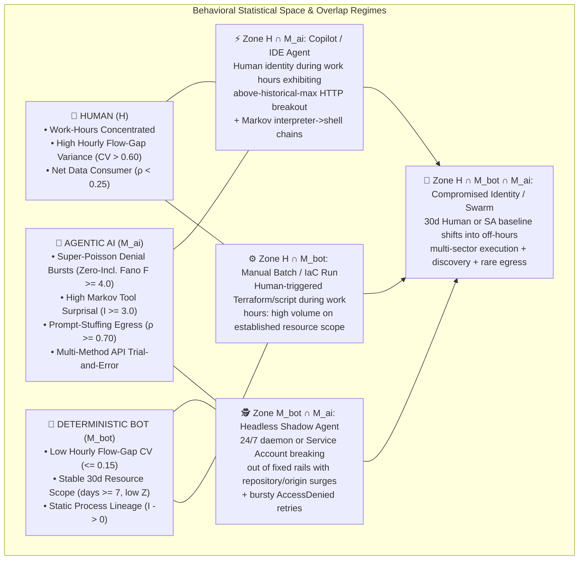

# Multi-Horizon Statistical & Point-Process UEBA: Hunting "Shadow AI" and Autonomous Agentic Behavior in Google SecOps

*Authored by Greg Kushmerek — Google Security Operations (Chronicle SIEM & SOAR)*

As enterprise adoption of Large Language Models (LLMs), Model Context Protocol (MCP) tool servers, headless coding assistants (`claude`, `codex`, `aider`, `cursor`, `goose`), and local inference runtimes (`ollama`, `vllm`, `litellm`, `llama-server`) accelerates, security operations teams face a structural visibility gap: **Shadow AI and Autonomous Agentic Workflows**.

Traditional point-in-time SIEM rules attempt to detect Shadow AI using static indicators—hardcoded domain lists (`api.openai.com`, `api.anthropic.com`), default HTTP User-Agent strings (`openai-python`, `anthropic-sdk`), or fixed binary names. In practice, these static tripwires fail for three reasons:

1. **Infrastructure & Gateway Abstraction**: Developers and shadow deployments frequently route LLM traffic through custom Cloudflare Workers, AWS Bedrock / GCP Vertex AI VPC endpoints, OpenRouter, LiteLLM proxies, or self-hosted vLLM/Ollama containers, bypassing static domain allow/deny lists.
2. **Identity Multiplexing (Human-in-the-Loop vs. Headless Daemons)**: An AI agent often executes under a legitimate human developer's corporate identity (`principal.user.userid`) or an existing cloud service account (`@*.iam.gserviceaccount.com`), inheriting trusted credentials and blending into authorized access logs.
3. **Dynamic Tool-Use Adaptation**: Unlike traditional scripts that fail deterministically when blocked, an agentic ReAct (*Reason $\rightarrow$ Act $\rightarrow$ Observe*) loop reads error messages (`AccessDenied`, `HTTP 403`, CLI syntax errors) and autonomously mutates its command-line flags or API calls until it succeeds.

By combining the two engines of the **Google SecOps Behavioral Analytics Harness**—**`secops-risk-metrics-multistage`** (30-day pre-computed `metrics.*` UEBA baselines) and **`secops-statistical-hunter`** (ad-hoc multi-stage bucketed point-process dispersion, Laplace-smoothed Markov transition surprisal, and stateless structural screens over raw `UDM_EVENTS`)—we can separate resource consumption statistically across **Human ($H$)**, **Deterministic Bot ($M_{\text{bot}}$)**, and **Agentic AI ($M_{\text{AI}}$)** regimes.

> [!IMPORTANT]
> **What This Playbook Computes (Statistical & Point-Process UEBA, Not DSP Waveform Analysis)**: Because Chronicle SIEM operates on daily pre-computed baselines (`metrics.*`) and bucketed event aggregations (`by 1h`, `by 1d`) rather than continuous packet-level waveforms, recursive EMA state, or character-by-character string loops, every model below is grounded in operations YARA-L 2.0 executes natively:
> 1. **Maturity-Gated 30-Day Z-Scores with Calibrated Dispersion Floors**: Parametric Z-scores require at least 7 active baseline days (`num_metric_periods >= 7`) over the prior `[D-30, D)` window, applying a continuous Poisson dispersion floor $\max(\sigma, \sqrt{\max(\mu, 1)})$ on count metrics and an empirical fleet byte dispersion floor (`44,979.0` B) on `metrics.network_bytes_outbound`. Unseen Day-0 sub-keys (`num_metric_periods = 0`) are surfaced strictly as discrete novelty counts/flags (or via dedicated `first_seen` novelty queries), never conflated as $\sigma$.
> 2. **Bucketed Point-Process Dispersion (Flow-Gap Ratio Screen & Zero-Inclusive Hourly Fano Factor)** to distinguish steady multi-hour callback pacing ($\text{CV} \le 0.35$) and clustered multi-method API retry bursts ($F = \sigma^2/\mu \ge 4.0$ across 24 hourly buckets including silent zero-event hours) from irregular human work.
> 3. **Whole-Window Laplace-Smoothed Markov 2-Gram Surprisal ($\ln \frac{N_{\text{parent}} + 20}{N_{\text{pair}} + 1}$)** to isolate rare interpreter-to-shell process spawns (`python`/`node` $\rightarrow$ `bash`/`curl`/`gcloud`) without step-function cliffs.
> 4. **Defensible Stateless Screens & Cross-Scenario Euclidean L2 Rollup**—using exact bucketed constructions where YARA-L engine constraints apply (**Off-Hours Schedule Share Adaptive Thresholding**, **Above-Historical-Max Z Linear Peak Exceedance**, **Multiplicity-Adjusted Roll-Up Fusion**, **Windowed Slack Sum**, and **Long-String & Rare-Token Candidate Screen**) and converging multi-plane hits via UDM Loopback in Scenario 10 (`distinct_scenarios_matched >= 2`, $\sum Z_i^2 \ge 25.0$), while Python (`agentic_ueba` `ueba_constants.calculate_cri`) computes the `[0, 100]` Composite Risk Index (CRI).

> [!NOTE]
> **Programmatic `agentic_ueba` Playbook Compatibility (16 Queries across 3 Execution Waves: `W1=13, W2=2, W3=1`)**: Every multi-stage YARA-L 2.0 query in this document is structured for direct ingestion by the `PlaybookRunner` engine in `agentic_ueba` (`/api/v1/playbooks` and MCP `run_markdown_playbook`). All **16 queries** (15 scenario queries across Scenarios 1–10 plus Section 5's per-flow payload quantile hunt) pass offline AST/antipattern validation and **100% live Chronicle compiler verification (`200 OK`)**:
> * **Single-Shot Combined Scenarios (Scenarios 1, 5, 6, 7 & Section 5)**: Where both halves share the same entity key and horizon and fit within Chronicle's 2-UDM-source and 4-named-stage compiler caps, they are unified into a single multi-stage query (`Query 1`, `Query 5`, `Query 6`, `Query 7`, and Section 5).
> * **Parallel Wave 1 Pairs (Scenarios 3, 8, 9)**: Where the two halves evaluate different entity keys (`9A` `USER` vs. `9B` `ASSET`) or pair a `metrics.*` query with a tightly pre-filtered raw statistical screen (`3B` Markov interpreter$\rightarrow$shell regex, `8B` DNS FQDN length $\ge 45$), both run in parallel in **Wave 1** and export their findings to UDM.
> * **True Serial `A -> UDM -> B` Splits (Scenarios 2, 4)**: Where Stage B requires hourly (`by 1h`) raw pacing or dispersion over high-volume telemetry (`2B` `NETWORK_CONNECTION` flow-gap ratio CV, `4B` Cloud API denial zero-inclusive Fano factor), `2A` and `4A` run in **Wave 1**, flush their candidate entities to UDM (`PLAYBOOK_BEHAVIORAL_HUNT_MATCH`), and gate **Wave 2** (`Query 2B`, `Query 4B`) via Stage 1 UDM Loopback.
> * **Unified Single-Query Capstone Rollup & Forensic Bridge (Scenario 10)**: **Wave 3** (`Query 10`) unions all upstream scenario tags via a single hierarchical regex (`re.regex(security_result.rule_name, `:q[0-9]+_query_[1-9]`)`), deduplicates per scenario in Stage 1, computes cross-scenario Euclidean L2 convergence ($\ge 2$ distinct scenarios and $\sum Z_i^2 \ge 25.0$) in Stage 2, and pivots winning entities directly into raw endpoint/network/cloud telemetry in Stage 3.

---

## 1. Theory of the Case: Multi-Horizon Statistical Signatures, Overlap Topology & Historical Baselines

### 1.1 Multi-Horizon Statistical & Point-Process Signatures: Three Behavioral Regimes

Across authentication logs, process launches, cloud control-plane calls, DNS queries, and network byte flows, **Humans ($H$)**, **Deterministic Bots ($M_{\text{bot}}$)**, and **Autonomous AI Agents ($M_{\text{AI}}$)** exhibit distinct statistical behaviors across bucketed event rates, lineage transitions, error dispersion, and payload directionality:

| Behavioral Dimension | Native YARA-L Metric | 🧑 Human Actor ($H$) | 🤖 Deterministic Bot / Cron ($M_{\text{bot}}$) | 🧠 Autonomous / Shadow AI Agent ($M_{\text{AI}}$) |
| :--- | :--- | :--- | :--- | :--- |
| **1. Diurnal Activity Timing (Off-Hours Schedule Share)** | **Off-Hours Schedule Share Adaptive Gate** ($\ge 50\%$ events outside `08:00–18:00 UTC` lowers gate from $3.0\sigma$ to $1.75\sigma$) | **Work-Hours Concentrated**: Activity clusters within daytime working hours; deep overnight lulls. | **Uniform or Cron-Scheduled**: Either steady 24/7 execution or fixed wall-clock cron spikes (`0 * * * *`). | **Unattended Off-Hours Runs**: Long autonomous `/goal` or overnight background runs where the majority of egress events occur outside business hours. |
| **2. Hourly Bucketed Pacing & Retry Dispersion** | **Flow-Gap Ratio CV** ($\text{CV} = \sigma_{\bar{g}} / \mu_{\bar{g}}$) & **Zero-Inclusive Hourly Fano Factor** ($F = \sigma^2 / \mu$) | **High Hourly Variance** ($\text{CV} > 0.60, F \approx 1\text{--}2$): Irregular active and idle intervals across hours due to meetings, context switches, and breaks. | **Rigid Hourly Rate** ($\text{CV} \le 0.15$): Near-constant hourly connection spacing on fixed schedules or tight polling loops. | **Sustained Polling + Bursty Retries** ($\text{CV} \le 0.35$ across $\ge 3$ active hours; $F \ge 4.0$ on denials): Steady multi-hour external callback pacing paired with super-Poisson bursts of API retries inside active hours. |
| **3. Process Lineage & Resource Scope** | **Laplace-Smoothed Markov 2-Gram Surprisal** ($\ln \frac{N_p + 20}{N_{p\to c} + 1}$) & **Local-Baseline Isolation** | **Familiar Working Set**: Moderate diversity; recurring interactive workflows (`bash` $\rightarrow$ `git`). | **Fixed Resource Rails** ($I \approx 0$, `$read_days >= 7` with low $Z$): Executes the exact same script, binary hash, and target cloud resources every run. | **High-Surprisal Tool Spawns & ScopeBreakouts** ($I \ge 3.0$, surging repository/origin $Z$ or Day-0 novel sub-keys): Language runtimes and IDEs (`node`, `python3`, `cursor`, `claude`) spawning rare shell/cloud CLI children (`curl`, `gcloud`, `ssh`) or surging across cloud repositories. |
| **4. Permission-Denial Feedback Loop** | **30-Day Failure Z-Scores** & **Zero-Inclusive Denial Fano Factor** ($F_{\text{fail}}$) | **Sporadic Errors**: Occasional typos or permission denials; human stops or requests access. | **Static Misconfiguration**: If broken, repeats the exact same failing call at fixed intervals. | **Iterative Parameter Probing**: Clustered bursts of `resource_*_fail` / `AccessDenied` across $\ge 3$ *distinct* API methods as the agent reads error outputs, mutates arguments, and retries. |
| **5. Directional Payload Asymmetry** | **Producer-Consumer Byte Ratio** ($\rho = \frac{\text{Sent}}{\text{Sent} + \text{Recv} + 1}$) & **$P_{90}/P_{50}$ Flow Tail Ratio** | **Net Consumer** ($\rho < 0.25$): Browsing, pulling code, reading docs, downloading packages. | **Predictable Volume**: Consistent scheduled backup uploads or artifact pulls ($\sigma_{30\text{d}}$ stable). | **Prompt-Stuffing Net Producer** ($\rho \ge 0.70$, $P_{90}/P_{50} \ge 10\times$): Frequent small tool-call heartbeats punctuated by large RAG context-window uploads while receiving compact token completions. |

---

### 1.2 The Behavioral Venn Diagram: Mapping the Overlap Regimes

In real enterprise telemetry, behavior rarely sits in a pure, isolated archetype. Instead, entities move across a **3-Circle Venn Diagram** where confidence levels depend on which overlapping signatures fire simultaneously:



1. **Zone $H \cap M_{\text{AI}}$ (Interactive Copilot / Shadow IDE Agent)**:
   * **Behavioral Overlap**: Authenticated as a human user during normal working hours, but exhibits an **Above-Historical-Max Z breakout** in HTTP/API queries, **Laplace-smoothed Markov 2-gram process surprisal** (IDE/Node/Python spawning shell recon tools), and **Producer-Consumer byte inversion** ($\rho \ge 0.70$).
2. **Zone $M_{\text{bot}} \cap M_{\text{AI}}$ (Headless Autonomous Agent / MCP Service Account)**:
   * **Behavioral Overlap**: Runs unattended like a bot or cloud service account (`@*.iam.gserviceaccount.com`), so steady hourly pacing alone cannot distinguish it from a cron job. The differentiator is **Local-Baseline Scope Breakout & Failure Dispersion**: a deterministic bot stays within its 30-day repository and caller-IP baselines, whereas an autonomous agent triggers **4-CRUD Repository or Origin IP Z-Score Surges (`Query 4A`)** coupled with **Zero-Inclusive Hourly Fano Burst Clustering ($F \ge 4.0$, `Query 4B`)** across distinct denied API methods as it probes the environment.
3. **Zone $H \cap M_{\text{bot}} \cap M_{\text{AI}}$ (Full Regime Shift / Shadow Agent Breakout)**:
   * **Behavioral Overlap**: An entity with an established 30-day baseline (`>= 7` active days) abruptly breaches multiple orthogonal sectors simultaneously ($D = \sqrt{\sum \max(0, Z_i)^2} \ge 3.5\sigma$), operates primarily off-hours (amplified by the adaptive off-hours gate), and communicates with low-prevalence external AI gateways.

---

### 1.3 Using 30-Day Historical Baselines, Dispersion Floors & Mode A Windows

Rather than treating every high-volume event as an alert, the UEBA harness conditions today's multi-stage observations on **30-Day Pre-Computed Rolling Baselines (`metrics.*`)** ($\mu_{30\text{d}}, \sigma_{30\text{d}}, N_{\text{active days}}$) over `[D-30, D)` alongside cross-sectional fleet prevalence:

$$\text{Composite Anomaly Score} = f\Big(\text{Scored UTC Day Observation},\; \underbrace{\mu_{30\text{d}},\, \max(\sigma_{30\text{d}}, \sigma_{\text{floor}}),\, N_{\text{active days}} \ge 7}_{\text{30-Day Historical Baseline}},\; \underbrace{k_{\text{fleet}}}_{\text{Fleet Prevalence}}\Big)$$

* **Mode A Evaluation Window & Entity Graph Freshness**: Standard `metrics.*` macro queries evaluate the last complete UTC day `D` (`startTime = D T00:00:00Z`, `endTime = D+1 T00:00:00Z`) against the non-overlapping 30-day baseline `[D-30, D)`. Because Chronicle Entity Graph (`DERIVED_CONTEXT`) prevalence records lag roughly one day, Entity Graph joins (`Query 8A`) set `startTime = D-2 T00:00:00Z` and pin each raw UDM event stage to the scored UTC day via `timestamp.get_date(metadata.event_timestamp.seconds) = "YYYY-MM-DD"`.
* **7-Active-Day Maturity Gate & Calibrated Dispersion Floors**: Parametric Z-scores require `num_metric_periods >= 7` (`min_baseline_days = 7`). To prevent division-by-zero or near-zero variance explosions on steady accounts without collapsing real variance to `1.0`, count metrics apply the Poisson floor $\sigma_{\text{safe}} = \max(\sigma_{30\text{d}}, \sqrt{\max(\mu_{30\text{d}}, 1.0)})$ and `metrics.network_bytes_outbound` applies the empirical fleet byte dispersion floor `44,979.0` B. Sectors with fewer than 7 active days contribute `0.0` to multi-sector Euclidean norms so a mature companion sector can still fire cleanly.
* **Discrete Day-0 Novelty Separation**: Unseen Day-0 binaries, alert rules, cloud origins, or applications (`num_metric_periods = 0` or `first_seen == 0`) are tracked as explicit diagnostic counts/flags (`$novel_binaries`, `$novel_rules`, `$asn_novel_flag`, `$app_novel_flag`) or via dedicated `first_seen` novelty queries rather than injecting uncalibrated cold-start pseudo-Z scores into parametric threat norms.
* **Multiplicity Adjustment on Composite Roll-Ups**: Composite-only metrics (`file_executions_total`, `resource_*`, `alert_event_name_count`) have no entity-only baseline. When rolling up peak per-key Z-scores to a host or service account (`Queries 3A, 7, 9B`), the roll-up stage subtracts the Gaussian expected-maximum approximation $\sqrt{2 \ln K_{\text{eff}}}$ across $K_{\text{eff}}$ active sub-keys so hosts running hundreds of routine binaries or rules do not false-positive by chance.
* **Cross-Query UDM Loopback Convergence & Python CRI (`Option 3` Connective Tissue)**: As `PlaybookRunner` executes **Wave 1** (`Queries 1, 2A, 3A, 3B, 4A, 5, 6, 7, 8A, 8B, 9A, 9B` plus Section 5), matched entities are scored in Python via `ueba_constants.calculate_cri`, ingested as `GENERIC_EVENT` records (`metadata.product_event_type = "PLAYBOOK_BEHAVIORAL_HUNT_MATCH"`, `metadata.product_log_id = $run_id`), and verified via `verify_udm_run_indexed()`. **Wave 2** (`Query 2B` and `Query 4B`) reads those indexed UDM candidate keys (`:q[0-9]+_query_2a` and `:q[0-9]+_query_4a`) to gate hourly raw pacing/dispersion queries. Finally, **Wave 3** (**Scenario 10 — `Query 10`**) unions all upstream scenario tags (`re.regex(security_result.rule_name, `:q[0-9]+_query_[1-9]`)`) and fires when an entity matches $\ge 2$ distinct scenarios (`LOOPBACK_MIN_DISTINCT_HITS = 2`) with $\sum Z_i^2 \ge 25.0$ (`LOOPBACK_COMPOSITE_SUM_Z_SQ_THRESHOLD = 25.0`).

---

## 2. Portfolio Matrix: 15 Scenario Queries (+ Section 5 Payload Hunt) Across 3 Execution Waves

| Scenario | Architecture Pattern & Execution Wave | Behavioral Signature & Venn Regime | Query Specification (`secops-risk-metrics-multistage` & `secops-statistical-hunter`) |
| :---: | :--- | :--- | :--- |
| **1** | **Combined Single Query** (Wave 1 $\rightarrow$ Exports `:q01_`) | **Human-to-Agent Regime Shift & Off-Hours Autonomy** ($H \to M_{\text{AI}}$) | **Query 1**: 3-Stage Holistic HTTP Volume (`metrics.http_queries_total`), Outbound Egress (`metrics.network_bytes_outbound`, `44,979` B floor), and Off-Hours Schedule Share Adaptive Gate ($1.75\sigma$ when $\ge 50\%$ off-hours vs. $3.0\sigma$; $D^2 \ge 12.25$). |
| **2** | **Split `2A -> UDM -> 2B`** (2A in Wave 1 $\rightarrow$ 2B in Wave 2) | **Above-Historical-Max Breakout & Steady Hourly Callback Pacing** ($M_{\text{bot}} \ vs.\ M_{\text{AI}}$) | **Query 2A**: 2-Stage Above-Historical-Max Z HTTP Breakout (`metrics.http_queries_total`, linear peak exceedance `personal_z + above_max_z >= 3.0`, exports `:q02_query_2a_`).<br>**Query 2B**: 4-Stage UDM-Gated Hourly Flow-Gap Ratio Screen (`FLOW_GAP_RATIO_SCREEN`, $\text{CV} \le 0.35$ across $\ge 3$ active hours, destination prevalence $\le 5$) on 2A candidate hosts (`exports :q03_query_2b_`). |
| **3** | **Parallel Wave 1 Pair** (Both in Wave 1 $\rightarrow$ Export `:q04_`, `:q05_`) | **Shadow AI Runtimes, CLI Agents & Interpreter-to-Shell Spawns** ($H \cap M_{\text{AI}}$) | **Query 3A**: Multiplicity-Adjusted Roll-Up Sector Fusion (`metrics.file_executions_total` minus $\sqrt{2 \ln K_{\text{eff}}}$ + `metrics.network_bytes_outbound`).<br>**Query 3B**: Whole-Window Laplace-Smoothed Markov 2-Gram Surprisal ($\ln \frac{N_{\text{parent}}+20}{N_{\text{pair}}+1} \ge 3.0$) on Interpreter/IDE $\rightarrow$ Shell/CLI spawns. |
| **4** | **Split `4A -> UDM -> 4B`** (4A in Wave 1 $\rightarrow$ 4B in Wave 2) | **Autonomous Cloud Recon & Multi-Method Denial Bursts** ($M_{\text{bot}} \cap M_{\text{AI}}$) | **Query 4A**: Dual-Branch Cloud Repository Scope & Caller IP Outlier (4-family `metrics.resource_*_total` across destination and origin IP with $\ge 7$ active-day gates, exports `:q06_query_4a_`).<br>**Query 4B**: 4-Stage UDM-Gated Zero-Inclusive Hourly Fano Factor Dispersion ($F = \sigma^2/\mu \ge 4.0$ over 24h) on Denied Cloud CRUD Calls for 4A candidate identities (`exports :q07_query_4b_`). |
| **5** | **Combined Single Query** (Wave 1 $\rightarrow$ Exports `:q08_`) | **Shadow LLM SDK User-Agents & Prompt-Stuffing Byte Inversion** ($H \cap M_{\text{AI}}$) | **Query 5**: 4-Stage HTTP User-Agent Fleet Prevalence (`metrics.http_queries_total`, $k_{\text{fleet}} \le 3$) fused with Producer-Consumer Directional Byte Ratio ($\rho = \frac{\text{sent}}{\text{sent}+\text{recv}+1} \ge 0.70$) & Outbound Byte Z-Score. |
| **6** | **Combined Single Query** (Wave 1 $\rightarrow$ Exports `:q09_`) | **Bulk RAG Knowledge Harvesting & Multi-Day Egress Drift** ($H \cap M_{\text{bot}} \cap M_{\text{AI}}$) | **Query 6**: Google Workspace Activity Triad (`auth`, `download`, `change` vs. 30d personal baselines) fused with **Windowed Slack Sum** (`$windowed_slack_sum` on `metrics.network_bytes_outbound`, slack $k=0.5\sigma$, $\ge 2$ drift days over multi-day Mode B/C horizons). |
| **7** | **Combined Single Query** (Wave 1 $\rightarrow$ Exports `:q10_`) | **Service Account Rail Breakout, Cloud CRUD Denials & Egress** ($M_{\text{bot}} \cap M_{\text{AI}}$) | **Query 7**: Multiplicity-Adjusted Unsanctioned Service Account Cloud CRUD Failure & Provisioning Roll-Up (`resource_read_fail`, `resource_written_fail`, `resource_creation_fail`, `resource_creation_success`) fused with Outbound Network Egress (`metrics.network_bytes_outbound`). |
| **8** | **Parallel Wave 1 Pair** (Both in Wave 1 $\rightarrow$ Export `:q11_`, `:q12_`) | **Rare AI Gateway Resolution, NXDOMAIN Surges & Long DNS Strings** ($H \cap M_{\text{AI}}$ & $M_{\text{bot}} \cap M_{\text{AI}}$) | **Query 8A**: 3-Stage DNS Activity Baseline (`metrics.dns_queries_total` + `metrics.dns_queries_fail`) joined with `DERIVED_CONTEXT` Rare Domain Prevalence ($\le 3$ hosts in 10d Entity Graph; Mode A `startTime = D-2` pinned to scored UTC day).<br>**Query 8B**: 2-Stage Long-String & Rare-Token Candidate Screen (`LONG_STRING_SCREEN`, FQDN length $\ge 45$, $\ge 5$ queries, $\ln L + \ln(1 + N_{\text{host}}/N_{\text{tok}}) \ge 5.5$). |
| **9** | **Parallel Wave 1 Pair** (Both in Wave 1 $\rightarrow$ Export `:q13_`, `:q14_`) | **External Cloud/AI ASN Login Multiplexing & EDR Alert Velocity Fusion** ($H \cap M_{\text{bot}} \cap M_{\text{AI}}$) | **Query 9A**: 2-Stage External Cloud ASN & OAuth Application Credential Multiplexing (`metrics.auth_attempts_total` by `organization_name` and `target.application`, `USER`).<br>**Query 9B**: Multiplicity-Adjusted Roll-Up Sector Fusion (`metrics.alert_event_name_count` across distinct EDR/DLP rules + `metrics.network_bytes_outbound`, `ASSET`). |
| **10** | **Unified Single Capstone Query** (Wave 3 — Final Rollup & Forensic Bridge) | **Multi-Scenario Euclidean Convergence & Raw Telemetry Forensic Bridge** ($H \cap M_{\text{AI}}$ & $M_{\text{bot}} \cap M_{\text{AI}} \to M_{\text{AI}}$) | **Query 10**: 3-Stage Unified Capstone Rollup & Forensic Bridge (`re.regex(security_result.rule_name, ":q[0-9]+_query_[1-9]")`, Stage 1 per-scenario dedup $\rightarrow$ Stage 2 cross-scenario L2 convergence `$distinct_scenarios_matched >= 2` and `$capstone_threat_norm_sq >= 25.0` $\rightarrow$ Stage 3 raw `PROCESS_LAUNCH` / `NETWORK_CONNECTION` / `RESOURCE_READ` pivot). |

---

## 3. Programmatic Multi-Stage YARA-L 2.0 Queries (`agentic_ueba` Playbook)

---

### Scenario 1: Holistic Cross-Resource — Human-to-Agent Regime Shift & Off-Hours Autonomy (Combined Single Query)

When a human engineer attaches an autonomous agent to their corporate identity—or leaves a ReAct loop running unattended—their account exhibits a simultaneous surge in **outbound API/web transactions** and **outbound byte volume** (context-window uploads), frequently continuing into overnight hours outside normal daytime work schedules. Because both signals share `principal.user.userid` and `by 1d` bucketing, **Query 1** fuses `metrics.http_queries_total` (Poisson dispersion floor) and `metrics.network_bytes_outbound` (`44,979.0` B dispersion floor) with **Off-Hours Schedule Share Adaptive Thresholding** (`adaptive_context_threshold.yl2`: when $\ge 50\%$ of outbound network events fall outside `08:00–18:00 UTC`, the effective gate tightens from $3.0\sigma$ to $1.75\sigma$ via `$z_b_adaptive = ($z_b_base * 3.0) / $effective_gate`).

#### Query 1: 3-Stage Holistic HTTP Volume, Outbound Egress & Off-Hours Schedule Share Fusion (`secops-risk-metrics-multistage`)

```yara
// ============================================================================
// Copyright 2026 Google LLC. All Rights Reserved.
// Author: Greg Kushmerek
// ARCHITECTURE: 3-STAGE HOLISTIC HTTP, OUTBOUND EGRESS & OFF-HOURS SCHEDULE SHARE FUSION
// Goal: Detect mature human identities shifting into high-velocity or off-hours Shadow AI agent loops across Web/API requests and outbound byte volume.
// Statistical Model: Multi-Sector Euclidean Threat Norm (metrics.http_queries_total + metrics.network_bytes_outbound) + Off-Hours Schedule Share Adaptive Thresholding
// ============================================================================

stage sector_a {
    (network.http.method != "" or network.http.user_agent != "" or network.http.response_code != 0 or network.http.referral_url != "")
    principal.user.userid = $entity
    $entity != ""

  match:
    $entity by 1d

  outcome:
    $a_obs = count(metadata.id)
    $a_avg = max(metrics.http_queries_total(
        period: 1d, window: 30d, metric: event_count_sum, agg: avg,
        principal.user.userid: principal.user.userid
    ))
    $a_std = max(metrics.http_queries_total(
        period: 1d, window: 30d, metric: event_count_sum, agg: stddev,
        principal.user.userid: principal.user.userid
    ))
    $a_days = max(metrics.http_queries_total(
        period: 1d, window: 30d, metric: event_count_sum, agg: num_metric_periods,
        principal.user.userid: principal.user.userid
    ))
}

stage sector_b {
    network.sent_bytes > 0
    network.sent_bytes < 1000000000000000
    principal.user.userid = $entity
    $entity != ""
    $hour = timestamp.get_hour(metadata.event_timestamp.seconds, "UTC")

  match:
    $entity by 1d

  outcome:
    $b_obs = sum(network.sent_bytes)
    $b_events = count(metadata.id)
    $off_hours_obs = sum(if($hour >= 8 and $hour < 18, 0, 1))
    $b_avg = max(metrics.network_bytes_outbound(
        period: 1d, window: 30d, metric: value_sum, agg: avg,
        principal.user.userid: principal.user.userid
    ))
    $b_std = max(metrics.network_bytes_outbound(
        period: 1d, window: 30d, metric: value_sum, agg: stddev,
        principal.user.userid: principal.user.userid
    ))
    $b_days = max(metrics.network_bytes_outbound(
        period: 1d, window: 30d, metric: value_sum, agg: num_metric_periods,
        principal.user.userid: principal.user.userid
    ))
}

$entity = $sector_a.entity
$entity = $sector_b.entity
$ws = $sector_a.window_start
$ws = $sector_b.window_start

match:
  $entity, $ws by 1d

outcome:
  $http_queries_observed = max($sector_a.a_obs)
  $http_active_days = max($sector_a.a_days)
  $a_floor = math.sqrt(if(max($sector_a.a_avg) > 1.0, max($sector_a.a_avg), 1.0))
  $a_safe_std = if(max($sector_a.a_std) > $a_floor, max($sector_a.a_std), $a_floor)
  $z_a_raw = ($http_queries_observed - max($sector_a.a_avg)) / $a_safe_std
  $z_a_pos = if($z_a_raw > 0.0, $z_a_raw, 0.0)
  $z_a = if($http_active_days >= 7, $z_a_pos, 0.0)

  $outbound_bytes_observed = max($sector_b.b_obs)
  $egress_active_days = max($sector_b.b_days)
  $b_safe_std = if(max($sector_b.b_std) > 44979.0, max($sector_b.b_std), 44979.0)
  $z_b_raw = ($outbound_bytes_observed - max($sector_b.b_avg)) / $b_safe_std
  $z_b_pos = if($z_b_raw > 0.0, $z_b_raw, 0.0)
  $z_b_base = if($egress_active_days >= 7, $z_b_pos, 0.0)

  $safe_b_events = if(max($sector_b.b_events) > 0, max($sector_b.b_events), 1)
  $off_hours_share = (1.0 * max($sector_b.off_hours_obs)) / $safe_b_events
  $effective_gate = if($off_hours_share >= 0.5, 1.75, 3.0)
  $z_b_adaptive = ($z_b_base * 3.0) / $effective_gate

  $composite_threat_norm_sq = ($z_a * $z_a) + ($z_b_adaptive * $z_b_adaptive)
  $unified_threat_score = math.sqrt($composite_threat_norm_sq)

condition:
  $composite_threat_norm_sq >= 12.25

order:
  $unified_threat_score desc
```

---

### Scenario 2: Multi-Horizon Pacing — Above-Historical-Max HTTP Breakout & Hourly Flow-Gap Regularity (`2A -> UDM -> 2B` Split)

Autonomous agent loops generate two complementary signatures across incompatible time horizons (`by 1d` vs. `by 1h`):
1. **Above-Historical-Max Z HTTP Breakout (`Query 2A`, Wave 1)**: When an engineer starts an agentic workload on a mature host (`$active_days >= 7`), daily HTTP/API volume jumps past both the 30-day mean ($\mu_{30\text{d}}$) and the 30-day historical peak (`max`). Following `macd_momentum_velocity_2stage.yl2`, `Query 2A` adds the linear peak exceedance `$above_max_z = max(0, observed - hist_max) / safe_stddev` to `$personal_z` without quadratic overflow. `PlaybookRunner` exports matched hosts to UDM (`PLAYBOOK_BEHAVIORAL_HUNT_MATCH` with rule suffix `:q02_query_2a_...`).
2. **UDM-Gated Hourly Flow-Gap Ratio Screen (`Query 2B`, Wave 2)**: Because stateless YARA-L aggregates over bucketed windows rather than subtracting consecutive packet timestamps ($t_i - t_{i-1}$), `Query 2B` implements `flow_gap_ratio_screen_2stage.yl2` (`FLOW_GAP_RATIO_SCREEN`), computing within-hour span-to-count flow-gap ratios $\bar{g}_h = \frac{1.0 \cdot (\max(t) - \min(t))}{N_h}$ across `1h` buckets (`network.sent_bytes > 500` to routable external IPs) and screening for **Coefficient of Variation ($\text{CV} = \sigma_{\bar{g}} / \mu_{\bar{g}} \le 0.35$)** across $\ge 3$ active hours and low destination prevalence ($\le 5$ internal hosts). Reading `Query 2A`'s UDM loopback candidates in Stage 1 (`re.regex(security_result.rule_name, `:q[0-9]+_query_2a`)`) prevents scanning enterprise-wide `NETWORK_CONNECTION` telemetry unseeded.

#### Query 2A: 2-Stage Above-Historical-Max Z HTTP Volume Breakout (`secops-risk-metrics-multistage`)

```yara
// ============================================================================
// Copyright 2026 Google LLC. All Rights Reserved.
// Author: Greg Kushmerek
// ARCHITECTURE: 2-STAGE ABOVE-HISTORICAL-MAX Z HTTP VOLUME BREAKOUT PIPELINE
// Goal: Isolate sudden daily HTTP/API request breakouts above both the 30-day mean and 30-day historical maximum on mature hosts.
// Statistical Model: Above-Historical-Max Z Linear Peak Exceedance (macd_momentum_velocity_2stage.yl2)
// ============================================================================

stage stage1_extract {
    (network.http.method != "" or network.http.user_agent != "" or network.http.response_code != 0 or network.http.referral_url != "")
    principal.asset.hostname = $entity
    $entity != ""

  match:
    $entity by 1d

  outcome:
    $observed_val = count(metadata.id)
    $distinct_targets = count_distinct(target.hostname)

    $historical_avg = max(metrics.http_queries_total(
        period: 1d, window: 30d, metric: event_count_sum, agg: avg,
        principal.asset.hostname: principal.asset.hostname
    ))
    $historical_stddev = max(metrics.http_queries_total(
        period: 1d, window: 30d, metric: event_count_sum, agg: stddev,
        principal.asset.hostname: principal.asset.hostname
    ))
    $historical_active_days = max(metrics.http_queries_total(
        period: 1d, window: 30d, metric: event_count_sum, agg: num_metric_periods,
        principal.asset.hostname: principal.asset.hostname
    ))
    $historical_max = max(metrics.http_queries_total(
        period: 1d, window: 30d, metric: event_count_sum, agg: max,
        principal.asset.hostname: principal.asset.hostname
    ))
}

$entity = $stage1_extract.entity
$ws = $stage1_extract.window_start

match:
  $entity, $ws by 1d

outcome:
  $observed = max($stage1_extract.observed_val)
  $distinct_hosts_contacted = max($stage1_extract.distinct_targets)
  $hist_avg = max($stage1_extract.historical_avg)
  $hist_stddev = max($stage1_extract.historical_stddev)
  $active_days = max($stage1_extract.historical_active_days)
  $hist_max = max($stage1_extract.historical_max)

  $personal_diff = $observed - $hist_avg
  $dispersion_floor = math.sqrt(if($hist_avg > 1.0, $hist_avg, 1.0))
  $safe_stddev = if($hist_stddev > $dispersion_floor, $hist_stddev, $dispersion_floor)
  $personal_z = $personal_diff / $safe_stddev

  $exceed_raw = $observed - $hist_max
  $exceed_pos = if($exceed_raw > 0, $exceed_raw, 0.0)
  $above_max_z = $exceed_pos / $safe_stddev
  $macd_z = $personal_z + $above_max_z
  $macd_momentum_score = $macd_z
  $unified_threat_score = $macd_z
  $z_score = $macd_z

condition:
  $active_days >= 7
  and $observed >= 100
  and $distinct_hosts_contacted >= 3
  and $macd_z >= 3.0

order:
  $macd_z desc
```

#### Query 2B: 4-Stage UDM-Gated Hourly Flow-Gap Ratio Screen (`secops-statistical-hunter`)

```yara
// ============================================================================
// Copyright 2026 Google LLC. All Rights Reserved.
// Author: Greg Kushmerek
// ARCHITECTURE: 4-STAGE UDM-GATED HOURLY FLOW-GAP RATIO SCREEN PIPELINE
// Goal: Evaluate sustained, low-variance hourly outbound callback flow-gap ratios (CV <= 0.35 across >= 3 active hours) strictly on candidate hosts surfaced by Query 2A via UDM Loopback.
// Statistical Model: UDM Loopback Stage 1 Candidate Gate + Cross-Bucket Flow-Gap Ratio Dispersion (FLOW_GAP_RATIO_SCREEN)
// ============================================================================

stage stage1_upstream_2a_candidates {
    metadata.event_type = "GENERIC_EVENT"
    metadata.vendor_name = "Google SecOps"
    metadata.product_name = "SecOps Risk Metrics Hunter"
    metadata.product_event_type = "PLAYBOOK_BEHAVIORAL_HUNT_MATCH"
    metadata.product_log_id = $run_id
    re.regex(security_result.rule_name, `:q[0-9]+_query_2a`)
    $host = strings.coalesce(principal.asset.hostname, principal.hostname, principal.ip[0])
    $host != ""
    $run_id != ""

  match:
    $host

  outcome:
    $upstream_2a_z = max(security_result.confidence_score)
}

stage host_intervals {
    metadata.event_type = "NETWORK_CONNECTION"
    network.sent_bytes > 500
    target.ip = $dst_ip
    $dst_ip != ""
    $dst_ip != "::1"
    $host = strings.coalesce(principal.asset.hostname, principal.hostname, principal.asset.ip[0], principal.ip[0])
    $host != ""
    not net.ip_in_range_cidr($dst_ip, "10.0.0.0/8")
    not net.ip_in_range_cidr($dst_ip, "172.16.0.0/12")
    not net.ip_in_range_cidr($dst_ip, "192.168.0.0/16")
    not net.ip_in_range_cidr($dst_ip, "127.0.0.0/8")
    not net.ip_in_range_cidr($dst_ip, "224.0.0.0/4")
    not net.ip_in_range_cidr($dst_ip, "169.254.0.0/16")
    not net.ip_in_range_cidr($dst_ip, "255.255.255.255/32")
    not net.ip_in_range_cidr($dst_ip, "fe80::/10")
    not net.ip_in_range_cidr($dst_ip, "ff00::/8")
    $ts = metadata.event_timestamp.seconds

  match:
    $host, $dst_ip by 1h

  outcome:
    $conn_count = count(metadata.id)
    $avg_gap = 1.0 * (max($ts) - min($ts)) / count(metadata.id)
    $hourly_sent = sum(network.sent_bytes)
}

stage timing_stats {
    $host = $host_intervals.host
    $dst_ip = $host_intervals.dst_ip

  match:
    $host, $dst_ip

  outcome:
    $mean_gap = avg($host_intervals.avg_gap)
    $stddev_gap = stddev($host_intervals.avg_gap)
    $total_conns = sum($host_intervals.conn_count)
    $total_sent_bytes = sum($host_intervals.hourly_sent)
    $active_hours = count($host_intervals.window_start)
}

stage dst_prevalence {
    $dst_ip = $host_intervals.dst_ip

  match:
    $dst_ip

  outcome:
    $src_breadth = count_distinct($host_intervals.host)
}

$host = $stage1_upstream_2a_candidates.host
$host = $timing_stats.host
$dst_ip = $timing_stats.dst_ip
$dst_ip = $dst_prevalence.dst_ip

match:
  $host, $dst_ip

outcome:
  $upstream_2a_score = max($stage1_upstream_2a_candidates.upstream_2a_z)
  $observation_count = max($timing_stats.total_conns)
  $baseline_active_samples = max($timing_stats.active_hours)
  $baseline_mean = max($timing_stats.mean_gap)
  $baseline_dispersion = max($timing_stats.stddev_gap)
  $fleet_prevalence = max($dst_prevalence.src_breadth)
  $distinct_binaries = max($timing_stats.total_conns)
  $total_outbound_bytes = max($timing_stats.total_sent_bytes)

  $safe_mean = if($baseline_mean > 0.0, $baseline_mean, 1.0)
  $cv = $baseline_dispersion / $safe_mean

condition:
  $baseline_active_samples >= 3
  and $observation_count >= 25
  and $baseline_mean >= 1.0
  and $fleet_prevalence <= 5
  and $cv <= 0.35

order:
  $cv asc
```

---

### Scenario 3: Narrow Context (Endpoint & EDR) — Headless Agent Toolchains & Interpreter-to-Shell Spawns

On endpoints and developer workstations, Shadow AI agents operate by running local inference binaries (`ollama`, `llama-server`, `vllm`, `litellm`) or agentic CLI/IDE harnesses (`node`, `python3`, `cursor`, `claude`, `aider`) that autonomously invoke system binaries (`bash`, `sh`, `curl`, `git`, `ssh`, `gcloud`, `aws`, `kubectl`).

* **Query 3A (`secops-risk-metrics-multistage`)** rolls up 30-day per-binary process execution baselines (`metrics.file_executions_total`, requiring `>= 7` active days per binary and subtracting the K-key Gaussian expected-maximum offset $\sqrt{2 \ln K_{\text{eff}}}$ across active binaries while reporting Day-0 `$novel_binaries` separately) alongside a 30-day outbound network byte Z-score (`44,979.0` B floor).
* **Query 3B (`secops-statistical-hunter`)** models whole-window parent-to-child process launches using **Laplace-Smoothed Markov 2-Gram Information Surprisal** (`markov_2gram_transition_rarity_2stage.yl2`): $I = \ln \frac{N_{\text{parent}} + 20}{N_{\text{pair}} + 1}$, smoothly scoring rare single-occurrence interpreter-to-shell tool spawns without arbitrary frequency step cliffs.

#### Query 3A: Roll-Up Sector Fusion on Process Execution Rarity and Network Egress (`secops-risk-metrics-multistage`)

```yara
// ============================================================================
// Copyright 2026 Google LLC. All Rights Reserved.
// Author: Greg Kushmerek
// ARCHITECTURE: ROLL-UP SECTOR FUSION (FILE EXECUTIONS + OUTBOUND BYTES)
// Goal: Detect endpoints with surging binary executions (Shadow AI CLIs/runtimes) after K-key multiplicity adjustment coupled with 30-day outbound byte anomalies.
// Statistical Model: Multiplicity-Adjusted Composite Roll-Up Fusion (rollup_sector_fusion_4stage.yl2)
// ADVISORY: Z_a is the largest per-binary Z for the host after subtracting sqrt(2 * ln(K_eff)) across active binaries (metrics.file_executions_total has no host-only baseline).
// ============================================================================

stage sector_a_detail {
    metadata.event_type = "PROCESS_LAUNCH"
    principal.asset.hostname = $entity
    $entity != ""
    metadata.event_type = $event_type
    principal.process.file.sha256 = $principal_process_file_hash
    $principal_process_file_hash != ""

  match:
    $entity, $event_type, $principal_process_file_hash by 1d

  outcome:
    $d_obs = count(metadata.id)
    $d_avg = max(metrics.file_executions_total(
        period: 1d, window: 30d, metric: event_count_sum, agg: avg,
        principal.asset.hostname: principal.asset.hostname,
        metadata.event_type: metadata.event_type,
        principal.process.file.sha256: principal.process.file.sha256
    ))
    $d_std = max(metrics.file_executions_total(
        period: 1d, window: 30d, metric: event_count_sum, agg: stddev,
        principal.asset.hostname: principal.asset.hostname,
        metadata.event_type: metadata.event_type,
        principal.process.file.sha256: principal.process.file.sha256
    ))
    $d_days = max(metrics.file_executions_total(
        period: 1d, window: 30d, metric: event_count_sum, agg: num_metric_periods,
        principal.asset.hostname: principal.asset.hostname,
        metadata.event_type: metadata.event_type,
        principal.process.file.sha256: principal.process.file.sha256
    ))
}

stage sector_a_scores {
    $entity = $sector_a_detail.entity
    $principal_process_file_hash = $sector_a_detail.principal_process_file_hash
    $ws = $sector_a_detail.window_start

  match:
    $entity, $principal_process_file_hash, $ws by 1d

  outcome:
    $d_obs = max($sector_a_detail.d_obs)
    $d_days = max($sector_a_detail.d_days)
    $d_floor = math.sqrt(if(max($sector_a_detail.d_avg) > 1.0, max($sector_a_detail.d_avg), 1.0))
    $d_safe_std = if(max($sector_a_detail.d_std) > $d_floor, max($sector_a_detail.d_std), $d_floor)
    $d_z_raw = ($d_obs - max($sector_a_detail.d_avg)) / $d_safe_std
    $d_z_pos = if($d_z_raw > 0.0, $d_z_raw, 0.0)
    $d_z = if($d_obs > 0 and $d_days >= 7, $d_z_pos, 0.0)
    $d_hot = if($d_obs > 0 and $d_days >= 7 and $d_z_raw >= 3.0, 1, 0)
    $d_novel = if($d_obs > 0 and $d_days = 0, 1, 0)
    $d_active = if($d_obs > 0, 1, 0)
}

stage sector_a {
    $entity = $sector_a_scores.entity
    $ws = $sector_a_scores.ws

  match:
    $entity, $ws by 1d

  outcome:
    $a_obs = sum($sector_a_scores.d_obs)
    $a_keys = count_distinct($sector_a_scores.principal_process_file_hash)
    $a_active_keys = sum($sector_a_scores.d_active)
    $a_hot_keys = sum($sector_a_scores.d_hot)
    $a_novel_keys = sum($sector_a_scores.d_novel)
    $a_days = max($sector_a_scores.d_days)
    $z_a_max = max($sector_a_scores.d_z)
    $k_eff = if($a_active_keys > 1, $a_active_keys, 1)
    $multiplicity_offset = math.sqrt(2.0 * math.log($k_eff))
    $z_a_adj = $z_a_max - $multiplicity_offset
    $z_a = if($z_a_adj > 0.0, $z_a_adj, 0.0)
}

stage sector_b {
    network.sent_bytes > 0
    network.sent_bytes < 1000000000000000
    principal.asset.hostname = $entity
    $entity != ""

  match:
    $entity by 1d

  outcome:
    $b_obs = sum(network.sent_bytes)
    $b_avg = max(metrics.network_bytes_outbound(
        period: 1d, window: 30d, metric: value_sum, agg: avg,
        principal.asset.hostname: principal.asset.hostname
    ))
    $b_std = max(metrics.network_bytes_outbound(
        period: 1d, window: 30d, metric: value_sum, agg: stddev,
        principal.asset.hostname: principal.asset.hostname
    ))
    $b_days = max(metrics.network_bytes_outbound(
        period: 1d, window: 30d, metric: value_sum, agg: num_metric_periods,
        principal.asset.hostname: principal.asset.hostname
    ))
}

$entity = $sector_a.entity
$entity = $sector_b.entity
$ws = $sector_a.ws
$ws = $sector_b.window_start

match:
  $entity, $ws by 1d

outcome:
  $a_observed = max($sector_a.a_obs)
  $distinct_hashes = max($sector_a.a_keys)
  $surging_binaries = max($sector_a.a_hot_keys)
  $novel_binaries = max($sector_a.a_novel_keys)
  $a_active_days = max($sector_a.a_days)
  $z_a = max($sector_a.z_a)

  $b_observed = max($sector_b.b_obs)
  $b_active_days = max($sector_b.b_days)
  $b_safe_std = if(max($sector_b.b_std) > 44979.0, max($sector_b.b_std), 44979.0)
  $z_b_raw = ($b_observed - max($sector_b.b_avg)) / $b_safe_std
  $z_b_pos = if($z_b_raw > 0.0, $z_b_raw, 0.0)
  $z_b = if($b_active_days >= 7, $z_b_pos, 0.0)

  $composite_threat_norm_sq = ($z_a * $z_a) + ($z_b * $z_b)
  $unified_threat_score = math.sqrt($composite_threat_norm_sq)

condition:
  $composite_threat_norm_sq >= 12.25

order:
  $unified_threat_score desc
```

#### Query 3B: Whole-Window Laplace-Smoothed Markov 2-Gram Surprisal on Agentic Interpreter-to-Shell Lineage (`secops-statistical-hunter`)

```yara
// ============================================================================
// Copyright 2026 Google LLC. All Rights Reserved.
// Author: Greg Kushmerek
// ARCHITECTURE: WHOLE-WINDOW LAPLACE-SMOOTHED MARKOV 2-GRAM PROCESS LINEAGE SURPRISAL PIPELINE
// Goal: Detect agentic runtimes and IDEs (node, python, cursor, claude, ollama) spawning rare shell or cloud recon child processes.
// Statistical Model: Laplace-Smoothed Markov 2-Gram Information Surprisal (markov_2gram_transition_rarity_2stage.yl2)
// ============================================================================

stage parent_window_totals {
    metadata.event_type = "PROCESS_LAUNCH"
    re.regex(principal.process.file.full_path, `(?i)/(node|python[0-9.]*|deno|bun|cursor|code|claude|aider|ollama|litellm|vllm|llama-server|java|go)$`)
    principal.hostname = $host
    $host != ""
    $parent = principal.process.file.full_path
    $parent != ""
    target.process.file.full_path != ""

  match:
    $host, $parent

  outcome:
    $total_parent_launches = count(metadata.id)
}

stage child_transition {
    metadata.event_type = "PROCESS_LAUNCH"
    re.regex(principal.process.file.full_path, `(?i)/(node|python[0-9.]*|deno|bun|cursor|code|claude|aider|ollama|litellm|vllm|llama-server|java|go)$`)
    re.regex(target.process.file.full_path, `(?i)/(sh|bash|zsh|dash|powershell|pwsh|cmd\.exe|curl|wget|ssh|scp|git|gcloud|aws|az|kubectl|docker|podman|nc|socat)$`)
    principal.hostname = $host
    $host != ""
    $parent = principal.process.file.full_path
    $child = target.process.file.full_path
    $parent != ""
    $child != ""

  match:
    $host, $parent, $child by 1h

  outcome:
    $transition_count = count(metadata.id)
    $sample_command = array_distinct(target.process.command_line)
}

stage pair_window_totals {
    $host = $child_transition.host
    $parent = $child_transition.parent
    $child = $child_transition.child

  match:
    $host, $parent, $child

  outcome:
    $total_pair_launches = sum($child_transition.transition_count)
}

$host = $parent_window_totals.host
$host = $child_transition.host
$host = $pair_window_totals.host
$parent = $parent_window_totals.parent
$parent = $child_transition.parent
$parent = $pair_window_totals.parent
$child = $child_transition.child
$child = $pair_window_totals.child
$ws = $child_transition.window_start

match:
  $host, $parent, $child, $ws by 1h

outcome:
  $transition_launches = max($child_transition.transition_count)
  $window_pair_launches = max($pair_window_totals.total_pair_launches)
  $window_parent_launches = max($parent_window_totals.total_parent_launches)
  $sample_commands = array_distinct($child_transition.sample_command)

  $transition_prob = ($window_pair_launches + 1.0) / ($window_parent_launches + 20.0)
  $markov_threat_score = math.log(($window_parent_launches + 20.0) / ($window_pair_launches + 1.0))

  $observation_count = $transition_launches
  $baseline_active_samples = $window_parent_launches
  $baseline_mean = $transition_prob
  $baseline_dispersion = $markov_threat_score
  $fleet_prevalence = 0 - 1
  $distinct_binaries = 1

condition:
  $window_parent_launches >= 25
  and $markov_threat_score >= 3.0

order:
  $markov_threat_score desc
```

---

### Scenario 4: Narrow Context (Cloud Control Plane) — Autonomous Cloud Recon & Multi-Method Denial Bursts

When an AI agent is connected to a Cloud environment (via an MCP server, LangChain tool, or leaked workload identity), its behavior diverges sharply from deterministic Infrastructure-as-Code (`M_bot`):
1. **Repository Scope & Caller Origin Drift (`Query 4A`)**: Following `cloud_repository_scope_dual_branch.yl2`, `Query 4A` enforces **Local-Baseline Isolation** across all 4 Cloud CRUD families (`resource_read_total`, `resource_written_total`, `resource_deletion_total`, `resource_creation_total`) on **both** target cloud repositories (`target.resource.name`) and caller origin IPs (`principal.ip`), gating each branch on `>= 7` active baseline days with Poisson dispersion floors while excluding Windows AD computer (`$`) and local OS accounts. (For brand-new Day-0 repositories or caller IPs with `first_seen == 0`, pair with `first_seen_novelty_2stage.yl2`.)
2. **Zero-Inclusive Hourly Denial Dispersion (`Query 4B`)**: Because LLMs frequently guess resource names, IAM permissions, or CLI flags, agentic cloud exploration produces clustered bursts of failed/denied cloud API calls. Following `poisson_burst_clustering_2stage.yl2`, `Query 4B` reconstructs the **zero-inclusive 24-hour Fano Factor** ($\mu = \sum x / 24, \sigma^2 = \sum x^2 / 24 - \mu^2, F = \sigma^2 / \mu \ge 4.0$) across $\ge 3$ distinct `product_event_type` API methods, accurately scoring even single-hour denial bursts separated by 23 silent hours.

#### Query 4A: Dual-Branch Cloud Repository Scope & Caller IP Outlier (`secops-risk-metrics-multistage`)

```yara
// ============================================================================
// Copyright 2026 Google LLC. All Rights Reserved.
// Author: Greg Kushmerek
// ARCHITECTURE: DUAL-BRANCH CLOUD REPOSITORY SCOPE & ORIGIN OUTLIER PIPELINE
// Goal: Detect service accounts or cloud identities hijacked by Shadow AI agents surging against cloud data repositories or calling from anomalous origin IPs.
// Statistical Model: Local-Baseline Isolation across 4 Cloud CRUD Families on Destination & Origin IP (cloud_repository_scope_dual_branch.yl2)
// ============================================================================

stage stage1_extract {
    (
        metadata.event_type = "RESOURCE_READ" or
        metadata.event_type = "USER_RESOURCE_ACCESS" or
        metadata.event_type = "RESOURCE_DELETION" or
        metadata.event_type = "USER_RESOURCE_DELETION" or
        metadata.event_type = "RESOURCE_WRITTEN" or
        metadata.event_type = "USER_RESOURCE_UPDATE_CONTENT" or
        metadata.event_type = "RESOURCE_CREATION" or
        metadata.event_type = "USER_RESOURCE_CREATION"
    )
    $sa = principal.user.userid
    $vendor = metadata.vendor_name
    $product = metadata.product_name
    $resource = target.resource.name
    $ip = principal.ip

    $sa != ""
    re.regex(principal.user.userid, `(?i)(@.*gserviceaccount\.com$|^arn:aws(-cn|-us-gov)?:(iam|sts)::|^[0-9a-f][0-9a-f][0-9a-f][0-9a-f][0-9a-f][0-9a-f][0-9a-f][0-9a-f]-[0-9a-f][0-9a-f][0-9a-f][0-9a-f]-[0-9a-f][0-9a-f][0-9a-f][0-9a-f]-[0-9a-f][0-9a-f][0-9a-f][0-9a-f]-[0-9a-f][0-9a-f][0-9a-f][0-9a-f][0-9a-f][0-9a-f][0-9a-f][0-9a-f][0-9a-f][0-9a-f][0-9a-f][0-9a-f]$|@[a-z0-9.-]+\.[a-z][a-z]+$)`)
    not re.regex(principal.user.userid, `(?i)^(system|local service|network service|.*\$$)`)
    $vendor != ""
    $product != ""
    $resource != ""
    $ip != ""

  match:
    $sa, $vendor, $product, $resource, $ip by 1d

  outcome:
    $observed_reads = sum(if(metadata.event_type = "RESOURCE_READ" or metadata.event_type = "USER_RESOURCE_ACCESS", 1, 0))
    $observed_writes = sum(if(metadata.event_type = "RESOURCE_WRITTEN" or metadata.event_type = "USER_RESOURCE_UPDATE_CONTENT", 1, 0))
    $observed_deletes = sum(if(metadata.event_type = "RESOURCE_DELETION" or metadata.event_type = "USER_RESOURCE_DELETION", 1, 0))
    $observed_creates = sum(if(metadata.event_type = "RESOURCE_CREATION" or metadata.event_type = "USER_RESOURCE_CREATION", 1, 0))

    $dest_avg = max(metrics.resource_read_total(
        period: 1d, window: 30d, metric: event_count_sum, agg: avg,
        principal.user.userid: principal.user.userid,
        metadata.vendor_name: metadata.vendor_name,
        metadata.product_name: metadata.product_name,
        target.resource.name: target.resource.name
    ))
    $dest_stddev = max(metrics.resource_read_total(
        period: 1d, window: 30d, metric: event_count_sum, agg: stddev,
        principal.user.userid: principal.user.userid,
        metadata.vendor_name: metadata.vendor_name,
        metadata.product_name: metadata.product_name,
        target.resource.name: target.resource.name
    ))
    $dest_active_days = max(metrics.resource_read_total(
        period: 1d, window: 30d, metric: event_count_sum, agg: num_metric_periods,
        principal.user.userid: principal.user.userid,
        metadata.vendor_name: metadata.vendor_name,
        metadata.product_name: metadata.product_name,
        target.resource.name: target.resource.name
    ))
    $dest_write_avg = max(metrics.resource_written_total(
        period: 1d, window: 30d, metric: event_count_sum, agg: avg,
        principal.user.userid: principal.user.userid,
        metadata.vendor_name: metadata.vendor_name,
        metadata.product_name: metadata.product_name,
        target.resource.name: target.resource.name
    ))
    $dest_write_stddev = max(metrics.resource_written_total(
        period: 1d, window: 30d, metric: event_count_sum, agg: stddev,
        principal.user.userid: principal.user.userid,
        metadata.vendor_name: metadata.vendor_name,
        metadata.product_name: metadata.product_name,
        target.resource.name: target.resource.name
    ))
    $dest_write_days = max(metrics.resource_written_total(
        period: 1d, window: 30d, metric: event_count_sum, agg: num_metric_periods,
        principal.user.userid: principal.user.userid,
        metadata.vendor_name: metadata.vendor_name,
        metadata.product_name: metadata.product_name,
        target.resource.name: target.resource.name
    ))
    $dest_del_avg = max(metrics.resource_deletion_total(
        period: 1d, window: 30d, metric: event_count_sum, agg: avg,
        principal.user.userid: principal.user.userid,
        metadata.vendor_name: metadata.vendor_name,
        metadata.product_name: metadata.product_name,
        target.resource.name: target.resource.name
    ))
    $dest_del_stddev = max(metrics.resource_deletion_total(
        period: 1d, window: 30d, metric: event_count_sum, agg: stddev,
        principal.user.userid: principal.user.userid,
        metadata.vendor_name: metadata.vendor_name,
        metadata.product_name: metadata.product_name,
        target.resource.name: target.resource.name
    ))
    $dest_del_days = max(metrics.resource_deletion_total(
        period: 1d, window: 30d, metric: event_count_sum, agg: num_metric_periods,
        principal.user.userid: principal.user.userid,
        metadata.vendor_name: metadata.vendor_name,
        metadata.product_name: metadata.product_name,
        target.resource.name: target.resource.name
    ))
    $dest_create_avg = max(metrics.resource_creation_total(
        period: 1d, window: 30d, metric: event_count_sum, agg: avg,
        principal.user.userid: principal.user.userid,
        metadata.vendor_name: metadata.vendor_name,
        metadata.product_name: metadata.product_name,
        target.resource.name: target.resource.name
    ))
    $dest_create_stddev = max(metrics.resource_creation_total(
        period: 1d, window: 30d, metric: event_count_sum, agg: stddev,
        principal.user.userid: principal.user.userid,
        metadata.vendor_name: metadata.vendor_name,
        metadata.product_name: metadata.product_name,
        target.resource.name: target.resource.name
    ))
    $dest_create_days = max(metrics.resource_creation_total(
        period: 1d, window: 30d, metric: event_count_sum, agg: num_metric_periods,
        principal.user.userid: principal.user.userid,
        metadata.vendor_name: metadata.vendor_name,
        metadata.product_name: metadata.product_name,
        target.resource.name: target.resource.name
    ))
}

stage stage2_origin_rollup {
    (
        metadata.event_type = "RESOURCE_READ" or
        metadata.event_type = "USER_RESOURCE_ACCESS" or
        metadata.event_type = "RESOURCE_DELETION" or
        metadata.event_type = "USER_RESOURCE_DELETION" or
        metadata.event_type = "RESOURCE_WRITTEN" or
        metadata.event_type = "USER_RESOURCE_UPDATE_CONTENT" or
        metadata.event_type = "RESOURCE_CREATION" or
        metadata.event_type = "USER_RESOURCE_CREATION"
    )
    $sa = principal.user.userid
    $vendor = metadata.vendor_name
    $product = metadata.product_name
    $ip = principal.ip

    $sa != ""
    re.regex(principal.user.userid, `(?i)(@.*gserviceaccount\.com$|^arn:aws(-cn|-us-gov)?:(iam|sts)::|^[0-9a-f][0-9a-f][0-9a-f][0-9a-f][0-9a-f][0-9a-f][0-9a-f][0-9a-f]-[0-9a-f][0-9a-f][0-9a-f][0-9a-f]-[0-9a-f][0-9a-f][0-9a-f][0-9a-f]-[0-9a-f][0-9a-f][0-9a-f][0-9a-f]-[0-9a-f][0-9a-f][0-9a-f][0-9a-f][0-9a-f][0-9a-f][0-9a-f][0-9a-f][0-9a-f][0-9a-f][0-9a-f][0-9a-f]$|@[a-z0-9.-]+\.[a-z][a-z]+$)`)
    not re.regex(principal.user.userid, `(?i)^(system|local service|network service|.*\$$)`)
    $vendor != ""
    $product != ""
    $ip != ""

  match:
    $sa, $vendor, $product, $ip by 1d

  outcome:
    $ip_total_reads = sum(if(metadata.event_type = "RESOURCE_READ" or metadata.event_type = "USER_RESOURCE_ACCESS", 1, 0))
    $ip_total_writes = sum(if(metadata.event_type = "RESOURCE_WRITTEN" or metadata.event_type = "USER_RESOURCE_UPDATE_CONTENT", 1, 0))
    $ip_total_deletes = sum(if(metadata.event_type = "RESOURCE_DELETION" or metadata.event_type = "USER_RESOURCE_DELETION", 1, 0))
    $ip_total_creates = sum(if(metadata.event_type = "RESOURCE_CREATION" or metadata.event_type = "USER_RESOURCE_CREATION", 1, 0))

    $origin_read_avg = max(metrics.resource_read_total(
        period: 1d, window: 30d, metric: event_count_sum, agg: avg,
        principal.user.userid: principal.user.userid,
        principal.ip: principal.ip,
        metadata.vendor_name: metadata.vendor_name,
        metadata.product_name: metadata.product_name
    ))
    $origin_read_stddev = max(metrics.resource_read_total(
        period: 1d, window: 30d, metric: event_count_sum, agg: stddev,
        principal.user.userid: principal.user.userid,
        principal.ip: principal.ip,
        metadata.vendor_name: metadata.vendor_name,
        metadata.product_name: metadata.product_name
    ))
    $origin_read_days = max(metrics.resource_read_total(
        period: 1d, window: 30d, metric: event_count_sum, agg: num_metric_periods,
        principal.user.userid: principal.user.userid,
        principal.ip: principal.ip,
        metadata.vendor_name: metadata.vendor_name,
        metadata.product_name: metadata.product_name
    ))
    $origin_write_avg = max(metrics.resource_written_total(
        period: 1d, window: 30d, metric: event_count_sum, agg: avg,
        principal.user.userid: principal.user.userid,
        principal.ip: principal.ip,
        metadata.vendor_name: metadata.vendor_name,
        metadata.product_name: metadata.product_name
    ))
    $origin_write_stddev = max(metrics.resource_written_total(
        period: 1d, window: 30d, metric: event_count_sum, agg: stddev,
        principal.user.userid: principal.user.userid,
        principal.ip: principal.ip,
        metadata.vendor_name: metadata.vendor_name,
        metadata.product_name: metadata.product_name
    ))
    $origin_write_days = max(metrics.resource_written_total(
        period: 1d, window: 30d, metric: event_count_sum, agg: num_metric_periods,
        principal.user.userid: principal.user.userid,
        principal.ip: principal.ip,
        metadata.vendor_name: metadata.vendor_name,
        metadata.product_name: metadata.product_name
    ))
    $origin_del_avg = max(metrics.resource_deletion_total(
        period: 1d, window: 30d, metric: event_count_sum, agg: avg,
        principal.user.userid: principal.user.userid,
        principal.ip: principal.ip,
        metadata.vendor_name: metadata.vendor_name,
        metadata.product_name: metadata.product_name
    ))
    $origin_del_stddev = max(metrics.resource_deletion_total(
        period: 1d, window: 30d, metric: event_count_sum, agg: stddev,
        principal.user.userid: principal.user.userid,
        principal.ip: principal.ip,
        metadata.vendor_name: metadata.vendor_name,
        metadata.product_name: metadata.product_name
    ))
    $origin_del_days = max(metrics.resource_deletion_total(
        period: 1d, window: 30d, metric: event_count_sum, agg: num_metric_periods,
        principal.user.userid: principal.user.userid,
        principal.ip: principal.ip,
        metadata.vendor_name: metadata.vendor_name,
        metadata.product_name: metadata.product_name
    ))
    $origin_create_avg = max(metrics.resource_creation_total(
        period: 1d, window: 30d, metric: event_count_sum, agg: avg,
        principal.user.userid: principal.user.userid,
        principal.ip: principal.ip,
        metadata.vendor_name: metadata.vendor_name,
        metadata.product_name: metadata.product_name
    ))
    $origin_create_stddev = max(metrics.resource_creation_total(
        period: 1d, window: 30d, metric: event_count_sum, agg: stddev,
        principal.user.userid: principal.user.userid,
        principal.ip: principal.ip,
        metadata.vendor_name: metadata.vendor_name,
        metadata.product_name: metadata.product_name
    ))
    $origin_create_days = max(metrics.resource_creation_total(
        period: 1d, window: 30d, metric: event_count_sum, agg: num_metric_periods,
        principal.user.userid: principal.user.userid,
        principal.ip: principal.ip,
        metadata.vendor_name: metadata.vendor_name,
        metadata.product_name: metadata.product_name
    ))
}

stage stage3_origin_score {
    $sa = $stage2_origin_rollup.sa
    $vendor = $stage2_origin_rollup.vendor
    $product = $stage2_origin_rollup.product
    $ip = $stage2_origin_rollup.ip
    $ws = $stage2_origin_rollup.window_start

  match:
    $sa, $vendor, $product, $ip, $ws by 1d

  outcome:
    $r_fl = math.sqrt(if(max($stage2_origin_rollup.origin_read_avg) > 1.0, max($stage2_origin_rollup.origin_read_avg), 1.0))
    $r_safe = if(max($stage2_origin_rollup.origin_read_stddev) > $r_fl, max($stage2_origin_rollup.origin_read_stddev), $r_fl)
    $r_raw = (max($stage2_origin_rollup.ip_total_reads) - max($stage2_origin_rollup.origin_read_avg)) / $r_safe
    $r_z = if(max($stage2_origin_rollup.origin_read_days) >= 7 and $r_raw > 0.0, $r_raw, 0.0)

    $w_fl = math.sqrt(if(max($stage2_origin_rollup.origin_write_avg) > 1.0, max($stage2_origin_rollup.origin_write_avg), 1.0))
    $w_safe = if(max($stage2_origin_rollup.origin_write_stddev) > $w_fl, max($stage2_origin_rollup.origin_write_stddev), $w_fl)
    $w_raw = (max($stage2_origin_rollup.ip_total_writes) - max($stage2_origin_rollup.origin_write_avg)) / $w_safe
    $w_z = if(max($stage2_origin_rollup.origin_write_days) >= 7 and $w_raw > 0.0, $w_raw, 0.0)

    $d_fl = math.sqrt(if(max($stage2_origin_rollup.origin_del_avg) > 1.0, max($stage2_origin_rollup.origin_del_avg), 1.0))
    $d_safe = if(max($stage2_origin_rollup.origin_del_stddev) > $d_fl, max($stage2_origin_rollup.origin_del_stddev), $d_fl)
    $d_raw = (max($stage2_origin_rollup.ip_total_deletes) - max($stage2_origin_rollup.origin_del_avg)) / $d_safe
    $d_z = if(max($stage2_origin_rollup.origin_del_days) >= 7 and $d_raw > 0.0, $d_raw, 0.0)

    $c_fl = math.sqrt(if(max($stage2_origin_rollup.origin_create_avg) > 1.0, max($stage2_origin_rollup.origin_create_avg), 1.0))
    $c_safe = if(max($stage2_origin_rollup.origin_create_stddev) > $c_fl, max($stage2_origin_rollup.origin_create_stddev), $c_fl)
    $c_raw = (max($stage2_origin_rollup.ip_total_creates) - max($stage2_origin_rollup.origin_create_avg)) / $c_safe
    $c_z = if(max($stage2_origin_rollup.origin_create_days) >= 7 and $c_raw > 0.0, $c_raw, 0.0)

    $ip_origin_z = $r_z + $w_z + $d_z + $c_z
}

$sa = $stage1_extract.sa
$vendor = $stage1_extract.vendor
$product = $stage1_extract.product
$resource = $stage1_extract.resource
$ip = $stage1_extract.ip
$ws = $stage1_extract.window_start
$sa = $stage3_origin_score.sa
$vendor = $stage3_origin_score.vendor
$product = $stage3_origin_score.product
$ip = $stage3_origin_score.ip
$ws = $stage3_origin_score.ws

match:
  $sa, $vendor, $product, $resource, $ws by 1d

outcome:
  $r_fl = math.sqrt(if(max($stage1_extract.dest_avg) > 1.0, max($stage1_extract.dest_avg), 1.0))
  $r_safe = if(max($stage1_extract.dest_stddev) > $r_fl, max($stage1_extract.dest_stddev), $r_fl)
  $r_raw = (sum($stage1_extract.observed_reads) - max($stage1_extract.dest_avg)) / $r_safe
  $dest_z = if(max($stage1_extract.dest_active_days) >= 7 and $r_raw > 0.0, $r_raw, 0.0)

  $w_fl = math.sqrt(if(max($stage1_extract.dest_write_avg) > 1.0, max($stage1_extract.dest_write_avg), 1.0))
  $w_safe = if(max($stage1_extract.dest_write_stddev) > $w_fl, max($stage1_extract.dest_write_stddev), $w_fl)
  $w_raw = (sum($stage1_extract.observed_writes) - max($stage1_extract.dest_write_avg)) / $w_safe
  $write_z = if(max($stage1_extract.dest_write_days) >= 7 and $w_raw > 0.0, $w_raw, 0.0)

  $d_fl = math.sqrt(if(max($stage1_extract.dest_del_avg) > 1.0, max($stage1_extract.dest_del_avg), 1.0))
  $d_safe = if(max($stage1_extract.dest_del_stddev) > $d_fl, max($stage1_extract.dest_del_stddev), $d_fl)
  $d_raw = (sum($stage1_extract.observed_deletes) - max($stage1_extract.dest_del_avg)) / $d_safe
  $del_z = if(max($stage1_extract.dest_del_days) >= 7 and $d_raw > 0.0, $d_raw, 0.0)

  $c_fl = math.sqrt(if(max($stage1_extract.dest_create_avg) > 1.0, max($stage1_extract.dest_create_avg), 1.0))
  $c_safe = if(max($stage1_extract.dest_create_stddev) > $c_fl, max($stage1_extract.dest_create_stddev), $c_fl)
  $c_raw = (sum($stage1_extract.observed_creates) - max($stage1_extract.dest_create_avg)) / $c_safe
  $create_z = if(max($stage1_extract.dest_create_days) >= 7 and $c_raw > 0.0, $c_raw, 0.0)

  $obs_total_crud = sum($stage1_extract.observed_reads) + sum($stage1_extract.observed_writes) + sum($stage1_extract.observed_deletes) + sum($stage1_extract.observed_creates)
  $distinct_ips = count_distinct($stage1_extract.ip)
  $origin_z = max($stage3_origin_score.ip_origin_z)
  $composite_risk = $dest_z + $write_z + $del_z + $create_z + $origin_z

condition:
  $composite_risk >= 3.0

order:
  $composite_risk desc
```

#### Query 4B: 4-Stage UDM-Gated Zero-Inclusive Hourly Fano Factor Dispersion on Denied Cloud API Calls (`secops-statistical-hunter`)

```yara
// ============================================================================
// Copyright 2026 Google LLC. All Rights Reserved.
// Author: Greg Kushmerek
// ARCHITECTURE: 4-STAGE UDM-GATED ZERO-INCLUSIVE HOURLY FANO FACTOR DISPERSION PIPELINE
// Goal: Detect clustered multi-method cloud API denial bursts (zero-inclusive hourly Fano F >= 4.0) strictly on candidate identities surfaced by Query 4A via UDM Loopback.
// Statistical Model: UDM Loopback Stage 1 Candidate Gate + Zero-Inclusive Hourly Poisson Dispersion via Fano Factor (poisson_burst_clustering_2stage.yl2)
// ============================================================================

stage stage1_upstream_4a_candidates {
    metadata.event_type = "GENERIC_EVENT"
    metadata.vendor_name = "Google SecOps"
    metadata.product_name = "SecOps Risk Metrics Hunter"
    metadata.product_event_type = "PLAYBOOK_BEHAVIORAL_HUNT_MATCH"
    metadata.product_log_id = $run_id
    re.regex(security_result.rule_name, `:q[0-9]+_query_4a`)
    $entity = principal.user.userid
    $entity != ""
    $run_id != ""

  match:
    $entity

  outcome:
    $upstream_4a_risk = max(security_result.confidence_score)
}

stage hourly_failures {
    (
        metadata.event_type = "RESOURCE_READ" or
        metadata.event_type = "USER_RESOURCE_ACCESS" or
        metadata.event_type = "RESOURCE_WRITTEN" or
        metadata.event_type = "USER_RESOURCE_UPDATE_CONTENT" or
        metadata.event_type = "RESOURCE_CREATION"
    )
    not security_result.action = "ALLOW"
    principal.user.userid = $entity
    $entity != ""

  match:
    $entity by 1h

  outcome:
    $read_access_fails = sum(if(metadata.event_type = "RESOURCE_READ" or metadata.event_type = "USER_RESOURCE_ACCESS", 1, 0))
    $write_create_fails = sum(if(metadata.event_type = "RESOURCE_WRITTEN" or metadata.event_type = "USER_RESOURCE_UPDATE_CONTENT" or metadata.event_type = "RESOURCE_CREATION", 1, 0))
    $hourly_fails = count(metadata.id)
    $hourly_fails_sq = 1.0 * count(metadata.id) * count(metadata.id)
    $distinct_methods = count_distinct(metadata.product_event_type)
    $sample_ip = array_distinct(principal.ip)
}

stage dispersion_baseline {
    $entity = $hourly_failures.entity

  match:
    $entity

  outcome:
    $sum_x = sum($hourly_failures.hourly_fails)
    $sum_x2 = sum($hourly_failures.hourly_fails_sq)
    $max_hourly_methods = max($hourly_failures.distinct_methods)
    $active_hours = count($hourly_failures.window_start)
}

stage fleet_breadth {
    $ws = $hourly_failures.window_start

  match:
    $ws by 1h

  outcome:
    $fleet_users = sum(if($hourly_failures.hourly_fails >= 5, 1, 0))
}

$entity = $stage1_upstream_4a_candidates.entity
$entity = $hourly_failures.entity
$entity = $dispersion_baseline.entity
$ws = $hourly_failures.window_start
$ws = $fleet_breadth.ws

match:
  $entity

outcome:
  $upstream_4a_risk = max($stage1_upstream_4a_candidates.upstream_4a_risk)
  $sum_x = max($dispersion_baseline.sum_x)
  $sum_x2 = max($dispersion_baseline.sum_x2)
  $zero_incl_mean = 1.0 * $sum_x / 24.0
  $mean_sq = 1.0 * $sum_x2 / 24.0
  $raw_var = $mean_sq - ($zero_incl_mean * $zero_incl_mean)
  $zero_incl_var = if($raw_var > 0.0, $raw_var, 0.0)
  $zero_incl_sd = math.sqrt($zero_incl_var)
  $safe_mean = if($zero_incl_mean > 0.0, $zero_incl_mean, 1.0)
  $raw_fano = $zero_incl_var / $safe_mean
  $fano_factor = if($zero_incl_mean > 0.0, $raw_fano, 0.0)

  $observation_count = $sum_x
  $baseline_active_samples = max($dispersion_baseline.active_hours)
  $baseline_mean = $zero_incl_mean
  $baseline_dispersion = $zero_incl_sd
  $fleet_prevalence = max($fleet_breadth.fleet_users)
  $distinct_binaries = max($dispersion_baseline.max_hourly_methods)
  $sample_ips = array_distinct($hourly_failures.sample_ip)

condition:
  $baseline_active_samples >= 1
  and $observation_count >= 10
  and $distinct_binaries >= 3
  and $fano_factor >= 4.0

order:
  $fano_factor desc
```

---

### Scenario 5: Narrow Context (Network & Web Proxy) — Shadow LLM SDKs & Prompt-Stuffing Byte Inversion (Combined Single Query)

At the network and proxy layer, Shadow AI tools leave two structural footprints on the same `principal.asset.hostname` entity:
1. **Low-Prevalence Programmatic User-Agents**: Shadow AI scripts, MCP servers, and SDKs (`python-httpx`, `openai-python`, `anthropic`, `LangChain`, `LiteLLM`, `Go-http-client`) generate high per-host request volume (`metrics.http_queries_total` with `>= 7` active baseline days) while exhibiting low enterprise fleet prevalence ($k_{\text{fleet}} \le 3$ hosts, weighted by hyperbolic prevalence dampener $1 / (k_{\text{fleet}} + 1)$ from `hybrid_metric_http_ua_prevalence_2stage.yl2`).
2. **Directional Byte Asymmetry Inversion**: Normal developer workstations are net data consumers ($\rho = \text{sent} / (\text{sent} + \text{received} + 1) < 0.25$). When a workstation runs a Shadow AI coding agent or local RAG indexer that stuffs repository files into outbound HTTPS POST payloads, the host inverts into a **net data producer ($\rho \ge 0.70$)** alongside an outbound byte Z-score (`metrics.network_bytes_outbound`, `44,979.0` B floor).

By making `stage2_fleet_prevalence` a derived roll-up over `stage1_personal_surge`, **Query 5** combines both orthogonal sectors (`WEB` + `NETWORK`) into a single 4-stage query.

#### Query 5: 4-Stage HTTP User-Agent Fleet Prevalence & Producer-Consumer Byte Inversion Fusion (`secops-risk-metrics-multistage`)

```yara
// ============================================================================
// Copyright 2026 Google LLC. All Rights Reserved.
// Author: Greg Kushmerek
// ARCHITECTURE: 4-STAGE HTTP USER-AGENT FLEET PREVALENCE & PRODUCER-CONSUMER BYTE INVERSION PIPELINE
// Goal: Surface isolated Shadow AI SDKs and programmatic User-Agents on mature hosts that simultaneously exhibit outbound prompt-stuffing byte asymmetry.
// Statistical Model: HTTP User-Agent Fleet Prevalence Normalization (hybrid_metric_http_ua_prevalence_2stage.yl2) + Producer-Consumer Byte Ratio & Outbound Byte Z-Score
// ============================================================================

stage stage1_personal_surge {
    (network.http.method != "" or network.http.user_agent != "" or network.http.response_code != 0 or network.http.referral_url != "")
    principal.asset.hostname = $entity
    $entity != ""
    network.http.user_agent = $token
    $token != ""

  match:
    $entity, $token by 1d

  outcome:
    $observed_val = count(metadata.id)
    $hist_mean = max(metrics.http_queries_total(
        period: 1d, window: 30d, metric: event_count_sum, agg: avg,
        principal.asset.hostname: principal.asset.hostname,
        network.http.user_agent: network.http.user_agent
    ))
    $hist_stddev = max(metrics.http_queries_total(
        period: 1d, window: 30d, metric: event_count_sum, agg: stddev,
        principal.asset.hostname: principal.asset.hostname,
        network.http.user_agent: network.http.user_agent
    ))
    $hist_active_days = max(metrics.http_queries_total(
        period: 1d, window: 30d, metric: event_count_sum, agg: num_metric_periods,
        principal.asset.hostname: principal.asset.hostname,
        network.http.user_agent: network.http.user_agent
    ))
}

stage stage2_fleet_prevalence {
    $token = $stage1_personal_surge.token
    $ws = $stage1_personal_surge.window_start

  match:
    $token, $ws by 1d

  outcome:
    $fleet_adopters = count_distinct($stage1_personal_surge.entity)
    $total_fleet_events = sum($stage1_personal_surge.observed_val)
}

stage stage3_directional_bytes {
    network.sent_bytes > 0
    network.sent_bytes < 1000000000000000
    principal.asset.hostname = $entity
    $entity != ""

  match:
    $entity by 1d

  outcome:
    $sent_bytes = sum(network.sent_bytes)
    $recv_bytes = sum(network.received_bytes)
    $b_avg = max(metrics.network_bytes_outbound(
        period: 1d, window: 30d, metric: value_sum, agg: avg,
        principal.asset.hostname: principal.asset.hostname
    ))
    $b_std = max(metrics.network_bytes_outbound(
        period: 1d, window: 30d, metric: value_sum, agg: stddev,
        principal.asset.hostname: principal.asset.hostname
    ))
    $b_days = max(metrics.network_bytes_outbound(
        period: 1d, window: 30d, metric: value_sum, agg: num_metric_periods,
        principal.asset.hostname: principal.asset.hostname
    ))
}

$host = $stage1_personal_surge.entity
$token = $stage1_personal_surge.token
$ws = $stage1_personal_surge.window_start
$token = $stage2_fleet_prevalence.token
$ws = $stage2_fleet_prevalence.ws
$host = $stage3_directional_bytes.entity
$ws = $stage3_directional_bytes.window_start

match:
  $host, $token, $ws by 1d

outcome:
  $observed_requests = max($stage1_personal_surge.observed_val)
  $active_baseline_days = max($stage1_personal_surge.hist_active_days)
  $ua_floor = math.sqrt(if(max($stage1_personal_surge.hist_mean) > 1.0, max($stage1_personal_surge.hist_mean), 1.0))
  $ua_safe_std = if(max($stage1_personal_surge.hist_stddev) > $ua_floor, max($stage1_personal_surge.hist_stddev), $ua_floor)
  $personal_z_raw = ($observed_requests - max($stage1_personal_surge.hist_mean)) / $ua_safe_std
  $personal_z_pos = if($personal_z_raw > 0.0, $personal_z_raw, 0.0)
  $personal_z = if($active_baseline_days >= 7, $personal_z_pos, 0.0)

  $fleet_adopters = max($stage2_fleet_prevalence.fleet_adopters)
  $total_events = max($stage2_fleet_prevalence.total_fleet_events)
  $prevalence_dampener = 1.0 / ($fleet_adopters + 1.0)
  $normalized_odds_score = $personal_z * $prevalence_dampener

  $sent_bytes = max($stage3_directional_bytes.sent_bytes)
  $recv_bytes = max($stage3_directional_bytes.recv_bytes)
  $producer_ratio = (1.0 * $sent_bytes) / ($sent_bytes + $recv_bytes + 1.0)

  $b_safe_std = if(max($stage3_directional_bytes.b_std) > 44979.0, max($stage3_directional_bytes.b_std), 44979.0)
  $egress_z_raw = ($sent_bytes - max($stage3_directional_bytes.b_avg)) / $b_safe_std
  $egress_z_pos = if($egress_z_raw > 0.0, $egress_z_raw, 0.0)
  $egress_z = if(max($stage3_directional_bytes.b_days) >= 7, $egress_z_pos, 0.0)

  $composite_threat_norm_sq = ($personal_z * $personal_z) + ($egress_z * $egress_z)
  $unified_threat_score = math.sqrt($composite_threat_norm_sq)

condition:
  $active_baseline_days >= 7
  and $observed_requests >= 25
  and $personal_z >= 3.0
  and $fleet_adopters <= 3
  and $producer_ratio >= 0.70

order:
  $unified_threat_score desc
```

---

### Scenario 6: Narrow Context (SaaS & Workspace Data Plane) — Bulk RAG Harvesting & Multi-Day Egress Drift (Combined Single Query)

Shadow AI pipelines frequently connect to Google Workspace (Drive, Docs, Gmail) via OAuth tokens or browser-session cookies to build local vector databases (Retrieval-Augmented Generation / RAG) or summarize executive communications. Because both signals key on `principal.user.userid`, **Query 6** joins the **Google Workspace Activity Triad** (`workspace_auth_attempts_total`, `workspace_total_download_actions`, `workspace_total_change_actions`) with the **Windowed Slack Sum** (`longitudinal_cusum_2stage.yl2`) on `metrics.network_bytes_outbound` (`44,979.0` B floor, `>= 7` active days). *(Note: YARA-L `sum()` aggregates over a multi-day Mode B/C window without recursive per-day state resets; `egress_slack` computes the lossless Windowed Slack Sum prefilter $W = \sum \max(0, Z_t - 0.5)$ across $\ge 2$ positive drift days, joined 1:1 on `($user, $ws)` to prevent multi-day Cartesian fan-out.)*

#### Query 6: Workspace Activity Triad & Windowed Slack Sum Egress Fusion (`secops-risk-metrics-multistage`)

```yara
// ============================================================================
// Copyright 2026 Google LLC. All Rights Reserved.
// Author: Greg Kushmerek
// ARCHITECTURE: WORKSPACE ACTIVITY TRIAD & WINDOWED SLACK SUM EGRESS FUSION
// Goal: Detect Shadow AI connectors or browser agents bulk-harvesting Google Workspace documents alongside multi-day outbound network byte Windowed Slack Sum exceedance.
// Statistical Model: Workspace Activity Triad Z-Scores + Windowed Slack Sum Prefilter (longitudinal_cusum_2stage.yl2, evaluated over multi-day Mode B/C horizons >= 2d)
// ============================================================================

stage workspace_triad {
    metadata.vendor_name = "Google Workspace"
    principal.user.userid = $user
    $user != ""

  match:
    $user by 1d

  outcome:
    $m1_obs = sum(if((metadata.product_name = "login" or metadata.product_name = "saml" or metadata.product_name = "token"), 1, 0))
    $m1_p_avg = max(metrics.workspace_auth_attempts_total(
        period: 1d, window: 30d, metric: event_count_sum, agg: avg,
        principal.user.userid: principal.user.userid
    ))
    $m1_p_std = max(metrics.workspace_auth_attempts_total(
        period: 1d, window: 30d, metric: event_count_sum, agg: stddev,
        principal.user.userid: principal.user.userid
    ))
    $m1_days = max(metrics.workspace_auth_attempts_total(
        period: 1d, window: 30d, metric: event_count_sum, agg: num_metric_periods,
        principal.user.userid: principal.user.userid
    ))

    $m2_obs = sum(if(metadata.product_event_type = "download", 1, 0))
    $m2_p_avg = max(metrics.workspace_total_download_actions(
        period: 1d, window: 30d, metric: event_count_sum, agg: avg,
        principal.user.userid: principal.user.userid
    ))
    $m2_p_std = max(metrics.workspace_total_download_actions(
        period: 1d, window: 30d, metric: event_count_sum, agg: stddev,
        principal.user.userid: principal.user.userid
    ))
    $m2_days = max(metrics.workspace_total_download_actions(
        period: 1d, window: 30d, metric: event_count_sum, agg: num_metric_periods,
        principal.user.userid: principal.user.userid
    ))

    $m3_obs = count(metadata.id)
    $m3_p_avg = max(metrics.workspace_total_change_actions(
        period: 1d, window: 30d, metric: event_count_sum, agg: avg,
        principal.user.userid: principal.user.userid
    ))
    $m3_p_std = max(metrics.workspace_total_change_actions(
        period: 1d, window: 30d, metric: event_count_sum, agg: stddev,
        principal.user.userid: principal.user.userid
    ))
    $m3_days = max(metrics.workspace_total_change_actions(
        period: 1d, window: 30d, metric: event_count_sum, agg: num_metric_periods,
        principal.user.userid: principal.user.userid
    ))
}

stage workspace_scores {
    $user = $workspace_triad.user
    $ws = $workspace_triad.window_start

  match:
    $user, $ws by 1d

  outcome:
    $m1_obs = max($workspace_triad.m1_obs)
    $m2_obs = max($workspace_triad.m2_obs)
    $m3_obs = max($workspace_triad.m3_obs)

    $f1 = math.sqrt(if(max($workspace_triad.m1_p_avg) > 1.0, max($workspace_triad.m1_p_avg), 1.0))
    $s1 = if(max($workspace_triad.m1_p_std) > $f1, max($workspace_triad.m1_p_std), $f1)
    $r1 = ($m1_obs - max($workspace_triad.m1_p_avg)) / $s1
    $z1_pos = if(max($workspace_triad.m1_days) >= 7 and $r1 > 0.0, $r1, 0.0)

    $f2 = math.sqrt(if(max($workspace_triad.m2_p_avg) > 1.0, max($workspace_triad.m2_p_avg), 1.0))
    $s2 = if(max($workspace_triad.m2_p_std) > $f2, max($workspace_triad.m2_p_std), $f2)
    $r2 = ($m2_obs - max($workspace_triad.m2_p_avg)) / $s2
    $z2_pos = if(max($workspace_triad.m2_days) >= 7 and $r2 > 0.0, $r2, 0.0)

    $f3 = math.sqrt(if(max($workspace_triad.m3_p_avg) > 1.0, max($workspace_triad.m3_p_avg), 1.0))
    $s3 = if(max($workspace_triad.m3_p_std) > $f3, max($workspace_triad.m3_p_std), $f3)
    $r3 = ($m3_obs - max($workspace_triad.m3_p_avg)) / $s3
    $z3_pos = if(max($workspace_triad.m3_days) >= 7 and $r3 > 0.0, $r3, 0.0)
}

stage egress_daily {
    network.sent_bytes > 0
    network.sent_bytes < 1000000000000000
    principal.user.userid = $user
    $user != ""

  match:
    $user by 1d

  outcome:
    $observed_bytes = sum(network.sent_bytes)
    $historical_avg = max(metrics.network_bytes_outbound(
        period: 1d, window: 30d, metric: value_sum, agg: avg,
        principal.user.userid: principal.user.userid
    ))
    $historical_stddev = max(metrics.network_bytes_outbound(
        period: 1d, window: 30d, metric: value_sum, agg: stddev,
        principal.user.userid: principal.user.userid
    ))
    $historical_active_days = max(metrics.network_bytes_outbound(
        period: 1d, window: 30d, metric: value_sum, agg: num_metric_periods,
        principal.user.userid: principal.user.userid
    ))
}

stage egress_slack {
    $user = $egress_daily.user
    $ws = $egress_daily.window_start

  match:
    $user, $ws by 1d

  outcome:
    $days_b = max($egress_daily.historical_active_days)
    $safe_std_b = if(max($egress_daily.historical_stddev) > 44979.0, max($egress_daily.historical_stddev), 44979.0)
    $daily_z = (max($egress_daily.observed_bytes) - max($egress_daily.historical_avg)) / $safe_std_b
    $deviation = $daily_z - 0.5
    $daily_excess = if($days_b >= 7 and $deviation > 0.0, $deviation, 0.0)
    $is_drift_day = if($daily_excess > 0.0, 1, 0)
}

$user = $workspace_scores.user
$user = $egress_slack.user
$ws = $workspace_scores.ws
$ws = $egress_slack.ws

match:
  $user

outcome:
  $workspace_auth_observed = max($workspace_scores.m1_obs)
  $workspace_downloads_observed = max($workspace_scores.m2_obs)
  $workspace_total_events = max($workspace_scores.m3_obs)

  $z1_personal = max($workspace_scores.z1_pos)
  $z2_personal = max($workspace_scores.z2_pos)
  $z3_personal = max($workspace_scores.z3_pos)

  $egress_active_days = max($egress_slack.days_b)
  $windowed_slack_sum = sum($egress_slack.daily_excess)
  $cusum_drift_score = $windowed_slack_sum
  $drift_days = sum($egress_slack.is_drift_day)

  $composite_threat_norm_sq = ($z1_personal * $z1_personal) + ($z2_personal * $z2_personal) + ($z3_personal * $z3_personal) + ($cusum_drift_score * $cusum_drift_score)
  $unified_threat_score = math.sqrt($composite_threat_norm_sq)
  $z_score = $unified_threat_score

condition:
  $drift_days >= 2
  and $composite_threat_norm_sq >= 12.25

order:
  $unified_threat_score desc
```

---

### Scenario 7: Narrow Context (Unsanctioned Service Accounts & Autonomous Cloud CRUD Provisioning Drift — Combined Single Query)

In enterprise cloud environments, a critical Shadow AI pattern is **Service Account Co-Option**: developers extract long-lived service account keys (`@*.iam.gserviceaccount.com`, `arn:aws:iam::*:role/*`, or `svc-*` identities) and wire them into autonomous coding agents, MCP servers, or LangChain/CrewAI pipelines. **Query 7** unifies directional Cloud CRUD failure & provisioning metrics (`resource_read_fail`, `resource_written_fail`, `resource_creation_fail`, `resource_creation_success`, each gated on `>= 7` active days with Poisson dispersion floors and K-resource multiplicity adjustment $\sqrt{2 \ln K_{\text{eff}}}$) with 30-day outbound network egress (`metrics.network_bytes_outbound`, `44,979.0` B floor) while excluding local OS and Active Directory computer (`$`) accounts.

#### Query 7: Unsanctioned Service Account Cloud CRUD Failure, Provisioning & Egress Fusion (`secops-risk-metrics-multistage`)

```yara
// ============================================================================
// Copyright 2026 Google LLC. All Rights Reserved.
// Author: Greg Kushmerek
// ARCHITECTURE: UNSANCTIONED SERVICE ACCOUNT CLOUD CRUD FAILURE, PROVISIONING & EGRESS FUSION
// Goal: Detect service accounts co-opted by Shadow AI agents exhibiting repeated Cloud CRUD permission denials, autonomous resource creation, and outbound network egress.
// Statistical Model: Multiplicity-Adjusted Cloud CRUD Failure & Provisioning Roll-Up + Network Egress Fusion (rollup_sector_fusion_4stage.yl2)
// ============================================================================

stage crud_detail {
    (
        metadata.event_type = "RESOURCE_READ" or
        metadata.event_type = "USER_RESOURCE_ACCESS" or
        metadata.event_type = "RESOURCE_WRITTEN" or
        metadata.event_type = "USER_RESOURCE_UPDATE_CONTENT" or
        metadata.event_type = "RESOURCE_CREATION" or
        metadata.event_type = "USER_RESOURCE_CREATION"
    )
    $sa = principal.user.userid
    $vendor = metadata.vendor_name
    $product = metadata.product_name
    $resource = target.resource.name
    $ip = principal.ip

    $sa != ""
    ($sa = /@.*gserviceaccount\.com$/ nocase or $sa = /^arn:aws:(iam|sts)::/ nocase or $sa = /^arn:aws-(cn|us-gov):(iam|sts)::/ nocase or $sa = /(svc|service|bot|agent)/ nocase)
    not re.regex(principal.user.userid, `(?i)^(system|local service|network service|.*\$$)`)
    $vendor != ""
    $product != ""
    $resource != ""
    $ip != ""

  match:
    $sa, $vendor, $product, $resource, $ip by 1d

  outcome:
    $obs_read_fails = sum(if((metadata.event_type = "RESOURCE_READ" or metadata.event_type = "USER_RESOURCE_ACCESS") and not security_result.action = "ALLOW", 1, 0))
    $obs_write_fails = sum(if((metadata.event_type = "RESOURCE_WRITTEN" or metadata.event_type = "USER_RESOURCE_UPDATE_CONTENT") and not security_result.action = "ALLOW", 1, 0))
    $obs_create_fails = sum(if((metadata.event_type = "RESOURCE_CREATION" or metadata.event_type = "USER_RESOURCE_CREATION") and not security_result.action = "ALLOW", 1, 0))
    $obs_creates_ok = sum(if((metadata.event_type = "RESOURCE_CREATION" or metadata.event_type = "USER_RESOURCE_CREATION") and security_result.action = "ALLOW", 1, 0))

    $rf_avg = max(metrics.resource_read_fail(
        period: 1d, window: 30d, metric: event_count_sum, agg: avg,
        principal.user.userid: principal.user.userid,
        metadata.vendor_name: metadata.vendor_name,
        metadata.product_name: metadata.product_name,
        target.resource.name: target.resource.name
    ))
    $rf_std = max(metrics.resource_read_fail(
        period: 1d, window: 30d, metric: event_count_sum, agg: stddev,
        principal.user.userid: principal.user.userid,
        metadata.vendor_name: metadata.vendor_name,
        metadata.product_name: metadata.product_name,
        target.resource.name: target.resource.name
    ))
    $rf_days = max(metrics.resource_read_fail(
        period: 1d, window: 30d, metric: event_count_sum, agg: num_metric_periods,
        principal.user.userid: principal.user.userid,
        metadata.vendor_name: metadata.vendor_name,
        metadata.product_name: metadata.product_name,
        target.resource.name: target.resource.name
    ))

    $wf_avg = max(metrics.resource_written_fail(
        period: 1d, window: 30d, metric: event_count_sum, agg: avg,
        principal.user.userid: principal.user.userid,
        metadata.vendor_name: metadata.vendor_name,
        metadata.product_name: metadata.product_name,
        target.resource.name: target.resource.name
    ))
    $wf_std = max(metrics.resource_written_fail(
        period: 1d, window: 30d, metric: event_count_sum, agg: stddev,
        principal.user.userid: principal.user.userid,
        metadata.vendor_name: metadata.vendor_name,
        metadata.product_name: metadata.product_name,
        target.resource.name: target.resource.name
    ))
    $wf_days = max(metrics.resource_written_fail(
        period: 1d, window: 30d, metric: event_count_sum, agg: num_metric_periods,
        principal.user.userid: principal.user.userid,
        metadata.vendor_name: metadata.vendor_name,
        metadata.product_name: metadata.product_name,
        target.resource.name: target.resource.name
    ))

    $cf_avg = max(metrics.resource_creation_fail(
        period: 1d, window: 30d, metric: event_count_sum, agg: avg,
        principal.user.userid: principal.user.userid,
        metadata.vendor_name: metadata.vendor_name,
        metadata.product_name: metadata.product_name,
        target.resource.name: target.resource.name
    ))
    $cf_std = max(metrics.resource_creation_fail(
        period: 1d, window: 30d, metric: event_count_sum, agg: stddev,
        principal.user.userid: principal.user.userid,
        metadata.vendor_name: metadata.vendor_name,
        metadata.product_name: metadata.product_name,
        target.resource.name: target.resource.name
    ))
    $cf_days = max(metrics.resource_creation_fail(
        period: 1d, window: 30d, metric: event_count_sum, agg: num_metric_periods,
        principal.user.userid: principal.user.userid,
        metadata.vendor_name: metadata.vendor_name,
        metadata.product_name: metadata.product_name,
        target.resource.name: target.resource.name
    ))

    $cs_avg = max(metrics.resource_creation_success(
        period: 1d, window: 30d, metric: event_count_sum, agg: avg,
        principal.user.userid: principal.user.userid,
        metadata.vendor_name: metadata.vendor_name,
        metadata.product_name: metadata.product_name,
        target.resource.name: target.resource.name
    ))
    $cs_std = max(metrics.resource_creation_success(
        period: 1d, window: 30d, metric: event_count_sum, agg: stddev,
        principal.user.userid: principal.user.userid,
        metadata.vendor_name: metadata.vendor_name,
        metadata.product_name: metadata.product_name,
        target.resource.name: target.resource.name
    ))
    $cs_days = max(metrics.resource_creation_success(
        period: 1d, window: 30d, metric: event_count_sum, agg: num_metric_periods,
        principal.user.userid: principal.user.userid,
        metadata.vendor_name: metadata.vendor_name,
        metadata.product_name: metadata.product_name,
        target.resource.name: target.resource.name
    ))
}

stage crud_scores {
    $sa = $crud_detail.sa
    $vendor = $crud_detail.vendor
    $product = $crud_detail.product
    $resource = $crud_detail.resource
    $ip = $crud_detail.ip
    $ws = $crud_detail.window_start

  match:
    $sa, $vendor, $product, $resource, $ip, $ws by 1d

  outcome:
    $rf_fl = math.sqrt(if(max($crud_detail.rf_avg) > 1.0, max($crud_detail.rf_avg), 1.0))
    $rf_safe = if(max($crud_detail.rf_std) > $rf_fl, max($crud_detail.rf_std), $rf_fl)
    $rf_raw = (max($crud_detail.obs_read_fails) - max($crud_detail.rf_avg)) / $rf_safe
    $rf_z = if(max($crud_detail.rf_days) >= 7 and $rf_raw > 0.0, $rf_raw, 0.0)

    $wf_fl = math.sqrt(if(max($crud_detail.wf_avg) > 1.0, max($crud_detail.wf_avg), 1.0))
    $wf_safe = if(max($crud_detail.wf_std) > $wf_fl, max($crud_detail.wf_std), $wf_fl)
    $wf_raw = (max($crud_detail.obs_write_fails) - max($crud_detail.wf_avg)) / $wf_safe
    $wf_z = if(max($crud_detail.wf_days) >= 7 and $wf_raw > 0.0, $wf_raw, 0.0)

    $cf_fl = math.sqrt(if(max($crud_detail.cf_avg) > 1.0, max($crud_detail.cf_avg), 1.0))
    $cf_safe = if(max($crud_detail.cf_std) > $cf_fl, max($crud_detail.cf_std), $cf_fl)
    $cf_raw = (max($crud_detail.obs_create_fails) - max($crud_detail.cf_avg)) / $cf_safe
    $cf_z = if(max($crud_detail.cf_days) >= 7 and $cf_raw > 0.0, $cf_raw, 0.0)

    $cs_fl = math.sqrt(if(max($crud_detail.cs_avg) > 1.0, max($crud_detail.cs_avg), 1.0))
    $cs_safe = if(max($crud_detail.cs_std) > $cs_fl, max($crud_detail.cs_std), $cs_fl)
    $cs_raw = (max($crud_detail.obs_creates_ok) - max($crud_detail.cs_avg)) / $cs_safe
    $cs_z = if(max($crud_detail.cs_days) >= 7 and $cs_raw > 0.0, $cs_raw, 0.0)

    $row_crud_z = $rf_z + $wf_z + $cf_z + $cs_z
    $row_ops = max($crud_detail.obs_read_fails) + max($crud_detail.obs_write_fails) + max($crud_detail.obs_create_fails) + max($crud_detail.obs_creates_ok)
}

stage crud_rollup {
    $sa = $crud_scores.sa
    $ws = $crud_scores.ws

  match:
    $sa, $ws by 1d

  outcome:
    $total_crud_ops = sum($crud_scores.row_ops)
    $distinct_services = count_distinct($crud_scores.product)
    $distinct_resources = count_distinct($crud_scores.resource)
    $distinct_ips = count_distinct($crud_scores.ip)
    $z_crud_max = max($crud_scores.row_crud_z)
    $k_eff = if($distinct_resources > 1, $distinct_resources, 1)
    $multiplicity_offset = math.sqrt(2.0 * math.log($k_eff))
    $z_crud_adj = $z_crud_max - $multiplicity_offset
    $z_crud = if($z_crud_adj > 0.0, $z_crud_adj, 0.0)
}

stage egress_sector {
    network.sent_bytes > 0
    network.sent_bytes < 1000000000000000
    principal.user.userid = $sa
    $sa != ""
    ($sa = /@.*gserviceaccount\.com$/ nocase or $sa = /^arn:aws:(iam|sts)::/ nocase or $sa = /^arn:aws-(cn|us-gov):(iam|sts)::/ nocase or $sa = /(svc|service|bot|agent)/ nocase)
    not re.regex(principal.user.userid, `(?i)^(system|local service|network service|.*\$$)`)

  match:
    $sa by 1d

  outcome:
    $b_obs = sum(network.sent_bytes)
    $b_avg = max(metrics.network_bytes_outbound(
        period: 1d, window: 30d, metric: value_sum, agg: avg,
        principal.user.userid: principal.user.userid
    ))
    $b_std = max(metrics.network_bytes_outbound(
        period: 1d, window: 30d, metric: value_sum, agg: stddev,
        principal.user.userid: principal.user.userid
    ))
    $b_days = max(metrics.network_bytes_outbound(
        period: 1d, window: 30d, metric: value_sum, agg: num_metric_periods,
        principal.user.userid: principal.user.userid
    ))
}

$sa = $crud_rollup.sa
$sa = $egress_sector.sa
$ws = $crud_rollup.ws
$ws = $egress_sector.window_start

match:
  $sa, $ws by 1d

outcome:
  $total_crud_ops = max($crud_rollup.total_crud_ops)
  $distinct_services = max($crud_rollup.distinct_services)
  $distinct_resources = max($crud_rollup.distinct_resources)
  $distinct_ips = max($crud_rollup.distinct_ips)
  $z_a = max($crud_rollup.z_crud)

  $egress_bytes = max($egress_sector.b_obs)
  $egress_days = max($egress_sector.b_days)
  $b_safe_std = if(max($egress_sector.b_std) > 44979.0, max($egress_sector.b_std), 44979.0)
  $z_b_raw = ($egress_bytes - max($egress_sector.b_avg)) / $b_safe_std
  $z_b_pos = if($z_b_raw > 0.0, $z_b_raw, 0.0)
  $z_b = if($egress_days >= 7, $z_b_pos, 0.0)

  $composite_threat_norm_sq = ($z_a * $z_a) + ($z_b * $z_b)
  $unified_threat_score = math.sqrt($composite_threat_norm_sq)
  $z_score = $unified_threat_score

condition:
  $composite_threat_norm_sq >= 12.25

order:
  $unified_threat_score desc
```

---

### Scenario 8: Narrow Context (DNS Control Plane — Rare Gateway Discovery & Long-String Candidate Screen)

Even when SSL/TLS inspection is bypassed, custom reverse proxies are used, or HTTP proxy logs are absent on headless server subnets, **DNS acts as a reliable control-plane proxy for Shadow AI activity**:
1. **DNS Sibling Baseline + `DERIVED_CONTEXT` Rare AI Gateway Discovery (`Query 8A`)**: Autonomous agents generating web search tool calls, fetching external MCP schemas, or probing hallucinated internal/external endpoints trigger simultaneous surges in `metrics.dns_queries_total` and `metrics.dns_queries_fail` (`NXDOMAIN`). Following `rare_destination_ecg_3stage.yl2`, `Query 8A` evaluates mature 30-day host DNS baselines (`>= 7` active days with Poisson dispersion floors) in Stage 1 and joins against Chronicle's **Entity Context Graph (`DERIVED_CONTEXT` `DOMAIN_NAME` prevalence, `day_count = 10`, `rolling_max <= 3`)** in Stage 3, excluding reverse-DNS (`in-addr.arpa`, `ip6.arpa`) and mDNS (`.local`) noise. In Mode A (`D = 2026-10-29`), start the search window at `D-2` (`2026-10-27T00:00:00Z` to `2026-10-30T00:00:00Z`) so lagged daily graph records are in-window while pinning both raw event stages to the scored UTC day (`timestamp.get_date(metadata.event_timestamp.seconds) = "2026-10-29"`). *(Note: the Entity Graph join is an inner filter—domains absent from `DERIVED_CONTEXT` drop out.)*
2. **Long-String & Rare-Token DNS Candidate Screen (`Query 8B`)**: Certain Shadow AI CLI wrappers, telemetry beacons, and covert agent bridges encode serialized context tokens, session IDs, or exfiltrated snippets directly into Base64/Hex DNS subdomain labels (`<encoded-chunk>.<session>.custom-gateway.tld`). Because YARA-L 2.0 has no per-character iteration primitive to compute true $-\sum p(c)\log_2 p(c)$ Shannon entropy in-query, `Query 8B` implements `long_string_screen_2stage.yl2` (`LONG_STRING_SCREEN`), combining log-length and within-host token rarity ($\text{score} = \ln L + \ln(1 + N_{\text{host}} / N_{\text{token}}) \ge 5.5$) for FQDNs with length $\ge 45$ and $\ge 5$ queries.

#### Query 8A: 3-Stage DNS Activity Baseline and Rare AI Gateway Domain Discovery (`secops-risk-metrics-multistage`)

```yara
// ============================================================================
// Copyright 2026 Google LLC. All Rights Reserved.
// Author: Greg Kushmerek
// ARCHITECTURE: 3-STAGE DNS ACTIVITY TRIAD & RARE AI GATEWAY DOMAIN DISCOVERY (DERIVED_CONTEXT)
// Goal: Surface mature endpoints with 30-day DNS query or NXDOMAIN surges that resolve enterprise-rare domains (<= 3 hosts in 10d Entity Graph).
// Statistical Model: DNS Sibling Baseline + Entity Graph Domain Prevalence (rare_destination_ecg_3stage.yl2; Mode A startTime = D-2 with event stages pinned to scored UTC day)
// ============================================================================

stage sector_a {
    (network.dns.questions.name != "" or network.dns.answers.name != "" or network.dns.id != 0)
    // Mode A Entity Graph freshness pin: set to scored UTC day YYYY-MM-DD (with query startTime = D-2)
    timestamp.get_date(metadata.event_timestamp.seconds) = "2026-10-29"
    principal.asset.hostname = $host
    $host != ""

  match:
    $host by 1d

  outcome:
    $dns_total_obs = count(metadata.id)
    $dns_fail_obs = sum(if(network.dns.response_code != 0, 1, 0))

    $tot_avg = max(metrics.dns_queries_total(
        period: 1d, window: 30d, metric: event_count_sum, agg: avg,
        principal.asset.hostname: principal.asset.hostname
    ))
    $tot_std = max(metrics.dns_queries_total(
        period: 1d, window: 30d, metric: event_count_sum, agg: stddev,
        principal.asset.hostname: principal.asset.hostname
    ))
    $tot_days = max(metrics.dns_queries_total(
        period: 1d, window: 30d, metric: event_count_sum, agg: num_metric_periods,
        principal.asset.hostname: principal.asset.hostname
    ))
    $fail_avg = max(metrics.dns_queries_fail(
        period: 1d, window: 30d, metric: event_count_sum, agg: avg,
        principal.asset.hostname: principal.asset.hostname
    ))
    $fail_std = max(metrics.dns_queries_fail(
        period: 1d, window: 30d, metric: event_count_sum, agg: stddev,
        principal.asset.hostname: principal.asset.hostname
    ))
    $fail_days = max(metrics.dns_queries_fail(
        period: 1d, window: 30d, metric: event_count_sum, agg: num_metric_periods,
        principal.asset.hostname: principal.asset.hostname
    ))
}

stage contacts {
    (network.dns.questions.name != "" or network.dns.answers.name != "" or network.dns.id != 0)
    timestamp.get_date(metadata.event_timestamp.seconds) = "2026-10-29"
    principal.asset.hostname = $host
    network.dns.questions.name = $dest
    $host != ""
    $dest != ""
    not re.regex(network.dns.questions.name, `(?i)\.(in-addr\.arpa|ip6\.arpa|local)$`)

  match:
    $host, $dest

  outcome:
    $contact_events = count(metadata.id)
}

stage rare_dest {
    $g.graph.metadata.source_type = "DERIVED_CONTEXT"
    $g.graph.metadata.entity_type = "DOMAIN_NAME"
    $g.graph.entity.domain.name = $dest
    $g.graph.entity.domain.prevalence.day_count = 10
    $g.graph.entity.domain.prevalence.rolling_max <= 3
    $g.graph.entity.domain.prevalence.rolling_max > 0

  match:
    $dest

  outcome:
    $prevalence = max($g.graph.entity.domain.prevalence.rolling_max)
}

$host = $sector_a.host
$host = $contacts.host
$dest = $contacts.dest
$dest = $rare_dest.dest

match:
  $host by 1d

outcome:
  $observed_dns_total = max($sector_a.dns_total_obs)
  $observed_dns_fail = max($sector_a.dns_fail_obs)
  $baseline_avg = max($sector_a.tot_avg)
  $active_days = max($sector_a.tot_days)

  $tot_floor = math.sqrt(if($baseline_avg > 1.0, $baseline_avg, 1.0))
  $tot_safe_std = if(max($sector_a.tot_std) > $tot_floor, max($sector_a.tot_std), $tot_floor)
  $z_tot_raw = ($observed_dns_total - $baseline_avg) / $tot_safe_std
  $z_tot_pos = if($z_tot_raw > 0.0, $z_tot_raw, 0.0)
  $z_total = if($active_days >= 7, $z_tot_pos, 0.0)

  $fail_floor = math.sqrt(if(max($sector_a.fail_avg) > 1.0, max($sector_a.fail_avg), 1.0))
  $fail_safe_std = if(max($sector_a.fail_std) > $fail_floor, max($sector_a.fail_std), $fail_floor)
  $z_fail_raw = ($observed_dns_fail - max($sector_a.fail_avg)) / $fail_safe_std
  $z_fail_pos = if($z_fail_raw > 0.0, $z_fail_raw, 0.0)
  $z_fail = if(max($sector_a.fail_days) >= 7, $z_fail_pos, 0.0)

  $z_sector = if($z_total > $z_fail, $z_total, $z_fail)
  $rare_destinations = array_distinct($contacts.dest)
  $rare_destination_count = count_distinct($contacts.dest)
  $min_prevalence = min($rare_dest.prevalence)
  $unified_threat_score = $z_sector

condition:
  $z_sector >= 3.0
  and $rare_destination_count >= 1

order:
  $z_sector desc
```

#### Query 8B: 2-Stage Long-String & Rare-Token DNS Candidate Screen (`secops-statistical-hunter`)

```yara
// ============================================================================
// Copyright 2026 Google LLC. All Rights Reserved.
// Author: Greg Kushmerek
// ARCHITECTURE: 2-STAGE LONG-STRING & RARE-TOKEN DNS CANDIDATE SCREEN PIPELINE
// Goal: Screen Shadow AI CLI tools and covert tunnels encoding prompt or session payloads into unusually long, rare DNS query names.
// Statistical Model: Long-String & Rare-Token Candidate Screen (LONG_STRING_SCREEN — long_string_screen_2stage.yl2)
// ============================================================================

stage entity_baseline {
    (network.dns.questions.name != "" or network.dns.answers.name != "" or network.dns.id != 0)
    principal.asset.hostname = $entity
    $entity != ""

  match:
    $entity by 1d

  outcome:
    $total_events = count(metadata.id)
    $distinct_domains = count_distinct(network.dns.questions.name)
}

stage token_observation {
    (network.dns.questions.name != "" or network.dns.answers.name != "" or network.dns.id != 0)
    principal.asset.hostname = $entity
    $entity != ""
    $token = network.dns.questions.name
    $token != ""
    not re.regex(network.dns.questions.name, `(?i)\.(in-addr\.arpa|ip6\.arpa|local)$`)

  match:
    $entity, $token by 1d

  outcome:
    $token_count = count(metadata.id)
    $token_length = max(strings.length($token))
    $token_sent_bytes = sum(network.sent_bytes)
}

$entity = $entity_baseline.entity
$entity = $token_observation.entity
$token = $token_observation.token
$ws = $entity_baseline.window_start
$ws = $token_observation.window_start

match:
  $entity, $token, $ws by 1d

outcome:
  $total_activity = max($entity_baseline.total_events)
  $distinct_host_domains = max($entity_baseline.distinct_domains)
  $token_executions = max($token_observation.token_count)
  $token_bytes = max($token_observation.token_sent_bytes)
  $raw_length = max($token_observation.token_length)
  $safe_length = if($raw_length > 0, $raw_length, 1)
  $safe_total = if($total_activity > 0, $total_activity, 1)
  $safe_tok = if($token_executions > 0, $token_executions, 1)

  $log_len = math.log($safe_length)
  $rarity_ratio = (1.0 * $safe_total) / $safe_tok
  $rarity_lift = math.log(1.0 + $rarity_ratio)
  $shannon_entropy_score = $log_len + $rarity_lift
  $unified_threat_score = $shannon_entropy_score

  $observation_count = $token_executions
  $baseline_active_samples = $total_activity
  $baseline_mean = $raw_length
  $baseline_dispersion = $log_len
  $fleet_prevalence = 0 - 1
  $distinct_binaries = $distinct_host_domains

condition:
  $raw_length >= 45
  and $token_executions >= 5
  and $shannon_entropy_score >= 5.5

order:
  $shannon_entropy_score desc
```

---

### Scenario 9: Cross-Plane Identity Multiplexing (External Cloud ASN / OAuth Auth) & Endpoint EDR Alert Velocity Fusion

Two additional 30-day `metrics.*` families in the SecOps catalog capture the **identity perimeter** and **endpoint defense friction** of Shadow AI agents:
1. **External Cloud ASN & OAuth Application Credential Multiplexing (`Query 9A`)**: When a user delegates corporate credentials, session cookies, or OAuth tokens to a cloud-hosted AI agent, `USER_LOGIN` events surge from an **Autonomous System Organization (`principal.ip_geo_artifact.network.organization_name`)** or against a **Target Application (`target.application`)**. `Query 9A` profiles both composite dimensions of `metrics.auth_attempts_total` (`organization_name:user` and `application:user`) with Poisson dispersion floors and `>= 7` active-day maturity gates, taking the conservative peak `max(Z_asn, Z_app)` so collinear login counts on the same stream are never double-counted while exposing boolean Day-0 novelty flags (`$asn_novel_flag`, `$app_novel_flag`).
2. **Multiplicity-Adjusted EDR Alert Velocity (`metrics.alert_event_name_count`) + Outbound Egress Fusion (`Query 9B`)**: Local autonomous agents frequently trip informational or medium-severity EDR/DLP behavioral rules (unsigned interpreter execution, credential-store reads, `/tmp` script execution) that do not individually page SOC analysts. Following `rollup_sector_fusion_4stage.yl2`, `Query 9B` adjusts the peak per-rule Z-score for active-rule multiplicity ($\sqrt{2 \ln K_{\text{eff}}}$) and fuses it with `metrics.network_bytes_outbound` (`44,979.0` B floor) to isolate endpoints where EDR alert surges coincide with high-volume outbound byte streams.

#### Query 9A: 2-Stage External Cloud ASN and OAuth Application Credential Multiplexing (`secops-risk-metrics-multistage`)

```yara
// ============================================================================
// Copyright 2026 Google LLC. All Rights Reserved.
// Author: Greg Kushmerek
// ARCHITECTURE: 2-STAGE EXTERNAL CLOUD ASN & OAUTH APPLICATION CREDENTIAL MULTIPLEXING PIPELINE
// Goal: Detect corporate identities surging in authentication volume from external cloud/AI provider ASNs or against target OAuth applications.
// Statistical Model: Dual-Dimension Auth Standardized Z-Score Baseline (metrics.auth_attempts_total across PRINCIPAL_NETWORK_ORGANIZATION_NAME & TARGET_APPLICATION)
// ============================================================================

stage stage1_extract {
    metadata.event_type = "USER_LOGIN"
    $user = target.user.userid
    $asn_org = principal.ip_geo_artifact.network.organization_name
    $app = target.application

    $user != ""
    $asn_org != ""
    $app != ""

  match:
    $user, $asn_org, $app by 1d

  outcome:
    $obs_total = count(metadata.id)
    $obs_fail = sum(if(security_result.action = "ALLOW", 0, 1))

    $asn_avg = max(metrics.auth_attempts_total(
        period: 1d, window: 30d, metric: event_count_sum, agg: avg,
        principal.ip_geo_artifact.network.organization_name: principal.ip_geo_artifact.network.organization_name,
        target.user.userid: target.user.userid
    ))
    $asn_std = max(metrics.auth_attempts_total(
        period: 1d, window: 30d, metric: event_count_sum, agg: stddev,
        principal.ip_geo_artifact.network.organization_name: principal.ip_geo_artifact.network.organization_name,
        target.user.userid: target.user.userid
    ))
    $asn_days = max(metrics.auth_attempts_total(
        period: 1d, window: 30d, metric: event_count_sum, agg: num_metric_periods,
        principal.ip_geo_artifact.network.organization_name: principal.ip_geo_artifact.network.organization_name,
        target.user.userid: target.user.userid
    ))
    $app_avg = max(metrics.auth_attempts_total(
        period: 1d, window: 30d, metric: event_count_sum, agg: avg,
        target.application: target.application,
        target.user.userid: target.user.userid
    ))
    $app_std = max(metrics.auth_attempts_total(
        period: 1d, window: 30d, metric: event_count_sum, agg: stddev,
        target.application: target.application,
        target.user.userid: target.user.userid
    ))
    $app_days = max(metrics.auth_attempts_total(
        period: 1d, window: 30d, metric: event_count_sum, agg: num_metric_periods,
        target.application: target.application,
        target.user.userid: target.user.userid
    ))
}

stage stage2_asn_rollup {
    $user = $stage1_extract.user
    $asn_org = $stage1_extract.asn_org
    $ws = $stage1_extract.window_start

  match:
    $user, $asn_org, $ws by 1d

  outcome:
    $asn_total_logins = sum($stage1_extract.obs_total)
    $asn_avg = max($stage1_extract.asn_avg)
    $asn_std = max($stage1_extract.asn_std)
    $asn_days = max($stage1_extract.asn_days)
    $asn_floor = math.sqrt(if($asn_avg > 1.0, $asn_avg, 1.0))
    $asn_safe_std = if($asn_std > $asn_floor, $asn_std, $asn_floor)
    $asn_z_raw = ($asn_total_logins - $asn_avg) / $asn_safe_std
    $asn_z_pos = if($asn_z_raw > 0.0, $asn_z_raw, 0.0)
    $asn_score = if($asn_days >= 7, $asn_z_pos, 0.0)
    $asn_novel = if($asn_days = 0, 1, 0)
}

$user = $stage1_extract.user
$asn_org = $stage1_extract.asn_org
$app = $stage1_extract.app
$ws = $stage1_extract.window_start
$user = $stage2_asn_rollup.user
$asn_org = $stage2_asn_rollup.asn_org
$ws = $stage2_asn_rollup.ws

match:
  $user, $asn_org, $app, $ws by 1d

outcome:
  $observed_logins = sum($stage1_extract.obs_total)
  $observed_fails = sum($stage1_extract.obs_fail)
  $asn_active_days = max($stage1_extract.asn_days)
  $app_active_days = max($stage1_extract.app_days)
  $asn_novel_flag = max($stage2_asn_rollup.asn_novel)
  $app_novel_flag = if($app_active_days = 0, 1, 0)

  $app_floor = math.sqrt(if(max($stage1_extract.app_avg) > 1.0, max($stage1_extract.app_avg), 1.0))
  $app_safe_std = if(max($stage1_extract.app_std) > $app_floor, max($stage1_extract.app_std), $app_floor)
  $app_z_raw = ($observed_logins - max($stage1_extract.app_avg)) / $app_safe_std
  $app_z_pos = if($app_z_raw > 0.0, $app_z_raw, 0.0)
  $app_score = if($app_active_days >= 7, $app_z_pos, 0.0)

  $asn_score = max($stage2_asn_rollup.asn_score)
  $unified_threat_score = if($asn_score > $app_score, $asn_score, $app_score)
  $z_score = $unified_threat_score

condition:
  $observed_logins >= 3
  and $unified_threat_score >= 3.0

order:
  $unified_threat_score desc
```

#### Query 9B: Roll-Up Sector Fusion on EDR Alert Velocity and Outbound Egress (`secops-risk-metrics-multistage`)

```yara
// ============================================================================
// Copyright 2026 Google LLC. All Rights Reserved.
// Author: Greg Kushmerek
// ARCHITECTURE: ROLL-UP SECTOR FUSION (EDR ALERT VELOCITY + NETWORK EGRESS)
// Goal: Detect endpoints where local Shadow AI agents trigger surging EDR/DLP rule alerts after K-key multiplicity adjustment alongside anomalous outbound network egress.
// Statistical Model: Multiplicity-Adjusted Composite Roll-Up Euclidean Sector Fusion (rollup_sector_fusion_4stage.yl2)
// ADVISORY: Sector A (metrics.alert_event_name_count) is a composite-only metric; Z_a is the largest per-rule Z for the host after subtracting sqrt(2 * ln(K_eff)) across active rules.
// ============================================================================

stage sector_a_detail {
    (metadata.log_type = "CB_EDR" or metadata.log_type = "CS_EDR" or metadata.log_type = "MICROSOFT_GRAPH_ALERT" or metadata.log_type = "SENTINELONE_ALERTS")
    principal.asset.hostname = $entity
    $entity != ""
    security_result.rule_name = $security_result_rule_name
    $security_result_rule_name != ""

  match:
    $entity, $security_result_rule_name by 1d

  outcome:
    $d_obs = count(metadata.id)
    $d_avg = max(metrics.alert_event_name_count(
        period: 1d, window: 30d, metric: event_count_sum, agg: avg,
        principal.asset.hostname: principal.asset.hostname,
        security_result.rule_name: security_result.rule_name
    ))
    $d_std = max(metrics.alert_event_name_count(
        period: 1d, window: 30d, metric: event_count_sum, agg: stddev,
        principal.asset.hostname: principal.asset.hostname,
        security_result.rule_name: security_result.rule_name
    ))
    $d_days = max(metrics.alert_event_name_count(
        period: 1d, window: 30d, metric: event_count_sum, agg: num_metric_periods,
        principal.asset.hostname: principal.asset.hostname,
        security_result.rule_name: security_result.rule_name
    ))
}

stage sector_a_scores {
    $entity = $sector_a_detail.entity
    $security_result_rule_name = $sector_a_detail.security_result_rule_name
    $ws = $sector_a_detail.window_start

  match:
    $entity, $security_result_rule_name, $ws by 1d

  outcome:
    $d_obs = max($sector_a_detail.d_obs)
    $d_days = max($sector_a_detail.d_days)
    $d_floor = math.sqrt(if(max($sector_a_detail.d_avg) > 1.0, max($sector_a_detail.d_avg), 1.0))
    $d_safe_std = if(max($sector_a_detail.d_std) > $d_floor, max($sector_a_detail.d_std), $d_floor)
    $d_z_raw = ($d_obs - max($sector_a_detail.d_avg)) / $d_safe_std
    $d_z_pos = if($d_z_raw > 0.0, $d_z_raw, 0.0)
    $d_z = if($d_obs > 0 and $d_days >= 7, $d_z_pos, 0.0)
    $d_hot = if($d_obs > 0 and $d_days >= 7 and $d_z_raw >= 3.0, 1, 0)
    $d_novel = if($d_obs > 0 and $d_days = 0, 1, 0)
    $d_active = if($d_obs > 0, 1, 0)
}

stage sector_a {
    $entity = $sector_a_scores.entity
    $ws = $sector_a_scores.ws

  match:
    $entity, $ws by 1d

  outcome:
    $a_obs = sum($sector_a_scores.d_obs)
    $a_keys = count_distinct($sector_a_scores.security_result_rule_name)
    $a_active_keys = sum($sector_a_scores.d_active)
    $a_hot_keys = sum($sector_a_scores.d_hot)
    $a_novel_keys = sum($sector_a_scores.d_novel)
    $a_days = max($sector_a_scores.d_days)
    $z_a_max = max($sector_a_scores.d_z)
    $k_eff = if($a_active_keys > 1, $a_active_keys, 1)
    $multiplicity_offset = math.sqrt(2.0 * math.log($k_eff))
    $z_a_adj = $z_a_max - $multiplicity_offset
    $z_a = if($z_a_adj > 0.0, $z_a_adj, 0.0)
}

stage sector_b {
    network.sent_bytes > 0
    network.sent_bytes < 1000000000000000
    principal.asset.hostname = $entity
    $entity != ""

  match:
    $entity by 1d

  outcome:
    $b_obs = sum(network.sent_bytes)
    $b_avg = max(metrics.network_bytes_outbound(
        period: 1d, window: 30d, metric: value_sum, agg: avg,
        principal.asset.hostname: principal.asset.hostname
    ))
    $b_std = max(metrics.network_bytes_outbound(
        period: 1d, window: 30d, metric: value_sum, agg: stddev,
        principal.asset.hostname: principal.asset.hostname
    ))
    $b_days = max(metrics.network_bytes_outbound(
        period: 1d, window: 30d, metric: value_sum, agg: num_metric_periods,
        principal.asset.hostname: principal.asset.hostname
    ))
}

$entity = $sector_a.entity
$entity = $sector_b.entity
$ws = $sector_a.ws
$ws = $sector_b.window_start

match:
  $entity, $ws by 1d

outcome:
  $a_observed = max($sector_a.a_obs)
  $distinct_rules = max($sector_a.a_keys)
  $surging_rules = max($sector_a.a_hot_keys)
  $novel_rules = max($sector_a.a_novel_keys)
  $a_active_days = max($sector_a.a_days)
  $z_a = max($sector_a.z_a)

  $b_observed = max($sector_b.b_obs)
  $b_active_days = max($sector_b.b_days)
  $b_safe_std = if(max($sector_b.b_std) > 44979.0, max($sector_b.b_std), 44979.0)
  $z_b_raw = ($b_observed - max($sector_b.b_avg)) / $b_safe_std
  $z_b_pos = if($z_b_raw > 0.0, $z_b_raw, 0.0)
  $z_b = if($b_active_days >= 7, $z_b_pos, 0.0)

  $composite_threat_norm_sq = ($z_a * $z_a) + ($z_b * $z_b)
  $unified_threat_score = math.sqrt($composite_threat_norm_sq)

condition:
  $composite_threat_norm_sq >= 12.25

order:
  $unified_threat_score desc
```

---

### Scenario 10: Unified 3-Stage Capstone Multi-Scenario Convergence & Raw Telemetry Forensic Bridge (`Option 3` Cross-Query Connective Tissue)

Individual behavioral queries in Scenarios 1–9 frequently fire inside ambiguous Venn overlap regimes—for example, a developer workstation exhibiting high HTTP velocity during working hours ($H \cap M_{\text{AI}}$) or a headless service account triggering bursty cloud API permission denials ($M_{\text{bot}} \cap M_{\text{AI}}$). Furthermore, statistical 30-day `metrics.*` stages aggregate away raw forensic artifacts such as full process file paths or specific cloud resource names.

Unlike the decoupled 360° Entity Health Check (which queries 6 separate `metrics.*` families independently), **Scenario 10 (`Query 10`) executes as a single unified 3-stage Capstone query** in Wave 3 after all Wave 1 and Wave 2 queries (`Queries 1–9B`) have already exported their findings into a **single unified UDM event stream** (`metadata.product_event_type = "PLAYBOOK_BEHAVIORAL_HUNT_MATCH"`):

1. **Regex Union Token Matching Across All 9 Scenarios (`stage1_per_scenario_dedup`)**: Matches `PLAYBOOK_BEHAVIORAL_HUNT_MATCH` events using a single regex union across all upstream scenario rule tokens (`re.regex(security_result.rule_name, `:q[0-9]+_query_[1-9]`)`) and groups by `$entity, $scenario_tag` so multiple hits from the same query on the same entity are deduplicated before scoring.
2. **Multi-Scenario Euclidean L2 Rollup (`stage2_multi_scenario_rollup`)**: Aggregates across Stage 1 by `$entity`, counting distinct scenario tags (`$distinct_scenarios_matched = count_distinct($stage1_per_scenario_dedup.scenario_tag)`) and summing their squared Z-scores (`$capstone_threat_norm_sq = sum($stage1_per_scenario_dedup.scenario_z_sq)`).
3. **Raw Telemetry Forensic Pivot (`stage3_raw_forensic_pivot` & Root Join)**: Simultaneously aggregates per-plane raw endpoint, network, and cloud telemetry (`PROCESS_LAUNCH`, `NETWORK_CONNECTION`, `RESOURCE_READ`, `USER_RESOURCE_ACCESS`) by `$entity` and joins it with Stage 2 in the Root stage—requiring `$distinct_scenarios_matched >= 2` (`LOOPBACK_MIN_DISTINCT_HITS`), `$capstone_threat_norm_sq >= 25.0` (`LOOPBACK_COMPOSITE_SUM_Z_SQ_THRESHOLD`, $\ge 5.0\sigma$ L2 norm), and `$raw_event_count >= 1` to deliver both the calibrated L2 convergence score (`$capstone_threat_score`) and concrete raw forensic artifacts (`$sample_processes`, `$sample_resources`, `$total_sent_bytes`) in one pass.

#### Query 10: 3-Stage Unified Capstone Multi-Scenario Convergence & Raw Telemetry Forensic Bridge (`secops-statistical-hunter`)

```yara
// ============================================================================
// Copyright 2026 Google LLC. All Rights Reserved.
// Author: Greg Kushmerek
// ARCHITECTURE: 3-STAGE UNIFIED CAPSTONE CONVERGENCE & RAW FORENSIC BRIDGE
// Goal: Deduplicate and roll up normalized UEBA hunt matches across all 9 Shadow AI scenarios (1 through 9B) via UDM Loopback regex token union while simultaneously joining raw endpoint, network, and cloud telemetry for forensic attribution.
// Statistical Model: Cross-Scenario Euclidean L2 Threat Norm Convergence (distinct_scenarios_matched >= 2, capstone_threat_norm_sq >= 25.0) + Cross-Plane Raw Telemetry Bridge
// Skill: secops-statistical-hunter
// ============================================================================

stage stage1_per_scenario_dedup {
    metadata.event_type = "GENERIC_EVENT"
    metadata.vendor_name = "Google SecOps"
    metadata.product_name = "SecOps Risk Metrics Hunter"
    metadata.product_event_type = "PLAYBOOK_BEHAVIORAL_HUNT_MATCH"
    metadata.product_log_id = $run_id
    re.regex(security_result.rule_name, `:q[0-9]+_query_[1-9]`)
    $scenario_tag = security_result.rule_name
    $entity = strings.coalesce(principal.user.userid, principal.asset.hostname, principal.ip[0])
    $entity != ""
    $run_id != ""

  match:
    $entity, $scenario_tag

  outcome:
    $scenario_z = max(security_result.confidence_score)
    $scenario_cri = max(security_result.risk_score)
    $scenario_z_sq = max(security_result.confidence_score) * max(security_result.confidence_score)
    $scenario_hits = count(metadata.id)
    $run_ids = array_distinct(metadata.product_log_id)
}

stage stage2_multi_scenario_rollup {
    $entity = $stage1_per_scenario_dedup.entity

  match:
    $entity

  outcome:
    $distinct_scenarios_matched = count_distinct($stage1_per_scenario_dedup.scenario_tag)
    $matched_scenario_tags = array_distinct($stage1_per_scenario_dedup.scenario_tag)
    $correlated_run_ids = array_distinct($stage1_per_scenario_dedup.run_ids)
    $total_loopback_matches = sum($stage1_per_scenario_dedup.scenario_hits)
    $peak_scenario_z = max($stage1_per_scenario_dedup.scenario_z)
    $peak_scenario_cri = max($stage1_per_scenario_dedup.scenario_cri)
    $capstone_threat_norm_sq = sum($stage1_per_scenario_dedup.scenario_z_sq)
}

stage stage3_raw_forensic_pivot {
    (
        metadata.event_type = "PROCESS_LAUNCH" or
        metadata.event_type = "NETWORK_CONNECTION" or
        metadata.event_type = "RESOURCE_READ" or
        metadata.event_type = "USER_RESOURCE_ACCESS"
    )
    $entity = strings.coalesce(principal.user.userid, principal.asset.hostname, principal.ip[0])
    $entity != ""

  match:
    $entity

  outcome:
    $process_events = sum(if(metadata.event_type = "PROCESS_LAUNCH", 1, 0))
    $network_events = sum(if(metadata.event_type = "NETWORK_CONNECTION", 1, 0))
    $cloud_events = sum(if(metadata.event_type = "RESOURCE_READ" or metadata.event_type = "USER_RESOURCE_ACCESS", 1, 0))
    $raw_event_count = count(metadata.id)
    $distinct_event_types = count_distinct(metadata.event_type)
    $sample_processes = array_distinct(target.process.file.full_path)
    $sample_resources = array_distinct(target.resource.name)
    $total_sent_bytes = sum(network.sent_bytes)
}

$entity = $stage2_multi_scenario_rollup.entity
$entity = $stage3_raw_forensic_pivot.entity

match:
  $entity

outcome:
  $distinct_scenarios_matched = max($stage2_multi_scenario_rollup.distinct_scenarios_matched)
  $matched_scenario_tags = array_distinct($stage2_multi_scenario_rollup.matched_scenario_tags)
  $correlated_run_ids = array_distinct($stage2_multi_scenario_rollup.correlated_run_ids)
  $total_loopback_matches = max($stage2_multi_scenario_rollup.total_loopback_matches)
  $peak_scenario_z = max($stage2_multi_scenario_rollup.peak_scenario_z)
  $peak_scenario_cri = max($stage2_multi_scenario_rollup.peak_scenario_cri)
  $capstone_threat_norm_sq = max($stage2_multi_scenario_rollup.capstone_threat_norm_sq)
  $capstone_threat_score = math.sqrt($capstone_threat_norm_sq)
  $unified_threat_score = $capstone_threat_score

  $process_events = max($stage3_raw_forensic_pivot.process_events)
  $network_events = max($stage3_raw_forensic_pivot.network_events)
  $cloud_events = max($stage3_raw_forensic_pivot.cloud_events)
  $raw_event_count = max($stage3_raw_forensic_pivot.raw_event_count)
  $distinct_event_types = max($stage3_raw_forensic_pivot.distinct_event_types)
  $sample_processes = array_distinct($stage3_raw_forensic_pivot.sample_processes)
  $sample_resources = array_distinct($stage3_raw_forensic_pivot.sample_resources)
  $total_sent_bytes = max($stage3_raw_forensic_pivot.total_sent_bytes)

condition:
  $distinct_scenarios_matched >= 2
  and $capstone_threat_norm_sq >= 25.0
  and $raw_event_count >= 1

order:
  $unified_threat_score desc
```

---

## 4. Running This Playbook Programmatically in `agentic_ueba`

Because every query above follows the strict `PlaybookRunner` AST contract, you can register and execute this file directly through the `agentic_ueba` REST gateway or FastMCP server without writing any glue code:

### Option A: Register & Run via REST API (`/api/v1/playbooks`)

```bash
# 1. Register the Shadow AI playbook from a path or GitHub URL
curl -X POST "http://localhost:8080/api/v1/playbooks" \
  -H "Content-Type: application/json" \
  -d '{
    "playbook_id": "shadow-ai-agentic-ueba",
    "url": "<path-to-runbook>.md",
    "interval_seconds": 14400,
    "ingest_events": true,
    "run_immediately": true
  }'

# 2. Trigger an on-demand single pass across all 16 queries (Wave 1: 13 upstream, Wave 2: 2B & 4B UDM-gated Stage B, Wave 3: Unified Capstone Query 10)
curl -X POST "http://localhost:8080/api/v1/playbooks/run" \
  -H "Content-Type: application/json" \
  -d '{
    "playbook_id": "shadow-ai-agentic-ueba",
    "ingest_events": true
  }'
```

### Option B: Execute via FastMCP Tool (`run_markdown_playbook`)

```json
{
  "tool": "run_markdown_playbook",
  "arguments": {
    "url": "<path-to-runbook>.md",
    "playbook_id": "shadow-ai-agentic-ueba",
    "ingest_events": true
  }
}
```
---

---

## 5. Autonomous Agent RAG Payload Quantile Asymmetry ($P_{50}$ vs $P_{90}$ Tail Ratio)

Autonomous Shadow AI agents and headless MCP loops exhibit a distinctive dual-scale network signature: frequent small tool-call heartbeats (`$p50_bytes`) punctuated by large RAG context-window uploads (`$p90_bytes`). By combining a mature 30-day `metrics.network_bytes_outbound` baseline (`>= 7` active days with the `44,979.0` B fleet byte dispersion floor) with in-stage `window.percentile(network.sent_bytes, 50)` and `window.percentile(network.sent_bytes, 90)`, we isolate endpoints whose 90th-percentile flow payload exceeds 10x their median flow size (`$flow_tail_burst_ratio >= 10.0`):

```yara
// Goal: Combine 30-day metrics.network_bytes_outbound macro Z-score with intra-bucket per-flow P50/P90 payload tail ratio fingerprinting
// Statistical Model: Standardized Outbound Byte Z-Score (44,979 B Fleet Dispersion Floor) + Per-Flow P90/P50 Payload Tail Ratio
stage stage1_extract {
    network.sent_bytes > 0
    network.sent_bytes < 1000000000000000
    principal.asset.hostname = $host
    $host != ""

  match:
    $host by 1d

  outcome:
    $observed_val = sum(network.sent_bytes)
    $flow_count = count(metadata.id)
    $flow_p50_bytes = window.percentile(network.sent_bytes, 50)
    $flow_p90_bytes = window.percentile(network.sent_bytes, 90)
    $historical_avg = max(metrics.network_bytes_outbound(
        period: 1d, window: 30d, metric: value_sum, agg: avg,
        principal.asset.hostname: principal.asset.hostname
    ))
    $historical_stddev = max(metrics.network_bytes_outbound(
        period: 1d, window: 30d, metric: value_sum, agg: stddev,
        principal.asset.hostname: principal.asset.hostname
    ))
    $historical_active_days = max(metrics.network_bytes_outbound(
        period: 1d, window: 30d, metric: value_sum, agg: num_metric_periods,
        principal.asset.hostname: principal.asset.hostname
    ))
}

$host = $stage1_extract.host
$ws = $stage1_extract.window_start

match:
  $host, $ws by 1d

outcome:
  $observed = max($stage1_extract.observed_val)
  $flows = max($stage1_extract.flow_count)
  $p50_bytes = max($stage1_extract.flow_p50_bytes)
  $p90_bytes = max($stage1_extract.flow_p90_bytes)
  $hist_avg = max($stage1_extract.historical_avg)
  $hist_stddev = max($stage1_extract.historical_stddev)
  $active_days = max($stage1_extract.historical_active_days)

  $safe_stddev = if($hist_stddev > 44979.0, $hist_stddev, 44979.0)
  $personal_z = ($observed - $hist_avg) / $safe_stddev

  $safe_p50 = if($p50_bytes > 0.0, $p50_bytes, 1.0)
  $flow_tail_burst_ratio = $p90_bytes / $safe_p50

condition:
  $active_days >= 7 and $personal_z >= 2.0 and $flow_tail_burst_ratio >= 10.0

order:
  $flow_tail_burst_ratio desc
```

---

## 📜 License
This project is licensed under the [Apache License 2.0](LICENSE).
```
Copyright 2026 Google LLC

Licensed under the Apache License, Version 2.0 (the "License");
you may not use this file except in compliance with the License.
You may obtain a copy of the License at

    http://www.apache.org/licenses/LICENSE-2.0
```

---
*Created and maintained by Greg Kushmerek for Google Security Operations (Chronicle SIEM & SOAR).*
