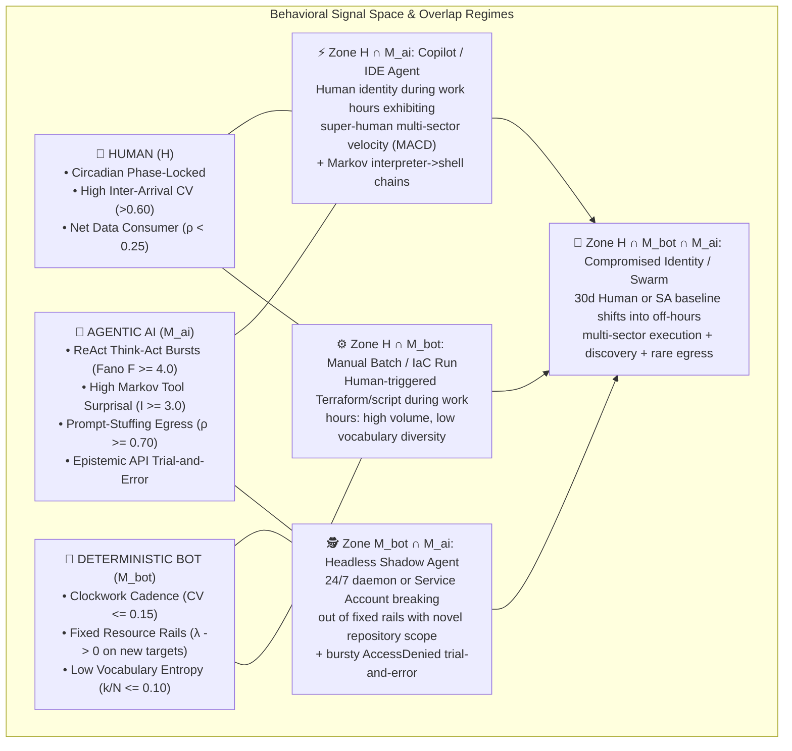

# Signal Processing & Behavioral Baselines: Hunting "Shadow AI" and Autonomous Agentic Behavior with Multi-Stage UEBA in Google SecOps

*Authored by Greg Kushmerek — Google Security Operations (Chronicle SIEM & SOAR)*

As enterprise adoption of Large Language Models (LLMs), Model Context Protocol (MCP) tool servers, headless coding assistants (`claude`, `codex`, `aider`, `cursor`, `goose`), and local inference runtimes (`ollama`, `vllm`, `litellm`, `llama-server`) accelerates, security operations teams face a structural visibility gap: **Shadow AI and Autonomous Agentic Workflows**.

Traditional point-in-time SIEM rules attempt to detect Shadow AI using static indicators—hardcoded domain lists (`api.openai.com`, `api.anthropic.com`), default HTTP User-Agent strings (`openai-python`, `anthropic-sdk`), or fixed binary names. In practice, these static tripwires fail for three reasons:

1. **Infrastructure & Gateway Abstraction**: Developers and shadow deployments frequently route LLM traffic through custom Cloudflare Workers, AWS Bedrock / GCP Vertex AI VPC endpoints, OpenRouter, LiteLLM proxies, or self-hosted vLLM/Ollama containers, bypassing static domain allow/deny lists.
2. **Identity Multiplexing (Human-in-the-Loop vs. Headless Daemons)**: An AI agent often executes under a legitimate human developer's corporate identity (`principal.user.userid`) or an existing cloud service account (`@*.iam.gserviceaccount.com`), inheriting trusted credentials and blending into authorized access logs.
3. **Dynamic Tool-Use Adaptation**: Unlike traditional scripts that fail deterministically when blocked, an agentic ReAct (*Reason $\rightarrow$ Act $\rightarrow$ Observe*) loop reads error messages (`AccessDenied`, `HTTP 403`, CLI syntax errors) and autonomously mutates its command-line flags or API calls until it succeeds.

By combining the two engines of the **Google SecOps Behavioral Analytics Harness**—**`secops-risk-metrics-multistage`** (30-day pre-computed `metrics.*` UEBA baselines) and **`secops-statistical-hunter`** (ad-hoc multi-stage signal processing and information-theoretic models over raw `UDM_EVENTS`)—we can classify resource consumption mathematically across **Human ($H$)**, **Deterministic Bot ($M_{\text{bot}}$)**, and **Agentic AI ($M_{\text{AI}}$)** regimes.

> [!NOTE]
> **Programmatic `agentic_ueba` Playbook Compatibility (15 Queries across 3 Execution Waves)**: Every multi-stage YARA-L 2.0 query in this document is structured for direct ingestion by the `PlaybookRunner` engine in `~/projects/agentic_ueba` (`/api/v1/playbooks` and MCP `run_markdown_playbook`). All **15 queries** (10 scenarios) pass `MalachiteASTValidator.validate_query()` with **0 AST errors** and **100% live Chronicle compiler verification (`200 OK`)**:
> * **Single-Shot Combined Scenarios (Scenarios 1, 5, 6, 7)**: Where both halves share the same entity key and `by 1d` horizon and fit within Chronicle's 2-UDM-source and 4-stage compiler caps, they are unified into a single multi-stage query (`Query 1`, `Query 5`, `Query 6`, `Query 7`).
> * **Parallel Wave 1 Pairs (Scenarios 3, 8, 9)**: Where the two halves evaluate different entity keys (`9A` `USER` vs. `9B` `ASSET`) or pair a `metrics.*` query with a tightly pre-filtered raw statistical model (`3B` Markov interpreter$\rightarrow$shell regex, `8B` DNS length $\ge 45$), both run in parallel in **Wave 1** and export their findings to UDM.
> * **True Serial `A -> UDM -> B` Splits (Scenarios 2, 4)**: Where Stage B requires sub-hour (`by 1h`) raw cadence/dispersion over high-volume telemetry (`2B` `NETWORK_CONNECTION` CV, `4B` Cloud API denial Fano factor), `2A` and `4A` run in **Wave 1**, flush their candidate entities to UDM (`PLAYBOOK_BEHAVIORAL_HUNT_MATCH`), and gate **Wave 2** (`Query 2B`, `Query 4B`) via Stage 1 UDM Loopback.
> * **Unified Single-Query Capstone Rollup & Forensic Bridge (Scenario 10)**: **Wave 3** (`Query 10`) unions all upstream scenario tags via a single hierarchical regex (`re.regex(security_result.rule_name, `:q[0-9]+_query_[1-9]`)`), deduplicates per scenario in Stage 1, computes cross-scenario Euclidean L2 convergence in Stage 2, and pivots winning entities directly into raw endpoint/network/cloud telemetry in Stage 3.

---

## 1. Theory of the Case: Signal Processing, Overlap Topology & Bayesian Priors

### 1.1 Applied Signal Processing: Three Distinct Resource Signatures

If we treat entity telemetry (authentication events, process launches, cloud API calls, DNS lookups, and network byte flows) as a discrete-time stochastic signal $x(t)$, **Humans ($H$)**, **Deterministic Bots ($M_{\text{bot}}$)**, and **Autonomous AI Agents ($M_{\text{AI}}$)** occupy distinct regions in the time, frequency, and information-theoretic domains:

| Signal Dimension | Mathematical Metric | 🧑 Human Actor ($H$) | 🤖 Deterministic Bot / Cron ($M_{\text{bot}}$) | 🧠 Autonomous / Shadow AI Agent ($M_{\text{AI}}$) |
| :--- | :--- | :--- | :--- | :--- |
| **1. Macro Temporal Envelope (Low-Frequency Carrier)** | **Circadian von Mises Distance** ($\Delta\theta$ from 14:00 UTC peak) | **Strongly Diurnal**: Phase-locked to local working hours; deep nocturnal & weekend troughs. | **Flat or Impulse-Locked**: Either uniform 24/7 execution or sharp wall-clock cron spikes (`0 * * * *`). | **Phase-Decoupled Bursts**: Long autonomous `/goal` or overnight background runs that violate the human's historical circadian phase prior. |
| **2. Micro Inter-Arrival Pacing (High-Frequency Cadence)** | **Coefficient of Variation** ($\text{CV} = \sigma_{\Delta t} / \mu_{\Delta t}$) & **Fano Factor** ($F = \sigma^2 / \mu$) | **Pink / Brownian Noise** ($\text{CV} > 0.60, F \approx 1\text{--}2$): Irregular cognitive pauses, context switches, and manual typing delays. | **Dirac Comb / Narrowband** ($\text{CV} \le 0.15$): Rigid, clockwork sleep intervals or unthrottled tight-loop saturation. | **Compound ReAct Oscillation** ($0.15 < \text{CV} \le 0.45$, $F \gg 4.0$): Alternating **2–15s LLM token-generation pauses** ("Think") followed by **millisecond parallel tool fan-out** ("Act"). |
| **3. State-Space & Execution Lineage** | **Markov 2-Gram Surprisal** ($I = -\ln P(B \mid A)$) & **Vocabulary Diversity** ($k / (N+1)$) | **Bounded Working Set**: Moderate diversity; familiar GUI/CLI workflows (`bash` $\rightarrow$ `git`). | **Deterministic Rails** ($I \approx 0$, $k/(N+1) \le 0.10$): Executes the exact same script, binary hash, and target resource every run. | **High-Surprisal Exploration** ($I \ge 3.0$): Runtime interpreters (`node`, `python3`, IDE helpers) spawning novel Living-off-the-Land toolchains (`curl`, `grep`, `gcloud`, `ssh`). |
| **4. Epistemic Error Feedback Loop** | **Failure-to-Total Ratio** & **Access-Denied Fano Burst** ($F_{\text{fail}}$) | **Sporadic Errors**: Occasional typos or permission denials; human stops or asks for access. | **Static Failure Mode**: If misconfigured, repeats the exact same failing call endlessly at fixed intervals. | **Epistemic Trial-and-Error**: Spikes in `resource_read_fail` / `HTTP 4xx` across *distinct* API methods as the LLM reads error outputs, mutates parameters, and retries. |
| **5. Directional Payload Asymmetry** | **Producer-Consumer Byte Ratio** ($\rho = \frac{\text{Sent}}{\text{Sent} + \text{Recv}}$) | **Net Consumer** ($\rho < 0.25$): Browsing, pulling code, reading docs, streaming media. | **Symmetric or Fixed**: Predictable backup uploads or package downloads ($\sigma_{\text{bytes}} \approx 0$). | **Prompt-Stuffing Net Producer** ($\rho \ge 0.70$): Continuously serializing local codebases, DOM trees, or Cloud/Workspace docs into massive outbound LLM context windows (100 KB–2 MB/turn) while receiving compact token completions. |

---

### 1.2 The Behavioral Venn Diagram: Mapping the Overlap Regimes

In real enterprise telemetry, behavior rarely sits in a pure, isolated archetype. Instead, entities move across a **3-Circle Venn Diagram** where confidence levels depend on which overlapping signatures fire simultaneously:



1. **Zone $H \cap M_{\text{AI}}$ (Interactive Copilot / Shadow IDE Agent)**:
   * **Signal Overlap**: Authenticated as a human user during normal working hours (passes basic circadian checks), but exhibits **instantaneous MACD velocity acceleration** across HTTP/API queries, **Markov 2-gram process surprisal** (IDE/Node/Python spawning shell recon tools), and **Producer-Consumer byte inversion** ($\rho \ge 0.70$).
2. **Zone $M_{\text{bot}} \cap M_{\text{AI}}$ (Headless Autonomous Agent / MCP Service Account)**:
   * **Signal Overlap**: Runs unattended like a bot or cloud service account (`@*.iam.gserviceaccount.com`), so flat temporal cadence alone cannot distinguish it from a cron job. The differentiator is **Scope & Error Entropy**: a deterministic bot stays on its 30-day resource rails (`$dest_days >= 7`), whereas an autonomous agent exhibits **Cloud Repository Breadth Expansion (`$dest_days = 0`)** coupled with **Fano Burst Clustering ($F \ge 4.0$)** on permission denials as it probes the environment.
3. **Zone $H \cap M_{\text{bot}} \cap M_{\text{AI}}$ (Full Regime Shift / Shadow Agent Breakout)**:
   * **Signal Overlap**: An entity whose 30-day prior is established as a human or narrow service account abruptly breaches multiple orthogonal sectors simultaneously ($D = \sqrt{\sum \max(0, Z_i)^2} \ge 3.5\sigma$), operates off-hours (von Mises penalty), and communicates with low-prevalence external AI gateways.

---

### 1.3 Using Prior Behavior to Judge Existing Behavior (Bayesian Regime Updating)

Rather than treating every high-volume event as an alert, the UEBA harness uses **30-Day Pre-Computed Baselines (`metrics.*`)** as the **Conjugate Prior** ($\mu_0, \sigma_0, N_{\text{days}}$) and **Today's Multi-Stage Telemetry** as the **Observed Likelihood**:

$$\text{Posterior Anomaly Confidence} \propto P(\text{Observed Signature} \mid M_{\text{AI}}) \times P_{\text{30d Prior}}(\text{Regime Shift from } H \text{ or } M_{\text{bot}})$$

* **Human Prior $\rightarrow$ Agentic Likelihood**: When `num_metric_periods >= 5` establishes a stable human baseline ($\mu_0, \sigma_0$) and today's observation triggers a multi-sector Euclidean breakout ($D^2 \ge 12.25$) or off-hours von Mises surge, the 30-day prior proves the activity is a **behavioral regime shift**, not a naturally heavy developer workload.
* **Cold-Start / Ephemeral Identity Prior (`Option 1` Piecewise Unification)**: Newly provisioned Shadow AI service accounts, ephemeral containers, or developer VMs (`num_metric_periods <= 4`) lack a mature 30-day variance estimate. Instead of dropping cold-start entities behind a rigid `>= 7` active-day gate, each `metrics.*` query implements a **Piecewise Two-Part Hurdle** (`if($active_days <= 4, $hurdle_score, $mature_30d_score)` exposed as `$unified_threat_score`), scoring cold-start entities via logarithmic volume/dispersion hurdles while scoring established identities (`>= 5` active days) against their 30-day parametric prior.
* **Service Account Prior $\rightarrow$ Exploratory Likelihood**: When a cloud service account has a zero-baseline prior (`$dest_days = 0`) on a sensitive data repository or a novel binary (`$d_days <= 4` in `metrics.file_executions_total`), the prior acts as a **Discrete Hurdle Gate**, elevating first-time autonomous exploration even at low absolute event counts.
* **Fleet Cross-Sectional Prior $\rightarrow$ Prevalence Dampening**: When evaluating new SDK User-Agents (`hybrid_metric_http_ua_prevalence_2stage.yl2`) or Workspace downloads (`part_of_the_whole_triad_multilevel.yl2`), the enterprise fleet distribution acts as a spatial prior—suppressing company-wide rollouts ($k_{\text{fleet}} \gg 10$) while amplifying isolated Shadow AI adoption ($k_{\text{fleet}} \le 3$).
* **Cross-Query UDM Loopback Convergence (`Option 3` Connective Tissue)**: As `PlaybookRunner` executes **Wave 1** (`Queries 1, 2A, 3A, 3B, 4A, 5, 6, 7, 8A, 8B, 9A, 9B`), matched entities are ingested as `GENERIC_EVENT` records (`metadata.product_event_type = "PLAYBOOK_BEHAVIORAL_HUNT_MATCH"`, `metadata.product_log_id = $run_id`) and verified via a read-after-write polling barrier (`verify_udm_run_indexed()`). **Wave 2** (`Query 2B` and `Query 4B`) reads those indexed UDM candidate keys (`:q[0-9]+_query_2a` and `:q[0-9]+_query_4a`) to gate sub-hour raw cadence/dispersion queries without risking 1M-row enterprise scan caps. Finally, **Wave 3** (**Scenario 10 — `Query 10`**) unions all upstream scenario tags (`re.regex(security_result.rule_name, `:q[0-9]+_query_[1-9]`)`) in a single 3-stage Capstone query that deduplicates per scenario, computes cross-scenario Euclidean L2 convergence, and pivots winning entities directly into raw forensic telemetry.

---

## 2. Portfolio Matrix: 15 Queries Across 10 Scenarios & 3 Execution Waves

| Scenario | Architecture Pattern & Execution Wave | Behavioral Signature & Venn Regime | Query Specification (`secops-risk-metrics-multistage` & `secops-statistical-hunter`) |
| :---: | :--- | :--- | :--- |
| **1** | **Combined Single Query** (Wave 1 $\rightarrow$ Exports `:q01_`) | **Human-to-Agent Regime Shift & Nocturnal Autonomy** ($H \to M_{\text{AI}}$) | **Query 1**: 3-Stage Holistic HTTP Velocity (`metrics.http_queries_total`), Outbound Egress (`metrics.network_bytes_outbound`), and Circadian von Mises Off-Hours Distance (Option 1 Piecewise + $D^2 \ge 12.25$). |
| **2** | **Split `2A -> UDM -> 2B`** (2A in Wave 1 $\rightarrow$ 2B in Wave 2) | **ReAct "Think-Act-Observe" Heartbeat vs. Bot vs. Human** ($M_{\text{bot}} \ vs.\ M_{\text{AI}}$) | **Query 2A**: 2-Stage MACD Dual-Spine HTTP Velocity Breakout (`metrics.http_queries_total`, exports `:q02_query_2a_`).<br>**Query 2B**: 4-Stage UDM-Gated Inter-Arrival Coefficient of Variation ($\text{CV} \le 0.35$) on 2A candidate hosts (`exports :q03_query_2b_`). |
| **3** | **Parallel Wave 1 Pair** (Both in Wave 1 $\rightarrow$ Export `:q04_`, `:q05_`) | **Shadow AI Runtimes, CLI Agents & Interpreter-to-Shell Spawns** ($H \cap M_{\text{AI}}$) | **Query 3A**: 4-Stage Roll-Up Sector Fusion (`metrics.file_executions_total` novel/hot binaries + `metrics.network_bytes_outbound`).<br>**Query 3B**: 2-Stage Markov 2-Gram Transition Surprisal ($I = -\ln P(\text{Child} \mid \text{Parent}) \ge 3.0$) on Interpreter/IDE $\rightarrow$ Shell/CLI spawns. |
| **4** | **Split `4A -> UDM -> 4B`** (4A in Wave 1 $\rightarrow$ 4B in Wave 2) | **Autonomous Cloud Agent Recon & Epistemic Trial-and-Error** ($M_{\text{bot}} \cap M_{\text{AI}}$) | **Query 4A**: 2-Stage Dual-Branch Cloud Repository Scope & Caller IP Outlier (4-family `metrics.resource_*_total`, exports `:q06_query_4a_`).<br>**Query 4B**: 4-Stage UDM-Gated Poisson Fano Factor Dispersion ($F = \sigma^2/\mu \ge 4.0$) on 4A candidate identities (`exports :q07_query_4b_`). |
| **5** | **Combined Single Query** (Wave 1 $\rightarrow$ Exports `:q08_`) | **Shadow LLM SDK User-Agents & Prompt-Stuffing Byte Inversion** ($H \cap M_{\text{AI}}$) | **Query 5**: 4-Stage HTTP User-Agent Fleet Prevalence (`metrics.http_queries_total`, $k_{\text{fleet}} \le 3$) fused with Producer-Consumer Directional Byte Ratio ($\rho = \frac{\text{sent}}{\text{sent}+\text{recv}} \ge 0.70$) & Outbound Byte Z-Score. |
| **6** | **Combined Single Query** (Wave 1 $\rightarrow$ Exports `:q09_`) | **Bulk RAG Knowledge Harvesting & Low-and-Slow Vector Sync** ($H \cap M_{\text{bot}} \cap M_{\text{AI}}$) | **Query 6**: 3-Stage Google Workspace Activity Triad (`auth`, `download`, `change` vs. 30d personal baselines) fused with Longitudinal Outbound Byte CUSUM Drift (`metrics.network_bytes_outbound`, slack $k=0.5\sigma$). |
| **7** | **Combined Single Query** (Wave 1 $\rightarrow$ Exports `:q10_`) | **Service Account Rail Breakout, Epistemic CRUD Denials & Egress** ($M_{\text{bot}} \cap M_{\text{AI}}$) | **Query 7**: 4-Stage Unsanctioned Service Account Cloud CRUD Failure & Provisioning Roll-Up (`resource_read_fail`, `resource_written_fail`, `resource_creation_fail`, `resource_creation_success`) fused with Outbound Network Egress (`metrics.network_bytes_outbound`). |
| **8** | **Parallel Wave 1 Pair** (Both in Wave 1 $\rightarrow$ Export `:q11_`, `:q12_`) | **Rare AI Gateway Resolution, NXDOMAIN Probing & High-Entropy DNS** ($H \cap M_{\text{AI}}$ & $M_{\text{bot}} \cap M_{\text{AI}}$) | **Query 8A**: 3-Stage DNS Activity Triad (`metrics.dns_queries_total` + `metrics.dns_queries_fail`) joined with `DERIVED_CONTEXT` Rare Domain Prevalence ($\le 3$ hosts in 10d Entity Graph).<br>**Query 8B**: 2-Stage DNS Subdomain Shannon Character-Class Entropy & Length Ratio (`network.dns.questions.name` length $\ge 45$, `$shannon_entropy_score >= 7.5`). |
| **9** | **Parallel Wave 1 Pair** (Both in Wave 1 $\rightarrow$ Export `:q13_`, `:q14_`) | **External Cloud/AI ASN Login Multiplexing & EDR Alert Velocity Fusion** ($H \cap M_{\text{bot}} \cap M_{\text{AI}}$) | **Query 9A**: 2-Stage External Cloud ASN & OAuth Application Credential Multiplexing (`metrics.auth_attempts_total` by `organization_name` and `target.application`, `USER`).<br>**Query 9B**: 4-Stage Roll-Up Sector Fusion (`metrics.alert_event_name_count` across distinct EDR/DLP rules + `metrics.network_bytes_outbound`, `ASSET`). |
| **10** | **Unified Single Capstone Query** (Wave 3 — Final Rollup & Forensic Bridge) | **Multi-Scenario Euclidean Convergence & Raw Telemetry Forensic Bridge** ($H \cap M_{\text{AI}}$ & $M_{\text{bot}} \cap M_{\text{AI}} \to M_{\text{AI}}$) | **Query 10**: 3-Stage Unified Capstone Rollup & Forensic Bridge (`re.regex(security_result.rule_name, ":q[0-9]+_query_[1-9]")`, Stage 1 per-scenario dedup $\rightarrow$ Stage 2 cross-scenario L2 convergence `$distinct_scenarios_matched >= 2` $\rightarrow$ Stage 3 raw `PROCESS_LAUNCH` / `NETWORK_CONNECTION` / `RESOURCE_READ` pivot). |

---

## 3. Programmatic Multi-Stage YARA-L 2.0 Queries (`agentic_ueba` Playbook)

---

### Scenario 1: Holistic Cross-Resource — Human-to-Agent Regime Shift & Nocturnal Autonomy (Combined Single Query)

When a human engineer attaches an autonomous agent to their corporate identity—or leaves a ReAct loop running unattended—their account exhibits a simultaneous surge in **outbound API/web transactions** and **outbound byte volume** (context-window uploads), frequently drifting into off-hours windows where their 30-day circadian prior expects silence. Because both signals share `principal.user.userid` and `by 1d` bucketing, **Query 1** fuses `metrics.http_queries_total`, `metrics.network_bytes_outbound`, and the **Circadian von Mises off-hours circular penalty** into a single 3-stage query.

#### Query 1: 3-Stage Holistic HTTP Velocity, Outbound Egress & Circadian von Mises Fusion (`secops-risk-metrics-multistage`)

```yara
// ============================================================================
// Copyright 2026 Google LLC. All Rights Reserved.
// Author: Greg Kushmerek
// ARCHITECTURE: 3-STAGE HOLISTIC HTTP, OUTBOUND EGRESS & CIRCADIAN VON MISES FUSION
// Goal: Detect human and cold-start identities shifting into high-velocity or off-hours Shadow AI agent loops across Web/API requests and outbound byte volume.
// Statistical Model: Option 1 Piecewise Cold-Start Hurdle + Multi-Sector Euclidean Threat Norm + Circadian von Mises Distance
// ============================================================================

stage sector_a {
    (network.http.method != "" or network.http.user_agent != "" or network.http.response_code != 0 or network.http.referral_url != "")
    principal.user.userid = $entity
    $entity != ""

  match:
    $entity by 1d

  outcome:
    $a_obs = count(metadata.id)
    $a_avg = max(metrics.http_queries_total(
        period: 1d, window: 30d, metric: event_count_sum, agg: avg,
        principal.user.userid: principal.user.userid
    ))
    $a_std = max(metrics.http_queries_total(
        period: 1d, window: 30d, metric: event_count_sum, agg: stddev,
        principal.user.userid: principal.user.userid
    ))
    $a_days = max(metrics.http_queries_total(
        period: 1d, window: 30d, metric: event_count_sum, agg: num_metric_periods,
        principal.user.userid: principal.user.userid
    ))
    $z_a_raw = ($a_obs - $a_avg) / if($a_std > 0, $a_std, 1.0)
    $z_a = if($z_a_raw > 0, $z_a_raw, 0.0)
    $hurdle_a_raw = math.log($a_obs + 1.0)
    $hurdle_a = if($a_obs >= 25, $hurdle_a_raw, 0.0)
    $z_a_piecewise = if($a_days <= 4, $hurdle_a, $z_a)
}

stage sector_b {
    network.sent_bytes > 0
    network.sent_bytes < 1000000000000000
    principal.user.userid = $entity
    $entity != ""

  match:
    $entity by 1d

  outcome:
    $b_obs = sum(network.sent_bytes)
    $event_hour = max(timestamp.get_hour(metadata.event_timestamp.seconds))
    $b_avg = max(metrics.network_bytes_outbound(
        period: 1d, window: 30d, metric: value_sum, agg: avg,
        principal.user.userid: principal.user.userid
    ))
    $b_std = max(metrics.network_bytes_outbound(
        period: 1d, window: 30d, metric: value_sum, agg: stddev,
        principal.user.userid: principal.user.userid
    ))
    $b_days = max(metrics.network_bytes_outbound(
        period: 1d, window: 30d, metric: value_sum, agg: num_metric_periods,
        principal.user.userid: principal.user.userid
    ))
    $z_b_raw = ($b_obs - $b_avg) / if($b_std > 0, $b_std, 1.0)
    $z_b = if($z_b_raw > 0, $z_b_raw, 0.0)
    $hurdle_b_raw = math.log($b_obs + 1.0) / 4.0
    $hurdle_b = if($b_obs >= 1000000, $hurdle_b_raw, 0.0)
    $z_b_piecewise = if($b_days <= 4, $hurdle_b, $z_b)
    $raw_diff = math.abs($event_hour - 14)
    $inverted_dist = 24 - $raw_diff
    $circ_dist = if($raw_diff > 12, $inverted_dist, $raw_diff)
    $von_mises_arc = math.pow($circ_dist, 2)
    $temporal_multiplier = 1.0 + ($von_mises_arc / 72.0)
}

$entity = $sector_a.entity
$entity = $sector_b.entity

match:
  $entity by 1d

outcome:
  $http_queries_observed = max($sector_a.a_obs)
  $outbound_bytes_observed = max($sector_b.b_obs)
  $http_active_days = max($sector_a.a_days)
  $egress_active_days = max($sector_b.b_days)
  $egress_stddev_daily = max($sector_b.b_std)
  $peak_event_hour = max($sector_b.event_hour)
  $z_a_piecewise = max($sector_a.z_a_piecewise)
  $z_b_piecewise = max($sector_b.z_b_piecewise)
  $temporal_multiplier = max($sector_b.temporal_multiplier)
  $z_b_circadian = $z_b_piecewise * $temporal_multiplier
  $composite_threat_norm_sq = ($z_a_piecewise * $z_a_piecewise) + ($z_b_circadian * $z_b_circadian)
  $unified_threat_score = math.sqrt($composite_threat_norm_sq)

condition:
  $composite_threat_norm_sq >= 12.25
  and $unified_threat_score >= 3.5

order:
  $unified_threat_score desc
```

---

### Scenario 2: Signal Processing Cadence — The ReAct "Think-Act-Observe" Heartbeat (`2A -> UDM -> 2B` Split)

In the frequency and time domains, an autonomous agent's ReAct loop produces two signatures across incompatible time horizons (`by 1d` vs. `by 1h`):
1. **Macro Momentum Breakout (`Query 2A`, Wave 1)**: When an engineer kicks off an agentic task, daily HTTP/API velocity accelerates past both the 30-day mean ($\mu$) and the 30-day historical maximum ($Z_{\text{fast}} > Z_{\text{slow}}$). `PlaybookRunner` exports matched hosts to UDM (`PLAYBOOK_BEHAVIORAL_HUNT_MATCH` with rule suffix `:q02_query_2a_...`).
2. **UDM-Gated Micro Quasi-Periodic Cadence (`Query 2B`, Wave 2)**: Computing inter-arrival jitter ($\text{CV} = \sigma_{\Delta t} / \mu_{\Delta t} \le 0.35$) across every `NETWORK_CONNECTION` in a large enterprise risks hitting Chronicle's 1M-row stage cap. `Query 2B` solves this by reading `Query 2A`'s UDM loopback candidates in Stage 1 (`re.regex(security_result.rule_name, `:q[0-9]+_query_2a`)`) and evaluating `by 1h` inter-arrival pacing strictly on those candidate hosts.

#### Query 2A: 2-Stage MACD Dual-Spine Momentum Velocity Breakout on HTTP/API Traffic (`secops-risk-metrics-multistage`)

```yara
// ============================================================================
// Copyright 2026 Google LLC. All Rights Reserved.
// Author: Greg Kushmerek
// ARCHITECTURE: 2-STAGE MACD DUAL-SPINE MOMENTUM VELOCITY PIPELINE
// Goal: Isolate sudden intraday/daily velocity acceleration in HTTP/API requests when an autonomous agent loop starts on cold-start or mature hosts.
// Statistical Model: Option 1 Piecewise Cold-Start Hurdle + MACD Momentum Velocity Divergence (macd_momentum_velocity_2stage.yl2)
// ============================================================================

stage stage1_extract {
    (network.http.method != "" or network.http.user_agent != "" or network.http.response_code != 0 or network.http.referral_url != "")
    principal.asset.hostname = $entity
    $entity != ""

  match:
    $entity by 1d

  outcome:
    $observed_val = count(metadata.id)
    $distinct_targets = count_distinct(target.hostname)

    $historical_avg = max(metrics.http_queries_total(
        period: 1d, window: 30d, metric: event_count_sum, agg: avg,
        principal.asset.hostname: principal.asset.hostname
    ))
    $historical_stddev = max(metrics.http_queries_total(
        period: 1d, window: 30d, metric: event_count_sum, agg: stddev,
        principal.asset.hostname: principal.asset.hostname
    ))
    $historical_active_days = max(metrics.http_queries_total(
        period: 1d, window: 30d, metric: event_count_sum, agg: num_metric_periods,
        principal.asset.hostname: principal.asset.hostname
    ))
    $historical_max = max(metrics.http_queries_total(
        period: 1d, window: 30d, metric: event_count_sum, agg: max,
        principal.asset.hostname: principal.asset.hostname
    ))
}

$entity = $stage1_extract.entity
$ws = $stage1_extract.window_start

match:
  $entity, $ws by 1d

outcome:
  $observed = max($stage1_extract.observed_val)
  $distinct_hosts_contacted = max($stage1_extract.distinct_targets)
  $hist_avg = max($stage1_extract.historical_avg)
  $hist_stddev = max($stage1_extract.historical_stddev)
  $active_days = max($stage1_extract.historical_active_days)
  $hist_max = max($stage1_extract.historical_max)

  $fast_diff = $observed - $hist_avg
  $safe_stddev = if($hist_stddev > 0, $hist_stddev, 1.0)
  $fast_z = $fast_diff / $safe_stddev

  $slow_diff = $hist_max - $hist_avg
  $slow_z = $slow_diff / $safe_stddev

  $macd_diff = $fast_z - $slow_z
  $safe_max = if($hist_max > 0, $hist_max, 1.0)
  $velocity_ratio = $observed / $safe_max

  $scaled_diff = $macd_diff * $velocity_ratio
  $breakout_score = $fast_z + $scaled_diff
  $macd_momentum_score = if($macd_diff > 0, $breakout_score, $fast_z)

  // Option 1 Piecewise Cold-Start Hurdle (<= 4 active days) vs Mature 30d MACD Score (>= 5 active days)
  $hurdle_velocity_score = math.log($observed + 1.0) * 0.75
  $unified_threat_score = if($active_days <= 4, $hurdle_velocity_score, $macd_momentum_score)
  $z_score = $unified_threat_score

condition:
  (
    ($active_days <= 4 and $observed >= 100 and $distinct_hosts_contacted >= 3 and $unified_threat_score >= 3.5)
    or ($active_days >= 5 and $fast_z >= 3.0 and $unified_threat_score >= 3.5)
  )

order:
  $unified_threat_score desc
```

#### Query 2B: 4-Stage UDM-Gated ReAct Inference Pacing via Inter-Arrival Coefficient of Variation (`secops-statistical-hunter`)

```yara
// ============================================================================
// Copyright 2026 Google LLC. All Rights Reserved.
// Author: Greg Kushmerek
// ARCHITECTURE: 4-STAGE UDM-GATED REACT INTER-ARRIVAL JITTER & FLEET PREVALENCE PIPELINE
// Goal: Evaluate quasi-periodic ReAct inference callbacks (CV <= 0.35) strictly on candidate hosts surfaced by Query 2A via UDM Loopback.
// Statistical Model: UDM Loopback Stage 1 Candidate Gate + Coefficient of Variation (CV = sigma / mu)
// ============================================================================

stage stage1_upstream_2a_candidates {
    metadata.event_type = "GENERIC_EVENT"
    metadata.vendor_name = "Google SecOps"
    metadata.product_name = "SecOps Risk Metrics Hunter"
    metadata.product_event_type = "PLAYBOOK_BEHAVIORAL_HUNT_MATCH"
    metadata.product_log_id = $run_id
    re.regex(security_result.rule_name, `:q[0-9]+_query_2a`)
    $host = strings.coalesce(principal.asset.hostname, principal.hostname, principal.ip[0])
    $host != ""
    $run_id != ""

  match:
    $host

  outcome:
    $upstream_2a_z = max(security_result.confidence_score)
}

stage host_intervals {
    metadata.event_type = "NETWORK_CONNECTION"
    network.sent_bytes > 500
    target.ip = $target_ip
    $host = strings.coalesce(principal.asset.hostname, principal.hostname, principal.asset.ip[0], principal.ip[0])
    $host != ""
    $target_ip != ""
    not net.ip_in_range_cidr($target_ip, "10.0.0.0/8")
    not net.ip_in_range_cidr($target_ip, "172.16.0.0/12")
    not net.ip_in_range_cidr($target_ip, "192.168.0.0/16")
    $ts = metadata.event_timestamp.seconds

  match:
    $host, $target_ip by 1h

  outcome:
    $conn_count = count(metadata.id)
    $avg_gap = (max($ts) - min($ts)) / (count(metadata.id) + 1.0)
    $hourly_sent = sum(network.sent_bytes)
}

stage timing_stats {
    $host = $host_intervals.host
    $target_ip = $host_intervals.target_ip

  match:
    $host, $target_ip

  outcome:
    $mean_gap = avg($host_intervals.avg_gap)
    $stddev_gap = stddev($host_intervals.avg_gap)
    $total_conns = sum($host_intervals.conn_count)
    $total_sent_bytes = sum($host_intervals.hourly_sent)
    $active_hours = count($host_intervals.window_start)
}

$host = $stage1_upstream_2a_candidates.host
$host = $timing_stats.host
$target_ip = $timing_stats.target_ip

match:
  $host, $target_ip

outcome:
  $upstream_macd_z = max($stage1_upstream_2a_candidates.upstream_2a_z)
  $observation_count = max($timing_stats.total_conns)
  $baseline_active_samples = max($timing_stats.active_hours)
  $baseline_mean = max($timing_stats.mean_gap)
  $baseline_dispersion = max($timing_stats.stddev_gap)
  $fleet_prevalence = 1
  $distinct_binaries = max($timing_stats.total_conns)
  $total_outbound_bytes = max($timing_stats.total_sent_bytes)

  $safe_mean = if($baseline_mean > 0, $baseline_mean, 1.0)
  $cv = $baseline_dispersion / $safe_mean

condition:
  $baseline_active_samples >= 3
  and $observation_count >= 25
  and $baseline_mean >= 2.0
  and $cv <= 0.35

order:
  $cv asc
```

---

### Scenario 3: Narrow Context (Endpoint & EDR) — Headless Agent Toolchains & Interpreter-to-Shell Spawns

On endpoints and developer workstations, Shadow AI agents operate by running local inference binaries (`ollama`, `llama-server`, `vllm`, `litellm`) or agentic CLI/IDE harnesses (`node`, `python3`, `cursor`, `claude`, `aider`) that autonomously invoke system binaries (`bash`, `sh`, `curl`, `git`, `ssh`, `gcloud`, `aws`, `kubectl`).

* **Query 3A (`secops-risk-metrics-multistage`)** rolls up 30-day per-binary process execution baselines (`metrics.file_executions_total`) to flag hosts executing novel (`$d_days = 0`) or surging (`$d_z >= 3.0`) binaries alongside a 30-day outbound network byte surge.
* **Query 3B (`secops-statistical-hunter`)** models parent-to-child process launches as a **first-order Markov chain**, computing the information surprisal $I = -\ln P(\text{Child} \mid \text{Parent})$ to isolate rare interpreter-to-shell tool execution transitions.

#### Query 3A: 4-Stage Roll-Up Sector Fusion on Process Execution Rarity and Network Egress (`secops-risk-metrics-multistage`)

```yara
// ============================================================================
// Copyright 2026 Google LLC. All Rights Reserved.
// Author: Greg Kushmerek
// ARCHITECTURE: 4-STAGE ROLL-UP SECTOR FUSION (FILE EXECUTIONS + OUTBOUND BYTES)
// Goal: Detect endpoints launching novel or surging binaries (Shadow AI CLIs/runtimes) coupled with 30-day or cold-start outbound byte anomalies.
// Statistical Model: Option 1 Piecewise Cold-Start Hurdle + 4-Stage Composite Roll-Up Fusion (rollup_sector_fusion_4stage.yl2)
// ADVISORY: Z_a is the largest per-binary Z or cold-start hurdle score for the host (metrics.file_executions_total has no host-only baseline).
// ============================================================================

stage sector_a_detail {
    metadata.event_type = "PROCESS_LAUNCH"
    principal.asset.hostname = $entity
    $entity != ""
    metadata.event_type = $event_type
    principal.process.file.sha256 = $principal_process_file_hash
    $principal_process_file_hash != ""

  match:
    $entity, $event_type, $principal_process_file_hash by 1d

  outcome:
    $d_obs = count(metadata.id)
    $d_avg = max(metrics.file_executions_total(
        period: 1d, window: 30d, metric: event_count_sum, agg: avg,
        principal.asset.hostname: principal.asset.hostname,
        metadata.event_type: metadata.event_type,
        principal.process.file.sha256: principal.process.file.sha256
    ))
    $d_std = max(metrics.file_executions_total(
        period: 1d, window: 30d, metric: event_count_sum, agg: stddev,
        principal.asset.hostname: principal.asset.hostname,
        metadata.event_type: metadata.event_type,
        principal.process.file.sha256: principal.process.file.sha256
    ))
    $d_days = max(metrics.file_executions_total(
        period: 1d, window: 30d, metric: event_count_sum, agg: num_metric_periods,
        principal.asset.hostname: principal.asset.hostname,
        metadata.event_type: metadata.event_type,
        principal.process.file.sha256: principal.process.file.sha256
    ))
    $d_z_raw = ($d_obs - $d_avg) / if($d_std > 0, $d_std, 1.0)
    $d_z_mature = if($d_z_raw > 0, $d_z_raw, 0.0)
    $d_hurdle_raw = math.log($d_obs + 1.0) * 1.25
    $d_hurdle = if($d_obs >= 5, $d_hurdle_raw, 0.0)
    $d_z = if($d_days <= 4, $d_hurdle, $d_z_mature)
    $d_hot = if($d_days >= 5 and $d_z_raw >= 3.0, 1, 0)
    $d_novel = if($d_days <= 4, 1, 0)
}

stage sector_a {
    $entity = $sector_a_detail.entity
    $ws = $sector_a_detail.window_start

  match:
    $entity, $ws by 1d

  outcome:
    $a_obs = sum($sector_a_detail.d_obs)
    $a_keys = count_distinct($sector_a_detail.principal_process_file_hash)
    $a_hot_keys = sum($sector_a_detail.d_hot)
    $a_novel_keys = sum($sector_a_detail.d_novel)
    $a_days = max($sector_a_detail.d_days)
    $z_a = max($sector_a_detail.d_z)
}

stage sector_b {
    network.sent_bytes > 0
    network.sent_bytes < 1000000000000000
    principal.asset.hostname = $entity
    $entity != ""

  match:
    $entity by 1d

  outcome:
    $b_obs = sum(network.sent_bytes)
    $b_avg = max(metrics.network_bytes_outbound(
        period: 1d, window: 30d, metric: value_sum, agg: avg,
        principal.asset.hostname: principal.asset.hostname
    ))
    $b_std = max(metrics.network_bytes_outbound(
        period: 1d, window: 30d, metric: value_sum, agg: stddev,
        principal.asset.hostname: principal.asset.hostname
    ))
    $b_days = max(metrics.network_bytes_outbound(
        period: 1d, window: 30d, metric: value_sum, agg: num_metric_periods,
        principal.asset.hostname: principal.asset.hostname
    ))
    $z_b_raw = ($b_obs - $b_avg) / if($b_std > 0, $b_std, 1.0)
    $z_b_pos = if($z_b_raw > 0, $z_b_raw, 0.0)
    $b_hurdle_raw = math.log($b_obs + 1.0) / 4.0
    $b_hurdle = if($b_obs >= 1000000, $b_hurdle_raw, 0.0)
    $z_b = if($b_days <= 4, $b_hurdle, $z_b_pos)
}

$entity = $sector_a.entity
$entity = $sector_b.entity
$ws = $sector_a.window_start
$ws = $sector_b.window_start

match:
  $entity, $ws by 1d

outcome:
  $a_observed = max($sector_a.a_obs)
  $distinct_hashes = max($sector_a.a_keys)
  $surging_binaries = max($sector_a.a_hot_keys)
  $novel_binaries = max($sector_a.a_novel_keys)
  $a_active_days = max($sector_a.a_days)
  $b_observed = max($sector_b.b_obs)
  $b_active_days = max($sector_b.b_days)

  $z_a = max($sector_a.z_a)
  $z_b = max($sector_b.z_b)

  $z_a_sq = $z_a * $z_a
  $z_b_sq = $z_b * $z_b
  $composite_threat_norm_sq = $z_a_sq + $z_b_sq
  $unified_threat_score = math.sqrt($composite_threat_norm_sq)

condition:
  $composite_threat_norm_sq >= 12.25
  and $unified_threat_score >= 3.5

order:
  $unified_threat_score desc
```

#### Query 3B: 2-Stage Markov 2-Gram Surprisal on Agentic Interpreter-to-Shell Lineage (`secops-statistical-hunter`)

```yara
// ============================================================================
// Copyright 2026 Google LLC. All Rights Reserved.
// Author: Greg Kushmerek
// ARCHITECTURE: 2-STAGE MARKOV 2-GRAM PROCESS LINEAGE SURPRISAL PIPELINE
// Goal: Detect agentic runtimes and IDEs (node, python, cursor, claude, ollama) spawning rare shell or cloud recon child processes.
// Statistical Model: Markov 2-Gram Transition Probability & Information Surprisal (markov_2gram_transition_rarity_2stage.yl2)
// ============================================================================

stage parent_baseline {
    metadata.event_type = "PROCESS_LAUNCH"
    re.regex(principal.process.file.full_path, `(?i)/(node|python[0-9.]*|deno|bun|cursor|code|claude|aider|ollama|litellm|java|go)$`)
    principal.hostname = $host
    $host != ""
    $parent = principal.process.file.full_path
    $parent != ""

  match:
    $host, $parent by 1d

  outcome:
    $parent_total_launches = count(metadata.id)
}

stage child_transition {
    metadata.event_type = "PROCESS_LAUNCH"
    re.regex(principal.process.file.full_path, `(?i)/(node|python[0-9.]*|deno|bun|cursor|code|claude|aider|ollama|litellm|java|go)$`)
    re.regex(target.process.file.full_path, `(?i)/(sh|bash|zsh|dash|powershell|pwsh|cmd\.exe|curl|wget|ssh|scp|git|gcloud|aws|az|kubectl|docker|podman|nc|socat)$`)
    principal.hostname = $host
    $host != ""
    $parent = principal.process.file.full_path
    $child = target.process.file.full_path
    $parent != ""
    $child != ""

  match:
    $host, $parent, $child by 1d

  outcome:
    $transition_count = count(metadata.id)
    $sample_command = array_distinct(target.process.command_line)
}

$host = $parent_baseline.host
$host = $child_transition.host
$parent = $parent_baseline.parent
$parent = $child_transition.parent
$child = $child_transition.child

match:
  $host, $parent, $child by 1d

outcome:
  $parent_launches = max($parent_baseline.parent_total_launches)
  $transition_launches = max($child_transition.transition_count)
  $sample_commands = array_distinct($child_transition.sample_command)

  $safe_parent = if($parent_launches > 0, $parent_launches, 1)
  $safe_trans = if($transition_launches > 0, $transition_launches, 1)

  $transition_prob = $safe_trans / $safe_parent

  $log_parent = math.log($safe_parent)
  $log_trans = math.log($safe_trans)
  $surprisal_score = $log_parent - $log_trans

  $rare_multiplier = if($transition_launches <= 2, 2.0, 1.0)
  $markov_threat_score = $surprisal_score * $rare_multiplier

  $observation_count = $transition_launches
  $baseline_active_samples = $parent_launches
  $baseline_mean = $transition_prob
  $baseline_dispersion = $surprisal_score
  $fleet_prevalence = 0 - 1
  $distinct_binaries = 1

condition:
  $parent_launches >= 10
  and $markov_threat_score >= 3.0

order:
  $markov_threat_score desc
```

---

### Scenario 4: Narrow Context (Cloud Control Plane) — Autonomous Cloud Recon & Epistemic Trial-and-Error

When an AI agent is connected to a Cloud environment (via an MCP server, LangChain tool, or leaked workload identity), its behavior diverges sharply from deterministic Infrastructure-as-Code (`M_bot`):
1. **Repository Scope & Caller Origin Drift (`Query 4A`)**: A deterministic service account touches the exact same buckets, secrets, and tables from the same caller IPs every day. An autonomous agent expands into **unseen cloud repositories (`$dest_days = 0`)** or invokes CRUD operations from **unseen caller IPs** (e.g., a developer laptop or external SaaS runner using a service account token).
2. **Epistemic Trial-and-Error Bursting (`Query 4B`)**: Because LLMs frequently guess resource names, IAM permissions, or CLI flags, agentic cloud exploration produces synchronized bursts of failed/denied cloud API calls (`Fano Factor F >= 4.0`) across multiple distinct API methods.

#### Query 4A: 2-Stage Dual-Branch Cloud Repository Scope & Caller IP Outlier (`secops-risk-metrics-multistage`)

```yara
// ============================================================================
// Copyright 2026 Google LLC. All Rights Reserved.
// Author: Greg Kushmerek
// ARCHITECTURE: 2-STAGE DUAL-BRANCH CLOUD REPOSITORY SCOPE & ORIGIN OUTLIER PIPELINE
// Goal: Detect service accounts or cloud identities hijacked by Shadow AI agents accessing novel cloud resources or calling from unseen IPs.
// Statistical Model: Local-Baseline Isolation across 4 Cloud CRUD Families (cloud_repository_scope_dual_branch.yl2)
// ============================================================================

stage stage1_extract {
    (
        metadata.event_type = "RESOURCE_READ" or
        metadata.event_type = "USER_RESOURCE_ACCESS" or
        metadata.event_type = "RESOURCE_DELETION" or
        metadata.event_type = "USER_RESOURCE_DELETION" or
        metadata.event_type = "RESOURCE_WRITTEN" or
        metadata.event_type = "USER_RESOURCE_UPDATE_CONTENT" or
        metadata.event_type = "RESOURCE_CREATION" or
        metadata.event_type = "USER_RESOURCE_CREATION"
    )
    $user = principal.user.userid
    $vendor = metadata.vendor_name
    $product = metadata.product_name
    $resource = target.resource.name
    $ip = principal.ip

    $user != ""
    $vendor != ""
    $product != ""
    $resource != ""
    $ip != ""

  match:
    $user, $vendor, $product, $resource, $ip by 1d

  outcome:
    $observed_reads = sum(if(metadata.event_type = "RESOURCE_READ" or metadata.event_type = "USER_RESOURCE_ACCESS", 1, 0))
    $observed_writes = sum(if(metadata.event_type = "RESOURCE_WRITTEN" or metadata.event_type = "USER_RESOURCE_UPDATE_CONTENT", 1, 0))
    $observed_deletes = sum(if(metadata.event_type = "RESOURCE_DELETION" or metadata.event_type = "USER_RESOURCE_DELETION", 1, 0))
    $observed_creates = sum(if(metadata.event_type = "RESOURCE_CREATION" or metadata.event_type = "USER_RESOURCE_CREATION", 1, 0))

    $dest_avg = max(metrics.resource_read_total(
        period: 1d, window: 30d, metric: event_count_sum, agg: avg,
        principal.user.userid: principal.user.userid,
        metadata.vendor_name: metadata.vendor_name,
        metadata.product_name: metadata.product_name,
        target.resource.name: target.resource.name
    ))
    $dest_stddev = max(metrics.resource_read_total(
        period: 1d, window: 30d, metric: event_count_sum, agg: stddev,
        principal.user.userid: principal.user.userid,
        metadata.vendor_name: metadata.vendor_name,
        metadata.product_name: metadata.product_name,
        target.resource.name: target.resource.name
    ))
    $dest_write_avg = max(metrics.resource_written_total(
        period: 1d, window: 30d, metric: event_count_sum, agg: avg,
        principal.user.userid: principal.user.userid,
        metadata.vendor_name: metadata.vendor_name,
        metadata.product_name: metadata.product_name,
        target.resource.name: target.resource.name
    ))
    $dest_write_stddev = max(metrics.resource_written_total(
        period: 1d, window: 30d, metric: event_count_sum, agg: stddev,
        principal.user.userid: principal.user.userid,
        metadata.vendor_name: metadata.vendor_name,
        metadata.product_name: metadata.product_name,
        target.resource.name: target.resource.name
    ))
    $dest_del_avg = max(metrics.resource_deletion_total(
        period: 1d, window: 30d, metric: event_count_sum, agg: avg,
        principal.user.userid: principal.user.userid,
        metadata.vendor_name: metadata.vendor_name,
        metadata.product_name: metadata.product_name,
        target.resource.name: target.resource.name
    ))
    $dest_del_stddev = max(metrics.resource_deletion_total(
        period: 1d, window: 30d, metric: event_count_sum, agg: stddev,
        principal.user.userid: principal.user.userid,
        metadata.vendor_name: metadata.vendor_name,
        metadata.product_name: metadata.product_name,
        target.resource.name: target.resource.name
    ))
    $dest_create_avg = max(metrics.resource_creation_total(
        period: 1d, window: 30d, metric: event_count_sum, agg: avg,
        principal.user.userid: principal.user.userid,
        metadata.vendor_name: metadata.vendor_name,
        metadata.product_name: metadata.product_name,
        target.resource.name: target.resource.name
    ))
    $dest_create_stddev = max(metrics.resource_creation_total(
        period: 1d, window: 30d, metric: event_count_sum, agg: stddev,
        principal.user.userid: principal.user.userid,
        metadata.vendor_name: metadata.vendor_name,
        metadata.product_name: metadata.product_name,
        target.resource.name: target.resource.name
    ))
    $origin_avg = max(metrics.resource_read_total(
        period: 1d, window: 30d, metric: event_count_sum, agg: avg,
        principal.user.userid: principal.user.userid,
        principal.ip: principal.ip,
        metadata.vendor_name: metadata.vendor_name,
        metadata.product_name: metadata.product_name
    ))
    $origin_stddev = max(metrics.resource_read_total(
        period: 1d, window: 30d, metric: event_count_sum, agg: stddev,
        principal.user.userid: principal.user.userid,
        principal.ip: principal.ip,
        metadata.vendor_name: metadata.vendor_name,
        metadata.product_name: metadata.product_name
    ))
    $dest_active_days = max(metrics.resource_read_total(
        period: 1d, window: 30d, metric: event_count_sum, agg: num_metric_periods,
        principal.user.userid: principal.user.userid,
        metadata.vendor_name: metadata.vendor_name,
        metadata.product_name: metadata.product_name,
        target.resource.name: target.resource.name
    ))
}

stage stage2_origin_rollup {
    $user = $stage1_extract.user
    $product = $stage1_extract.product
    $ip = $stage1_extract.ip
    $ws = $stage1_extract.window_start

  match:
    $user, $product, $ip, $ws by 1d

  outcome:
    $ip_total_reads = sum($stage1_extract.observed_reads)
    $origin_avg = max($stage1_extract.origin_avg)
    $origin_stddev = max($stage1_extract.origin_stddev)
    $ip_origin_z = ($ip_total_reads - $origin_avg) / if($origin_stddev > 0, $origin_stddev, 1.0)
}

$user = $stage1_extract.user
$product = $stage1_extract.product
$resource = $stage1_extract.resource
$ip = $stage1_extract.ip
$ws = $stage1_extract.window_start
$user = $stage2_origin_rollup.user
$product = $stage2_origin_rollup.product
$ip = $stage2_origin_rollup.ip
$ws = $stage2_origin_rollup.ws

match:
  $user, $product, $resource, $ws by 1d

outcome:
  $obs = sum($stage1_extract.observed_reads)
  $obs_writes = sum($stage1_extract.observed_writes)
  $obs_deletes = sum($stage1_extract.observed_deletes)
  $obs_creates = sum($stage1_extract.observed_creates)
  $dest_days = max($stage1_extract.dest_active_days)
  $distinct_ips = count_distinct($stage1_extract.ip)

  $dest_z = ($obs - max($stage1_extract.dest_avg)) / if(max($stage1_extract.dest_stddev) > 0, max($stage1_extract.dest_stddev), 1.0)
  $write_z = ($obs_writes - max($stage1_extract.dest_write_avg)) / if(max($stage1_extract.dest_write_stddev) > 0, max($stage1_extract.dest_write_stddev), 1.0)
  $del_z = ($obs_deletes - max($stage1_extract.dest_del_avg)) / if(max($stage1_extract.dest_del_stddev) > 0, max($stage1_extract.dest_del_stddev), 1.0)
  $create_z = ($obs_creates - max($stage1_extract.dest_create_avg)) / if(max($stage1_extract.dest_create_stddev) > 0, max($stage1_extract.dest_create_stddev), 1.0)
  $origin_z = max($stage2_origin_rollup.ip_origin_z)
  $composite_risk = if($dest_z > 0, $dest_z, 0.0) + if($write_z > 0, $write_z, 0.0) + if($del_z > 0, $del_z, 0.0) + if($create_z > 0, $create_z, 0.0) + if($origin_z > 0, $origin_z, 0.0)
  $z_score = $composite_risk

condition:
  $composite_risk >= 3.0 and ($dest_days >= 7 or $dest_days = 0 or $obs_deletes > 0 or $obs_writes > 0)

order:
  $composite_risk desc
```

#### Query 4B: 4-Stage UDM-Gated Poisson Fano Factor Dispersion on Epistemic Cloud API Denials (`secops-statistical-hunter`)

```yara
// ============================================================================
// Copyright 2026 Google LLC. All Rights Reserved.
// Author: Greg Kushmerek
// ARCHITECTURE: 4-STAGE UDM-GATED POISSON DISPERSION / FANO FACTOR CLUSTERING PIPELINE
// Goal: Detect agentic trial-and-error cloud reconnaissance (Fano F >= 4.0) strictly on candidate identities surfaced by Query 4A via UDM Loopback.
// Statistical Model: UDM Loopback Stage 1 Candidate Gate + Poisson Dispersion via Fano Factor (F = sigma^2 / mu)
// ============================================================================

stage stage1_upstream_4a_candidates {
    metadata.event_type = "GENERIC_EVENT"
    metadata.vendor_name = "Google SecOps"
    metadata.product_name = "SecOps Risk Metrics Hunter"
    metadata.product_event_type = "PLAYBOOK_BEHAVIORAL_HUNT_MATCH"
    metadata.product_log_id = $run_id
    re.regex(security_result.rule_name, `:q[0-9]+_query_4a`)
    $entity = principal.user.userid
    $entity != ""
    $run_id != ""

  match:
    $entity

  outcome:
    $upstream_4a_risk = max(security_result.confidence_score)
}

stage hourly_failures {
    (
        metadata.event_type = "RESOURCE_READ" or
        metadata.event_type = "USER_RESOURCE_ACCESS" or
        metadata.event_type = "RESOURCE_WRITTEN" or
        metadata.event_type = "USER_RESOURCE_UPDATE_CONTENT" or
        metadata.event_type = "RESOURCE_CREATION"
    )
    not security_result.action = "ALLOW"
    principal.user.userid = $entity
    $entity != ""

  match:
    $entity by 1h

  outcome:
    $hourly_fails = count(metadata.id)
    $distinct_methods = count_distinct(metadata.product_event_type)
    $sample_ip = array_distinct(principal.ip)
}

stage dispersion_baseline {
    $entity = $hourly_failures.entity

  match:
    $entity

  outcome:
    $mean_rate = avg($hourly_failures.hourly_fails)
    $stddev_rate = stddev($hourly_failures.hourly_fails)
    $total_failures = sum($hourly_failures.hourly_fails)
    $max_hourly_methods = max($hourly_failures.distinct_methods)
    $active_hours = count($hourly_failures.window_start)
}

$entity = $stage1_upstream_4a_candidates.entity
$entity = $hourly_failures.entity
$entity = $dispersion_baseline.entity

match:
  $entity

outcome:
  $upstream_4a_risk = max($stage1_upstream_4a_candidates.upstream_4a_risk)
  $observation_count = max($dispersion_baseline.total_failures)
  $baseline_active_samples = max($dispersion_baseline.active_hours)
  $baseline_mean = max($dispersion_baseline.mean_rate)
  $baseline_dispersion = max($dispersion_baseline.stddev_rate)
  $fleet_prevalence = 0 - 1
  $distinct_binaries = max($dispersion_baseline.max_hourly_methods)
  $sample_ips = array_distinct($hourly_failures.sample_ip)

  $safe_mean = if($baseline_mean > 0, $baseline_mean, 1.0)
  $variance = $baseline_dispersion * $baseline_dispersion
  $fano_factor = $variance / $safe_mean

condition:
  $baseline_active_samples >= 2
  and $observation_count >= 10
  and $distinct_binaries >= 3
  and $fano_factor >= 4.0

order:
  $fano_factor desc
```

---

### Scenario 5: Narrow Context (Network & Web Proxy) — Shadow LLM SDKs & Prompt-Stuffing Byte Inversion (Combined Single Query)

At the network and proxy layer, Shadow AI tools leave two structural footprints on the same `principal.asset.hostname` entity:
1. **Low-Prevalence Programmatic User-Agents**: Shadow AI scripts, MCP servers, and SDKs (`python-httpx`, `openai-python`, `anthropic`, `LangChain`, `LiteLLM`, `Go-http-client`) generate high per-host request volume (`metrics.http_queries_total`) while exhibiting low enterprise fleet prevalence ($k_{\text{fleet}} \le 3$ hosts).
2. **Directional Byte Asymmetry Inversion**: Normal developer workstations are net data consumers ($\rho = \text{sent} / (\text{sent} + \text{received}) < 0.25$). When a workstation runs a Shadow AI coding agent or local RAG indexer that stuffs repository files into outbound HTTPS POST payloads, the host inverts into a **net data producer ($\rho \ge 0.70$)** alongside a 30-day outbound byte surge (`metrics.network_bytes_outbound`).

By making `stage2_fleet_prevalence` a derived roll-up over `stage1_personal_surge`, **Query 5** combines both signals into a single 4-stage query (2 UDM sources + 1 derived stage + Root).

#### Query 5: 4-Stage HTTP User-Agent Fleet Prevalence & Producer-Consumer Byte Inversion Fusion (`secops-risk-metrics-multistage`)

```yara
// ============================================================================
// Copyright 2026 Google LLC. All Rights Reserved.
// Author: Greg Kushmerek
// ARCHITECTURE: 4-STAGE HTTP USER-AGENT FLEET PREVALENCE & PRODUCER-CONSUMER BYTE INVERSION PIPELINE
// Goal: Surface isolated Shadow AI SDKs and programmatic User-Agents on hosts that simultaneously exhibit outbound prompt-stuffing byte asymmetry.
// Statistical Model: Option 1 Piecewise Cold-Start Hurdle + Fleet Prevalence Normalization + Producer-Consumer Byte Ratio
// ============================================================================

stage stage1_personal_surge {
    (network.http.method != "" or network.http.user_agent != "" or network.http.response_code != 0 or network.http.referral_url != "")
    principal.asset.hostname = $entity
    $entity != ""
    network.http.user_agent = $token
    $token != ""

  match:
    $entity, $token by 1d

  outcome:
    $observed_val = count(metadata.id)
    $hist_mean = max(metrics.http_queries_total(
        period: 1d, window: 30d, metric: event_count_sum, agg: avg,
        principal.asset.hostname: principal.asset.hostname,
        network.http.user_agent: network.http.user_agent
    ))
    $hist_stddev = max(metrics.http_queries_total(
        period: 1d, window: 30d, metric: event_count_sum, agg: stddev,
        principal.asset.hostname: principal.asset.hostname,
        network.http.user_agent: network.http.user_agent
    ))
    $hist_active_days = max(metrics.http_queries_total(
        period: 1d, window: 30d, metric: event_count_sum, agg: num_metric_periods,
        principal.asset.hostname: principal.asset.hostname,
        network.http.user_agent: network.http.user_agent
    ))

    $personal_z = ($observed_val - $hist_mean) / if($hist_stddev > 0, $hist_stddev, 1.0)
}

stage stage2_fleet_prevalence {
    $token = $stage1_personal_surge.token
    $ws = $stage1_personal_surge.window_start

  match:
    $token, $ws by 1d

  outcome:
    $fleet_adopters = count_distinct($stage1_personal_surge.entity)
    $total_fleet_events = sum($stage1_personal_surge.observed_val)
}

stage stage3_directional_bytes {
    network.sent_bytes > 0
    network.sent_bytes < 1000000000000000
    principal.asset.hostname = $entity
    $entity != ""

  match:
    $entity by 1d

  outcome:
    $sent_bytes = sum(network.sent_bytes)
    $recv_bytes = sum(network.received_bytes)
    $b_avg = max(metrics.network_bytes_outbound(
        period: 1d, window: 30d, metric: value_sum, agg: avg,
        principal.asset.hostname: principal.asset.hostname
    ))
    $b_std = max(metrics.network_bytes_outbound(
        period: 1d, window: 30d, metric: value_sum, agg: stddev,
        principal.asset.hostname: principal.asset.hostname
    ))
    $b_days = max(metrics.network_bytes_outbound(
        period: 1d, window: 30d, metric: value_sum, agg: num_metric_periods,
        principal.asset.hostname: principal.asset.hostname
    ))
    $egress_z_raw = ($sent_bytes - $b_avg) / if($b_std > 0, $b_std, 1.0)
    $egress_z = if($egress_z_raw > 0, $egress_z_raw, 0.0)
}

$host = $stage1_personal_surge.entity
$token = $stage1_personal_surge.token
$token = $stage2_fleet_prevalence.token
$host = $stage3_directional_bytes.entity

match:
  $host, $token by 1d

outcome:
  $personal_z = max($stage1_personal_surge.personal_z)
  $observed_requests = max($stage1_personal_surge.observed_val)
  $active_baseline_days = max($stage1_personal_surge.hist_active_days)
  $fleet_adopters = max($stage2_fleet_prevalence.fleet_adopters)
  $total_events = max($stage2_fleet_prevalence.total_fleet_events)

  $sent_bytes = max($stage3_directional_bytes.sent_bytes)
  $recv_bytes = max($stage3_directional_bytes.recv_bytes)
  $egress_z = max($stage3_directional_bytes.egress_z)
  $producer_ratio = $sent_bytes / ($sent_bytes + $recv_bytes + 1.0)
  $producer_boost = if($producer_ratio >= 0.70, 1.5, 1.0)

  // Option 1 Piecewise Cold-Start Hurdle (<= 4 active days) vs Mature 30d Personal Z-Score (>= 5 active days)
  $hurdle_z = math.log($observed_requests + 1.0) * 2.0
  $piecewise_personal_z = if($active_baseline_days <= 4, $hurdle_z, $personal_z)

  $prevalence_weight = 4.0 / ($fleet_adopters + 1.0)
  $ua_threat_score = $piecewise_personal_z * $prevalence_weight
  $unified_threat_score = ($ua_threat_score * $producer_boost) + ($egress_z * 0.5)
  $z_score = $unified_threat_score

condition:
  $fleet_adopters <= 3
  and (
    ($active_baseline_days <= 4 and $observed_requests >= 5 and $unified_threat_score >= 3.5)
    or ($active_baseline_days >= 5 and $observed_requests >= 25 and $personal_z >= 3.0 and $unified_threat_score >= 3.5)
  )

order:
  $unified_threat_score desc
```

---

### Scenario 6: Narrow Context (SaaS & Workspace Data Plane) — Bulk RAG Harvesting & Low-and-Slow Sync (Combined Single Query)

Shadow AI pipelines frequently connect to Google Workspace (Drive, Docs, Gmail) via OAuth tokens or browser-session cookies to build local vector databases (Retrieval-Augmented Generation / RAG) or summarize executive communications. Because both signals key on `principal.user.userid`, **Query 6** joins the **Google Workspace Activity Triad** (`workspace_auth_attempts_total`, `workspace_total_download_actions`, `workspace_total_change_actions`) with **Page's Cumulative Sum (CUSUM) Outbound Byte Drift** (`metrics.network_bytes_outbound`) in a single 3-stage query.

#### Query 6: 3-Stage Workspace Activity Triad & Longitudinal Outbound Egress CUSUM Fusion (`secops-risk-metrics-multistage`)

```yara
// ============================================================================
// Copyright 2026 Google LLC. All Rights Reserved.
// Author: Greg Kushmerek
// ARCHITECTURE: 3-STAGE WORKSPACE ACTIVITY TRIAD & LONGITUDINAL EGRESS CUSUM FUSION
// Goal: Detect Shadow AI connectors or browser agents bulk-harvesting Google Workspace documents alongside persistent outbound network byte drift.
// Statistical Model: Workspace Activity Triad Z-Scores + Option 1 Piecewise Page's CUSUM Drift
// ============================================================================

stage workspace_triad {
    metadata.vendor_name = "Google Workspace"
    principal.user.userid = $user
    $user != ""

  match:
    $user by 1d

  outcome:
    $m1_obs = sum(if((metadata.product_name = "login" or metadata.product_name = "saml" or metadata.product_name = "token"), 1, 0))
    $m1_p_avg = max(metrics.workspace_auth_attempts_total(
        period: 1d, window: 30d, metric: event_count_sum, agg: avg,
        principal.user.userid: principal.user.userid
    ))
    $m1_p_std = max(metrics.workspace_auth_attempts_total(
        period: 1d, window: 30d, metric: event_count_sum, agg: stddev,
        principal.user.userid: principal.user.userid
    ))

    $m2_obs = sum(if(metadata.product_event_type = "download", 1, 0))
    $m2_p_avg = max(metrics.workspace_total_download_actions(
        period: 1d, window: 30d, metric: event_count_sum, agg: avg,
        principal.user.userid: principal.user.userid
    ))
    $m2_p_std = max(metrics.workspace_total_download_actions(
        period: 1d, window: 30d, metric: event_count_sum, agg: stddev,
        principal.user.userid: principal.user.userid
    ))

    $m3_obs = count(metadata.id)
    $m3_p_avg = max(metrics.workspace_total_change_actions(
        period: 1d, window: 30d, metric: event_count_sum, agg: avg,
        principal.user.userid: principal.user.userid
    ))
    $m3_p_std = max(metrics.workspace_total_change_actions(
        period: 1d, window: 30d, metric: event_count_sum, agg: stddev,
        principal.user.userid: principal.user.userid
    ))

    $z1_p = ($m1_obs - $m1_p_avg) / if($m1_p_std > 0, $m1_p_std, 1.0)
    $z2_p = ($m2_obs - $m2_p_avg) / if($m2_p_std > 0, $m2_p_std, 1.0)
    $z3_p = ($m3_obs - $m3_p_avg) / if($m3_p_std > 0, $m3_p_std, 1.0)
    $z1_pos = if($z1_p > 0, $z1_p, 0.0)
    $z2_pos = if($z2_p > 0, $z2_p, 0.0)
    $z3_pos = if($z3_p > 0, $z3_p, 0.0)
}

stage egress_cusum {
    network.sent_bytes > 0
    network.sent_bytes < 1000000000000000
    principal.user.userid = $user
    $user != ""

  match:
    $user by 1d

  outcome:
    $observed_bytes = sum(network.sent_bytes)
    $historical_avg = max(metrics.network_bytes_outbound(
        period: 1d, window: 30d, metric: value_sum, agg: avg,
        principal.user.userid: principal.user.userid
    ))
    $historical_stddev = max(metrics.network_bytes_outbound(
        period: 1d, window: 30d, metric: value_sum, agg: stddev,
        principal.user.userid: principal.user.userid
    ))
    $historical_active_days = max(metrics.network_bytes_outbound(
        period: 1d, window: 30d, metric: value_sum, agg: num_metric_periods,
        principal.user.userid: principal.user.userid
    ))
    $daily_z = ($observed_bytes - $historical_avg) / if($historical_stddev > 0, $historical_stddev, 1.0)
    $deviation = $daily_z - 0.5
    $mature_daily_excess = if($deviation > 0.0, $deviation, 0.0)
    $hurdle_daily_raw = (math.log($observed_bytes + 1.0) / 5.0) - 0.5
    $hurdle_daily_pos = if($hurdle_daily_raw > 0.0, $hurdle_daily_raw, 0.0)
    $hurdle_daily_excess = if($observed_bytes >= 5000000, $hurdle_daily_pos, 0.0)
    $daily_excess = if($historical_active_days <= 4, $hurdle_daily_excess, $mature_daily_excess)
}

$user = $workspace_triad.user
$user = $egress_cusum.user

match:
  $user

outcome:
  $workspace_auth_observed = max($workspace_triad.m1_obs)
  $workspace_downloads_observed = max($workspace_triad.m2_obs)
  $workspace_total_events = max($workspace_triad.m3_obs)

  $z1_personal = max($workspace_triad.z1_pos)
  $z2_personal = max($workspace_triad.z2_pos)
  $z3_personal = max($workspace_triad.z3_pos)

  $cusum_drift_score = sum($egress_cusum.daily_excess)
  $drift_days = sum(if($egress_cusum.daily_excess > 0.0, 1, 0))

  $composite_threat_norm_sq = ($z1_personal * $z1_personal) + ($z2_personal * $z2_personal) + ($z3_personal * $z3_personal) + ($cusum_drift_score * $cusum_drift_score)
  $unified_threat_score = math.sqrt($composite_threat_norm_sq)
  $z_score = $unified_threat_score

condition:
  $composite_threat_norm_sq >= 12.25
  and $unified_threat_score >= 3.5

order:
  $unified_threat_score desc
```

---

### Scenario 7: Narrow Context (Unsanctioned Service Accounts & Autonomous Cloud CRUD Provisioning Drift — Combined Single Query)

In enterprise cloud environments, the most dangerous Shadow AI pattern is **Service Account Co-Option**: developers extract long-lived service account keys (`@*.iam.gserviceaccount.com`, `arn:aws:iam::*:role/*`, or `svc-*` identities) and wire them into autonomous coding agents, MCP servers, or LangChain/CrewAI pipelines. **Query 7** unifies directional Cloud CRUD failure & provisioning metrics (`resource_read_fail`, `resource_written_fail`, `resource_creation_fail`, `resource_creation_success`) with 30-day outbound network egress (`metrics.network_bytes_outbound`) in a single **4-Stage Roll-Up Sector Fusion** query (`crud_detail` $\rightarrow$ `crud_rollup` + `egress_sector` $\rightarrow$ Root).

#### Query 7: 4-Stage Unsanctioned Service Account Cloud CRUD Failure, Provisioning & Egress Fusion (`secops-risk-metrics-multistage`)

```yara
// ============================================================================
// Copyright 2026 Google LLC. All Rights Reserved.
// Author: Greg Kushmerek
// ARCHITECTURE: 4-STAGE UNSANCTIONED SERVICE ACCOUNT CLOUD CRUD FAILURE, PROVISIONING & EGRESS FUSION
// Goal: Detect service accounts co-opted by Shadow AI agents exhibiting epistemic CRUD failures, autonomous resource creation across novel services, and outbound network egress.
// Statistical Model: Option 1 Piecewise Cold-Start Hurdle + 4-Stage Cloud CRUD Failure & Network Egress Roll-Up Fusion
// ============================================================================

stage crud_detail {
    (
        metadata.event_type = "RESOURCE_READ" or
        metadata.event_type = "USER_RESOURCE_ACCESS" or
        metadata.event_type = "RESOURCE_WRITTEN" or
        metadata.event_type = "USER_RESOURCE_UPDATE_CONTENT" or
        metadata.event_type = "RESOURCE_CREATION" or
        metadata.event_type = "USER_RESOURCE_CREATION"
    )
    $sa = principal.user.userid
    $vendor = metadata.vendor_name
    $product = metadata.product_name
    $resource = target.resource.name
    $ip = principal.ip

    $sa != ""
    ($sa = /@.*gserviceaccount\.com$/ nocase or $sa = /^arn:aws:(iam|sts)::/ nocase or $sa = /(svc|service|bot|agent)/ nocase)
    $vendor != ""
    $product != ""
    $resource != ""
    $ip != ""

  match:
    $sa, $vendor, $product, $resource, $ip by 1d

  outcome:
    $obs_read_fails = sum(if((metadata.event_type = "RESOURCE_READ" or metadata.event_type = "USER_RESOURCE_ACCESS") and not security_result.action = "ALLOW", 1, 0))
    $obs_write_fails = sum(if((metadata.event_type = "RESOURCE_WRITTEN" or metadata.event_type = "USER_RESOURCE_UPDATE_CONTENT") and not security_result.action = "ALLOW", 1, 0))
    $obs_create_fails = sum(if((metadata.event_type = "RESOURCE_CREATION" or metadata.event_type = "USER_RESOURCE_CREATION") and not security_result.action = "ALLOW", 1, 0))
    $obs_creates_ok = sum(if((metadata.event_type = "RESOURCE_CREATION" or metadata.event_type = "USER_RESOURCE_CREATION") and security_result.action = "ALLOW", 1, 0))

    $rf_avg = max(metrics.resource_read_fail(
        period: 1d, window: 30d, metric: event_count_sum, agg: avg,
        principal.user.userid: principal.user.userid,
        metadata.vendor_name: metadata.vendor_name,
        metadata.product_name: metadata.product_name,
        target.resource.name: target.resource.name
    ))
    $rf_std = max(metrics.resource_read_fail(
        period: 1d, window: 30d, metric: event_count_sum, agg: stddev,
        principal.user.userid: principal.user.userid,
        metadata.vendor_name: metadata.vendor_name,
        metadata.product_name: metadata.product_name,
        target.resource.name: target.resource.name
    ))
    $wf_avg = max(metrics.resource_written_fail(
        period: 1d, window: 30d, metric: event_count_sum, agg: avg,
        principal.user.userid: principal.user.userid,
        metadata.vendor_name: metadata.vendor_name,
        metadata.product_name: metadata.product_name,
        target.resource.name: target.resource.name
    ))
    $wf_std = max(metrics.resource_written_fail(
        period: 1d, window: 30d, metric: event_count_sum, agg: stddev,
        principal.user.userid: principal.user.userid,
        metadata.vendor_name: metadata.vendor_name,
        metadata.product_name: metadata.product_name,
        target.resource.name: target.resource.name
    ))
    $cf_avg = max(metrics.resource_creation_fail(
        period: 1d, window: 30d, metric: event_count_sum, agg: avg,
        principal.user.userid: principal.user.userid,
        metadata.vendor_name: metadata.vendor_name,
        metadata.product_name: metadata.product_name,
        target.resource.name: target.resource.name
    ))
    $cf_std = max(metrics.resource_creation_fail(
        period: 1d, window: 30d, metric: event_count_sum, agg: stddev,
        principal.user.userid: principal.user.userid,
        metadata.vendor_name: metadata.vendor_name,
        metadata.product_name: metadata.product_name,
        target.resource.name: target.resource.name
    ))
    $cs_avg = max(metrics.resource_creation_success(
        period: 1d, window: 30d, metric: event_count_sum, agg: avg,
        principal.user.userid: principal.user.userid,
        metadata.vendor_name: metadata.vendor_name,
        metadata.product_name: metadata.product_name,
        target.resource.name: target.resource.name
    ))
    $cs_std = max(metrics.resource_creation_success(
        period: 1d, window: 30d, metric: event_count_sum, agg: stddev,
        principal.user.userid: principal.user.userid,
        metadata.vendor_name: metadata.vendor_name,
        metadata.product_name: metadata.product_name,
        target.resource.name: target.resource.name
    ))
    $dest_days = max(metrics.resource_read_total(
        period: 1d, window: 30d, metric: event_count_sum, agg: num_metric_periods,
        principal.user.userid: principal.user.userid,
        metadata.vendor_name: metadata.vendor_name,
        metadata.product_name: metadata.product_name,
        target.resource.name: target.resource.name
    ))

    $rf_z = ($obs_read_fails - $rf_avg) / if($rf_std > 0, $rf_std, 1.0)
    $wf_z = ($obs_write_fails - $wf_avg) / if($wf_std > 0, $wf_std, 1.0)
    $cf_z = ($obs_create_fails - $cf_avg) / if($cf_std > 0, $cf_std, 1.0)
    $cs_z = ($obs_creates_ok - $cs_avg) / if($cs_std > 0, $cs_std, 1.0)
    $row_mature_z = if($rf_z > 0, $rf_z, 0.0) + if($wf_z > 0, $wf_z, 0.0) + if($cf_z > 0, $cf_z, 0.0) + if($cs_z > 0, $cs_z, 0.0)
    $row_hurdle_z = math.log($obs_read_fails + $obs_write_fails + $obs_create_fails + $obs_creates_ok + 1.0) * 2.5
    $row_crud_z = if($dest_days <= 4, $row_hurdle_z, $row_mature_z)
}

stage crud_rollup {
    $sa = $crud_detail.sa
    $ws = $crud_detail.window_start

  match:
    $sa, $ws by 1d

  outcome:
    $total_read_fails = sum($crud_detail.obs_read_fails)
    $total_write_fails = sum($crud_detail.obs_write_fails)
    $total_create_fails = sum($crud_detail.obs_create_fails)
    $total_creates_ok = sum($crud_detail.obs_creates_ok)
    $distinct_services = count_distinct($crud_detail.product)
    $distinct_ips = count_distinct($crud_detail.ip)
    $max_dest_days = max($crud_detail.dest_days)
    $z_crud = max($crud_detail.row_crud_z)
}

stage egress_sector {
    network.sent_bytes > 0
    network.sent_bytes < 1000000000000000
    principal.user.userid = $sa
    $sa != ""

  match:
    $sa by 1d

  outcome:
    $b_obs = sum(network.sent_bytes)
    $b_avg = max(metrics.network_bytes_outbound(
        period: 1d, window: 30d, metric: value_sum, agg: avg,
        principal.user.userid: principal.user.userid
    ))
    $b_std = max(metrics.network_bytes_outbound(
        period: 1d, window: 30d, metric: value_sum, agg: stddev,
        principal.user.userid: principal.user.userid
    ))
    $b_days = max(metrics.network_bytes_outbound(
        period: 1d, window: 30d, metric: value_sum, agg: num_metric_periods,
        principal.user.userid: principal.user.userid
    ))
    $z_b_raw = ($b_obs - $b_avg) / if($b_std > 0, $b_std, 1.0)
    $z_b_pos = if($z_b_raw > 0, $z_b_raw, 0.0)
    $b_hurdle_raw = math.log($b_obs + 1.0) / 4.0
    $b_hurdle = if($b_obs >= 1000000, $b_hurdle_raw, 0.0)
    $z_egress = if($b_days <= 4, $b_hurdle, $z_b_pos)
}

$sa = $crud_rollup.sa
$sa = $egress_sector.sa
$ws = $crud_rollup.ws
$ws = $egress_sector.window_start

match:
  $sa, $ws by 1d

outcome:
  $obs_read_fails = max($crud_rollup.total_read_fails)
  $obs_write_fails = max($crud_rollup.total_write_fails)
  $obs_create_fails = max($crud_rollup.total_create_fails)
  $obs_creates_ok = max($crud_rollup.total_creates_ok)
  $distinct_services = max($crud_rollup.distinct_services)
  $distinct_ips = max($crud_rollup.distinct_ips)
  $dest_days = max($crud_rollup.max_dest_days)
  $egress_bytes = max($egress_sector.b_obs)

  $z_a = max($crud_rollup.z_crud)
  $z_b = max($egress_sector.z_egress)

  $z_a_sq = $z_a * $z_a
  $z_b_sq = $z_b * $z_b
  $composite_threat_norm_sq = $z_a_sq + $z_b_sq
  $unified_threat_score = math.sqrt($composite_threat_norm_sq)
  $z_score = $unified_threat_score

condition:
  $composite_threat_norm_sq >= 12.25
  and $unified_threat_score >= 3.5

order:
  $unified_threat_score desc
```

---

### Scenario 8: Narrow Context (DNS Shadow AI Proxy, Rare Gateway Discovery & Subdomain Tunneling)

Even when SSL/TLS inspection is bypassed, custom reverse proxies are used, or HTTP proxy logs are absent on headless server subnets, **DNS acts as an inescapable control-plane proxy for Shadow AI activity**:
1. **DNS Activity Triad + `DERIVED_CONTEXT` Rare AI Gateway Discovery (`Query 8A`)**: Autonomous agents generating web search tool calls, fetching external MCP schemas, or probing hallucinated internal/external endpoints trigger simultaneous surges in `metrics.dns_queries_total` and `metrics.dns_queries_fail` (`NXDOMAIN`). By joining the 30-day DNS behavioral triad in Stage 1 against Chronicle's **Entity Context Graph (`DERIVED_CONTEXT` `DOMAIN_NAME` prevalence)** in Stage 3 (`rolling_max <= 3` across a 10-day window), we isolate hosts experiencing a DNS velocity or failure surge that are simultaneously resolving newly adopted, low-prevalence external AI gateways, Cloudflare tunnels, or custom proxy domains.
2. **DNS Subdomain Shannon Entropy & Outbound Byte Proxy (`Query 8B`)**: Certain Shadow AI CLI wrappers, telemetry beacons, and covert agent bridges encode serialized context tokens, session IDs, or exfiltrated snippets directly into Base64/Hex DNS subdomain labels (`<encoded-chunk>.<session>.custom-gateway.tld`). Measuring **Shannon character-class information density and query length ($\ge 45$ characters, `$shannon_entropy_score >= 7.5`)** per `(hostname,network.dns.questions.name)` exposes DNS-based AI proxies and covert channels without relying on domain blocklists.

#### Query 8A: 3-Stage DNS Activity Triad and Rare AI Gateway Domain Discovery (`secops-risk-metrics-multistage`)

```yara
// ============================================================================
// Copyright 2026 Google LLC. All Rights Reserved.
// Author: Greg Kushmerek
// ARCHITECTURE: 3-STAGE DNS ACTIVITY TRIAD & RARE AI GATEWAY DOMAIN DISCOVERY (DERIVED_CONTEXT)
// Goal: Surface endpoints with 30-day DNS query or NXDOMAIN surges that resolve enterprise-rare domains (<= 3 hosts in 10d Entity Graph).
// Statistical Model: Option 1 Piecewise Cold-Start Hurdle + DNS Sibling Triad + Entity Graph Domain Prevalence (rare_destination_ecg_3stage.yl2)
// ============================================================================

stage sector_a {
    (network.dns.questions.name != "" or network.dns.answers.name != "" or network.dns.id != 0)
    principal.asset.hostname = $host
    $host != ""

  match:
    $host by 1d

  outcome:
    $dns_total_obs = count(metadata.id)
    $dns_fail_obs = sum(if(network.dns.response_code != 0, 1, 0))
    $dns_succ_obs = sum(if(network.dns.response_code = 0, 1, 0))

    $tot_avg = max(metrics.dns_queries_total(
        period: 1d, window: 30d, metric: event_count_sum, agg: avg,
        principal.asset.hostname: principal.asset.hostname
    ))
    $tot_std = max(metrics.dns_queries_total(
        period: 1d, window: 30d, metric: event_count_sum, agg: stddev,
        principal.asset.hostname: principal.asset.hostname
    ))
    $tot_days = max(metrics.dns_queries_total(
        period: 1d, window: 30d, metric: event_count_sum, agg: num_metric_periods,
        principal.asset.hostname: principal.asset.hostname
    ))
    $fail_avg = max(metrics.dns_queries_fail(
        period: 1d, window: 30d, metric: event_count_sum, agg: avg,
        principal.asset.hostname: principal.asset.hostname
    ))
    $fail_std = max(metrics.dns_queries_fail(
        period: 1d, window: 30d, metric: event_count_sum, agg: stddev,
        principal.asset.hostname: principal.asset.hostname
    ))

    $z_total_raw = ($dns_total_obs - $tot_avg) / if($tot_std > 0, $tot_std, 1.0)
    $z_fail_raw = ($dns_fail_obs - $fail_avg) / if($fail_std > 0, $fail_std, 1.0)
    $z_total_pos = if($z_total_raw > 0, $z_total_raw, 0.0)
    $z_fail_pos = if($z_fail_raw > 0, $z_fail_raw, 0.0)

    $mature_z = if($z_total_pos > $z_fail_pos, $z_total_pos, $z_fail_pos)
    $hurdle_z = math.log($dns_total_obs + 1.0) * 1.5
    $z_sector = if($tot_days <= 4, $hurdle_z, $mature_z)
}

stage contacts {
    (network.dns.questions.name != "" or network.dns.answers.name != "" or network.dns.id != 0)
    principal.asset.hostname = $host
    network.dns.questions.name = $dest
    $host != ""
    $dest != ""

  match:
    $host, $dest

  outcome:
    $contact_events = count(metadata.id)
}

stage rare_dest {
    $g.graph.metadata.source_type = "DERIVED_CONTEXT"
    $g.graph.metadata.entity_type = "DOMAIN_NAME"
    $g.graph.entity.domain.name = $dest
    $g.graph.entity.domain.prevalence.day_count = 10
    $g.graph.entity.domain.prevalence.rolling_max <= 3
    $g.graph.entity.domain.prevalence.rolling_max > 0

  match:
    $dest

  outcome:
    $prevalence = max($g.graph.entity.domain.prevalence.rolling_max)
}

$host = $sector_a.host
$host = $contacts.host
$dest = $contacts.dest
$dest = $rare_dest.dest

match:
  $host by 1d

outcome:
  $observed_dns_total = max($sector_a.dns_total_obs)
  $observed_dns_fail = max($sector_a.dns_fail_obs)
  $baseline_avg = max($sector_a.tot_avg)
  $active_days = max($sector_a.tot_days)
  $z_sector = max($sector_a.z_sector)
  $rare_destinations = array_distinct($contacts.dest)
  $rare_destination_count = count_distinct($contacts.dest)
  $min_prevalence = min($rare_dest.prevalence)
  $unified_threat_score = $z_sector + math.log($rare_destination_count + 1.0)
  $z_score = $unified_threat_score

condition:
  $unified_threat_score >= 3.0
  and $rare_destination_count >= 1

order:
  $unified_threat_score desc
```

#### Query 8B: 2-Stage DNS Subdomain Shannon Entropy and Outbound Byte Proxy (`secops-statistical-hunter`)

```yara
// ============================================================================
// Copyright 2026 Google LLC. All Rights Reserved.
// Author: Greg Kushmerek
// ARCHITECTURE: 2-STAGE DNS SUBDOMAIN SHANNON ENTROPY & OUTBOUND BYTE PROXY PIPELINE
// Goal: Detect Shadow AI CLI tools and covert tunnels encoding prompt or telemetry payloads into high-entropy DNS query names.
// Statistical Model: Shannon Character-Class Information Density & Length Ratio (shannon_entropy_character_2stage.yl2)
// ============================================================================

stage entity_baseline {
    (network.dns.questions.name != "" or network.dns.answers.name != "" or network.dns.id != 0)
    principal.asset.hostname = $entity
    $entity != ""

  match:
    $entity by 1d

  outcome:
    $total_events = count(metadata.id)
    $distinct_domains = count_distinct(network.dns.questions.name)
}

stage token_observation {
    (network.dns.questions.name != "" or network.dns.answers.name != "" or network.dns.id != 0)
    principal.asset.hostname = $entity
    $entity != ""
    $token = network.dns.questions.name
    $token != ""

  match:
    $entity, $token by 1d

  outcome:
    $token_count = count(metadata.id)
    $token_length = max(strings.length($token))
    $token_sent_bytes = sum(network.sent_bytes)
}

$entity = $entity_baseline.entity
$entity = $token_observation.entity
$token = $token_observation.token

match:
  $entity, $token by 1d

outcome:
  $total_activity = max($entity_baseline.total_events)
  $distinct_host_domains = max($entity_baseline.distinct_domains)
  $token_executions = max($token_observation.token_count)
  $token_bytes = max($token_observation.token_sent_bytes)
  $raw_length = max($token_observation.token_length)
  $safe_length = if($raw_length > 0, $raw_length, 1)

  $log_len = math.log($safe_length)
  $length_factor = if($safe_length >= 45, 2.0, 1.0)
  $shannon_entropy_score = $log_len * $length_factor
  $unified_threat_score = $shannon_entropy_score

  $observation_count = $token_executions
  $baseline_active_samples = $total_activity
  $baseline_mean = $raw_length
  $baseline_dispersion = $log_len
  $fleet_prevalence = 0 - 1
  $distinct_binaries = $distinct_host_domains

condition:
  $raw_length >= 45
  and $token_executions >= 5
  and $shannon_entropy_score >= 7.5

order:
  $shannon_entropy_score desc
```

---

### Scenario 9: Cross-Plane Identity Multiplexing (External Cloud ASN / OAuth Auth) & Endpoint EDR Alert Velocity Fusion

Two additional 30-day `metrics.*` families in the SecOps catalog capture the **identity perimeter** and **endpoint defense friction** of Shadow AI agents:
1. **External Cloud ASN & OAuth Application Credential Multiplexing (`Query 9A`)**: When a user delegates their corporate credentials, session cookies, or OAuth tokens to a third-party cloud-hosted AI agent (e.g., an external coding agent, cloud browser automation platform, or SaaS copilot), `USER_LOGIN` events suddenly originate from a novel **Autonomous System Organization (`principal.ip_geo_artifact.network.organization_name`)** or target a novel **OAuth Application (`target.application`)**. By profiling both composite dimensions of `metrics.auth_attempts_total` simultaneously (`organization_name:user` and `application:user`), `Query 9A` detects corporate identities being multiplexed from unseen hosting providers or into unsanctioned SaaS AI applications.
2. **4-Stage EDR Alert Velocity (`metrics.alert_event_name_count`) + Outbound Egress Fusion (`Query 9B`)**: Local autonomous agents frequently trip low-severity informational or medium-severity EDR/DLP behavioral rules (unsigned interpreter execution, keychain/credential-store reads, anomalous `/tmp` script execution, or sensitive file inspection) that do not individually page SOC analysts. Using a **4-Stage Roll-Up Sector Fusion** over `metrics.alert_event_name_count` (`principal.asset.hostname`, `security_result.rule_name`) and `metrics.network_bytes_outbound` (`principal.asset.hostname`), `Query 9B` detects endpoints experiencing a multi-rule EDR alert velocity surge at the exact moment they stream high-volume outbound payloads.

#### Query 9A: 2-Stage External Cloud ASN and OAuth Application Credential Multiplexing (`secops-risk-metrics-multistage`)

```yara
// ============================================================================
// Copyright 2026 Google LLC. All Rights Reserved.
// Author: Greg Kushmerek
// ARCHITECTURE: 2-STAGE EXTERNAL CLOUD ASN & OAUTH APPLICATION CREDENTIAL MULTIPLEXING PIPELINE
// Goal: Detect corporate identities authenticating from unseen external cloud/AI provider ASNs or surging against novel target applications.
// Statistical Model: Option 1 Piecewise Cold-Start Hurdle + Dual-Dimension Auth Baseline (PRINCIPAL_NETWORK_ORGANIZATION_NAME & TARGET_APPLICATION)
// ============================================================================

stage stage1_extract {
    metadata.event_type = "USER_LOGIN"
    $user = target.user.userid
    $asn_org = principal.ip_geo_artifact.network.organization_name
    $app = target.application

    $user != ""
    $asn_org != ""
    $app != ""

  match:
    $user, $asn_org, $app by 1d

  outcome:
    $obs_total = count(metadata.id)
    $obs_fail = sum(if(security_result.action = "ALLOW", 0, 1))

    $asn_avg = max(metrics.auth_attempts_total(
        period: 1d, window: 30d, metric: event_count_sum, agg: avg,
        principal.ip_geo_artifact.network.organization_name: principal.ip_geo_artifact.network.organization_name,
        target.user.userid: target.user.userid
    ))
    $asn_std = max(metrics.auth_attempts_total(
        period: 1d, window: 30d, metric: event_count_sum, agg: stddev,
        principal.ip_geo_artifact.network.organization_name: principal.ip_geo_artifact.network.organization_name,
        target.user.userid: target.user.userid
    ))
    $asn_days = max(metrics.auth_attempts_total(
        period: 1d, window: 30d, metric: event_count_sum, agg: num_metric_periods,
        principal.ip_geo_artifact.network.organization_name: principal.ip_geo_artifact.network.organization_name,
        target.user.userid: target.user.userid
    ))
    $app_avg = max(metrics.auth_attempts_total(
        period: 1d, window: 30d, metric: event_count_sum, agg: avg,
        target.application: target.application,
        target.user.userid: target.user.userid
    ))
    $app_std = max(metrics.auth_attempts_total(
        period: 1d, window: 30d, metric: event_count_sum, agg: stddev,
        target.application: target.application,
        target.user.userid: target.user.userid
    ))
    $app_days = max(metrics.auth_attempts_total(
        period: 1d, window: 30d, metric: event_count_sum, agg: num_metric_periods,
        target.application: target.application,
        target.user.userid: target.user.userid
    ))
}

stage stage2_asn_rollup {
    $user = $stage1_extract.user
    $asn_org = $stage1_extract.asn_org
    $ws = $stage1_extract.window_start

  match:
    $user, $asn_org, $ws by 1d

  outcome:
    $asn_total_logins = sum($stage1_extract.obs_total)
    $asn_avg = max($stage1_extract.asn_avg)
    $asn_std = max($stage1_extract.asn_std)
    $asn_days = max($stage1_extract.asn_days)
    $asn_z_raw = ($asn_total_logins - $asn_avg) / if($asn_std > 0, $asn_std, 1.0)
    $asn_z_pos = if($asn_z_raw > 0, $asn_z_raw, 0.0)
    $asn_hurdle = math.log($asn_total_logins + 1.0) * 2.5
    $asn_score = if($asn_days <= 4, $asn_hurdle, $asn_z_pos)
}

$user = $stage1_extract.user
$asn_org = $stage1_extract.asn_org
$app = $stage1_extract.app
$ws = $stage1_extract.window_start
$user = $stage2_asn_rollup.user
$asn_org = $stage2_asn_rollup.asn_org
$ws = $stage2_asn_rollup.ws

match:
  $user, $asn_org, $app, $ws by 1d

outcome:
  $observed_logins = sum($stage1_extract.obs_total)
  $observed_fails = sum($stage1_extract.obs_fail)
  $asn_active_days = max($stage1_extract.asn_days)
  $app_active_days = max($stage1_extract.app_days)

  $app_z_raw = ($observed_logins - max($stage1_extract.app_avg)) / if(max($stage1_extract.app_std) > 0, max($stage1_extract.app_std), 1.0)
  $app_z_pos = if($app_z_raw > 0, $app_z_raw, 0.0)
  $app_hurdle = math.log($observed_logins + 1.0) * 2.0
  $app_score = if($app_active_days <= 4, $app_hurdle, $app_z_pos)

  $asn_score = max($stage2_asn_rollup.asn_score)
  $unified_threat_score = $asn_score + $app_score
  $z_score = $unified_threat_score

condition:
  $observed_logins >= 2
  and $unified_threat_score >= 3.5

order:
  $unified_threat_score desc
```

#### Query 9B: 4-Stage Roll-Up Sector Fusion on EDR Alert Velocity and Outbound Egress (`secops-risk-metrics-multistage`)

```yara
// ============================================================================
// Copyright 2026 Google LLC. All Rights Reserved.
// Author: Greg Kushmerek
// ARCHITECTURE: 4-STAGE ROLL-UP SECTOR FUSION (EDR ALERT VELOCITY + NETWORK EGRESS)
// Goal: Detect endpoints where local Shadow AI agents trigger clusters of low-severity EDR/DLP alerts alongside anomalous outbound network egress.
// Statistical Model: Option 1 Piecewise Cold-Start Hurdle + 4-Stage Roll-Up Euclidean Sector Fusion (rollup_sector_fusion_4stage.yl2)
// ADVISORY: Sector A (metrics.alert_event_name_count) is a composite-only metric; its Z-score represents the peak per-rule anomaly for the host.
// ============================================================================

stage sector_a_detail {
    (metadata.log_type = "CB_EDR" or metadata.log_type = "CS_EDR" or metadata.log_type = "MICROSOFT_GRAPH_ALERT" or metadata.log_type = "SENTINELONE_ALERTS")
    principal.asset.hostname = $entity
    $entity != ""
    security_result.rule_name = $security_result_rule_name
    $security_result_rule_name != ""

  match:
    $entity, $security_result_rule_name by 1d

  outcome:
    $d_obs = count(metadata.id)
    $d_avg = max(metrics.alert_event_name_count(
        period: 1d, window: 30d, metric: event_count_sum, agg: avg,
        principal.asset.hostname: principal.asset.hostname,
        security_result.rule_name: security_result.rule_name
    ))
    $d_std = max(metrics.alert_event_name_count(
        period: 1d, window: 30d, metric: event_count_sum, agg: stddev,
        principal.asset.hostname: principal.asset.hostname,
        security_result.rule_name: security_result.rule_name
    ))
    $d_days = max(metrics.alert_event_name_count(
        period: 1d, window: 30d, metric: event_count_sum, agg: num_metric_periods,
        principal.asset.hostname: principal.asset.hostname,
        security_result.rule_name: security_result.rule_name
    ))
    $d_z_raw = ($d_obs - $d_avg) / if($d_std > 0, $d_std, 1.0)
    $d_z_pos = if($d_z_raw > 0, $d_z_raw, 0.0)
    $d_hurdle = math.log($d_obs + 1.0) * 2.5
    $d_z = if($d_days <= 4, $d_hurdle, $d_z_pos)
    $d_hot = if($d_days >= 5 and $d_z_raw >= 3.0, 1, 0)
    $d_novel = if($d_days <= 4, 1, 0)
}

stage sector_a {
    $entity = $sector_a_detail.entity
    $ws = $sector_a_detail.window_start

  match:
    $entity, $ws by 1d

  outcome:
    $a_obs = sum($sector_a_detail.d_obs)
    $a_keys = count_distinct($sector_a_detail.security_result_rule_name)
    $a_hot_keys = sum($sector_a_detail.d_hot)
    $a_novel_keys = sum($sector_a_detail.d_novel)
    $a_days = max($sector_a_detail.d_days)
    $z_a = max($sector_a_detail.d_z)
}

stage sector_b {
    network.sent_bytes > 0
    network.sent_bytes < 1000000000000000
    principal.asset.hostname = $entity
    $entity != ""

  match:
    $entity by 1d

  outcome:
    $b_obs = sum(network.sent_bytes)
    $b_avg = max(metrics.network_bytes_outbound(
        period: 1d, window: 30d, metric: value_sum, agg: avg,
        principal.asset.hostname: principal.asset.hostname
    ))
    $b_std = max(metrics.network_bytes_outbound(
        period: 1d, window: 30d, metric: value_sum, agg: stddev,
        principal.asset.hostname: principal.asset.hostname
    ))
    $b_days = max(metrics.network_bytes_outbound(
        period: 1d, window: 30d, metric: value_sum, agg: num_metric_periods,
        principal.asset.hostname: principal.asset.hostname
    ))
    $z_b_raw = ($b_obs - $b_avg) / if($b_std > 0, $b_std, 1.0)
    $z_b_pos = if($z_b_raw > 0, $z_b_raw, 0.0)
    $b_hurdle_raw = math.log($b_obs + 1.0) / 4.0
    $b_hurdle = if($b_obs >= 1000000, $b_hurdle_raw, 0.0)
    $z_b = if($b_days <= 4, $b_hurdle, $z_b_pos)
}

$entity = $sector_a.entity
$entity = $sector_b.entity
$ws = $sector_a.window_start
$ws = $sector_b.window_start

match:
  $entity, $ws by 1d

outcome:
  $a_observed = max($sector_a.a_obs)
  $distinct_rules = max($sector_a.a_keys)
  $surging_rules = max($sector_a.a_hot_keys)
  $novel_rules = max($sector_a.a_novel_keys)
  $a_active_days = max($sector_a.a_days)
  $b_observed = max($sector_b.b_obs)
  $b_active_days = max($sector_b.b_days)

  $z_a = max($sector_a.z_a)
  $z_b = max($sector_b.z_b)

  $z_a_sq = $z_a * $z_a
  $z_b_sq = $z_b * $z_b
  $composite_threat_norm_sq = $z_a_sq + $z_b_sq
  $unified_threat_score = math.sqrt($composite_threat_norm_sq)

condition:
  $composite_threat_norm_sq >= 12.25
  and $unified_threat_score >= 3.5

order:
  $unified_threat_score desc
```

---

### Scenario 10: Unified 3-Stage Capstone Multi-Scenario Convergence & Raw Telemetry Forensic Bridge (`Option 3` Cross-Query Connective Tissue)

Individual behavioral queries in Scenarios 1–9 frequently fire inside ambiguous Venn overlap regimes—for example, a developer workstation exhibiting high HTTP velocity during working hours ($H \cap M_{\text{AI}}$) or a headless service account triggering bursty cloud API permission denials ($M_{\text{bot}} \cap M_{\text{AI}}$). Furthermore, statistical 30-day `metrics.*` stages aggregate away raw forensic artifacts such as full process file paths or specific cloud resource names.

Unlike the 360° Entity Health Check (which must query 6 separate `metrics.*` families from scratch and therefore hits the 4-stage limit), **Scenario 10 (`Query 10`) executes as a single unified 3-stage Capstone query** in Wave 3 after all Wave 1 and Wave 2 queries (`Queries 1–9B`) have already exported their findings into a **single unified UDM event stream** (`metadata.product_event_type = "PLAYBOOK_BEHAVIORAL_HUNT_MATCH"`):

1. **Regex Union Token Matching Across All 9 Scenarios (`stage1_per_scenario_dedup`)**: Matches `PLAYBOOK_BEHAVIORAL_HUNT_MATCH` events using a single regex union across all upstream scenario rule tokens (`re.regex(security_result.rule_name, `:q[0-9]+_query_[1-9]`)`) and groups by `$entity, $scenario_tag` so multiple hits from the same query on the same entity are deduplicated before scoring.
2. **Multi-Scenario Euclidean L2 Rollup (`stage2_multi_scenario_rollup`)**: Aggregates across Stage 1 by `$entity`, counting distinct scenario tags (`$distinct_scenarios_matched = count_distinct($stage1_per_scenario_dedup.scenario_tag)`) and summing their squared Z-scores (`$capstone_threat_norm_sq = sum($stage1_per_scenario_dedup.scenario_z_sq)`).
3. **Raw Telemetry Forensic Pivot (`stage3_raw_forensic_pivot` & Root Join)**: Simultaneously aggregates raw endpoint, network, and cloud telemetry (`PROCESS_LAUNCH`, `NETWORK_CONNECTION`, `RESOURCE_READ`, `USER_RESOURCE_ACCESS`) by `$entity` and joins it with Stage 2 in the Root stage—requiring `$distinct_scenarios_matched >= 2`, `$capstone_threat_norm_sq >= 18.0` ($\ge 4.24\sigma$), and `$raw_event_count >= 1` to deliver both the multi-scenario L2 convergence score and concrete raw forensic artifacts (`$sample_processes`, `$sample_resources`, `$total_sent_bytes`) in one pass.

#### Query 10: 3-Stage Unified Capstone Multi-Scenario Convergence & Raw Telemetry Forensic Bridge (`secops-statistical-hunter`)

```yara
// ============================================================================
// Copyright 2026 Google LLC. All Rights Reserved.
// Author: Greg Kushmerek
// ARCHITECTURE: 3-STAGE UNIFIED CAPSTONE CONVERGENCE & RAW FORENSIC BRIDGE
// Goal: Deduplicate and roll up normalized UEBA hunt matches across all 9 Shadow AI scenarios (1 through 9B) via UDM Loopback regex token union while simultaneously joining raw endpoint, network, and cloud telemetry for forensic attribution.
// Statistical Model: Cross-Scenario Euclidean L2 Threat Norm Convergence (distinct_scenarios_matched >= 2, capstone_threat_norm_sq >= 18.0) + Cross-Plane Raw Telemetry Bridge
// Skill: secops-statistical-hunter
// ============================================================================

stage stage1_per_scenario_dedup {
    metadata.event_type = "GENERIC_EVENT"
    metadata.vendor_name = "Google SecOps"
    metadata.product_name = "SecOps Risk Metrics Hunter"
    metadata.product_event_type = "PLAYBOOK_BEHAVIORAL_HUNT_MATCH"
    metadata.product_log_id = $run_id
    re.regex(security_result.rule_name, `:q[0-9]+_query_[1-9]`)
    $scenario_tag = security_result.rule_name
    $entity = strings.coalesce(principal.user.userid, principal.asset.hostname, principal.ip[0])
    $entity != ""
    $run_id != ""

  match:
    $entity, $scenario_tag

  outcome:
    $scenario_z = max(security_result.confidence_score)
    $scenario_cri = max(security_result.risk_score)
    $scenario_z_sq = max(security_result.confidence_score) * max(security_result.confidence_score)
    $scenario_hits = count(metadata.id)
    $run_ids = array_distinct(metadata.product_log_id)
}

stage stage2_multi_scenario_rollup {
    $entity = $stage1_per_scenario_dedup.entity

  match:
    $entity

  outcome:
    $distinct_scenarios_matched = count_distinct($stage1_per_scenario_dedup.scenario_tag)
    $matched_scenario_tags = array_distinct($stage1_per_scenario_dedup.scenario_tag)
    $correlated_run_ids = array_distinct($stage1_per_scenario_dedup.run_ids)
    $total_loopback_matches = sum($stage1_per_scenario_dedup.scenario_hits)
    $peak_scenario_z = max($stage1_per_scenario_dedup.scenario_z)
    $peak_scenario_cri = max($stage1_per_scenario_dedup.scenario_cri)
    $capstone_threat_norm_sq = sum($stage1_per_scenario_dedup.scenario_z_sq)
}

stage stage3_raw_forensic_pivot {
    (
        metadata.event_type = "PROCESS_LAUNCH" or
        metadata.event_type = "NETWORK_CONNECTION" or
        metadata.event_type = "RESOURCE_READ" or
        metadata.event_type = "USER_RESOURCE_ACCESS"
    )
    $entity = strings.coalesce(principal.user.userid, principal.asset.hostname, principal.ip[0])
    $entity != ""

  match:
    $entity

  outcome:
    $raw_event_count = count(metadata.id)
    $distinct_event_types = count_distinct(metadata.event_type)
    $sample_processes = array_distinct(target.process.file.full_path)
    $sample_resources = array_distinct(target.resource.name)
    $total_sent_bytes = sum(network.sent_bytes)
}

$entity = $stage2_multi_scenario_rollup.entity
$entity = $stage3_raw_forensic_pivot.entity

match:
  $entity

outcome:
  $distinct_scenarios_matched = max($stage2_multi_scenario_rollup.distinct_scenarios_matched)
  $matched_scenario_tags = array_distinct($stage2_multi_scenario_rollup.matched_scenario_tags)
  $correlated_run_ids = array_distinct($stage2_multi_scenario_rollup.correlated_run_ids)
  $total_loopback_matches = max($stage2_multi_scenario_rollup.total_loopback_matches)
  $peak_scenario_z = max($stage2_multi_scenario_rollup.peak_scenario_z)
  $peak_scenario_cri = max($stage2_multi_scenario_rollup.peak_scenario_cri)
  $capstone_threat_norm_sq = max($stage2_multi_scenario_rollup.capstone_threat_norm_sq)
  $capstone_threat_score = math.sqrt($capstone_threat_norm_sq)

  $raw_event_count = max($stage3_raw_forensic_pivot.raw_event_count)
  $distinct_event_types = max($stage3_raw_forensic_pivot.distinct_event_types)
  $sample_processes = array_distinct($stage3_raw_forensic_pivot.sample_processes)
  $sample_resources = array_distinct($stage3_raw_forensic_pivot.sample_resources)
  $total_sent_bytes = max($stage3_raw_forensic_pivot.total_sent_bytes)

  $unified_threat_score = $capstone_threat_score + math.log($raw_event_count + 1)

condition:
  $distinct_scenarios_matched >= 2
  and $capstone_threat_norm_sq >= 18.0
  and $raw_event_count >= 1

order:
  $unified_threat_score desc
```

---

## 4. Running This Playbook Programmatically in `~/projects/agentic_ueba`

Because every query above follows the strict `PlaybookRunner` AST contract, you can register and execute this file directly through the `agentic_ueba` REST gateway or FastMCP server without writing any glue code:

### Option A: Register & Run via REST API (`/api/v1/playbooks`)

```bash
# 1. Register the Shadow AI playbook from a local path or GitHub URL
curl -X POST "http://localhost:8080/api/v1/playbooks" \
  -H "Content-Type: application/json" \
  -d '{
    "playbook_id": "shadow-ai-agentic-ueba",
    "url": "/usr/local/google/home/kushmerek/projects/docs/shadow-ai-agentic-ueba-hunting.md",
    "interval_seconds": 14400,
    "ingest_events": true,
    "run_immediately": true
  }'

# 2. Trigger an on-demand single pass across all 15 queries (Wave 1: 12 upstream, Wave 2: 2B & 4B UDM-gated Stage B, Wave 3: Unified Capstone Query 10)
curl -X POST "http://localhost:8080/api/v1/playbooks/run" \
  -H "Content-Type: application/json" \
  -d '{
    "playbook_id": "shadow-ai-agentic-ueba",
    "ingest_events": true
  }'
```

### Option B: Execute via FastMCP Tool (`run_markdown_playbook`)

```json
{
  "tool": "run_markdown_playbook",
  "arguments": {
    "url": "/usr/local/google/home/kushmerek/projects/docs/shadow-ai-agentic-ueba-hunting.md",
    "playbook_id": "shadow-ai-agentic-ueba",
    "ingest_events": true
  }
}
```
---

## 📜 License
This project is licensed under the [Apache License 2.0](LICENSE).
```
Copyright 2026 Google LLC

Licensed under the Apache License, Version 2.0 (the "License");
you may not use this file except in compliance with the License.
You may obtain a copy of the License at

    http://www.apache.org/licenses/LICENSE-2.0
```

---
*Created and maintained by Greg Kushmerek for Google Security Operations (Chronicle SIEM & SOAR).*
